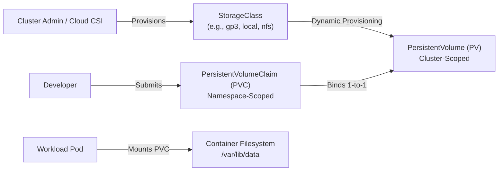

# Domain 4: Storage — In-Depth Master Study Guide

**Exam Weight:** 10% of CKA  
**Target Mastery:** PersistentVolumes (PV), PersistentVolumeClaims (PVC), StorageClasses, CSI Dynamic Provisioning, Access Modes (`RWO`, `ROX`, `RWX`, `RWOP`), Reclaim Policies (`Retain`, `Delete`), Online PVC Volume Expansion, Local Persistent Volumes with NodeAffinity, VolumeSnapshots, and VolumeMounts.

---

## 1. Kubernetes Storage Architecture & PV/PVC Lifecycle

Kubernetes decouples storage infrastructure configuration (managed by cluster administrators) from storage consumption (requested by application developers) through PersistentVolumes and PersistentVolumeClaims.



### The 4 Phases of the PV/PVC Lifecycle
1. **Provisioning:**
   - **Static Provisioning:** An administrator manually creates PersistentVolume objects pointing to physical SAN, NAS, AWS EBS, NFS, or local disk storage.
   - **Dynamic Provisioning:** A PVC references a `StorageClass`. The Container Storage Interface (CSI) provisioner automatically provisions the backend volume and creates a matching PV.
2. **Binding:**
   - The master control-plane (`pv-controller`) watches for unbound PVCs and finds a matching PV by checking:
     - Storage capacity (PV capacity $\ge$ PVC requested capacity).
     - AccessModes compatibility.
     - StorageClassName match (`spec.storageClassName`).
     - VolumeMode (`Filesystem` vs `Block`).
   - The binding is strictly **exclusive and 1-to-1**. A PV bound to one PVC cannot bind to another, even if excess storage remains!
3. **Using:**
   - Pod manifests reference the claim: `volumes: [persistentVolumeClaim: {claimName: my-pvc}]`.
   - The `kubelet` attaches the volume (via CSI Node plugin) and mounts the filesystem into the container target directory.
4. **Reclaiming:**
   - When a user deletes a PVC, the bound PV transitions to the `Released` status.
   - The `persistentVolumeReclaimPolicy` governs what happens next.

---

## 2. Access Modes & Reclaim Policies

### Access Modes Deep Dive

| Access Mode | CLI Shorthand | Mount Capability | Typical Storage Backends |
|---|---|---|---|
| **ReadWriteOnce** | `RWO` | Mounted as read-write by a **single node**. Multiple pods on the *same node* can access it simultaneously. | AWS EBS, Google Persistent Disk, Azure Managed Disk, iSCSI, Local NVMe. |
| **ReadOnlyMany** | `ROX` | Mounted as read-only by **many nodes** simultaneously. | AWS EFS, NFS, CephFS, GlusterFS, Read-only S3 Mountpoint. |
| **ReadWriteMany** | `RWX` | Mounted as read-write by **many nodes** simultaneously. | NFS, AWS EFS, Azure Files, GlusterFS, CephFS. |
| **ReadWriteOncePod** | `RWOP` | Mounted as read-write by a **single Pod** across the entire cluster. | CSI drivers supporting `ReadWriteOncePod` (Kubernetes 1.27+ GA). |

> [!WARNING]
> **Exam Trap:** `ReadWriteOnce` means **Once per NODE**, not once per pod! Multiple pods scheduled on the *same* physical worker node can mount an `RWO` volume concurrently. If you require single-pod isolation across the entire cluster, use `ReadWriteOncePod`.

### PersistentVolume Reclaim Policies
- **`Retain`:**
  - When the PVC is deleted, the PV is NOT deleted.
  - PV status changes from `Bound` to `Released`.
  - The underlying physical data remains completely untouched.
  - Another PVC **cannot** immediately bind to this PV because `spec.claimRef` still contains the UID of the deleted claim. An administrator must manually scrub data or edit the PV to clear `claimRef`.
- **`Delete` (Default for dynamically provisioned volumes):**
  - When the PVC is deleted, the Kubernetes PV object AND the underlying cloud/hardware asset (e.g., AWS EBS volume) are deleted.
- **`Recycle` (Deprecated):**
  - Performs an automated `rm -rf /volume/*` wipe and makes the PV available for rebinding.

---

## 3. StorageClasses & CSI Dynamic Provisioning

A `StorageClass` defines the "provisioner", volume parameters, and binding behavior.

```yaml
apiVersion: storage.k8s.io/v1
kind: StorageClass
metadata:
  name: enterprise-gp3
provisioner: ebs.csi.aws.com
volumeBindingMode: WaitForFirstConsumer
allowVolumeExpansion: true
reclaimPolicy: Delete
parameters:
  type: gp3
  iops: "5000"
  throughput: "250"
  encrypted: "true"
```

### `volumeBindingMode` Deep Dive
- **`Immediate` (Default):**
  - The CSI provisioner immediately creates the physical volume and Kubernetes PV as soon as the PVC is submitted.
  - **The Multi-AZ Scheduling Disaster:** In cloud environments (e.g. AWS Multi-AZ), an EBS volume is created in Availability Zone `us-east-1a`. If the Pod using this PVC is later scheduled onto a node in `us-east-1b`, the pod gets stuck forever in `Pending` with error `VolumeZoneTopologyMismatch`!
- **`WaitForFirstConsumer` (Best Practice):**
  - Delay PV provisioning and binding until a Pod referencing the PVC is scheduled.
  - The scheduler evaluates node taints, affinities, and capacity *first*, selects a node in AZ `us-east-1b`, and then signals the CSI driver to provision the volume in that specific Availability Zone!

---

## 4. Online PVC Volume Expansion

Kubernetes supports dynamic expansion of file systems without restarting workloads if the CSI driver and StorageClass support it.

### Step-by-Step Volume Expansion Workflow:
1. **Verify StorageClass allows expansion:**
   `allowVolumeExpansion: true` must be present on the StorageClass.
2. **Edit the PVC:**
   ```bash
   kubectl patch pvc data-claim -p '{"spec":{"resources":{"requests":{"storage":"50Gi"}}}}'
   ```
   *(Note: You can ONLY increase storage capacity; shrinking volumes is unsupported).*
3. **Verify Status:**
   - The PVC status shows `FileSystemResizePending` while the filesystem is expanding on the node.
   - Once completed, `kubectl get pvc data-claim` reflects the new storage size (`50Gi`).

---

## 5. Local Persistent Volumes & Node Affinity

For ultra-low latency workloads (e.g. Cassandra, Elasticsearch, local Kafka brokers), Kubernetes supports **Local Persistent Volumes** backed by local SSD/NVMe drives.

```yaml
apiVersion: v1
kind: PersistentVolume
metadata:
  name: local-nvme-pv
spec:
  capacity:
    storage: 500Gi
  volumeMode: Filesystem
  accessModes:
  - ReadWriteOnce
  persistentVolumeReclaimPolicy: Retain
  storageClassName: local-storage
  local:
    path: /mnt/disks/nvme0n1
  nodeAffinity:
    required:
      nodeSelectorTerms:
      - matchExpressions:
        - key: kubernetes.io/hostname
          operator: In
          values:
          - worker-node-03
```

> [!IMPORTANT]
> A Local Persistent Volume **MUST** specify `nodeAffinity`. It binds storage to a physical machine so the Kubernetes scheduler only schedules consuming pods onto that exact host.

---

## 6. VolumeSnapshots & Snapshot Controllers

The External Snapshotter CRDs (`snapshot.storage.k8s.io/v1`) allow point-in-time snapshotting and restoration.

```yaml
apiVersion: snapshot.storage.k8s.io/v1
kind: VolumeSnapshotClass
metadata:
  name: csi-aws-snapclass
driver: ebs.csi.aws.com
deletionPolicy: Delete
---
apiVersion: snapshot.storage.k8s.io/v1
kind: VolumeSnapshot
metadata:
  name: postgres-backup-snap
  namespace: databases
spec:
  volumeSnapshotClassName: csi-aws-snapclass
  source:
    persistentVolumeClaimName: postgres-data-pvc
---
# Restoring a PVC from VolumeSnapshot
apiVersion: v1
kind: PersistentVolumeClaim
metadata:
  name: postgres-restored-pvc
  namespace: databases
spec:
  storageClassName: enterprise-gp3
  dataSource:
    name: postgres-backup-snap
    kind: VolumeSnapshot
    apiGroup: snapshot.storage.k8s.io
  accessModes:
  - ReadWriteOnce
  resources:
    requests:
      storage: 50Gi
```

---

## 7. CKA Exam Traps & Troubleshooting Guide

1. **PVC Stuck in `Pending`:**
   - Case A: StorageClass uses `volumeBindingMode: WaitForFirstConsumer`. This is NORMAL behavior until a pod referencing the PVC is created.
   - Case B: No PV matches the PVC's requested size or AccessMode.
   - Case C: CSI plugin pod is crashing or not running in `kube-system`.
2. **Releasing Retained PV for Reuse:**
   - When a PV has status `Released` under `Retain` policy:
     `kubectl patch pv <pv-name> -p '{"spec":{"claimRef": null}}'` clears the claim reference and returns the PV to `Available` status.
3. **Volume Mount subPath Gotcha:**
   - Using `subPath` to mount a single file from a ConfigMap or Secret prevents automated live-updates when the ConfigMap changes!
