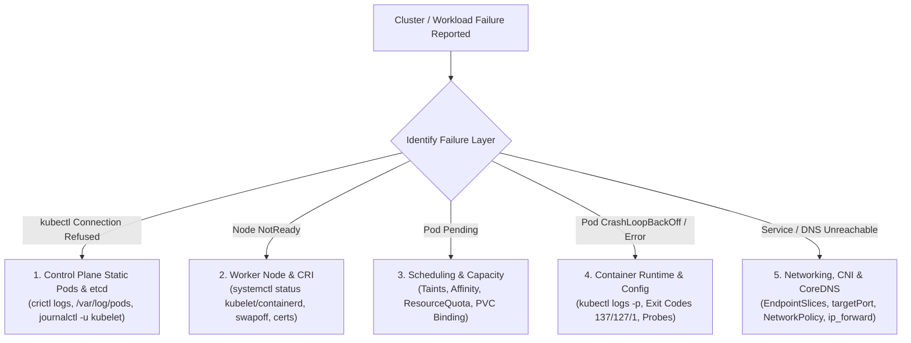

# Domain 5: Troubleshooting — Production Hands-On Exercises & Break-Fix Workbook

**Domain Weight:** 30% of the CKA Exam (Highest-Weighted Domain!)  
**Format:** 6 End-to-End Break-Fix Labs with Inject Scripts, Diagnostic Trees, Root-Cause Solutions, and Verification Commands.

---



---

## Lab 1: Control-Plane Outage — Broken `kube-apiserver` & `etcd` TLS Handshake

### 1.1 Break Scenario & Fault Injection
An operator attempted to rotate `etcd` flags inside `/etc/kubernetes/manifests/kube-apiserver.yaml`. Now `kubectl get nodes` fails with:
```text
The connection to the server 192.168.122.10:6443 was refused - did you specify the right host or port?
```

### 1.2 Step-by-Step Diagnostic Workflow
Because `kube-apiserver` is down, `kubectl` cannot be used. SSH directly into the control-plane node (`cp-01`):

```bash
# Step 1: Verify kubelet and containerd are running on the control-plane host
sudo systemctl is-active containerd kubelet

# Step 2: Inspect stopped/exited control-plane containers via crictl
sudo crictl ps -a | grep -E "kube-apiserver|etcd|kube-scheduler|kube-controller-manager"

# Step 3: Read the latest kube-apiserver container log directly from disk or crictl
APISERVER_CID=$(sudo crictl ps -a --name kube-apiserver -q | head -n 1)
sudo crictl logs "$APISERVER_CID" | tail -n 30
# Alternative if no container was created (YAML syntax error):
sudo journalctl -u kubelet -n 50 --no-pager | grep -i apiserver
```

**Observed Log Output:**
```text
W1021 11:15:02.411920 1 logging.go:59] [core] [Channel #1 SubChannel #2] grpc: addrConn.createTransport failed to connect to {Addr: "127.0.0.1:2380", ServerName: "127.0.0.1:2380"}. Err: connection error: desc = "transport: authentication handshake failed: remote error: tls: bad certificate"
F1021 11:15:22.412105 1 instance.go:290] Error creating leases: error creating storage factory: context deadline exceeded
```

### 1.3 Root-Cause Remediation
1. Inspect `/etc/kubernetes/manifests/kube-apiserver.yaml`:
   ```bash
   sudo grep -n -C 3 "etcd" /etc/kubernetes/manifests/kube-apiserver.yaml
   ```
2. Two defects are discovered:
   - `--etcd-servers=https://127.0.0.1:2380` was set to port `2380` (etcd peer port) instead of `2379` (etcd client port).
   - `--etcd-certfile=/etc/kubernetes/pki/apiserver.crt` was used instead of `/etc/kubernetes/pki/apiserver-etcd-client.crt`.
3. Fix `/etc/kubernetes/manifests/kube-apiserver.yaml`:
   ```yaml
   - --etcd-cafile=/etc/kubernetes/pki/etcd/ca.crt
   - --etcd-certfile=/etc/kubernetes/pki/apiserver-etcd-client.crt
   - --etcd-keyfile=/etc/kubernetes/pki/apiserver-etcd-client.key
   - --etcd-servers=https://127.0.0.1:2379
   ```

### 1.4 Verification
```bash
sudo crictl ps --name kube-apiserver
kubectl get --raw='/readyz?verbose'
kubectl get nodes
```

---

## Lab 2: Worker Node `NotReady` — Masked Kubelet, Swap Enabled & Wrong Binary Path

### 2.1 Break Scenario
`kubectl get nodes` shows `worker-02` in `NotReady` status for over 15 minutes. Pods scheduled via DaemonSets on `worker-02` are stuck terminating or outdated.

### 2.2 Step-by-Step Diagnostic Workflow
```bash
# Step 1: Inspect node conditions and recent kubelet events from control plane
kubectl describe node worker-02 | grep -A 15 "Conditions:"

# Step 2: SSH to worker-02 and check kubelet service state
ssh worker-02
sudo systemctl status kubelet
```

**Observed Output 1 (`masked` unit):**
```text
● kubelet.service
     Loaded: masked (Reason: Unit kubelet.service is masked.)
     Active: inactive (dead)
```

Unmask and start `kubelet`, then check `journalctl -u kubelet -e`:
```bash
sudo systemctl unmask kubelet
sudo systemctl start kubelet
sudo journalctl -u kubelet -n 40 --no-pager
```

**Observed Output 2 (`status=203/EXEC` & Swap Error):**
```text
kubelet.service: Failed to execute /usr/local/bin/kubelet: No such file or directory
```

### 2.3 Root-Cause Remediation
```bash
# 1. Locate the real kubelet binary
which kubelet
# Output: /usr/bin/kubelet

# 2. Fix the systemd drop-in file
sudo sed -i 's|/usr/local/bin/kubelet|/usr/bin/kubelet|g' /etc/systemd/system/kubelet.service.d/10-kubeadm.conf
sudo systemctl daemon-reload

# 3. Disable active swap and comment out swap in /etc/fstab so it survives reboot
sudo swapoff -a
sudo sed -i '/ swap / s/^\(.*\)$/#\1/g' /etc/fstab

# 4. Verify containerd cgroup driver matches kubelet (systemd)
grep -n "SystemdCgroup" /etc/containerd/config.toml
# Ensure SystemdCgroup = true

# 5. Enable and restart containerd and kubelet
sudo systemctl enable --now containerd kubelet
sudo systemctl restart kubelet
```

### 2.4 Verification
```bash
systemctl is-active kubelet
kubectl get node worker-02
# Confirm STATUS is Ready
```

---

## Lab 3: Multi-Layer Pod `CrashLoopBackOff` — Exit Codes (`137`, `127`, `1`) & Startup Probes

### 3.1 Scenario
Namespace `payments` has three broken Deployments (`ledger-db`, `currency-sync`, `fraud-engine`) all in `CrashLoopBackOff`.

### 3.2 Triage & Remediation Per Failure Mode

#### Case A: `ledger-db` — `OOMKilled` (`Exit Code: 137`)
```bash
kubectl describe pod -n payments -l app=ledger-db | grep -A 10 "Last State:"
# Output:
#   Last State:     Terminated
#     Reason:       OOMKilled
#     Exit Code:    137
```
- **Cause:** Container `resources.limits.memory` was set to `64Mi`, while the JVM allocates a `256Mi` heap on boot.
- **Fix:** Patch the Deployment memory limit to `512Mi`:
  ```bash
  kubectl set resources deployment ledger-db -n payments -c ledger-db --requests=memory=256Mi --limits=memory=512Mi
  ```

#### Case B: `currency-sync` — Command Not Found / Typo (`Exit Code: 127`)
```bash
kubectl logs -n payments -l app=currency-sync --previous
kubectl get deploy currency-sync -n payments -o jsonpath='{.spec.template.spec.containers[0].command}'
# Output: ["/bin/sh", "-c", "pythno3 /app/sync.py"]
```
- **Cause:** Typo `pythno3` in `command` causes shell exit code `127`.
- **Fix:**
  ```bash
  kubectl patch deploy currency-sync -n payments --type='json' \
    -p='[{"op": "replace", "path": "/spec/template/spec/containers/0/command", "value": ["/bin/sh", "-c", "python3 /app/sync.py"]}]'
  ```

#### Case C: `fraud-engine` — Premature Liveness Probe Kill (`Exit Code: 143` / `137`)
```bash
kubectl describe pod -n payments -l app=fraud-engine | grep -A 10 "Events:"
# Warning  Unhealthy  kubelet  Liveness probe failed: Get "http://10.244.1.44:8080/healthz": dial tcp 10.244.1.44:8080: connect: connection refused
# Normal   Killing    kubelet  Container fraud-engine failed liveness probe, will be restarted
```
- **Cause:** `fraud-engine` takes 45 seconds to load ML weights into memory, but `livenessProbe` has `initialDelaySeconds: 5, periodSeconds: 5, failureThreshold: 3` (killing the pod after 20 seconds) and points to port `8080` while the app listens on port `8443`.
- **Fix:** Update `livenessProbe.httpGet.port` to `8443` and add a `startupProbe` (`httpGet.port: 8443, periodSeconds: 5, failureThreshold: 15`).

---

## Lab 4: Resolving `Pending` & `CreateContainerConfigError` Workloads

### 4.1 Scenario
Pod `analytics-job-0` in namespace `batch` has been stuck in `Pending` for 10 minutes, and after scheduling, enters `CreateContainerConfigError`.

### 4.2 Triage & Remediation
```bash
# Step 1: Inspect FailedScheduling reason
kubectl describe pod analytics-job-0 -n batch
```
**Observed Scheduling Event:**
```text
0/3 nodes are available: 1 node(s) had untolerated taint {node-role.kubernetes.io/control-plane: }, 2 node(s) didn't match Pod's node affinity/selector.
```
```bash
# Check Pod nodeSelector vs actual node labels
kubectl get pod analytics-job-0 -n batch -o jsonpath='{.spec.nodeSelector}'
# Output: {"accelerator":"nvidia-t4"}
kubectl get nodes --show-labels | grep accelerator
# Output shows worker-02 has label accelerator=nvidia-l4 (or label is missing)

# Fix: Label worker-02 to satisfy nodeSelector
kubectl label node worker-02 accelerator=nvidia-t4 --overwrite
```

Now the Pod schedules onto `worker-02` but stalls in `CreateContainerConfigError`:
```bash
kubectl describe pod analytics-job-0 -n batch | tail -n 10
# Output:
# Warning  Failed  kubelet  Error: couldn't find key DB_HOST in ConfigMap batch/analytics-cm
```
```bash
# Inspect ConfigMap keys
kubectl get cm analytics-cm -n batch -o yaml
# Fix: Patch ConfigMap to include key DB_HOST
kubectl patch cm analytics-cm -n batch -p '{"data":{"DB_HOST":"postgres.batch.svc.cluster.local"}}'
```

---

## Lab 5: Ephemeral Container Live Debugging (`kubectl debug`) on Distroless Pods

### 5.1 Scenario
Pod `envoy-gateway` runs a `gcr.io/distroless/cc-debian12` image (no `/bin/sh`, no `ss`, no `curl`). It is reporting upstream timeouts to `auth-service.security.svc.cluster.local:9000`. You may **not** restart or modify the `envoy-gateway` Pod spec.

### 5.2 Execution Steps
```bash
# 1. Attach an ephemeral netshoot container targeting the envoy container's namespaces
kubectl debug -it envoy-gateway -n default \
  --image=nicolaka/netshoot:latest \
  --target=envoy \
  -- /bin/bash

# 2. Inside the ephemeral debug container, inspect listening sockets and established connections
ss -tulpn
ss -tapn

# 3. Inspect processes in the shared PID namespace and read envoy's filesystem via /proc/1/root
ps aux
cat /proc/1/root/etc/envoy/envoy.yaml

# 4. Test DNS resolution and TCP connectivity to auth-service
dig +short auth-service.security.svc.cluster.local
nc -zvw3 auth-service.security.svc.cluster.local 9000
```

---

## Lab 6: End-to-End Service, NetworkPolicy & CoreDNS Outage Recovery

### 6.1 Scenario
Frontend pods in namespace `storefront` cannot reach `http://catalog-svc.inventory.svc.cluster.local:80`.

### 6.2 Systematic 4-Step Network Triage
```bash
# Step 1: Verify CoreDNS is healthy and resolving Service FQDNs
kubectl get pods -n kube-system -l k8s-app=kube-dns
kubectl exec -n storefront deploy/frontend -- nslookup catalog-svc.inventory.svc.cluster.local
```
- **Defect 1 Found:** `nslookup` times out. Checking `kubectl get cm coredns -n kube-system -o yaml` reveals someone changed the `kubernetes` plugin zone from `cluster.local` to `k8s.internal`.
- **Fix 1:** Restore `kubernetes cluster.local in-addr.arpa ip6.arpa` in the `coredns` ConfigMap and run `kubectl rollout restart deploy coredns -n kube-system`.

```bash
# Step 2: Verify Service selector and EndpointSlices in namespace inventory
kubectl get svc catalog-svc -n inventory -o wide
kubectl get endpointslices -n inventory -l kubernetes.io/service-name=catalog-svc
kubectl get pods -n inventory --show-labels
```
- **Defect 2 Found:** `EndpointSlices` shows `ENDPOINTS: <unset>` because `catalog-svc` has selector `app=catalog-api`, while the Pods are labeled `app=catalog`. Also `targetPort` is set to `80` while the container listens on `3000`.
- **Fix 2:**
  ```bash
  kubectl patch svc catalog-svc -n inventory \
    -p '{"spec":{"selector":{"app":"catalog"},"ports":[{"port":80,"targetPort":3000,"protocol":"TCP"}]}}'
  ```

```bash
# Step 3: Check NetworkPolicies in both storefront (Egress) and inventory (Ingress)
kubectl get networkpolicy -n storefront
kubectl get networkpolicy -n inventory -o yaml
```
- **Defect 3 Found:** Namespace `inventory` has an Ingress NetworkPolicy allowing traffic only from namespaces labeled `access=inventory`, and on port `80` instead of the Pod's container port `3000`! (Remember: NetworkPolicies filter traffic at the Pod's **container port** (`3000`) after Service DNAT, not the Service's virtual port (`80`)!).
- **Fix 3:**
  ```bash
  kubectl label ns storefront access=inventory --overwrite
  kubectl patch networkpolicy allow-storefront -n inventory --type='json' \
    -p='[{"op":"replace","path":"/spec/ingress/0/ports/0/port","value":3000}]'
  ```

```bash
# Step 4: Verify end-to-end HTTP response
kubectl exec -n storefront deploy/frontend -- wget -qO- --timeout=2 http://catalog-svc.inventory.svc.cluster.local:80/healthz
```
