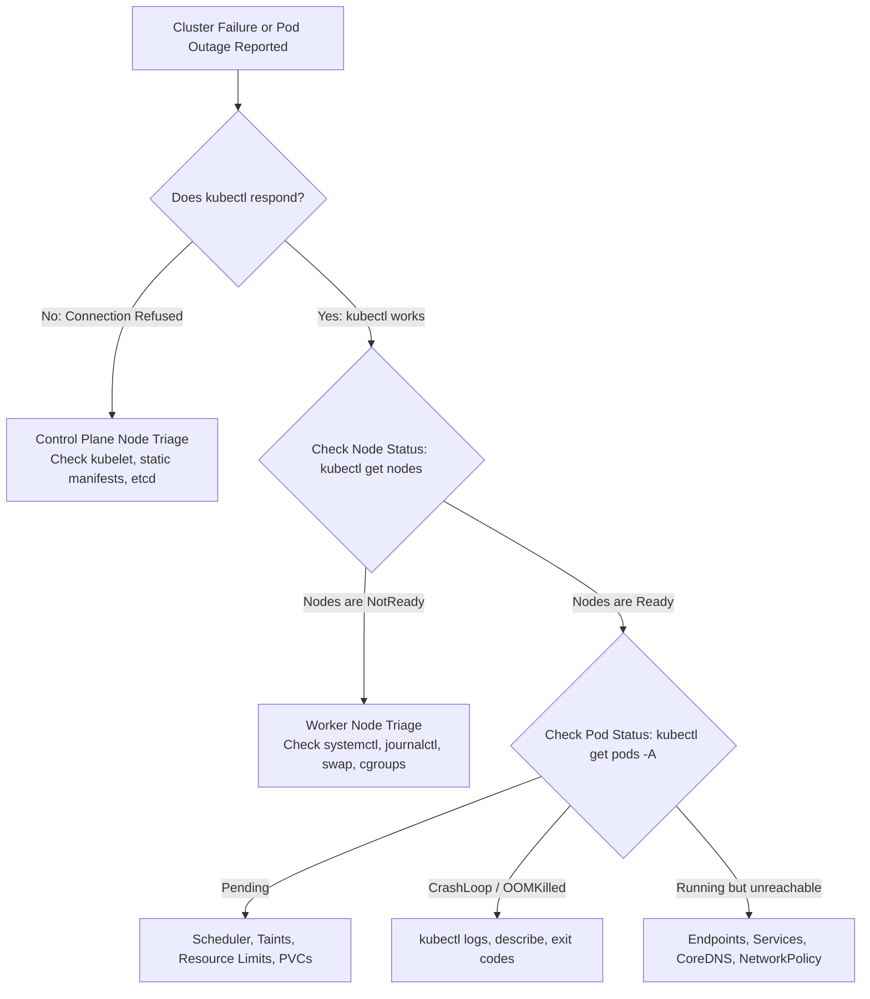

# Domain 5: Troubleshooting — In-Depth Master Study Guide

> [!IMPORTANT]
> **Exam Weighting & Core Architecture Focus:** Domain 5 accounts for **30% of the Certified Kubernetes Administrator (CKA)** examination—the single highest-weight domain on the exam. Questions test your ability to rapidly diagnose and repair broken clusters under intense exam time pressure: control plane static pod failures, broken API server certificates, etcd disaster recovery restores, worker nodes in `NotReady` state (cgroup driver mismatches, swap enabled, containerd socket failures), pod lifecycle failures (`CrashLoopBackOff`, `OOMKilled`, exit code `137`), ephemeral debugging with `kubectl debug`, and CoreDNS routing failures.

---

## 1. Systematic Cluster Troubleshooting Methodology



---

## 2. Control Plane Failure Triage (When `kubectl` is Dead!)

When `kubectl` commands fail with:
`The connection to the server <ip>:6443 was refused - did you specify the right host or port?`

### 2.1 Step 1: Verify Host Daemons on Control Plane Node

SSH into the control plane node and verify the `kubelet` and `containerd` systemd services:

```bash
# 1. Check systemd daemon status
sudo systemctl status kubelet
sudo systemctl status containerd

# 2. If kubelet is inactive or failing, inspect recent log errors
sudo journalctl -u kubelet -xe -n 50 --no-pager
```

### 2.2 Step 2: Debug with `crictl` When the API Server is Down

Because `kubectl` cannot communicate with an offline API server, you must use the container runtime CLI directly:

```bash
# Configure crictl endpoint
sudo crictl config runtime-endpoint unix:///run/containerd/containerd.sock

# List all containers (including crashed ones)
sudo crictl ps -a

# Inspect logs of the crashed kube-apiserver or etcd container
sudo crictl logs <API_SERVER_CONTAINER_ID>
```

### 2.3 Step 3: Inspect Static Pod Manifests (`/etc/kubernetes/manifests/`)

Static pods are launched and supervised directly by the node `kubelet` without API server intervention. Manifest location: `/etc/kubernetes/manifests/`
* `kube-apiserver.yaml`
* `etcd.yaml`
* `kube-controller-manager.yaml`
* `kube-scheduler.yaml`

* **Common Exam Traps in Static Pod Manifests:**
  1. **Flag Typos:** Look for errors like `--etcd-server` instead of `--etcd-servers`, or `--advertise-addresses` instead of `--advertise-address`.
  2. **Wrong Certificate Paths:** Check `/etc/kubernetes/pki/` to verify that all certificate files specified in the manifest actually exist on disk with correct filenames.
  3. **Wrong HostPath Mounts:** Ensure volume mounts in the manifest specify `type: File` or `type: Directory` matching the actual host path.

### 2.4 Certificate Expiration & Renewal

If API server or Kubelet certificates expire, all cluster communication fails:

```bash
# 1. Check certificate expiration dates
kubeadm certs check-expiration

# 2. Renew all certificates in one command
kubeadm certs renew all

# 3. Update admin kubeconfig for kubectl
sudo cp -i /etc/kubernetes/admin.conf $HOME/.kube/config
sudo chown $(id -u):$(id -g) $HOME/.kube/config

# 4. Restart control plane components
sudo crictl ps | grep kube-apiserver | awk '{print $1}' | xargs -r sudo crictl stop
```

---

## 3. Worker Node `NotReady` Triage

When `kubectl get nodes` outputs `STATUS: NotReady`:

```bash
# 1. Describe the failing node to identify condition flags
kubectl describe node <node-name>
```

Look at the `Conditions` section:
* `Ready: False`
* `MemoryPressure: True`
* `DiskPressure: True`
* `PIDPressure: True`
* `NetworkUnavailable: True`

### 3.1 Common Worker Node Failure Causes & Fixes

* **1. Kubelet Service Stopped or Masked:**
  ```bash
  sudo systemctl daemon-reload
  sudo systemctl unmask kubelet
  sudo systemctl enable --now kubelet
  ```
* **2. Swap Enabled on Host (Kubernetes fails to start if swap is on):**
  ```bash
  # Check swap status
  free -m
  # Disable swap immediately
  sudo swapoff -a
  # Disable permanently in /etc/fstab (comment out the swap line)
  sudo sed -i '/swap/d' /etc/fstab
  ```
* **3. Containerd CRI Plugin Disabled:**
  * In `/etc/containerd/config.toml`, if `disabled_plugins = ["cri"]` is present, containerd refuses Kubernetes CRI requests!
  * Remove `"cri"` from `disabled_plugins` and run `sudo systemctl restart containerd`.
* **4. Cgroup Driver Mismatch:**
  * Kubelet and Containerd must use the **exact same cgroup driver** (modern standard: `systemd`).
  * In `/etc/containerd/config.toml`: `[plugins."io.containerd.grpc.v1.cri".containerd.runtimes.runc.options]` $\to$ `SystemdCgroup = true`.
  * In `/var/lib/kubelet/config.yaml`: `cgroupDriver: systemd`.

---

## 4. Pod Failure States & Exit Code Analysis

```bash
kubectl get pods -A -o wide
```

### 4.1 Pod Lifecycle Failure Matrix

* **`Pending`**
  * **Root Cause:** Pod cannot be scheduled onto any node.
  * **Triage Steps:** Run `kubectl describe pod <pod-name>`.
  * Common Issues:
    1. Node resource exhaustion (`0/3 nodes available: Insufficient cpu/memory`).
    2. Node taints (`node-role.kubernetes.io/control-plane:NoSchedule`) without matching tolerations.
    3. Unbound PVC (`PersistentVolumeClaim is not bound`).
    4. NodeSelector or NodeAffinity label mismatch.

* **`CrashLoopBackOff`**
  * **Root Cause:** Container starts, crashes, exits, and Kubernetes attempts to restart it with exponential backoff delays ($10s, 20s, 40s\dots$).
  * **Triage Steps:** Run `kubectl logs <pod-name> --previous` to see logs emitted before the crash.

* **`OOMKilled` (Exit Code `137`)**
  * **Root Cause:** Container exceeded its configured memory limit (`resources.limits.memory`) or the host ran out of memory. The Linux kernel Out-Of-Memory (OOM) killer terminated the process with `SIGKILL` ($128 + 9 = 137$).
  * **Fix:** Increase container memory limit or profile application for memory leaks.

* **`CreateContainerConfigError` / `CreateContainerError`**
  * **Root Cause:** Pod references a `ConfigMap` or `Secret` that does not exist in the namespace, or has an invalid key name.
  * **Fix:** Run `kubectl describe pod <pod-name>` to identify the missing resource name, then create the ConfigMap/Secret.

* **`ImagePullBackOff` / `ErrImagePull`**
  * **Root Cause:** Image name misspelled, tag does not exist, or private registry credentials (`imagePullSecrets`) missing.

---

## 5. Modern In-Place Debugging with `kubectl debug`

`kubectl debug` allows engineers to troubleshoot running or crashed workloads without modifying production manifests:

### 5.1 Debugging with an Ephemeral Container

Inject an interactive troubleshooting container into an existing Pod with access to shared process and network namespaces:

```bash
# Attach an ephemeral container to a running pod
kubectl debug -it <pod-name> \
    --image=nicolaka/netshoot:latest \
    --target=<container-name>
```

### 5.2 Debugging a Crashed Pod by Copying Manifest

If a Pod crashes immediately on startup and `kubectl exec` cannot attach:

```bash
# Copy the crashed pod, override entrypoint to a sleeping shell, and attach
kubectl debug <pod-name> -it \
    --copy-to=debug-pod \
    --container=app \
    --entrypoint=/bin/sh
```

### 5.3 Debugging a Broken Node with Host Chroot

If SSH access to a worker node is unavailable:

```bash
# Launch a privileged pod on the broken node and chroot to the host filesystem
kubectl debug node/<node-name> -it --image=busybox:1.36

# Inside the debug shell:
chroot /host
# Now you have full root access to the node OS (systemctl, journalctl, /etc)
systemctl restart kubelet
```

---

## 6. Networking & CoreDNS Triage

### 6.1 CoreDNS CrashLoopBackOff Loop Detection

If CoreDNS pods crash continuously with exit code 1:
* **The Forwarding Loop Issue:** Occurs when the node's `/etc/resolv.conf` points to `127.0.0.53` (systemd-resolved). CoreDNS inherits this and forwards queries to itself in an infinite loop!
* **Fix:** Point the kubelet's resolvConf flag (`--resolv-conf=/run/systemd/resolve/resolv.conf`) to the upstream DNS server instead of localhost.

### 6.2 Service Endpoint Label Mismatches

When a Service is running and has a ClusterIP, but requests time out:

```bash
# 1. Check if the Service has registered backend endpoints
kubectl get endpoints <service-name>
kubectl get endpointslices -l kubernetes.io/service-name=<service-name>

# 2. If ENDPOINTS is <none>, inspect the Service selector
kubectl describe svc <service-name> | grep Selector

# 3. Compare with actual Pod labels
kubectl get pods --show-labels
```
* **Fix:** Correct the label selector in the Service YAML so it matches the Pod labels exactly.
