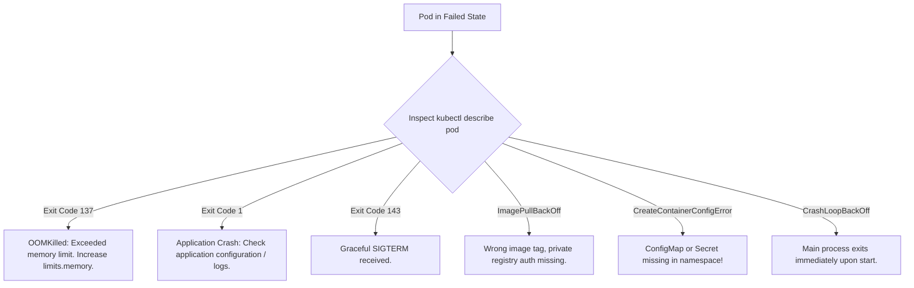

# Domain 5: Troubleshooting — In-Depth Master Study Guide

**Exam Weight:** 30% of CKA (The single highest-weight domain on the exam!)  
**Target Mastery:** Control plane static pod failures, API server / etcd crash loops, Worker node `NotReady` triage, kubelet & containerd systemd service debugging, Pod failure states (`CrashLoopBackOff`, `OOMKilled`, `CreateContainerConfigError`, `ImagePullBackOff`), CoreDNS failures, and Ephemeral debug containers (`kubectl debug`).

---

## 1. Systematic Cluster Troubleshooting Methodology


---

## 2. Control Plane Failure Triage (When `kubectl` is Dead!)

When `kubectl` commands fail with:
`The connection to the server <ip>:6443 was refused - did you specify the right host or port?`

### Step 1: Verify the Control Plane Node & Kubelet
SSH into the control plane node and verify the host daemon:
```bash
sudo systemctl status kubelet
# If inactive or failed:
sudo journalctl -u kubelet -xe -n 100 --no-pager
```

### Step 2: Inspect Static Pod Manifests
Static pods are managed directly by kubelet without API server involvement.
Manifest directory: `/etc/kubernetes/manifests/`
- `kube-apiserver.yaml`
- `etcd.yaml`
- `kube-controller-manager.yaml`
- `kube-scheduler.yaml`

### Step 3: Debug with `crictl` When the API Server is Down
Because `kubectl` cannot talk to an offline API server, you must use the container runtime CLI directly:
```bash
# Configure crictl endpoint (if not already set in /etc/crictl.yaml)
sudo crictl config runtime-endpoint unix:///run/containerd/containerd.sock

# List all containers including crashed ones
sudo crictl ps -a

# Inspect logs of the failed kube-apiserver or etcd container
sudo crictl logs <container-id>
```

### Step 4: Common Static Pod Manifest Exam Traps
1. **Misspelled CLI flags:** Look for typos like `--etcd-server` instead of `--etcd-servers`.
2. **Wrong Certificate Paths:** Verify all paths in `/etc/kubernetes/pki/` match the manifest.
3. **Invalid HostPath Volume Mounts:** Kubelet cannot start static pods if a referenced host directory does not exist.
4. **Expired Certificates:**
   ```bash
   sudo kubeadm certs check-expiration
   sudo kubeadm certs renew all
   ```

---

## 3. Worker Node `NotReady` Triage

When `kubectl get nodes` displays `NotReady`:

```bash
# Step 1: Describe the node to inspect Conditions and System Alerts
kubectl describe node worker-01
```

Look at the **Conditions** block:
- `MemoryPressure`: True if node memory is exhausted.
- `DiskPressure`: True if root filesystem or image storage is $> 85\%$ full.
- `PIDPressure`: True if host PID limits are reached.
- `Ready`: False/Unknown indicates kubelet heartbeat is missing.

### Step 2: SSH to Worker Node & Run Diagnostic Checks
```bash
# Check kubelet status and recent error traces
sudo systemctl status kubelet
sudo journalctl -u kubelet -e -n 100

# Check Container Runtime (containerd)
sudo systemctl status containerd

# Verify Swap status (kubelet fails to start if swap is active)
sudo swapoff -a
# Permanently disable in /etc/fstab

# Check Disk Capacity & Inodes
df -h
df -i

# Inspect Network & CNI
ls -la /etc/cni/net.d/
```

### Step 3: Kubelet PKI & Client Cert Issues
- Worker nodes authenticate to the API server using `/etc/kubernetes/kubelet.conf`.
- If the node's client certificate expired or bootstrap token was revoked, kubelet logs: `x509: certificate has expired or is not yet valid`.
- Fix: Regenerate or re-join using `kubeadm join`.

---

## 4. Pod Failure States & Process Exit Codes



### Detailed Exit Code Reference Table

| Exit Code | Signal / Name | Root Cause & Diagnostic Action |
|---|---|---|
| **0** | Normal Exit | Process completed its work (expected for Jobs/InitContainers). |
| **1 / 255** | Application Error | Code exception, missing environment variable, syntax error. Check `kubectl logs <pod> --previous`. |
| **126** | Command Cannot Execute | Container binary is not executable or lacks `chmod +x` permissions. |
| **127** | Command Not Found | Executable command specified in `command:` or `args:` does not exist in `$PATH`. |
| **137** | **`SIGKILL` / OOMKilled** | Container was killed by Linux OOM killer because it breached `resources.limits.memory`! Inspect with `kubectl describe pod <name> | grep -E "Reason|Exit Code"`. |
| **139** | `SIGSEGV` | Segmentation fault in memory. |
| **143** | `SIGTERM` | Graceful termination signal sent during pod eviction or deployment rollout. |

---

## 5. Live Debugging with Ephemeral Containers (`kubectl debug`)

For scratch/distroless containers lacking `sh`, `bash`, `curl`, or `ip`:

```bash
# Attach an ephemeral debug container with network tools to a running pod
kubectl debug -it target-pod --image=nicolaka/netshoot --target=app-container

# Debug a crashed pod by copying and editing its entrypoint
kubectl debug crashed-pod -it --copy-to=debug-pod --container=app -- sh

# Debug a broken node directly by mounting host root filesystem
kubectl debug node/worker-01 -it --image=busybox
# Inside debug container:
chroot /host
```

---

## 6. Service & DNS Troubleshooting Playbook

1. **Verify Pod Readiness:** If a pod fails its `readinessProbe`, it is removed from the service endpoints! Check `kubectl get endpoints <service>`.
2. **Verify Port Mapping:**
   - `port`: The port clients connect to on the Service ClusterIP.
   - `targetPort`: The port the application container actually listens on inside the Pod.
3. **CoreDNS Loop Detection:**
   - If host `/etc/resolv.conf` contains `nameserver 127.0.0.53` (systemd-resolved), CoreDNS forwarding can create a circular loop, crashing CoreDNS pods with `plugin/loop: Loop detected`.
