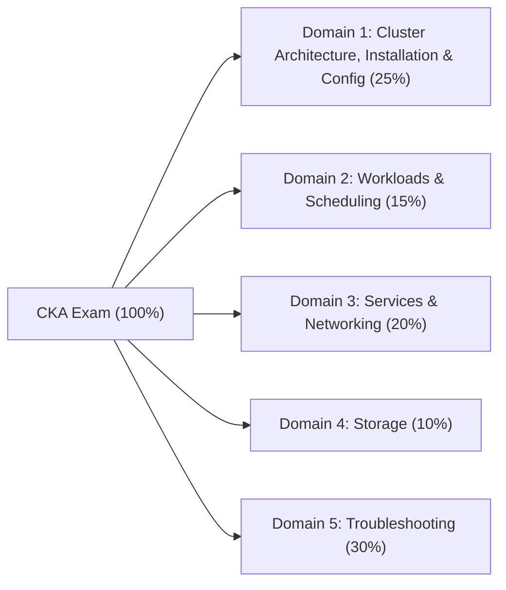

# Certified Kubernetes Administrator (CKA) — Complete Study & Lab Workspace

Welcome to the comprehensive **Certified Kubernetes Administrator (CKA)** preparation repository, aligned with the **2025/2026 CNCF CKA Curriculum** (Kubernetes v1.31 / v1.32+). This workspace contains production-grade study guides, architectural diagrams, imperative command references, 30 hands-on lab scenarios, 180 deep scenario quiz questions, and 3 full-length 17-task performance-based mock exams tailored for **DigitalOcean Droplets (`kubeadm` over DO VPC `eth1`)**.

---

## Exam Overview & Format

| Attribute | Specification |
| :--- | :--- |
| **Certification Name** | Certified Kubernetes Administrator (CKA) |
| **Exam Type** | Online, Proctored, Performance-Based (100% Hands-On CLI in Remote Terminal) |
| **Duration** | **120 Minutes** (2 Hours) |
| **Number of Tasks** | **15–20 Tasks** (Typically 17 Performance Tasks across 6 Kubernetes Clusters) |
| **Passing Score** | **66%** (660 / 1000 points) |
| **Kubernetes Version** | Current minor release (e.g., v1.31 / v1.32) |
| **Environment** | Ubuntu Linux Desktop via PSI Bridge Browser (`tmux`, `vim`, `nano`, `kubectl`, `helm`, `etcdctl`, `crictl`, `kubeadm`) |
| **Lab Infrastructure** | **DigitalOcean Droplets** (`Ubuntu 24.04 LTS`, `s-2vcpu-4gb`, DO Regional VPC `eth1` private networking) — see **[DigitalOcean Droplet Lab Guide](DigitalOcean_Droplet_Lab_Guide.md)** |
| **Allowed Documentation** | `https://kubernetes.io/docs/`, `https://kubernetes.io/blog/`, `https://helm.sh/docs/`, `https://gateway-api.sigs.k8s.io/` |

> [!IMPORTANT]
> **2025/2026 CKA Curriculum Updates:**
> The updated CKA exam places heavy emphasis on **Kubernetes Gateway API** (`GatewayClass`, `Gateway`, `HTTPRoute`), **Helm** chart lifecycle management, **Kustomize** overlays and patches, **Custom Resource Definitions (CRDs) & Operators**, **Native Sidecar Containers** (`initContainers` with `restartPolicy: Always`), and **Control Plane / Node Troubleshooting** (30% of the total score).

---

## CKA Curriculum Domains & Weights



| Domain | Weight | Core Competencies | Workspace Directory |
| :--- | :---: | :--- | :--- |
| **Domain 1: Cluster Architecture, Installation & Configuration** | **25%** | RBAC, `kubeadm` install & upgrades on Droplets, HA Control Plane, `etcd` backup/restore, CRDs, Operators, Helm, Kustomize | [`Domain_1_Cluster_Architecture_Installation_Configuration/`](Domain_1_Cluster_Architecture_Installation_Configuration) |
| **Domain 2: Workloads & Scheduling** | **15%** | Pod lifecycle, Init & Native Sidecar containers, Deployments, DaemonSets, StatefulSets, Jobs/CronJobs, ConfigMaps/Secrets, Probes, QoS, Taints/Tolerations, Node/Pod Affinity, PriorityClass, PDB, HPA | [`Domain_2_Workloads_Scheduling/`](Domain_2_Workloads_Scheduling) |
| **Domain 3: Services & Networking** | **20%** | CNI plugins (Calico/Cilium on Droplet `eth1`), Services (`ClusterIP`/`NodePort`/`LoadBalancer`/Headless), `EndpointSlices`, CoreDNS, `Ingress`, **Gateway API** (`GatewayClass`/`Gateway`/`HTTPRoute`), `NetworkPolicy` | [`Domain_3_Services_Networking/`](Domain_3_Services_Networking) |
| **Domain 4: Storage** | **10%** | Volumes (`emptyDir`/`hostPath`/`projected`), PV & PVC lifecycle, AccessModes (`RWO`/`RWX`/`ROX`/`RWOP`), Reclaim Policies, `StorageClass` (`dobs.csi.digitalocean.com` / `local-path` / NFS), CSI `WaitForFirstConsumer`, Online PVC expansion, `VolumeSnapshot` | [`Domain_4_Storage/`](Domain_4_Storage) |
| **Domain 5: Troubleshooting** | **30%** | Static Pod failures (`/etc/kubernetes/manifests/`), `crictl` debugging when API server is down, `NotReady` worker Droplets (`kubelet` `--node-ip`/`containerd`/cgroups/certs), Pod `CrashLoopBackOff`/`Pending`/`OOMKilled`, Service/DNS/NetworkPolicy triage, `kubectl debug` | [`Domain_5_Troubleshooting/`](Domain_5_Troubleshooting) |

---

## Quick Navigation Matrix

### Master Reference, DigitalOcean Lab Automation & Mock Exams
- **[DigitalOcean Droplet Lab Architecture & Automation Guide](DigitalOcean_Droplet_Lab_Guide.md)** — Complete `doctl` + `cloud-init` scripts to spin up and tear down a 3-Droplet (`cka-cp1`, `cka-worker1`, `cka-worker2`) `kubeadm` cluster over a DigitalOcean Private VPC (`eth1`) for `~$0.10/hr`.
- **[CKA Master Cheat Sheet](CKA_Master_Cheat_Sheet.md)** — Exam-day shell setup, imperative `kubectl` commands, JSONPath templates, `etcdctl` backup/restore, `kubeadm` upgrade sequence, and `crictl`/`journalctl` triage commands.
- **[Practice Exams Overview](Practice_Exams/README.md)** — Instructions, timing strategies, and cluster topology for the 3 full-length mock exams.
  - **[Practice Exam 1 (Standard Exam Simulation — 17 Tasks)](Practice_Exams/Practice_Exam_1.md)**
  - **[Practice Exam 2 (Production Scenarios — 17 Tasks)](Practice_Exams/Practice_Exam_2.md)**
  - **[Practice Exam 3 (Hard/Challenge Mode — 17 Tasks)](Practice_Exams/Practice_Exam_3.md)**

### Domain Study Guides, Labs & Quizzes

| Domain | Study Guide | Docs & Standards | Hands-On Labs (6 Scenarios) | Quiz 1 | Quiz 2 | Quiz 3 |
| :--- | :--- | :--- | :--- | :--- | :--- | :--- |
| **Domain 1 (25%)** | [Study Guide](Domain_1_Cluster_Architecture_Installation_Configuration/Study_Guide.md) | [White Papers & Docs](Domain_1_Cluster_Architecture_Installation_Configuration/White_Papers.md) | [Exercises](Domain_1_Cluster_Architecture_Installation_Configuration/Exercises.md) | [Quiz 1](Domain_1_Cluster_Architecture_Installation_Configuration/Quiz_1.md) | [Quiz 2](Domain_1_Cluster_Architecture_Installation_Configuration/Quiz_2.md) | [Quiz 3](Domain_1_Cluster_Architecture_Installation_Configuration/Quiz_3.md) |
| **Domain 2 (15%)** | [Study Guide](Domain_2_Workloads_Scheduling/Study_Guide.md) | [White Papers & Docs](Domain_2_Workloads_Scheduling/White_Papers.md) | [Exercises](Domain_2_Workloads_Scheduling/Exercises.md) | [Quiz 1](Domain_2_Workloads_Scheduling/Quiz_1.md) | [Quiz 2](Domain_2_Workloads_Scheduling/Quiz_2.md) | [Quiz 3](Domain_2_Workloads_Scheduling/Quiz_3.md) |
| **Domain 3 (20%)** | [Study Guide](Domain_3_Services_Networking/Study_Guide.md) | [White Papers & Docs](Domain_3_Services_Networking/White_Papers.md) | [Exercises](Domain_3_Services_Networking/Exercises.md) | [Quiz 1](Domain_3_Services_Networking/Quiz_1.md) | [Quiz 2](Domain_3_Services_Networking/Quiz_2.md) | [Quiz 3](Domain_3_Services_Networking/Quiz_3.md) |
| **Domain 4 (10%)** | [Study Guide](Domain_4_Storage/Study_Guide.md) | [White Papers & Docs](Domain_4_Storage/White_Papers.md) | [Exercises](Domain_4_Storage/Exercises.md) | [Quiz 1](Domain_4_Storage/Quiz_1.md) | [Quiz 2](Domain_4_Storage/Quiz_2.md) | [Quiz 3](Domain_4_Storage/Quiz_3.md) |
| **Domain 5 (30%)** | [Study Guide](Domain_5_Troubleshooting/Study_Guide.md) | [White Papers & Docs](Domain_5_Troubleshooting/White_Papers.md) | [Exercises](Domain_5_Troubleshooting/Exercises.md) | [Quiz 1](Domain_5_Troubleshooting/Quiz_1.md) | [Quiz 2](Domain_5_Troubleshooting/Quiz_2.md) | [Quiz 3](Domain_5_Troubleshooting/Quiz_3.md) |

---

## Recommended 4-Week Study Plan & Progress Tracker

### Week 1: Architecture, Control Plane & Cluster Operations on DigitalOcean Droplets (Domain 1)
- [ ] Provision your 3-Droplet `kubeadm` cluster using [DigitalOcean Droplet Lab Guide](DigitalOcean_Droplet_Lab_Guide.md)
- [ ] Read [Domain 1 Study Guide](Domain_1_Cluster_Architecture_Installation_Configuration/Study_Guide.md)
- [ ] Review [Domain 1 Technical Documentation & Standards](Domain_1_Cluster_Architecture_Installation_Configuration/White_Papers.md)
- [ ] Complete all 6 labs in [Domain 1 Exercises](Domain_1_Cluster_Architecture_Installation_Configuration/Exercises.md) (`kubeadm` upgrade across Droplets, `etcd` snapshot backup/restore, RBAC, Helm, Kustomize, CRDs)
- [ ] Score 85%+ on [Domain 1 Quiz 1](Domain_1_Cluster_Architecture_Installation_Configuration/Quiz_1.md), [Quiz 2](Domain_1_Cluster_Architecture_Installation_Configuration/Quiz_2.md), and [Quiz 3](Domain_1_Cluster_Architecture_Installation_Configuration/Quiz_3.md)

### Week 2: Workloads, Scheduling & Storage (Domains 2 & 4)
- [ ] Read [Domain 2 Study Guide](Domain_2_Workloads_Scheduling/Study_Guide.md)
- [ ] Review [Domain 2 Technical Documentation & Standards](Domain_2_Workloads_Scheduling/White_Papers.md)
- [ ] Complete all 6 labs in [Domain 2 Exercises](Domain_2_Workloads_Scheduling/Exercises.md)
- [ ] Score 85%+ on [Domain 2 Quiz 1](Domain_2_Workloads_Scheduling/Quiz_1.md), [Quiz 2](Domain_2_Workloads_Scheduling/Quiz_2.md), and [Quiz 3](Domain_2_Workloads_Scheduling/Quiz_3.md)
- [ ] Read [Domain 4 Study Guide](Domain_4_Storage/Study_Guide.md)
- [ ] Review [Domain 4 Technical Documentation & Standards](Domain_4_Storage/White_Papers.md)
- [ ] Complete all 6 labs in [Domain 4 Exercises](Domain_4_Storage/Exercises.md)
- [ ] Score 85%+ on [Domain 4 Quiz 1](Domain_4_Storage/Quiz_1.md), [Quiz 2](Domain_4_Storage/Quiz_2.md), and [Quiz 3](Domain_4_Storage/Quiz_3.md)

### Week 3: Services, Gateway API, NetworkPolicies & Troubleshooting (Domains 3 & 5)
- [ ] Read [Domain 3 Study Guide](Domain_3_Services_Networking/Study_Guide.md)
- [ ] Review [Domain 3 Technical Documentation & Standards](Domain_3_Services_Networking/White_Papers.md)
- [ ] Complete all 6 labs in [Domain 3 Exercises](Domain_3_Services_Networking/Exercises.md)
- [ ] Score 85%+ on [Domain 3 Quiz 1](Domain_3_Services_Networking/Quiz_1.md), [Quiz 2](Domain_3_Services_Networking/Quiz_2.md), and [Quiz 3](Domain_3_Services_Networking/Quiz_3.md)
- [ ] Read [Domain 5 Study Guide](Domain_5_Troubleshooting/Study_Guide.md)
- [ ] Review [Domain 5 Technical Documentation & Standards](Domain_5_Troubleshooting/White_Papers.md)
- [ ] Complete all 6 labs in [Domain 5 Exercises](Domain_5_Troubleshooting/Exercises.md)
- [ ] Score 85%+ on [Domain 5 Quiz 1](Domain_5_Troubleshooting/Quiz_1.md), [Quiz 2](Domain_5_Troubleshooting/Quiz_2.md), and [Quiz 3](Domain_5_Troubleshooting/Quiz_3.md)

### Week 4: Speed Drills & Full-Length Mock Exams
- [ ] Memorize all imperative workflows in [CKA Master Cheat Sheet](CKA_Master_Cheat_Sheet.md)
- [ ] Complete [Practice Exam 1](Practice_Exams/Practice_Exam_1.md) under strict 120-minute timer (Target: $\ge 75\%$)
- [ ] Complete [Practice Exam 2](Practice_Exams/Practice_Exam_2.md) under strict 120-minute timer (Target: $\ge 80\%$)
- [ ] Complete [Practice Exam 3](Practice_Exams/Practice_Exam_3.md) under strict 120-minute timer (Target: $\ge 85\%$)

---

## DigitalOcean Droplet Lab Cluster Setup (`doctl` + `kubeadm`)

All labs and mock exams in this workspace are designed to run on a **3-Droplet `kubeadm` cluster on DigitalOcean** (`Ubuntu 24.04 LTS`, `s-2vcpu-4gb`, `$0.036/hr` per Droplet). See **[DigitalOcean_Droplet_Lab_Guide.md](DigitalOcean_Droplet_Lab_Guide.md)** for the full `cloud-init-k8s.yaml` automation and storage setup.

### Quick Provisioning Summary (`doctl`)
```bash
# 1. Create DigitalOcean VPC (10.116.0.0/20) and launch 3 Ubuntu 24.04 Droplets
export DO_REGION="nyc3"
export SSH_KEY_ID=$(doctl compute ssh-key list --format ID --no-header | head -n 1)
export VPC_UUID=$(doctl vpcs create --name k8s-cert-vpc --region "$DO_REGION" --ip-range 10.116.0.0/20 --format ID --no-header)

doctl compute droplet create cka-cp1 cka-worker1 cka-worker2 \
  --region "$DO_REGION" \
  --image ubuntu-24-04-x64 \
  --size s-2vcpu-4gb \
  --vpc-uuid "$VPC_UUID" \
  --ssh-keys "$SSH_KEY_ID" \
  --tag-names k8s-lab \
  --user-data-file cloud-init-k8s.yaml \
  --wait

# 2. On cka-cp1: Always initialize kubeadm using eth1 (DigitalOcean VPC Private IP)
CP_VPC_IP=$(ip -4 addr show eth1 | awk '/inet / {print $2}' | cut -d/ -f1)
echo "KUBELET_EXTRA_ARGS=--node-ip=${CP_VPC_IP}" | sudo tee /etc/default/kubelet
sudo systemctl daemon-reload && sudo systemctl restart kubelet

sudo kubeadm init \
  --apiserver-advertise-address="${CP_VPC_IP}" \
  --pod-network-cidr="192.168.0.0/16"

# 3. Destroy all lab Droplets when finished studying to stop hourly billing
doctl compute droplet delete --tag-name k8s-lab --force
```

---

## Golden Exam-Day Rules

1. **Always Execute the Context Switch First:** Every single question provides a `kubectl config use-context <cluster-name>` command at the top. Run it before typing anything else.
2. **Never Write YAML from Scratch:** Use imperative generators (`kubectl create ... $do > task.yaml` or `kubectl run ... $do > pod.yaml`) and edit only the fields that cannot be generated imperatively.
3. **Use `kubectl explain --recursive`:** Instead of wasting 3 minutes searching browser docs for exact field names or capitalization, run `kubectl explain pod.spec.affinity.nodeAffinity` directly in the terminal.
4. **Return to the Base Jump Host after SSHing:** Whenever you `ssh cka-cp1` or `ssh cka-worker1` to fix a control plane or worker node, immediately `exit` back to your base session before moving to the next question.
5. **Manage Your Clock:** You have ~7 minutes per task across 17 tasks. If a low-weight task (e.g., 4%) takes longer than 6 minutes, flag it, save your manifest in `/root/q<num>.yaml`, and come back after finishing all high-weight tasks (7%–8%).
