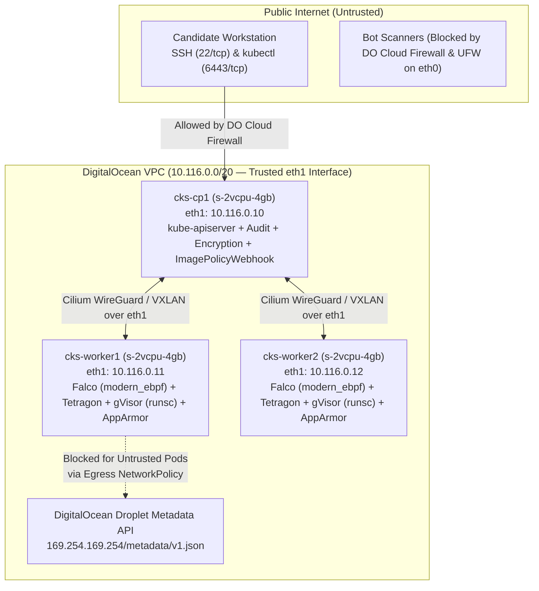

# DigitalOcean Droplet Security Lab & Tooling Guide (CKS)

This guide provides an automated, exam-matched **Certified Kubernetes Security Specialist (CKS)** lab environment running on **DigitalOcean Droplets** (`Ubuntu 24.04 / 22.04 LTS`) with `doctl` and `cloud-init`. It pre-installs and configures the complete CKS security toolchain: **Cilium + Tetragon eBPF**, **Falco (`modern_ebpf`)**, **gVisor (`runsc`)**, **AppArmor**, **Trivy**, **Cosign**, **Syft / Bom**, **OPA Gatekeeper**, and **kube-bench**.

---

## 1. Why DigitalOcean Ubuntu Droplets Are Ideal for CKS

Unlike local Docker-in-Docker (`kind`) containers—which share your laptop's kernel and cannot properly isolate **AppArmor profiles**, **gVisor `RuntimeClass`**, **Falco kernel/eBPF ring buffers**, **host `ufw` firewalls**, or **kernel module blacklisting (`modprobe.d`)**—DigitalOcean KVM Droplets run dedicated Ubuntu LTS Linux kernels with full support for every CKS domain:

| CKS Domain | Security Feature | DigitalOcean Ubuntu Droplet Support |
| :--- | :--- | :--- |
| **Domain 1 (10%)** | Cloud Metadata API (`169.254.169.254/32`), Cilium L7 Policies, `kube-bench` | Native DigitalOcean Metadata Service at `http://169.254.169.254/metadata/v1.json`; full CIS benchmark host paths. |
| **Domain 2 (15%)** | `kube-apiserver` flags, RBAC, `kubeadm` upgrades | Real `/etc/kubernetes/manifests/` static pods & `kubeadm` apt repositories. |
| **Domain 3 (15%)** | **AppArmor**, **Seccomp**, **Host `ufw`**, **Kernel Module Blacklisting** | AppArmor LSM enabled by default (`/sys/module/apparmor/parameters/enabled = Y`); separate `eth0` (WAN) and `eth1` (VPC) interfaces. |
| **Domain 4 (20%)** | **gVisor (`runsc`)**, `etcd` Encryption at Rest, PSA, OPA Gatekeeper, Istio mTLS | `runsc` works out-of-the-box on Droplets using the `systrap` (default) platform without needing nested `/dev/kvm`. |
| **Domain 5 (20%)** | **Trivy**, **Cosign**, **SBOM (`syft`/`bom`)**, **`ImagePolicyWebhook`** | High-speed registry pulls over DigitalOcean backbone + local `containerd` socket scanning. |
| **Domain 6 (20%)** | **Falco (`modern_ebpf`)**, **Cilium Tetragon (`Sigkill`)**, **API Audit Logs**, `/proc/<pid>` Forensics | Kernel 6.8+ BTF (`/sys/kernel/btf/vmlinux`) supports zero-header `modern_ebpf` for Falco and inline `Sigkill` for Tetragon. |

---

## 2. DigitalOcean Droplet Network & Security Architecture



---

## 3. One-Command CKS Droplet Provisioning (`doctl` + `cloud-init`)

### Step 1: Create `cloud-init-cks.yaml`
This `cloud-init` script provisions Ubuntu 24.04 LTS Droplets with `containerd`, `kubeadm`/`kubelet`/`kubectl` v1.31, **gVisor (`runsc`)** registered in `/etc/containerd/config.toml`, **Trivy**, **Cosign**, **Syft**, **Falco (`modern_ebpf`)**, **AppArmor utilities**, and **kube-bench**:

```yaml
#cloud-config
package_update: true
package_upgrade: false
packages:
  - apt-transport-https
  - ca-certificates
  - curl
  - wget
  - gpg
  - jq
  - yq
  - socat
  - conntrack
  - ipset
  - ufw
  - apparmor
  - apparmor-utils
  - auditd
  - libcap2-bin
  - strace
  - lsof
  - containerd

write_files:
  - path: /etc/modules-load.d/k8s.conf
    content: |
      overlay
      br_netfilter
  - path: /etc/sysctl.d/99-k8s-cri.conf
    content: |
      net.bridge.bridge-nf-call-iptables  = 1
      net.bridge.bridge-nf-call-ip6tables = 1
      net.ipv4.ip_forward                 = 1

runcmd:
  - swapoff -a
  - sed -i '/ swap / s/^\(.*\)$/#\1/g' /etc/fstab
  - modprobe overlay
  - modprobe br_netfilter
  - sysctl --system
  # 1. Install gVisor (runsc) and containerd shim
  - |
    ARCH=$(uname -m)
    URL="https://storage.googleapis.com/gvisor/releases/release/latest/${ARCH}"
    wget -q "${URL}/runsc" "${URL}/containerd-shim-runsc-v1" -P /usr/local/bin
    chmod a+rx /usr/local/bin/runsc /usr/local/bin/containerd-shim-runsc-v1
  # 2. Configure containerd with SystemdCgroup = true AND runsc runtime handler
  - mkdir -p /etc/containerd
  - containerd config default > /etc/containerd/config.toml
  - sed -i 's/SystemdCgroup = false/SystemdCgroup = true/g' /etc/containerd/config.toml
  - |
    cat << 'EOF' >> /etc/containerd/config.toml

    [plugins."io.containerd.grpc.v1.cri".containerd.runtimes.runsc]
      runtime_type = "io.containerd.runsc.v1"
    EOF
  - systemctl enable --now containerd
  - systemctl restart containerd
  # 3. Install Kubernetes v1.31 (kubeadm, kubelet, kubectl)
  - mkdir -p -m 755 /etc/apt/keyrings
  - curl -fsSL https://pkgs.k8s.io/core:/stable:/v1.31/deb/Release.key | gpg --dearmor -o /etc/apt/keyrings/kubernetes-apt-keyring.gpg
  - echo 'deb [signed-by=/etc/apt/keyrings/kubernetes-apt-keyring.gpg] https://pkgs.k8s.io/core:/stable:/v1.31/deb/ /' > /etc/apt/sources.list.d/kubernetes.list
  # 4. Install Trivy repository
  - curl -fsSL https://aquasecurity.github.io/trivy-repo/deb/public.key | gpg --dearmor -o /usr/share/keyrings/trivy.gpg
  - echo "deb [signed-by=/usr/share/keyrings/trivy.gpg] https://aquasecurity.github.io/trivy-repo/deb generic main" > /etc/apt/sources.list.d/trivy.list
  # 5. Install Falco repository
  - curl -fsSL https://falco.org/repo/falcosecurity-packages.asc | gpg --dearmor -o /usr/share/keyrings/falco-archive-keyring.gpg
  - echo "deb [signed-by=/usr/share/keyrings/falco-archive-keyring.gpg] https://download.falco.org/packages/deb stable main" > /etc/apt/sources.list.d/falcosecurity.list
  - apt-get update
  - DEBIAN_FRONTEND=noninteractive apt-get install -y kubelet kubeadm kubectl trivy
  - apt-mark hold kubelet kubeadm kubectl
  # 6. Install Cosign and Syft binaries
  - |
    COSIGN_VER=$(curl -s https://api.github.com/repos/sigstore/cosign/releases/latest | jq -r .tag_name)
    curl -sLo /usr/local/bin/cosign "https://github.com/sigstore/cosign/releases/download/${COSIGN_VER}/cosign-linux-amd64"
    chmod +x /usr/local/bin/cosign
    curl -sSfL https://raw.githubusercontent.com/anchore/syft/main/install.sh | sh -s -- -b /usr/local/bin
  # 7. Bind Kubelet to DigitalOcean VPC Private IP (eth1) and prepare Seccomp directory
  - |
    VPC_IP=$(ip -4 addr show eth1 | awk '/inet / {print $2}' | cut -d/ -f1)
    echo "KUBELET_EXTRA_ARGS=--node-ip=${VPC_IP}" > /etc/default/kubelet
    mkdir -p /var/lib/kubelet/seccomp/profiles
  - crictl config runtime-endpoint unix:///run/containerd/containerd.sock
  - systemctl daemon-reload
  - systemctl enable kubelet
```

---

### Step 2: Provision CKS Droplets & Cloud Firewall via `doctl`

```bash
export DO_REGION="nyc3"
export SSH_KEY_ID=$(doctl compute ssh-key list --format ID --no-header | head -n 1)
export MY_PUBLIC_IP="$(curl -s https://ifconfig.me)/32"

# 1. Create or reuse VPC (10.116.0.0/20)
export VPC_UUID=$(doctl vpcs list --format ID,Name --no-header | awk '$2=="k8s-cert-vpc"{print $1}')
if [ -z "$VPC_UUID" ]; then
  export VPC_UUID=$(doctl vpcs create --name k8s-cert-vpc --region "$DO_REGION" --ip-range 10.116.0.0/20 --format ID --no-header)
fi

# 2. Launch 3 Droplets (s-2vcpu-4gb = $0.036/hr per node)
doctl compute droplet create cks-cp1 cks-worker1 cks-worker2 \
  --region "$DO_REGION" \
  --image ubuntu-24-04-x64 \
  --size s-2vcpu-4gb \
  --vpc-uuid "$VPC_UUID" \
  --ssh-keys "$SSH_KEY_ID" \
  --tag-names cks-lab \
  --user-data-file cloud-init-cks.yaml \
  --wait

# 3. Attach DigitalOcean Cloud Firewall
doctl compute firewall create \
  --name cks-lab-fw \
  --tag-names cks-lab \
  --inbound-rules "protocol:tcp,ports:22,address:${MY_PUBLIC_IP} protocol:tcp,ports:6443,address:${MY_PUBLIC_IP} protocol:tcp,ports:all,address:10.116.0.0/20 protocol:udp,ports:all,address:10.116.0.0/20 protocol:icmp,address:10.116.0.0/20" \
  --outbound-rules "protocol:tcp,ports:all,address:0.0.0.0/0,address:::/0 protocol:udp,ports:all,address:0.0.0.0/0,address:::/0 protocol:icmp,address:0.0.0.0/0,address:::/0"
```

---

### Step 3: Bootstrap Control Plane with Cilium + Tetragon on `eth1`

```bash
CP_PUB_IP=$(doctl compute droplet list cks-cp1 --format PublicIPv4 --no-header)
ssh root@"${CP_PUB_IP}"

cloud-init status --wait

# 1. Initialize kubeadm on eth1 Private VPC IP
CP_VPC_IP=$(ip -4 addr show eth1 | awk '/inet / {print $2}' | cut -d/ -f1)
kubeadm init \
  --apiserver-advertise-address="${CP_VPC_IP}" \
  --apiserver-cert-extra-sans="${CP_VPC_IP},$(curl -s http://169.254.169.254/metadata/v1/interfaces/public/0/ipv4/address)" \
  --pod-network-cidr="10.244.0.0/16"

mkdir -p $HOME/.kube
cp -i /etc/kubernetes/admin.conf $HOME/.kube/config

# 2. Install Cilium CNI bound to DigitalOcean eth1 interface
CILIUM_CLI_VERSION=$(curl -s https://raw.githubusercontent.com/cilium/cilium-cli/main/stable.txt)
curl -L --fail --remote-name-all https://github.com/cilium/cilium-cli/releases/download/${CILIUM_CLI_VERSION}/cilium-linux-amd64.tar.gz
tar xzvfC cilium-linux-amd64.tar.gz /usr/local/bin
cilium install --version 1.16.3 --set devices=eth1

# 3. Join Worker Droplets
JOIN_CMD=$(kubeadm token create --print-join-command)
```

On your workstation, join `cks-worker1` and `cks-worker2`:
```bash
for NODE in cks-worker1 cks-worker2; do
  W_IP=$(doctl compute droplet list "$NODE" --format PublicIPv4 --no-header)
  ssh -o StrictHostKeyChecking=no root@"${W_IP}" "cloud-init status --wait && ${JOIN_CMD}"
done
```

---

## 4. DigitalOcean Droplet Specifics for CKS Labs

### 4.1 Domain 1 & 2: DigitalOcean Droplet Metadata Endpoint (`169.254.169.254`)
DigitalOcean Droplets expose the **DigitalOcean Metadata API** at `http://169.254.169.254/metadata/v1.json` (and `/metadata/v1/user-data`, which contains the full `cloud-init` script!).
When testing your `NetworkPolicy` blocking `169.254.169.254/32` on a DigitalOcean Droplet:
```bash
# Before NetworkPolicy (Returns full Droplet JSON metadata including VPC IPs and cloud-init!):
kubectl run test-meta --image=curlimages/curl --rm -it --restart=Never -- \
  curl -s http://169.254.169.254/metadata/v1.json | head -n 15

# After applying Egress NetworkPolicy with except: ["169.254.169.254/32"]:
kubectl run test-meta --image=curlimages/curl --rm -it --restart=Never -- \
  curl --connect-timeout 2 http://169.254.169.254/metadata/v1.json
# Expected: curl: (28) Connection timed out after 2001 milliseconds
```

### 4.2 Domain 3: Configuring `ufw` on Dual-Interface (`eth0` / `eth1`) Droplets
When practicing CKS Domain 3 host firewall tasks with `ufw` on a DigitalOcean Droplet:
- **Never block `22/tcp` on `eth0`** or you will disconnect your SSH session!
- Allow all cluster-internal traffic specifically on **`eth1`** (the DigitalOcean private VPC interface):
```bash
sudo ufw default deny incoming
sudo ufw default allow outgoing
sudo ufw allow in on eth0 to any port 22 proto tcp
sudo ufw allow in on eth1 from 10.116.0.0/20
sudo ufw --force enable
```

### 4.3 Domain 4: Registering the gVisor `RuntimeClass` (`runsc`)
Because `cloud-init-cks.yaml` installs `runsc` and registers the `runsc` handler in `/etc/containerd/config.toml`, you can immediately create the `RuntimeClass` in your cluster:
```yaml
apiVersion: node.k8s.io/v1
kind: RuntimeClass
metadata:
  name: gvisor
handler: runsc
```
> [!NOTE]
> Standard DigitalOcean Droplets do not expose nested hardware virtualization (`/dev/kvm`). `gVisor` (`runsc`) uses its default **`systrap`** platform mode, which runs natively on all DigitalOcean Droplets without needing `/dev/kvm`!

### 4.4 Domain 6: Running Falco with `modern_ebpf` on Ubuntu 24.04 Droplets
Ubuntu 24.04 LTS Droplets run Linux Kernel 6.8 with BTF enabled. Install and start the Falco systemd service using the zero-dependency `modern_ebpf` driver:
```bash
DEBIAN_FRONTEND=noninteractive sudo apt-get install -y falco
sudo yq -i '.engine.kind = "modern_ebpf"' /etc/falco/falco.yaml
sudo systemctl enable --now falco-modern-bpf.service
sudo journalctl -u falco-modern-bpf.service -f
```

---

## 5. Fast Teardown After Study Sessions (`doctl`)

```bash
# Delete all CKS lab Droplets immediately after your session
doctl compute droplet delete --tag-name cks-lab --force
```
