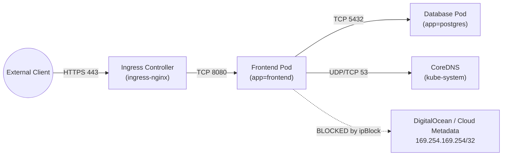
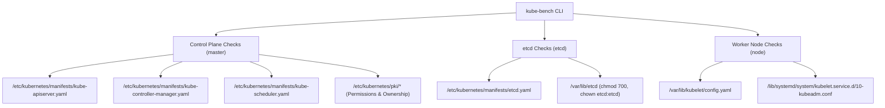

# CKS Domain 1: Cluster Setup — Deep-Dive Study Guide (10%)

> [!IMPORTANT]
> **Exam Weight: 10%**
> Domain 1 establishes the perimeter and network foundation of a hardened Kubernetes cluster. On the CKS exam, you can expect 2–3 tasks directly from this domain: writing multi-tier `NetworkPolicy` or `CiliumNetworkPolicy` manifests (including blocking access to the DigitalOcean / Cloud Metadata API at `169.254.169.254/32`), fixing CIS Kubernetes Benchmark failures reported by `kube-bench` across the Control Plane, Worker Nodes, and `etcd`, configuring an `Ingress` resource with a `kubernetes.io/tls` Secret and HTTPS redirection, and verifying Kubernetes platform binary integrity via `sha512sum`.
> See the [DigitalOcean Droplet CKS Lab Guide](../DigitalOcean_Droplet_Lab_Guide.md) for provisioning your `cks-cp1`, `cks-worker1`, and `cks-worker2` Droplets with Cilium on `eth1`.

---

## 1. Network Security Policies (L3/L4 & L7)

By default, Kubernetes networking is completely flat and permissive: **every Pod can communicate with every other Pod across all Namespaces** without restriction. While convenient for development, this flat network topology allows an attacker who compromises a single public-facing microservice to laterally scan internal databases, key-value stores, and cloud provider metadata endpoints.

### 1.1 How `NetworkPolicy` Works

A standard Kubernetes `NetworkPolicy` (`networking.k8s.io/v1`) operates at **OSI Layers 3 and 4** (IP addresses and TCP/UDP/SCTP ports).

> [!WARNING]
> **CNI Plugin Prerequisite**
> `NetworkPolicy` resources are purely declarative API objects; the Kubernetes control plane does nothing to enforce them unless your Container Network Interface (CNI) plugin supports policy enforcement (e.g., **Calico**, **Cilium**, **Weave Net**, **Antrea**). Notably, standalone **Flannel** does *not* enforce NetworkPolicies (unless paired with Calico as a policy engine via Canal). On DigitalOcean Droplets, ensure Cilium (`--set devices=eth1`) or Calico (`IP_AUTODETECTION_METHOD=interface=eth1`) is bound to the private VPC interface `eth1`.

Key behavioral rules of `NetworkPolicy`:
1. **Non-Isolated by Default**: Until at least one `NetworkPolicy` selects a Pod for a given direction (`Ingress` or `Egress`), all traffic in that direction is allowed.
2. **Isolated Once Selected**: As soon as *any* `NetworkPolicy` selects a Pod and includes `Ingress` (or `Egress`) in `spec.policyTypes`, **all** traffic in that direction is denied except what is explicitly allowed by the union of all policies selecting that Pod.
3. **Additive (Union) Evaluation**: NetworkPolicies do not have "deny" rules or priority numbers. Multiple policies selecting the same Pod are combined additively (logical OR). To restrict traffic, you first create a **Default Deny** policy, and then layer specific allow policies on top.
4. **Stateful Connections**: NetworkPolicies are stateful. If Ingress TCP port `8080` is allowed into Pod B from Pod A, the return response packets from Pod B back to Pod A's ephemeral source port are automatically permitted without needing an explicit Egress rule on Pod B.



### 1.2 The Four Fundamental Default-Deny Policies

Every hardened namespace on the CKS exam should start with a default-deny posture. Memorize how `podSelector: {}` and `policyTypes` interact:

#### 1. Default Deny All Ingress and Egress (Complete Lockdown)
```yaml
apiVersion: networking.k8s.io/v1
kind: NetworkPolicy
metadata:
  name: default-deny-all
  namespace: production
spec:
  podSelector: {} # Empty podSelector selects ALL pods in the 'production' namespace
  policyTypes:
    - Ingress
    - Egress
```

#### 2. Default Deny All Ingress Only
```yaml
apiVersion: networking.k8s.io/v1
kind: NetworkPolicy
metadata:
  name: default-deny-ingress
  namespace: production
spec:
  podSelector: {}
  policyTypes:
    - Ingress
```

#### 3. Default Deny All Egress Only (While Allowing Cluster DNS!)
> [!CAUTION]
> **The Classic CKS Egress Trap: Breaking CoreDNS Resolution!**
> When you apply an `Egress` policy (including a default-deny egress policy) to a Pod, the Pod immediately loses the ability to resolve service names via CoreDNS (`kube-dns` in `kube-system` on UDP/TCP port 53) unless you explicitly allow DNS egress! Always ask yourself whether the workload needs DNS resolution when restricting egress.

```yaml
apiVersion: networking.k8s.io/v1
kind: NetworkPolicy
metadata:
  name: default-deny-egress-allow-dns
  namespace: production
spec:
  podSelector: {}
  policyTypes:
    - Egress
  egress:
    - to:
        - namespaceSelector:
            matchLabels:
              kubernetes.io/metadata.name: kube-system
          podSelector:
            matchLabels:
              k8s-app: kube-dns
      ports:
        - protocol: UDP
          port: 53
        - protocol: TCP
          port: 53
```

### 1.3 The Critical YAML Pitfall: `AND` vs `OR` in Selectors

One of the most frequently tested nuances on the CKS exam is the difference between a single list item containing both `namespaceSelector` and `podSelector` (**Logical AND**) versus two separate list items prefixed with `-` (**Logical OR**).

#### Scenario A: Logical `AND` (Single List Element)
*"Allow ingress traffic to `backend` pods ONLY from pods labeled `role: frontend` that reside inside namespaces labeled `env: prod`."*

```yaml
  ingress:
    - from:
        - namespaceSelector:
            matchLabels:
              env: prod
          podSelector:
            matchLabels:
              role: frontend
```
Notice there is **only one hyphen (`-`)** under `from:`. Both conditions must be true simultaneously.

#### Scenario B: Logical `OR` (Two Separate List Elements)
*"Allow ingress traffic to `backend` pods from ANY pod in a namespace labeled `env: prod`, OR from any pod in the current namespace (`production`) labeled `role: frontend`."*

```yaml
  ingress:
    - from:
        - namespaceSelector:
            matchLabels:
              env: prod
        - podSelector:
            matchLabels:
              role: frontend
```
Because `podSelector` has its own hyphen (`-`), a single accidental `-` opens your database to **every Pod in the `env: prod` namespace** AND every `role: frontend` Pod in the local namespace!

- **`- podSelector: {matchLabels: {app: web}}`**
  - **Meaning:** Pods with `app=web` in the **same namespace** as the NetworkPolicy.
- **`- namespaceSelector: {matchLabels: {env: prod}}`**
  - **Meaning:** **All Pods** in any namespace with label `env=prod`.
- **`- namespaceSelector: {}`**
  - **Meaning:** **All Pods in ALL namespaces** across the entire cluster.
- **`- namespaceSelector: {matchLabels: {env: prod}}` + `podSelector: {matchLabels: {app: web}}`**
  - **Meaning:** Pods with `app=web` **inside** namespaces with `env=prod` (**AND**).
- **`- namespaceSelector: {}` + `podSelector: {matchLabels: {app: web}}`**
  - **Meaning:** Pods with `app=web` in **ANY namespace** across the cluster.

### 1.4 Protecting Node Metadata & DigitalOcean / Cloud Provider Endpoints (`169.254.169.254/32`)

In DigitalOcean Droplet, AWS, GCP, Azure, and OpenStack environments, cloud instances expose an Instance Metadata Service (IMDS) at the link-local IP address **`169.254.169.254`**.
- **On DigitalOcean Droplets:** Any Pod with unrestricted egress can query **`http://169.254.169.254/metadata/v1.json`** or **`http://169.254.169.254/metadata/v1/user-data`** to inspect the Droplet's full `cloud-init` user-data script, SSH public keys, VPC IP layout (`interfaces/private/0/ipv4/address`), and any bootstrap tokens passed during provisioning!
- **On Other Clouds:** Attackers query `/latest/meta-data/iam/security-credentials/` or `/computeMetadata/v1/` to steal node credentials.

To protect the DigitalOcean / cloud metadata server while still allowing Pods to reach external internet APIs, use an `ipBlock` rule with the `except` field:

```yaml
apiVersion: networking.k8s.io/v1
kind: NetworkPolicy
metadata:
  name: deny-cloud-metadata-egress
  namespace: default
spec:
  podSelector:
    matchLabels:
      cloud-metadata-access: "false"
  policyTypes:
    - Egress
  egress:
    - to:
        - ipBlock:
            cidr: 0.0.0.0/0
            except:
              - 169.254.169.254/32
```

#### Verifying Metadata Protection on Your DigitalOcean Droplet Lab
```bash
# Test BEFORE applying the NetworkPolicy (returns JSON metadata on a DO Droplet):
kubectl run test-meta --rm -it --image=curlimages/curl -- \
  curl -s http://169.254.169.254/metadata/v1.json | head -n 15

# Test AFTER labeling the Pod with cloud-metadata-access=false (must time out!):
kubectl run test-meta --rm -it --labels="cloud-metadata-access=false" --image=curlimages/curl -- \
  curl --connect-timeout 2 http://169.254.169.254/metadata/v1.json
```

### 1.5 Cilium L7 & DNS-Aware NetworkPolicies (`CiliumNetworkPolicy`)

Standard Kubernetes NetworkPolicies cannot filter by HTTP method/path (`GET /public` vs `POST /admin`) or by domain name (`*.github.com`). When a cluster runs **Cilium** as its CNI, you can use the `cilium.io/v2` `CiliumNetworkPolicy` CRD to enforce eBPF-powered Layer 3, Layer 4, and Layer 7 policies.

#### Example 1: DNS/FQDN Egress Filtering (`toFQDNs`)
```yaml
apiVersion: "cilium.io/v2"
kind: CiliumNetworkPolicy
metadata:
  name: allow-github-fqdn-only
  namespace: production
spec:
  endpointSelector:
    matchLabels:
      app: build-agent
  egress:
    # Step 1: Must intercept DNS queries via Cilium's DNS Proxy
    - toEndpoints:
        - matchLabels:
            "k8s:io.kubernetes.pod.namespace": kube-system
            "k8s:k8s-app": kube-dns
      toPorts:
        - ports:
            - port: "53"
              protocol: ANY
          rules:
            dns:
              - matchPattern: "*"
    # Step 2: Allow HTTPS egress only to resolved IPs of api.github.com
    - toFQDNs:
        - matchName: "api.github.com"
        - matchPattern: "*.githubusercontent.com"
      toPorts:
        - ports:
            - port: "443"
              protocol: TCP
```

#### Example 2: Layer 7 HTTP Method & Path Filtering
```yaml
apiVersion: "cilium.io/v2"
kind: CiliumNetworkPolicy
metadata:
  name: l7-http-api-policy
  namespace: production
spec:
  endpointSelector:
    matchLabels:
      app: payment-service
  ingress:
    - fromEndpoints:
        - matchLabels:
            app: checkout-service
      toPorts:
        - ports:
            - port: "8080"
              protocol: TCP
          rules:
            http:
              - method: "GET"
                path: "/v1/status"
              - method: "POST"
                path: "/v1/charge"
                headers:
                  - 'X-Internal-Auth: true'
```

---

## 2. CIS Kubernetes Benchmark & `kube-bench`

The **Center for Internet Security (CIS) Kubernetes Benchmark** is the industry standard checklist for securing Kubernetes control plane and worker node components. Aqua Security's open-source tool **`kube-bench`** automates checking a node against CIS rules.



### 2.1 Running `kube-bench` Effectively

```bash
# Run all applicable checks on the current machine
kube-bench

# Run only Control Plane (master) checks
kube-bench run --targets master

# Run only Worker Node (kubelet) checks
kube-bench run --targets node

# Run only etcd checks
kube-bench run --targets etcd

# Run a specific CIS check ID to verify your fix immediately!
kube-bench run --targets master --check 1.2.1,1.2.6,1.2.18
kube-bench run --targets node --check 4.2.1,4.2.2,4.2.6
```

### 2.2 Remediating Control Plane Static Pods

On `kubeadm` clusters, control plane components run as **Static Pods** managed directly by the `kubelet` via manifests in `/etc/kubernetes/manifests/`. Whenever you edit a file in `/etc/kubernetes/manifests/`, the `kubelet` detects the file change and automatically recreates the static Pod within 10–30 seconds.

#### 1. `kube-apiserver` (`/etc/kubernetes/manifests/kube-apiserver.yaml`)
- **1.2.1**
  - **Vulnerable Flag / Missing Setting:** `--anonymous-auth=true`
  - **Hardened Remediation Flag:** `--anonymous-auth=false`
  - **Security Rationale:** Prevents unauthenticated requests from reaching the API server.
- **1.2.5**
  - **Vulnerable Flag / Missing Setting:** Missing `--kubelet-certificate-authority`
  - **Hardened Remediation Flag:** `--kubelet-certificate-authority=/etc/kubernetes/pki/ca.crt`
  - **Security Rationale:** Verifies the kubelet's serving certificate when `kube-apiserver` connects to kubelets (`kubectl logs`/`exec`).
- **1.2.6 / 1.2.7**
  - **Vulnerable Flag / Missing Setting:** `--authorization-mode=AlwaysAllow`
  - **Hardened Remediation Flag:** `--authorization-mode=Node,RBAC`
  - **Security Rationale:** Ensures every request is authorized via Node authorizer and RBAC.
- **1.2.10 / 1.2.14**
  - **Vulnerable Flag / Missing Setting:** Missing `NodeRestriction`
  - **Hardened Remediation Flag:** `--enable-admission-plugins=NodeRestriction,...`
  - **Security Rationale:** Restricts a `kubelet` to only modifying its own `Node` and `Pod` objects bound to that node.
- **1.2.15**
  - **Vulnerable Flag / Missing Setting:** `--profiling=true` (default)
  - **Hardened Remediation Flag:** `--profiling=false`
  - **Security Rationale:** Disables `/debug/pprof` endpoints to reduce attack surface and DoS risk.
- **1.2.16 / 1.2.18**
  - **Vulnerable Flag / Missing Setting:** `--insecure-port=8080` or `--insecure-bind-address`
  - **Hardened Remediation Flag:** **Delete the flag completely** (or `--insecure-port=0` on older versions)
  - **Security Rationale:** Modern `kube-apiserver` rejects `--insecure-port` or `--insecure-bind-address` entirely and will crash if present!
- **1.2.19**
  - **Vulnerable Flag / Missing Setting:** `--service-account-lookup=false`
  - **Hardened Remediation Flag:** `--service-account-lookup=true`
  - **Security Rationale:** Verifies that the ServiceAccount token still exists in etcd before accepting it.

> [!CAUTION]
> **Watch Out for Deprecated Flags in `kube-apiserver`!**
> In Kubernetes v1.24+, the `--insecure-port` and `--insecure-bind-address` flags were completely removed from `kube-apiserver`. If an exam task has a broken API server or asks you to fix insecure port settings, **remove `--insecure-port` / `--insecure-bind-address` completely** rather than setting `--insecure-port=0` if `kube-apiserver` refuses to start with `Error: unknown flag: --insecure-port`.

#### 2. `kube-controller-manager` (`/etc/kubernetes/manifests/kube-controller-manager.yaml`)
* `--profiling=false`: Disables pprof profiling.
* `--use-service-account-credentials=true`: Runs each controller loop with its own dedicated ServiceAccount rather than a single shared superuser credential.
* `--terminated-pod-gc-threshold=100` (or `1000`, default is `12500`): Prevents resource exhaustion by garbage-collecting terminated pods earlier.
* `--bind-address=127.0.0.1`: Prevents external network access to the controller manager's health/metrics endpoint.

#### 3. `kube-scheduler` (`/etc/kubernetes/manifests/kube-scheduler.yaml`)
* `--profiling=false`: Disables pprof profiling.
* `--bind-address=127.0.0.1`: Binds only to localhost.

#### 4. `etcd` (`/etc/kubernetes/manifests/etcd.yaml`)
* `--client-cert-auth=true`: Requires clients (like `kube-apiserver`) to present a valid client certificate signed by the etcd CA.
* `--auto-tls=false`: Disables self-signed auto-generated TLS certificates for clients.
* `--peer-client-cert-auth=true`: Requires etcd cluster peers to authenticate via mTLS.
* `--peer-auto-tls=false`: Disables self-signed peer TLS certificates.

### 2.3 Remediating Control Plane File Permissions & Ownership (CIS Section 1.1)

`kube-bench` checks both `chmod` permissions and `chown` ownership on static pod manifests, kubeconfigs, and `/var/lib/etcd`:

```bash
# Static Pod Manifests & Kubeconfig Files: must be 600 (or 644 where specified) and root:root
chmod 600 /etc/kubernetes/manifests/*.yaml
chown root:root /etc/kubernetes/manifests/*.yaml
chmod 600 /etc/kubernetes/admin.conf /etc/kubernetes/kubelet.conf /etc/kubernetes/controller-manager.conf /etc/kubernetes/scheduler.conf

# etcd Data Directory: MUST be chmod 700 and owned by etcd:etcd!
chmod 700 /var/lib/etcd
chown -R etcd:etcd /var/lib/etcd

# PKI Certificates (.crt = 644 or 600) and Private Keys (.key = 600)
chmod 600 /etc/kubernetes/pki/*.key /etc/kubernetes/pki/etcd/*.key
chmod 644 /etc/kubernetes/pki/*.crt /etc/kubernetes/pki/etcd/*.crt
```

### 2.4 Remediating Worker Node (`kubelet`) Configuration (CIS Section 4.2)

Modern `kubeadm` clusters configure the `kubelet` primarily via `/var/lib/kubelet/config.yaml` (`KubeletConfiguration`), not command-line flags in `/etc/systemd/system/kubelet.service.d/10-kubeadm.conf` (though always inspect both if a command-line flag overrides the config file!).

```yaml
# /var/lib/kubelet/config.yaml
apiVersion: kubelet.config.k8s.io/v1beta1
kind: KubeletConfiguration
authentication:
  anonymous:
    enabled: false          # CIS 4.2.1: Disable anonymous requests to kubelet port 10250
  webhook:
    enabled: true           # CIS 4.2.2: Use SubjectAccessReview webhook for authentication
  x509:
    clientCAFile: /etc/kubernetes/pki/ca.crt # CIS 4.2.3
authorization:
  mode: Webhook             # CIS 4.2.2: Never use 'AlwaysAllow'! Use 'Webhook'.
readOnlyPort: 0             # CIS 4.2.4: Disable unauthenticated read-only port 10255
streamingConnectionIdleTimeout: 5m0s # CIS 4.2.5: Prevent idle exec/attach sessions
protectKernelDefaults: true # CIS 4.2.6: Error if kernel sysctl parameters differ from kubelet defaults
makeIPTablesUtilChains: true # CIS 4.2.7
rotateCertificates: true    # CIS 4.2.11: Automatically rotate kubelet client certs
serverTLSBootstrap: true    # CIS 4.2.12
tlsCipherSuites:            # CIS 4.2.13: Restrict to strong TLS cipher suites
  - TLS_ECDHE_ECDSA_WITH_AES_128_GCM_SHA256
  - TLS_ECDHE_RSA_WITH_AES_128_GCM_SHA256
  - TLS_ECDHE_ECDSA_WITH_CHACHA20_POLY1305
  - TLS_ECDHE_RSA_WITH_AES_256_GCM_SHA384
```

After editing `/var/lib/kubelet/config.yaml`, you **must** reload systemd and restart `kubelet`:
```bash
systemctl daemon-reload
systemctl restart kubelet
systemctl status kubelet --no-pager
```

---

## 3. Ingress Controller with TLS Termination

Exposing HTTP services over plaintext allows eavesdropping and Man-in-the-Middle (MitM) attacks. On the CKS exam, you must know how to generate or load an X.509 certificate and private key into a `kubernetes.io/tls` Secret, attach it to an `Ingress` resource, and enforce HTTP-to-HTTPS redirection.

### 3.1 Generating Certificates & Creating the `kubernetes.io/tls` Secret

If the exam provides `/root/tls.crt` and `/root/tls.key`, create the Secret directly. If asked to generate a self-signed certificate for a hostname (e.g., `portal.internal.cks`) valid for 365 days:

```bash
# 1. Generate a 2048-bit RSA private key and self-signed certificate with SAN
openssl req -x509 -nodes -days 365 -newkey rsa:2048 \
  -keyout /root/tls.key \
  -out /root/tls.crt \
  -subj "/CN=portal.internal.cks/O=CKS-Security" \
  -addext "subjectAltName = DNS:portal.internal.cks"

# 2. Create the kubernetes.io/tls Secret in the target namespace!
kubectl -n finance create secret tls portal-tls-secret \
  --cert=/root/tls.crt \
  --key=/root/tls.key
```

> [!TIP]
> **Namespace Match Requirement**
> The `kubernetes.io/tls` Secret **must** reside in the exact same Namespace as the `Ingress` resource referencing it.

### 3.2 Configuring the TLS `Ingress` Resource

```yaml
apiVersion: networking.k8s.io/v1
kind: Ingress
metadata:
  name: portal-ingress
  namespace: finance
  annotations:
    # Redirect all HTTP (port 80) requests to HTTPS (port 443) with 308 Permanent Redirect
    nginx.ingress.kubernetes.io/ssl-redirect: "true"
    # Force SSL redirect even when behind an L4 load balancer or terminated proxy
    nginx.ingress.kubernetes.io/force-ssl-redirect: "true"
spec:
  ingressClassName: nginx
  tls:
    - hosts:
        - portal.internal.cks
      secretName: portal-tls-secret
  rules:
    - host: portal.internal.cks
      http:
        paths:
          - path: /
            pathType: Prefix
            backend:
              service:
                name: portal-svc
                port:
                  number: 8080
```

### 3.3 Testing TLS Ingress with `curl --resolve`

On the CKS exam, external DNS might not resolve `portal.internal.cks`. Always test your TLS Ingress using `curl --resolve <host>:<port>:<ingress-ip>`:

```bash
# Find the Ingress Controller NodePort or ClusterIP/ExternalIP
INGRESS_IP=$(kubectl -n ingress-nginx get svc ingress-nginx-controller -o jsonpath='{.spec.clusterIP}')

# Test HTTPS termination (-k allows self-signed certificate, -v shows TLS handshake)
curl -kv --resolve portal.internal.cks:443:${INGRESS_IP} https://portal.internal.cks/

# Test HTTP -> HTTPS 308 redirect
curl -I --resolve portal.internal.cks:80:${INGRESS_IP} http://portal.internal.cks/
```

---

## 4. Verifying Kubernetes Platform Binaries Before Deploying

Supply chain attacks can target the Kubernetes binaries themselves (`kubelet`, `kubectl`, `kubeadm`, `kube-apiserver`, `cni` plugins) on a node before or after cluster provisioning. The CKS curriculum requires you to verify the cryptographic hash (`sha512sum` or `sha256sum`) of platform binaries against official hashes published at `https://dl.k8s.io` or provided in the exam prompt.

### 4.1 Step-by-Step Binary Verification Workflow

#### Scenario 1: Comparing Host Binaries Against Provided Checksums
Suppose an exam question states: *"Verify the binaries in `/opt/k8s-binaries/` (`kubeadm`, `kubelet`, `kubectl`) against the official SHA-512 checksums listed in `/opt/k8s-binaries/checksums.sha512` and delete any binary that fails verification."*

```bash
# Compute SHA512 hashes of all binaries in the directory
sha512sum /opt/k8s-binaries/kube*

# Or run automated verification against a checksum file
cd /opt/k8s-binaries && sha512sum -c checksums.sha512

# Delete any binary reported as FAILED
rm -f /opt/k8s-binaries/<tampered-binary>
```

#### Scenario 2: Downloading Official SHA-512 Hashes from `dl.k8s.io`
If you need to verify the installed `/usr/bin/kubelet` binary on a node against the official Kubernetes release server:

```bash
# 1. Check the exact version of the binary
kubelet --version
# Output: Kubernetes v1.31.2

# 2. Download the official SHA512 file for that exact version and architecture
curl -sLO https://dl.k8s.io/release/v1.31.2/bin/linux/amd64/kubelet.sha512

# 3. Compare the official hash with the local binary's hash
cat kubelet.sha512 ; echo ""
sha512sum /usr/bin/kubelet

# Automated one-liner check:
echo "$(cat kubelet.sha512)  /usr/bin/kubelet" | sha512sum --check
```

#### Scenario 3: Extracting & Verifying `kube-apiserver` Binary from a Running Container
What if a task asks you to verify the `kube-apiserver` binary running inside the static Pod container?

```bash
# 1. Find the container ID of kube-apiserver
CID=$(crictl ps --name kube-apiserver -q)

# 2. Find its rootfs path or host PID
PID=$(crictl inspect "$CID" | jq '.info.pid')

# 3. Hash the binary directly via /proc/<PID>/root/usr/local/bin/kube-apiserver
sha512sum /proc/${PID}/root/usr/local/bin/kube-apiserver
```

---

## 5. Securing the Kubernetes Dashboard & GUI Elements

While the Kubernetes Dashboard is rarely deployed in production, if it is present in a cluster:
1. **Never pass `--enable-skip-login` or `--enable-insecure-login`** in the Dashboard deployment arguments.
2. **Never bind the `kubernetes-dashboard` ServiceAccount to `cluster-admin`**. It should only have minimal permissions required to run its login screen, forcing users to authenticate with their own short-lived Bearer Token (`kubectl create token <sa>`) or kubeconfig.
3. **Never expose the Dashboard via `type: NodePort` or `type: LoadBalancer` without TLS and an authentication proxy**. Prefer `kubectl port-forward` or an internal mTLS-protected Ingress.

---

## 6. Domain 1 Exam Tips & Common Pitfalls

1. **Always Check Namespace Labels Before Writing `namespaceSelector`!**
   Since Kubernetes v1.21+, every namespace automatically gets the immutable label `kubernetes.io/metadata.name: <namespace-name>`. However, many CKS tasks ask you to select namespaces by a custom label like `role: frontend` or `team: secops`. Run `kubectl get ns --show-labels` first! If the label does not exist on the namespace, add it or use `kubernetes.io/metadata.name`.
2. **Remember Both TCP and UDP Port 53 for DNS Egress!**
   While standard DNS queries use `UDP 53`, DNS responses larger than 512 bytes (or DNS-over-TCP fallbacks) use `TCP 53`. Always include both `protocol: UDP` and `protocol: TCP` on port `53` in your DNS egress rules.
3. **Verify `kubelet` Status Immediately After Restarting!**
   If you introduce a YAML syntax error or invalid field in `/var/lib/kubelet/config.yaml`, `systemctl restart kubelet` will appear to succeed, but the `kubelet` process will crash-loop! Always run `systemctl status kubelet` and `journalctl -u kubelet -n 25` to confirm it is `active (running)`.
4. **Wait Up to 30 Seconds for Static Pod Recreation!**
   When you modify `/etc/kubernetes/manifests/kube-apiserver.yaml` or `etcd.yaml`, `crictl ps` will show the old container terminating and a new one starting. If `kubectl get nodes` fails after 45 seconds, inspect `/var/log/pods/kube-system_kube-apiserver-*/kube-apiserver/*.log` or restore your backup from `/root/backups/`.
