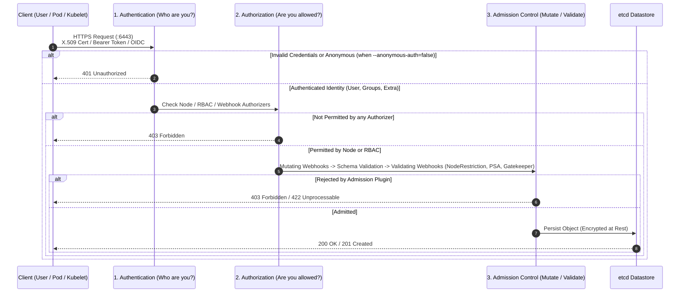
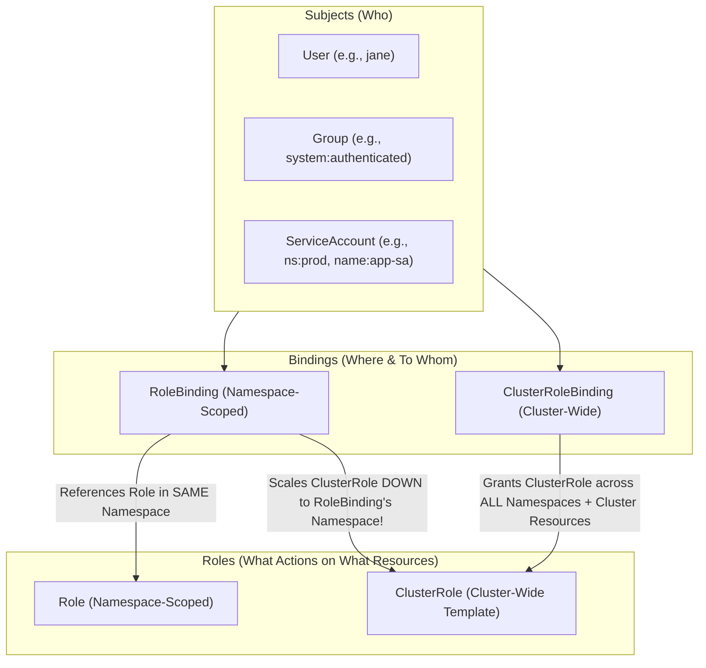
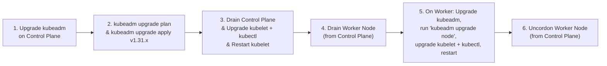

# CKS Domain 2: Cluster Hardening — Deep-Dive Study Guide (15%)

> [!IMPORTANT]
> **Exam Weight: 15%**
> Domain 2 focuses on securing the heart of Kubernetes: the **API Server** (`kube-apiserver`), **Role-Based Access Control (RBAC)**, **ServiceAccount** token security, and **Cluster Upgrades** (`kubeadm`). Expect 2–3 performance tasks on the CKS exam from this domain, including auditing overly permissive RBAC `ClusterRole` / `Role` manifests (removing `*` wildcards, scoping bindings down to namespaces, restricting Secret access), disabling `automountServiceAccountToken` while mounting short-lived Bound ServiceAccount Tokens via `projected` volumes, hardening `kube-apiserver` flags (`NodeRestriction`, `--anonymous-auth=false`), and performing a zero-downtime Kubernetes version upgrade to patch CVEs.

---

## 1. Restricting Access to the Kubernetes API

Every action in a Kubernetes cluster—whether initiated by a human administrator (`kubectl`), a worker node (`kubelet`), a controller, or an in-cluster Pod—flows through the **Kubernetes API Server (`kube-apiserver`)**. Every API request must traverse three sequential security gates before persisting to `etcd`:



### 1.1 Hardening `kube-apiserver` Authentication

1. **Disable Anonymous Authentication (`--anonymous-auth=false`)**:
   * By default, `kube-apiserver` sets `--anonymous-auth=true`, mapping any unauthenticated request to user `system:anonymous` and group `system:unauthenticated`.
   * While RBAC normally blocks `system:anonymous` from sensitive endpoints (except `/healthz`, `/livez`, `/readyz`), a single misconfigured `ClusterRoleBinding` granting permissions to `system:anonymous` or `system:unauthenticated` immediately exposes your cluster to the world without credentials!
   * Setting `--anonymous-auth=false` in `/etc/kubernetes/manifests/kube-apiserver.yaml` rejects all unauthenticated requests at Stage 1 with `401 Unauthorized`.

> [!WARNING]
> **Liveness/Readiness Probe Nuance with `--anonymous-auth=false`**
> In modern `kubeadm` clusters, the `livenessProbe`, `readinessProbe`, and `startupProbe` inside `/etc/kubernetes/manifests/kube-apiserver.yaml` use `httpGet` with `scheme: HTTPS` on `/livez` and `/readyz`. Kubernetes automatically whitelists `/healthz`, `/livez`, and `/readyz` for kubelet probes or uses local loopback checks, so setting `--anonymous-auth=false` is completely safe and frequently tested on the CKS exam.

2. **Disable Insecure Port (Removed in v1.24+)**:
   * Never expose `kube-apiserver` over plaintext HTTP. Ensure `--insecure-port` and `--insecure-bind-address` are completely absent from `kube-apiserver.yaml`.

3. **X.509 Client Certificate Authentication (`--client-ca-file`)**:
   * In X.509 client certificates signed by `/etc/kubernetes/pki/ca.crt`:
     * The **Common Name (`CN`)** becomes the Kubernetes **Username** (e.g., `CN=jane` or `CN=system:node:node01`).
     * The **Organization (`O`)** fields become the Kubernetes **Groups** (e.g., `O=system:masters` or `O=system:nodes`).
   * **Danger of `O=system:masters`**: The built-in `system:masters` group is hardcoded in `kube-apiserver` to bypass RBAC entirely as an unstoppable superuser! Even if you delete the `cluster-admin` `ClusterRoleBinding`, any certificate with `O=system:masters` still has full cluster root access. Never issue `O=system:masters` certificates to human users or CI/CD pipelines.

### 1.2 Hardening `kube-apiserver` Authorization (`--authorization-mode=Node,RBAC`)

`kube-apiserver` supports multiple authorization modules evaluated in order:
* `AlwaysAllow`: **DANGEROUS!** Approves every request without checking permissions. Must **never** be used in production or on the CKS exam.
* `AlwaysDeny`: Rejects every request (used only for testing).
* `ABAC` (Attribute-Based Access Control): Legacy static file-based policy requiring API server restarts; deprecated in favor of RBAC.
* `Node`: Special-purpose authorizer that authorizes API requests made by `kubelet`s (`system:node:<nodeName>` in group `system:nodes`) to read Secrets/ConfigMaps/PersistentVolumes **only** for Pods actually scheduled onto that specific node!
* `RBAC` (Role-Based Access Control): Standard dynamic authorization using `Role`, `ClusterRole`, `RoleBinding`, and `ClusterRoleBinding`.
* `Webhook`: Out-of-process HTTP callback for custom authorization engines.

Always configure:
```yaml
- --authorization-mode=Node,RBAC
```

### 1.3 Restricting Kubelet Permissions with `NodeRestriction` Admission Plugin

What stops a compromised worker node (`node01`, authenticating with its kubelet certificate `CN=system:node:node01, O=system:nodes`) from modifying the `Node` object of `controlplane` or adding fake labels to itself (like `node-role.kubernetes.io/control-plane=""` or `security-clearance=top-secret`) to attract sensitive Pods?

The **`NodeRestriction`** admission controller plugin!
When enabled via:
```yaml
- --enable-admission-plugins=NodeRestriction
```
`NodeRestriction` enforces three critical boundaries on every `kubelet`:
1. A `kubelet` can only modify **its own** `Node` API object (`system:node:node01` can only update `Node/node01`, never `Node/node02`).
2. A `kubelet` can only modify `Pod` status/eviction for `Pod` objects that are actually bound (`spec.nodeName: node01`) to its own node.
3. A `kubelet` **cannot** add, modify, or delete any node labels prefixed with `node-restriction.kubernetes.io/` (or `kubernetes.io/` core security labels). This allows administrators to safely schedule high-security workloads using `nodeSelector: {"node-restriction.kubernetes.io/pci-dss": "true"}` knowing that a compromised worker node cannot self-label to hijack those Pods!

### 1.4 Restricting External Network Access to the API Server

* Bind `kube-apiserver` `--advertise-address` to the internal control plane network interface rather than a public IP where possible.
* Protect TCP port `6443` via host firewall (`ufw` / `iptables`) or cloud security groups so only bastion hosts, authorized admin CIDRs, and cluster worker nodes can reach `6443`.
* Avoid exposing arbitrary services via `type: NodePort` (`30000-32767`), which opens a port on **every node** (including control plane nodes unless blocked by firewall or `--service-node-port-range` restrictions).

---

## 2. Role-Based Access Control (RBAC) with Least Privilege

RBAC (`rbac.authorization.k8s.io/v1`) is purely **additive** (there are no "deny" rules). Every permission granted is the union of all `RoleBinding` and `ClusterRoleBinding` rules matching the subject (`User`, `Group`, or `ServiceAccount`).

### 2.1 The Four Core RBAC Objects & Their Scope Matrix



* **`RoleBinding` — `Role`**
  * **Effective Permission Scope:** **Single Namespace** (where both reside)
  * **Common CKS Use Case:** Granting a microservice ServiceAccount access to ConfigMaps in its own namespace.
* **`RoleBinding` — `ClusterRole`**
  * **Effective Permission Scope:** **Single Namespace** (the `RoleBinding`'s namespace!)
  * **Common CKS Use Case:** Reusing a shared `ClusterRole` (like `view` or `edit`) inside a single namespace without duplicating Roles.
* **`ClusterRoleBinding` — `ClusterRole`**
  * **Effective Permission Scope:** **Entire Cluster** (all current & future namespaces + cluster-scoped resources like `nodes`, `persistentvolumes`, `namespaces`)
  * **Common CKS Use Case:** Cluster-wide operators, monitoring agents (`prometheus`), or `cluster-admin`.
* **`ClusterRoleBinding` — `Role`**
  * **Effective Permission Scope:** **INVALID / FORBIDDEN**
  * **Common CKS Use Case:** A `ClusterRoleBinding` cannot reference a namespace-scoped `Role`.

### 2.2 Dangerous RBAC Permissions & Privilege Escalation Vectors

When auditing RBAC on the CKS exam, look immediately for these high-risk configurations:

1. **Wildcards (`*`) in `apiGroups`, `resources`, or `verbs`**:
   * `resources: ["*"]` allows access to `secrets`, `pods/exec`, `roles`, and `rolebindings`.
   * `verbs: ["*"]` allows `delete`, `deletecollection`, `patch`, `impersonate`, and `escalate`.
   * **CKS Remediation**: Replace `*` with the exact `apiGroups`, `resources`, and `verbs` the workload actually uses (inspect application logs or source scripts to see what API calls it makes!).

2. **Unnecessary Access to `secrets` (`get`, `list`, `watch`)**:
   * **Critical Nuance**: Both `get` AND `list` (and `watch`) return the **full `data` payload** of every Secret in the namespace! Granting `verbs: ["list"]` on `secrets` allows an attacker to dump every Secret in the namespace with a single `kubectl get secrets -o json` call.
   * If a Pod only needs one specific Secret or ConfigMap, use **`resourceNames: ["my-specific-secret"]`** inside the Role rule! (Note: `resourceNames` works with `get`, `update`, `patch`, `delete`, but **cannot** filter `list`, `watch`, or `create`).

3. **RBAC Privilege Escalation Verbs (`bind`, `escalate`, `impersonate`)**:
   * `escalate` on `roles`/`clusterroles`: Allows a user to create/edit a Role with permissions the user themselves does not possess!
   * `bind` on `roles`/`clusterroles`: Allows a user to bind a privileged `ClusterRole` (like `cluster-admin`) to their own ServiceAccount.
   * `impersonate` on `users`/`groups`/`serviceaccounts`: Allows a user to run `kubectl --as=system:admin` or `--as-group=system:masters`.
   * `create` on `pods` or `pods/exec`: Anyone who can `create` Pods in a namespace can mount any Secret or ServiceAccount in that namespace into their Pod! Anyone with `create` on `pods/exec` can execute commands inside existing Pods in that namespace and steal their mounted credentials.

4. **Dangerous Subject Groups in Bindings**:
   * `system:anonymous` or `system:unauthenticated`: Grants permissions to unauthenticated network callers!
   * `system:authenticated`: Grants permissions to *every* authenticated user and ServiceAccount in the cluster.
   * `system:serviceaccounts`: Grants permissions to *every* ServiceAccount across *all* namespaces.
   * `system:serviceaccounts:<namespace>`: Grants permissions to *every* ServiceAccount in `<namespace>` (including the `default` ServiceAccount!).

### 2.3 Auditing & Remediating RBAC Step-by-Step

```bash
# 1. Inspect all Roles and RoleBindings in the target namespace
kubectl -n payments get role,rolebinding -o yaml

# 2. Find all ClusterRoleBindings referencing a specific ServiceAccount or Group
kubectl get clusterrolebinding -o json | jq -r '.items[] | select(.subjects[]?.name=="app-sa") | .metadata.name'

# 3. Test effective permissions of a ServiceAccount before and after remediation
kubectl auth can-i --list --as=system:serviceaccount:payments:app-sa -n payments
kubectl auth can-i delete pods --as=system:serviceaccount:payments:app-sa -n payments
kubectl auth can-i get secrets --as=system:serviceaccount:payments:app-sa -n payments
```

#### Example: Least-Privilege Role with `resourceNames`
```yaml
apiVersion: rbac.authorization.k8s.io/v1
kind: Role
metadata:
  name: config-reader-role
  namespace: payments
rules:
  - apiGroups: [""]
    resources: ["configmaps"]
    verbs: ["get", "watch"]
    resourceNames: ["payment-gateway-config"] # Can ONLY read this single ConfigMap!
  - apiGroups: [""]
    resources: ["pods"]
    verbs: ["get", "list"]
```

---

## 3. ServiceAccount Hardening & Bound Token Volumes

### 3.1 The Danger of the `default` ServiceAccount

Every Kubernetes Namespace automatically includes a ServiceAccount named **`default`**.
* If a Pod manifest does not specify `spec.serviceAccountName`, Kubernetes automatically assigns it the `default` ServiceAccount.
* Unless disabled, Kubernetes automatically mounts a ServiceAccount JWT token at **`/var/run/secrets/kubernetes.io/serviceaccount/token`** inside every container in the Pod!
* If an attacker achieves Remote Code Execution (RCE) or Server-Side Request Forgery (SSRF) inside the container, the very first place they look is `/var/run/secrets/kubernetes.io/serviceaccount/token` to authenticate against `https://kubernetes.default.svc/api/v1/...`.

### 3.2 Disabling Automatic Token Mounting (`automountServiceAccountToken: false`)

If a microservice does not need to talk to the Kubernetes API server (which is true for 95% of application Pods!), you should disable automatic ServiceAccount token mounting.

You can set `automountServiceAccountToken: false` in two places:
1. **On the `ServiceAccount` object**:
```yaml
apiVersion: v1
kind: ServiceAccount
metadata:
  name: frontend-sa
  namespace: payments
automountServiceAccountToken: false
```
2. **On the `Pod` spec (`spec.automountServiceAccountToken: false`)**:
```yaml
apiVersion: v1
kind: Pod
metadata:
  name: frontend-pod
  namespace: payments
spec:
  serviceAccountName: frontend-sa
  automountServiceAccountToken: false
  containers:
    - name: web
      image: nginx:1.27-alpine
```

> [!IMPORTANT]
> **Precedence Rule: `Pod.spec` Always Wins Over `ServiceAccount`!**
> If `ServiceAccount` has `automountServiceAccountToken: true` and `Pod.spec` has `automountServiceAccountToken: false`, the token is **NOT** mounted.
> Conversely, if `ServiceAccount` has `automountServiceAccountToken: false` and `Pod.spec` explicitly sets `automountServiceAccountToken: true`, the token **IS** mounted!
> On the CKS exam, it is best practice to set `automountServiceAccountToken: false` on **both** the `ServiceAccount` (or `default` SA) and the `Pod`/`Deployment` template when asked to disable token mounting.

### 3.3 Bound ServiceAccount Token Volumes (`TokenRequest` API & `projected` Volumes)

Historically (prior to Kubernetes v1.21), ServiceAccount tokens were stored in `Secret` objects in `etcd`, had **no expiration date** (valid forever!), and had no audience restriction.

Modern Kubernetes uses the **`TokenRequest` API** to issue **time-bound, audience-bound, object-bound JWT tokens** mounted via a **`projected` volume**. Even when `automountServiceAccountToken: false` is set, you can explicitly mount a custom short-lived token at a custom path with a strict expiration (`expirationSeconds`) and target `audience`:

```yaml
apiVersion: v1
kind: Pod
metadata:
  name: metrics-collector
  namespace: monitoring
spec:
  serviceAccountName: metrics-sa
  automountServiceAccountToken: false # Disable default /var/run/secrets/kubernetes.io/serviceaccount mount
  containers:
    - name: collector
      image: prom/prometheus:v2.53.0
      volumeMounts:
        - name: custom-sa-token
          mountPath: /var/run/secrets/tokens
          readOnly: true
  volumes:
    - name: custom-sa-token
      projected:
        sources:
          - serviceAccountToken:
              path: api-token
              expirationSeconds: 3600 # 1 hour (minimum allowed by kube-apiserver is 600s = 10 mins)
              audience: https://kubernetes.default.svc.cluster.local
```
Key facts about `projected` `serviceAccountToken` volumes:
* The `kubelet` automatically refreshes/rotates the token file before it reaches 80% of its `expirationSeconds` TTL.
* As soon as the Pod is deleted, the bound token becomes invalid immediately because its validity is cryptographically tied to the Pod's UID in the API server!
* You can also generate an ad-hoc time-bound token on the CLI using:
  ```bash
  kubectl -n monitoring create token metrics-sa --duration=15m
  ```

---

## 4. Upgrading Kubernetes Frequently to Patch CVEs (`kubeadm`)

Security vulnerabilities (CVEs) in Kubernetes components are discovered regularly, and the Kubernetes community only maintains patch releases for the **three most recent minor versions** (e.g., `1.31`, `1.30`, `1.29`). Keeping clusters updated is an explicit CKS exam objective.

### 4.1 Kubernetes Version Skew Policy & Upgrade Order

1. **No Skipping Minor Versions**: You can only upgrade one minor version at a time (`v1.30.x` > `v1.31.x`, never `v1.29` > `v1.31` directly).
2. **`kube-apiserver` First**: In a multi-node cluster, `kube-apiserver` must be upgraded first.
3. **`kubelet` Version Skew**: `kubelet` may never be newer than `kube-apiserver`, and may be up to 3 minor versions older in recent Kubernetes releases (though during `kubeadm` upgrades, you upgrade `kubelet` right after the control plane on each node).



### 4.2 Exact Step-by-Step `kubeadm` Upgrade Procedure (Ubuntu/Debian)

#### Part A: Upgrading the Control Plane Node (`controlplane`)
```bash
# 1. Find the exact package version available in the apt repository
apt-get update
apt-cache madison kubeadm | grep 1.31

# 2. Unhold, install, and re-hold kubeadm FIRST
apt-mark unhold kubeadm
apt-get install -y kubeadm=1.31.1-1.1
apt-mark hold kubeadm

# 3. Verify upgrade plan and apply control plane upgrade
kubeadm version
kubeadm upgrade plan
kubeadm upgrade apply v1.31.1 -y

# 4. Drain the control plane node (optional if no workloads run on it, but often required by exam tasks)
kubectl drain controlplane --ignore-daemonsets

# 5. Unhold, install, and re-hold kubelet and kubectl
apt-mark unhold kubelet kubectl
apt-get install -y kubelet=1.31.1-1.1 kubectl=1.31.1-1.1
apt-mark hold kubelet kubectl

# 6. Reload systemd daemon, restart kubelet, and uncordon node
systemctl daemon-reload
systemctl restart kubelet
kubectl uncordon controlplane
```

#### Part B: Upgrading a Worker Node (`node01`)
```bash
# 1. On controlplane: Drain the worker node safely
kubectl drain node01 --ignore-daemonsets --delete-emptydir-data

# 2. SSH into node01
ssh node01

# 3. Upgrade kubeadm on node01
apt-get update
apt-mark unhold kubeadm
apt-get install -y kubeadm=1.31.1-1.1
apt-mark hold kubeadm

# 4. Run 'kubeadm upgrade node' (NOT 'upgrade apply'!) to update local kubelet config
kubeadm upgrade node

# 5. Upgrade kubelet and kubectl on node01
apt-mark unhold kubelet kubectl
apt-get install -y kubelet=1.31.1-1.1 kubectl=1.31.1-1.1
apt-mark hold kubelet kubectl

# 6. Restart kubelet and exit SSH
systemctl daemon-reload
systemctl restart kubelet
exit

# 7. Back on controlplane: Uncordon node01 and verify Ready status + version
kubectl uncordon node01
kubectl get nodes -o wide
```

---

## 5. Domain 2 Exam Tips & Common Pitfalls

1. **Converting a `ClusterRoleBinding` to a `RoleBinding`**:
   On the CKS exam, you may be given a `ClusterRoleBinding` that grants a `ClusterRole` across the entire cluster when the application only runs in namespace `team-blue`. You can delete the `ClusterRoleBinding` and create a `RoleBinding` in `team-blue` that still references the existing `ClusterRole` (`--clusterrole=<name>`), or create a namespace-scoped `Role` and `RoleBinding`. Always read the prompt carefully to see if it specifies exact object names!
2. **Don't Forget to Delete Old Unused Roles/Bindings When Asked**:
   Some CKS tasks explicitly instruct: *"Delete any unused Roles or RoleBindings in the namespace."* Check every `RoleBinding` to see which `Role` and `ServiceAccount` are actually mounted by Pods (`kubectl get pods -n <ns> -o yaml | grep serviceAccountName`).
3. **In `kubeadm` Upgrades, Worker Nodes Use `kubeadm upgrade node`**:
   Never run `kubeadm upgrade apply` on a worker node! `kubeadm upgrade apply v1.x.y` is only for the primary control plane node; worker nodes and secondary control plane nodes use `kubeadm upgrade node`.
