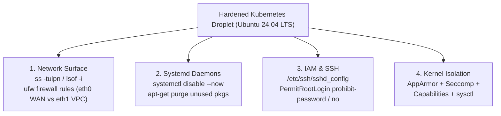

# CKS Domain 3: System Hardening — Deep-Dive Study Guide (15%)

> [!IMPORTANT]
> **Exam Weight: 15%**
> Containers are **not** virtual machines—they are isolated Linux processes sharing the underlying Worker Node's Linux kernel. If a container escapes its namespace or exploits a kernel vulnerability, the security posture of the host OS determines whether the attacker can compromise the entire node and cluster. On the CKS exam, expect 2–3 hands-on tasks from Domain 3: auditing open network ports (`ss -tulpn` / `lsof`) and disabling rogue systemd services, configuring `ufw` host firewalls across DigitalOcean Droplet interfaces (`eth0` WAN vs `eth1` VPC), loading **AppArmor** profiles onto worker nodes (`apparmor_parser -q`) and attaching them to Pods, configuring custom **Seccomp** syscall filters in `/var/lib/kubelet/seccomp/profiles/`, and dropping **Linux Capabilities** (`drop: ["ALL"]`, `add: ["NET_BIND_SERVICE"]`).

---

## 1. Minimizing Host OS Footprint & Attack Surface

Every unnecessary daemon, listening TCP/UDP port, SetUID binary, compiler (`gcc`), or package manager left running on a Kubernetes node expands the attack surface available to an attacker who achieves host access or a `hostNetwork` / `hostPID` / `hostPath` pod escape.



### 1.1 Identifying Open Network Ports & Owning Processes

A classic CKS exam task states: *"Worker node `cks-worker1` (`node01`) is running an unnecessary service listening on TCP port `9090` (or `21`/`25`/`111`). Identify the offending process, stop and disable its systemd service, and remove its binary or package."*

Memorize the exact flags for `ss`, `netstat`, and `lsof`:

```bash
# 1. List all listening TCP (-t) and UDP (-u) sockets (-l) with PID/Program (-p) and numeric ports (-n)
ss -tulpn

# Example output line:
# tcp   LISTEN 0   128   0.0.0.0:9090   0.0.0.0:*   users:(("rogue-daemon",pid=4182,fd=3))

# 2. Alternative using lsof or netstat:
lsof -i :9090
netstat -tulpn | grep 9090

# 3. Find the systemd unit managing PID 4182!
systemctl status 4182
# Output shows: Loaded: loaded (/lib/systemd/system/rogue-daemon.service; enabled)

# 4. Stop, disable, and mask the service so it cannot restart on reboot or socket activation:
systemctl stop rogue-daemon.service
systemctl disable --now rogue-daemon.service
systemctl mask rogue-daemon.service

# 5. Find which apt package owns the binary and purge it (if asked):
which rogue-daemon
dpkg -S /usr/sbin/rogue-daemon
apt-get purge -y rogue-daemon-pkg
```

### 1.2 Required Kubernetes Ports & Host Firewall (`ufw`)

When configuring a host firewall (`ufw` on Ubuntu) on a Control Plane or Worker Node, you **must not block** the ports required for Kubernetes control plane, `kubelet`, `etcd`, and CNI overlay communication!

#### Mandatory Kubernetes TCP/UDP Ports Table

| Node Role | Protocol | Port(s) | Process / Component | Purpose |
| :--- | :---: | :---: | :--- | :--- |
| **Control Plane** | TCP | **`6443`** | `kube-apiserver` | Kubernetes API server (used by all clients, kubectl, kubelets) |
| **Control Plane** | TCP | **`2379-2380`** | `etcd` | etcd client API (`2379`) and peer-to-peer communication (`2380`) |
| **Control Plane** | TCP | **`10250`** | `kubelet` | Kubelet API (used by `kube-apiserver` for `exec`/`logs`) |
| **Control Plane** | TCP | **`10259`** | `kube-scheduler` | Scheduler HTTPS health/metrics endpoint |
| **Control Plane** | TCP | **`10257`** | `kube-controller-manager` | Controller Manager HTTPS health/metrics endpoint |
| **Worker Node** | TCP | **`10250`** | `kubelet` | Kubelet API |
| **Worker Node** | TCP | **`10256`** | `kube-proxy` | kube-proxy health check server |
| **Worker Node** | TCP/UDP | **`30000-32767`** | `kube-proxy` | Default `NodePort` Service range |
| **CNI (Calico/Flannel/Cilium)** | TCP / UDP | **`179` (BGP), `4240` (Cilium health), `4789` / `8472` (UDP VXLAN)** | CNI DaemonSet | Pod-to-Pod cross-node overlay networking |

#### Configuring `ufw` (Uncomplicated Firewall) on Ubuntu DigitalOcean Droplets
On DigitalOcean Droplets, `eth0` is the public internet interface and `eth1` (`10.116.0.0/20`) is the private VPC interface:
```bash
# Check current UFW status
ufw status verbose

# Allow SSH first so you NEVER lock yourself out of the Droplet!
ufw allow 22/tcp

# Allow required Control Plane ports (or scope them to eth1 / VPC CIDR 10.116.0.0/20)
ufw allow 6443/tcp
ufw allow 2379:2380/tcp
ufw allow 10250/tcp
ufw allow 10259/tcp
ufw allow 10257/tcp

# On DigitalOcean Droplets: allow all internal cluster traffic over eth1 (VPC 10.116.0.0/20)
ufw allow in on eth1 from 10.116.0.0/20

# Allow traffic from a specific Worker Droplet VPC IP (e.g., 10.116.0.11)
ufw allow from 10.116.0.11 to any port 6443 proto tcp

# Deny a specific port explicitly
ufw deny 9090/tcp

# Delete a rule by number
ufw status numbered
ufw delete 3

# Enable or reload UFW
ufw --force enable
ufw reload
```

### 1.3 Auditing SUID/SGID Binaries, Linux Users & Open Files

```bash
# Find all files with SetUID (-4000) or SetGID (-2000) permissions on the root filesystem
find / -xdev -perm -4000 -type f 2>/dev/null
find / -xdev -perm -2000 -type f 2>/dev/null

# Remove SetUID bit from a dangerous binary
chmod u-s /usr/bin/chfn

# Audit human/service accounts in /etc/passwd that have an interactive login shell
awk -F: '($7 != "/usr/sbin/nologin" && $7 != "/bin/false") {print $1, $3, $7}' /etc/passwd

# Lock a rogue user account and disable its shell
usermod -L -s /usr/sbin/nologin rogueuser
```

### 1.4 SSH Hardening (`/etc/ssh/sshd_config`) & Kernel Hardening (`sysctl` / `modprobe`)

#### 1. Hardening `/etc/ssh/sshd_config`
```text
PermitRootLogin no
PasswordAuthentication no
PermitEmptyPasswords no
X11Forwarding no
MaxAuthTries 3
ClientAliveInterval 300
ClientAliveCountMax 0
AllowUsers ubuntu k-henry
```
Always validate and restart `sshd` after editing `/etc/ssh/sshd_config`:
```bash
sshd -t && systemctl restart sshd
```

#### 2. Blacklisting Unused Linux Kernel Modules (`/etc/modprobe.d/`)
Attackers frequently exploit vulnerabilities in obscure filesystem or network protocol kernel modules (`dccp`, `sctp`, `rds`, `tipc`, `cramfs`, `freevxfs`, `jffs2`, `hfs`, `hfsplus`, `udf`, `usb-storage`) to escalate privileges inside the kernel.
```bash
# Immediately unload a kernel module if loaded
lsmod | grep dccp
modprobe -r dccp

# Prevent the module from ever loading again
cat <<EOF > /etc/modprobe.d/blacklist-cks.conf
install dccp /bin/true
blacklist dccp
install sctp /bin/true
blacklist sctp
EOF
```

#### 3. Hardening Kernel Parameters with `sysctl` (`/etc/sysctl.d/`)
```bash
# Create persistent sysctl configuration file
cat <<EOF > /etc/sysctl.d/99-cks-hardening.conf
net.ipv4.ip_forward = 1
net.bridge.bridge-nf-call-iptables = 1
kernel.kptr_restrict = 2
kernel.dmesg_restrict = 1
fs.protected_hardlinks = 1
fs.protected_symlinks = 1
vm.overcommit_memory = 1
kernel.panic = 10
kernel.panic_on_oops = 1
EOF

# Apply immediately without rebooting
sysctl --system
```

---

## 2. Linux Kernel Security Modules: AppArmor (MAC)

Standard Linux file permissions (`rwx`) are **Discretionary Access Control (DAC)**—if a process runs as `root` (UID 0), it can read or write almost anything. **AppArmor** (Application Armor) is a Linux Security Module (LSM) enabled by default on Ubuntu/Debian DigitalOcean Droplets that enforces **Mandatory Access Control (MAC)**: it restricts **specific programs/containers** to a whitelist of file paths, network sockets, and Linux capabilities, regardless of whether the process runs as `root`!

### 2.1 AppArmor Operating Modes & Host Commands

An AppArmor profile operates in one of two modes:
1. **`enforce` mode**: Actively **blocks** any disallowed file access, execution, or capability and logs the violation to `dmesg` / `/var/log/syslog` (`audit`).
2. **`complain` mode**: **Allows** the restricted action to succeed, but logs every policy violation to `/var/log/syslog` (used for testing/developing profiles without breaking applications).

```bash
# 1. Inspect currently loaded AppArmor profiles and their mode (enforce vs complain)
aa-status

# 2. Load (or reload) a profile into the kernel in enforce mode (default):
apparmor_parser -q /etc/apparmor.d/k8s-deny-write
# Or explicitly replace an already loaded profile:
apparmor_parser -r /etc/apparmor.d/k8s-deny-write

# 3. Load a profile in COMPLAIN mode (-C):
apparmor_parser -C /etc/apparmor.d/k8s-deny-write
# Or use aa-complain / aa-enforce utilities (if apparmor-utils is installed):
aa-complain /etc/apparmor.d/k8s-deny-write
aa-enforce /etc/apparmor.d/k8s-deny-write

# 4. Unload/remove a profile from the kernel (-R):
apparmor_parser -R /etc/apparmor.d/k8s-deny-write
```

> [!CAUTION]
> **Three Critical AppArmor Exam Traps!**
> 1. **Load on the Correct Worker Node!** AppArmor profiles are loaded into the local node's Linux kernel. If your Pod will be scheduled onto `cks-worker1` (`node01`), you **must** copy the profile to `cks-worker1:/etc/apparmor.d/` and run `apparmor_parser -q /etc/apparmor.d/<file>` **on `cks-worker1`** (not just on `cks-cp1`)!
> 2. **Use the Profile Name Inside the File, NOT the Filename!** Look inside the profile file for `profile <PROFILE_NAME> flags=(...) {`. Even if the file on disk is named `/etc/apparmor.d/custom_nginx_profile`, if the line inside says `profile nginx-secure-v1 flags=(attach_disconnected,mediate_deleted) {`, you **must** specify `nginx-secure-v1` in your Pod manifest!
> 3. **Verify with `aa-status`!** Always run `aa-status | grep <profile-name>` on the worker node to confirm the exact profile name is listed under `profiles are in enforce mode`.

### 2.2 Anatomy of an AppArmor Profile

Below is a complete AppArmor profile (`/etc/apparmor.d/k8s-nginx-restricted`) commonly seen on the CKS exam:

```text
#include <tunables/global>

profile k8s-nginx-restricted flags=(attach_disconnected,mediate_deleted) {
  #include <abstractions/base>

  # Network rules: allow IPv4/IPv6 TCP, deny raw sockets (blocks ping/packet crafting)
  network inet tcp,
  network inet6 tcp,
  deny network raw,

  # Capability rules
  capability net_bind_service,
  capability setuid,
  capability setgid,
  capability dac_override,
  deny capability sys_admin,

  # File access rules (r=read, w=write, x=execute, k=lock, m=memory-map)
  /usr/sbin/nginx mr,
  /etc/nginx/** r,
  /usr/share/nginx/html/** r,
  /var/log/nginx/** rw,
  /var/run/nginx.pid rw,

  # Explicitly deny writing anywhere in /proc, /sys, or /etc
  deny /proc/** w,
  deny /sys/** w,
  deny /etc/** w,
  deny /bin/sh mrwx,
  deny /bin/bash mrwx,
}
```

### 2.3 Attaching an AppArmor Profile to a Pod (Kubernetes v1.30+ GA vs Legacy Annotation)

In **Kubernetes v1.30+**, AppArmor graduated to General Availability (GA) as a native field inside `securityContext.appArmorProfile` (at either the Pod level `spec.securityContext` or Container level `spec.containers[*].securityContext`).

#### Modern Syntax (Kubernetes v1.30+ / v1.31 Preferred on CKS)
```yaml
apiVersion: v1
kind: Pod
metadata:
  name: secured-nginx
  namespace: default
spec:
  securityContext:
    appArmorProfile:
      type: Localhost # Options: Localhost, RuntimeDefault, Unconfined
      localhostProfile: k8s-nginx-restricted
  containers:
    - name: nginx
      image: nginx:1.27-alpine
```

#### Legacy Annotation Syntax (Pre-v1.30 — Know Both in Case a Question Explicitly Requests the Annotation!)
```yaml
apiVersion: v1
kind: Pod
metadata:
  name: secured-nginx
  namespace: default
  annotations:
    # Format: container.apparmor.security.beta.kubernetes.io/<CONTAINER_NAME>: localhost/<PROFILE_NAME>
    container.apparmor.security.beta.kubernetes.io/nginx: localhost/k8s-nginx-restricted
spec:
  containers:
    - name: nginx
      image: nginx:1.27-alpine
```

#### How to Verify AppArmor is Active on a Running Container
```bash
# Check from inside the container (if /proc/1/attr/current is readable):
kubectl exec secured-nginx -- cat /proc/1/attr/current
# Expected output: k8s-nginx-restricted (enforce)

# Or check from the worker node host using the container's host PID:
PID=$(crictl inspect $(crictl ps --name nginx -q) | jq .info.pid)
cat /proc/$PID/attr/current
```

---

## 3. Seccomp (Secure Computing Mode) — System Call Filtering

Every action a Linux program performs—opening a file (`openat`), spawning a process (`execve`), changing system time (`settimeofday`), rebooting (`reboot`), or loading a kernel module (`init_module`)—is executed by making a **system call (syscall)** to the Linux kernel. The x86_64 Linux kernel exposes over **330+ system calls**, yet a typical microservice only needs 40–70 of them. Worse, many container escape CVEs (such as `dirty_cow`, `keyctl` exploits, or `unshare` user-namespace exploits) rely on obscure syscalls that normal containers never need.

**Seccomp** (with Berkeley Packet Filter — `seccomp-bpf`) intercepts every syscall at the kernel entry point and enforces an action:
* `SCMP_ACT_ALLOW`: Allow the syscall to execute.
* `SCMP_ACT_ERRNO`: Block the syscall and return an error code (`EPERM` / Operation not permitted) to the application without crashing the container.
* `SCMP_ACT_LOG`: Allow the syscall to execute, but log every invocation to `/var/log/syslog` or `/var/log/audit/audit.log` (`type=SECCOMP`).
* `SCMP_ACT_KILL_PROCESS` / `SCMP_ACT_KILL_THREAD`: Immediately terminate the process/thread making the disallowed syscall.

### 3.1 The Three Seccomp Profile Types in Kubernetes

1. **`Unconfined`** (Default in Kubernetes unless overridden!): No seccomp filter is applied; all 330+ syscalls are allowed.
2. **`RuntimeDefault`**: Uses the container runtime's (`containerd` / `CRI-O`) built-in default profile, which operates as a whitelist (`defaultAction: SCMP_ACT_ERRNO`) allowing ~300 safe syscalls while blocking ~44 dangerous syscalls (`reboot`, `kexec_load`, `init_module`, `mount`, `swapon`, `acct`, `bpf`, `unshare`).
3. **`Localhost`**: Uses a custom JSON seccomp profile file stored on the worker node under **`/var/lib/kubelet/seccomp/`**.

### 3.2 Custom Seccomp Profile JSON Examples

#### Example 1: Syscall Auditing Profile (`audit.json`)
Logs every single syscall made by the container to `/var/log/syslog`:
```json
{
  "defaultAction": "SCMP_ACT_LOG"
}
```

#### Example 2: Fine-Grained Deny/Blacklist Profile (`fine-grained.json`)
Allows all syscalls by default (`SCMP_ACT_ALLOW`), except explicitly blocked syscalls (`chmod`, `fchmod`, `fchmodat`, `unshare`, `reboot`):
```json
{
  "defaultAction": "SCMP_ACT_ALLOW",
  "architectures": [
    "SCMP_ARCH_X86_64",
    "SCMP_ARCH_X86",
    "SCMP_ARCH_X32"
  ],
  "syscalls": [
    {
      "names": [
        "chmod",
        "fchmod",
        "fchmodat",
        "unshare",
        "reboot"
      ],
      "action": "SCMP_ACT_ERRNO"
    }
  ]
}
```

#### Example 3: Strict Whitelist Profile (`whitelist.json`)
Blocks all syscalls by default (`SCMP_ACT_ERRNO`) and only allows the listed `names` (`SCMP_ACT_ALLOW`).

### 3.3 Where to Place Seccomp Profiles & How to Reference Them in Pods

> [!IMPORTANT]
> **Critical Seccomp Path Rule: `/var/lib/kubelet/seccomp/`**
> The `kubelet` always resolves `localhostProfile` **relative to `/var/lib/kubelet/seccomp/`** on the worker node!
> * If you place your file at `/var/lib/kubelet/seccomp/profiles/audit.json` on `cks-worker1` (`node01`), then in your Pod YAML you must write:
>   `localhostProfile: profiles/audit.json` (NEVER write `/var/lib/kubelet/seccomp/profiles/audit.json`!).
> * If you place your file directly at `/var/lib/kubelet/seccomp/audit.json`, you write:
>   `localhostProfile: audit.json`.

```yaml
apiVersion: v1
kind: Pod
metadata:
  name: seccomp-pod
  namespace: default
spec:
  securityContext:
    seccompProfile:
      type: Localhost
      localhostProfile: profiles/fine-grained.json # Maps to /var/lib/kubelet/seccomp/profiles/fine-grained.json
  containers:
    - name: app
      image: busybox:1.36
      command: ["sh", "-c", "sleep 3600"]
```

To verify that Seccomp is active on a container process (`Seccomp: 2` means `SECCOMP_MODE_FILTER` is active; `0` means disabled):
```bash
kubectl exec seccomp-pod -- grep Seccomp /proc/1/status
# Expected output:
# Seccomp:        2
# Seccomp_filters: 1
```

---

## 4. Linux Capabilities — Decomposing Root Privileges

Traditionally in UNIX, processes were either privileged (`UID 0 / root`, bypassing all kernel permission checks) or unprivileged (`non-root`). Linux kernels 2.2+ divided root's monolithic power into ~41 distinct **Capabilities** so a process can be granted only the exact kernel privilege it needs (e.g., binding to port 80) without receiving full root powers.

### 4.1 High-Impact Linux Capabilities to Know for CKS

| Capability Name (in `man capabilities`) | Value in Kubernetes `securityContext.capabilities` (Drop `CAP_` Prefix!) | What It Allows & Security Risk |
| :--- | :--- | :--- |
| `CAP_NET_BIND_SERVICE` | **`NET_BIND_SERVICE`** | Bind a socket to privileged ports (`< 1024`, like HTTP port `80` or HTTPS port `443`). Safe and common to `add`. |
| `CAP_NET_RAW` | **`NET_RAW`** | Use `RAW` and `PACKET` sockets (used by `ping`, `tcpdump`, ARP spoofing, packet sniffing). Should be dropped in production! |
| `CAP_SYS_TIME` | **`SYS_TIME`** | Modify the system hardware clock (`date -s`, `settimeofday`). Remember: the system clock is shared across the entire host node! |
| `CAP_SYS_ADMIN` | **`SYS_ADMIN`** | **The "New Root"!** Allows `mount`, `umount`, namespace manipulation, `swapon`, BPF, and trivial container escape. **Never grant `SYS_ADMIN`!** |
| `CAP_SYS_PTRACE` | **`SYS_PTRACE`** | Trace/inspect memory of arbitrary processes via `ptrace()` (`strace`, `gdb`). Dangerous if combined with `hostPID: true`. |
| `CAP_SYS_MODULE` | **`SYS_MODULE`** | Load and unload Linux kernel modules (`modprobe`, `insmod`). Instant kernel rootkit/container escape! |
| `CAP_CHOWN` / `CAP_DAC_OVERRIDE` | **`CHOWN` / `DAC_OVERRIDE`** | Change file ownership (`chown`) or bypass file read/write/execute permission checks. |

> [!WARNING]
> **Never Include the `CAP_` Prefix in Kubernetes YAML!**
> In Kubernetes `securityContext.capabilities.add` and `drop` lists, you **must omit the `CAP_` prefix**! Write `NET_BIND_SERVICE` or `SYS_TIME`, **not** `CAP_NET_BIND_SERVICE`. (Exception: `ALL` is written as `ALL`).

### 4.2 Best-Practice Capabilities Configuration (`drop: ["ALL"]`)

Container runtimes grant ~14 capabilities by default (including `NET_RAW`, `CHOWN`, `DAC_OVERRIDE`, `SETUID`, `SETGID`). Under the **Restricted** Pod Security Standard and CKS best practices, you should **drop `ALL` capabilities** and only `add` back `NET_BIND_SERVICE` if the container binds to a port below 1024:

```yaml
apiVersion: v1
kind: Pod
metadata:
  name: least-priv-web
spec:
  containers:
    - name: web
      image: nginx:1.27-alpine
      securityContext:
        allowPrivilegeEscalation: false
        capabilities:
          drop:
            - ALL
          add:
            - NET_BIND_SERVICE
```
*(Note: LinuxCapabilities is a **Container-level** `securityContext` field—`spec.containers[*].securityContext.capabilities`—and does NOT exist at the Pod-level `spec.securityContext`!)*

---

## 5. Domain 3 Summary Table: Pod vs Container `securityContext` Placement

A frequent mistake on the CKS exam is placing a container-only field at the Pod level (`spec.securityContext`). Use this table to avoid schema validation errors:

| Security Field | Valid at Pod Level (`spec.securityContext`)? | Valid at Container Level (`spec.containers[*].securityContext`)? |
| :--- | :---: | :---: |
| `runAsNonRoot` | Yes | Yes |
| `runAsUser` / `runAsGroup` | Yes | Yes |
| `fsGroup` / `supplementalGroups` | **Yes (Pod ONLY!)** | No |
| `seccompProfile` | Yes | Yes |
| `appArmorProfile` (v1.30+) | Yes | Yes |
| `capabilities` (`add` / `drop`) | No | **Yes (Container ONLY!)** |
| `readOnlyRootFilesystem` | No | **Yes (Container ONLY!)** |
| `allowPrivilegeEscalation` | No | **Yes (Container ONLY!)** |
| `privileged` | No | **Yes (Container ONLY!)** |
