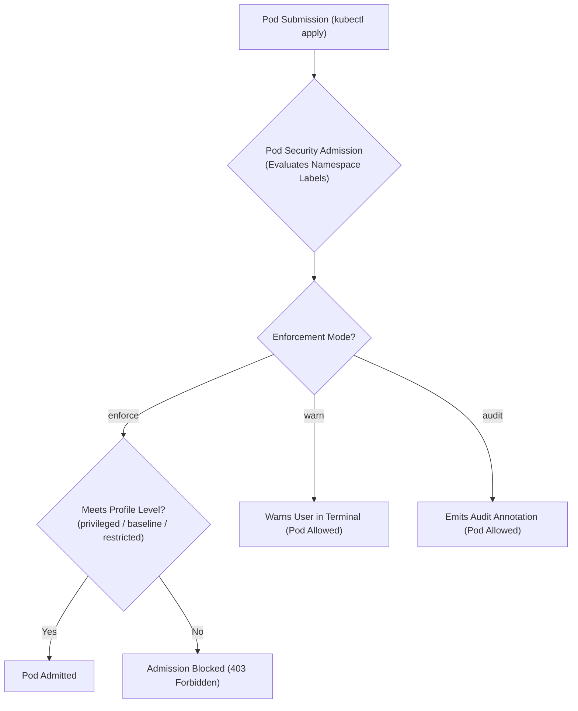
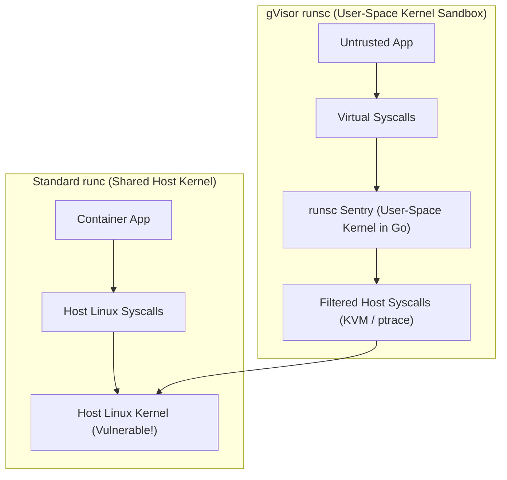
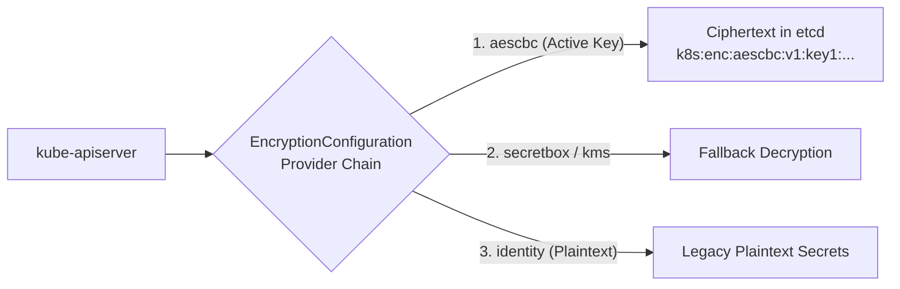

# Domain 4: Minimize Microservice Vulnerabilities — In-Depth Master Study Guide

> [!IMPORTANT]
> **Exam Weighting & Core Architecture Focus:** Domain 4 accounts for **20% of the Certified Kubernetes Security Specialist (CKS)** examination. Questions test your mastery of native Kubernetes admission security: Pod Security Standards (PSS) and Pod Security Admission (PSA) enforcement, Container Runtime Sandboxing (gVisor `runsc` and `RuntimeClass`), deep `securityContext` hardening (capabilities, seccomp, AppArmor, read-only root filesystems), etcd secret encryption at rest (`EncryptionConfiguration`), secret re-encryption and verification, and Pod-to-Pod mTLS network segmentation.

---

## 1. Pod Security Admission (PSA) & Pod Security Standards (PSS)

Kubernetes enforces security boundaries through the built-in **Pod Security Admission (PSA)** controller, which replaces legacy PodSecurityPolicies (PSP).



### 1.1 The 3 Pod Security Standards Levels

* **`privileged`**
  * **Scope:** Completely unrestricted.
  * **Allowed Controls:** Allows privileged containers (`privileged: true`), host namespaces (`hostPID`, `hostNetwork`, `hostIPC`), `hostPath` volume mounts, and arbitrary Linux capabilities.
  * **Intended Use:** Core control plane components and system DaemonSets (CNI plugins, `kube-proxy`, storage CSI drivers).

* **`baseline`**
  * **Scope:** Minimally restrictive default guardrail preventing known privilege escalations.
  * **Controls:** Blocks `privileged: true`, host namespaces (`hostNetwork`, `hostPID`, `hostIPC`), and host port bindings. Allows standard default capabilities and non-root or root user executions.

* **`restricted` (Hardened Production Standard)**
  * **Scope:** Heavily hardened security profile following container hardening best practices.
  * **Strict Requirements:**
    * Must enforce `runAsNonRoot: true` (or numeric `runAsUser > 0`).
    * Must set `allowPrivilegeEscalation: false`.
    * Must drop all capabilities: `capabilities: drop: ["ALL"]` (only `NET_BIND_SERVICE` permitted to be re-added).
    * Must set `seccompProfile: type: RuntimeDefault` or `Localhost`.
    * Volume types restricted strictly to `configMap`, `csi`, `downwardAPI`, `emptyDir`, `ephemeral`, `persistentVolumeClaim`, `projected`, and `secret` (`hostPath` is strictly forbidden).

### 1.2 Namespace Labels & Version Pinning

```yaml
apiVersion: v1
kind: Namespace
metadata:
  name: payment-processing
  labels:
    # 1. Enforce: Rejects violating pods
    pod-security.kubernetes.io/enforce: restricted
    pod-security.kubernetes.io/enforce-version: latest
    # 2. Audit: Records violation in audit logs
    pod-security.kubernetes.io/audit: restricted
    pod-security.kubernetes.io/audit-version: latest
    # 3. Warn: Emits terminal warning to engineer
    pod-security.kubernetes.io/warn: restricted
    pod-security.kubernetes.io/warn-version: latest
```

### 1.3 Cluster-Wide `PodSecurityConfiguration`

In addition to namespace labels, cluster administrators configure global admission defaults and exemptions via `/etc/kubernetes/admission/pod-security.yaml`:

```yaml
apiVersion: apiserver.config.k8s.io/v1
kind: AdmissionConfiguration
plugins:
  - name: PodSecurity
    configuration:
      apiVersion: pod-security.admission.config.k8s.io/v1
      kind: PodSecurityConfiguration
      defaults:
        enforce: "baseline"
        enforce-version: "latest"
        audit: "restricted"
        audit-version: "latest"
        warn: "restricted"
        warn-version: "latest"
      exemptions:
        usernames: ["system:serviceaccount:kube-system:cni-sa"]
        runtimeClasses: ["gvisor"]
        namespaces: ["kube-system", "monitoring"]
```

Configure `kube-apiserver` in `/etc/kubernetes/manifests/kube-apiserver.yaml`:
```
--admission-control-config-file=/etc/kubernetes/admission/pod-security.yaml
```

---

## 2. Pod & Container SecurityContext Hardening

To satisfy the `restricted` PSS profile, every container in the Pod must adhere to strict kernel isolation standards:

```yaml
apiVersion: v1
kind: Pod
metadata:
  name: secured-web-api
  namespace: payment-processing
spec:
  securityContext:
    runAsNonRoot: true
    runAsUser: 10001
    runAsGroup: 10001
    fsGroup: 10001
    seccompProfile:
      type: RuntimeDefault
    appArmorProfile:
      type: RuntimeDefault
  containers:
    - name: api
      image: cgr.dev/chainguard/static:latest
      securityContext:
        allowPrivilegeEscalation: false
        readOnlyRootFilesystem: true
        capabilities:
          drop:
            - ALL
      volumeMounts:
        - name: tmp-volume
          mountPath: /tmp
        - name: cache-volume
          mountPath: /var/cache/app
  volumes:
    - name: tmp-volume
      emptyDir: {}
    - name: cache-volume
      emptyDir: {}
```

* **Read-Only Root Filesystem (`readOnlyRootFilesystem: true`):**
  * Blocks attackers who achieve remote code execution from writing payloads, modifying system binaries, or installing crypto miners.
  * *Trap:* Applications that need to write ephemeral scratch files (e.g., `/tmp` or web server log caches) will crash unless provided with dedicated `emptyDir` volume mounts.
* **Privilege Escalation (`allowPrivilegeEscalation: false`):**
  * Controls whether a process can gain more privileges than its parent process (sets the Linux `no_new_privs` bit). Disables execution of `setuid` and `setgid` binaries (like `sudo` or `passwd`).

---

## 3. Container Runtime Sandboxing: gVisor & Kata Containers

Standard container engines (`runc`) share the host Linux kernel. A kernel vulnerability (e.g., Dirty COW, Dirty Pipe) allows a compromised container to escape to the host. Runtime sandboxing introduces an isolation boundary between the container and the host kernel.



### 3.1 gVisor (`runsc`) Architecture

* **Sentry:** A user-space kernel written in Go that implements Linux syscalls. Application syscalls are intercepted and handled inside Sentry rather than touching the host kernel directly.
* **Gofer:** A file proxy process that mediates file access outside the sandbox.

### 3.2 Configuring `RuntimeClass` in Kubernetes

1. **Verify node handler:** On worker nodes, install `runsc` and configure containerd runtime (`/etc/containerd/config.toml`).
2. **Create `RuntimeClass` resource:**

```yaml
apiVersion: node.k8s.io/v1
kind: RuntimeClass
metadata:
  name: gvisor
handler: runsc
overhead:
  podFixed:
    memory: "50Mi"
    cpu: "100m"
scheduling:
  nodeSelector:
    sandbox.gke.io/runtime: gvisor
```

3. **Assign to Pod:**

```yaml
apiVersion: v1
kind: Pod
metadata:
  name: untrusted-workload
spec:
  runtimeClassName: gvisor
  containers:
    - name: parser
      image: untrusted-python-runner:latest
```

---

## 4. etcd Secret Encryption at Rest (`EncryptionConfiguration`)

By default, Kubernetes Secrets stored in `etcd` are **plain unencrypted Base64 strings**. Any user or compromised process with read access to the etcd volume or API can view plaintext credentials.



### 4.1 `/etc/kubernetes/enc/enc.yaml` Configuration

```yaml
apiVersion: apiserver.config.k8s.io/v1
kind: EncryptionConfiguration
resources:
  - resources:
      - secrets
    providers:
      - aescbc:
          keys:
            - name: key1
              secret: c2VjcmV0IGlzIGEgMzItYnl0ZSBzdHJpbmc= # 32-byte Base64 key
      - identity: {} # Fallback to read unencrypted secrets
```

* **Provider Ordering Rule (Critical CKS Exam Fact):**
  * The **first provider in the list encrypts** all newly written secrets.
  * All subsequent providers in the list are used **only for reading (decrypting)** existing secrets.
  * To migrate from unencrypted to encrypted: Put `aescbc` first, followed by `identity: {}`.
  * To decrypt all secrets back to plaintext: Put `identity: {}` first, followed by `aescbc`.

### 4.2 Configuring `kube-apiserver` Static Pod Manifest

Edit `/etc/kubernetes/manifests/kube-apiserver.yaml`:

```yaml
spec:
  containers:
    - command:
        - kube-apiserver
        - --encryption-provider-config=/etc/kubernetes/enc/enc.yaml
      volumeMounts:
        - name: enc-config
          mountPath: /etc/kubernetes/enc/enc.yaml
          readOnly: true
  volumes:
    - name: enc-config
      hostPath:
        path: /etc/kubernetes/enc/enc.yaml
        type: File # Must be File, not Directory!
```

### 4.3 Re-Encrypting Existing Secrets & Verifying Ciphertext

* **Re-encrypt all existing secrets in-place:**
  ```bash
  kubectl get secrets --all-namespaces -o json | kubectl replace -f -
  ```
* **Verify ciphertext directly in etcd:**
  ```bash
  ETCDCTL_API=3 etcdctl \
    --cacert=/etc/kubernetes/pki/etcd/ca.crt \
    --cert=/etc/kubernetes/pki/etcd/server.crt \
    --key=/etc/kubernetes/pki/etcd/server.key \
    get /registry/secrets/default/my-secret | hexdump -C
  ```
  Look for the encrypted prefix header: **`k8s:enc:aescbc:v1:key1`**. If you see plaintext strings or JSON, encryption failed!

---

## 5. Pod-to-Pod mTLS & Microservice Network Segmentation

* **Transparent Pod-to-Pod Encryption:**
  * **Cilium WireGuard / IPsec:** In-kernel transparent Layer 3 encryption managed by eBPF without injecting sidecar proxies or modifying application code.
  * **Service Mesh (Istio / Linkerd):** Envoy sidecars intercept all TCP traffic, terminating mutual TLS (mTLS) with short-lived X.509 certificates.
* **Istio `PeerAuthentication` Strict Mode:**
  ```yaml
  apiVersion: security.istio.io/v1beta1
  kind: PeerAuthentication
  metadata:
    name: default
    namespace: payment-processing
  spec:
    mtls:
      mode: STRICT # Rejects plaintext HTTP connections
  ```
