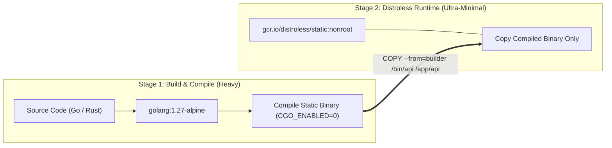
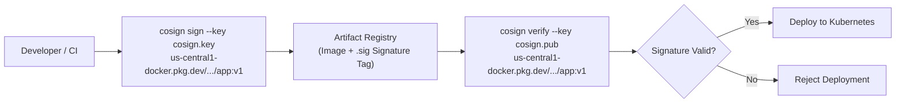
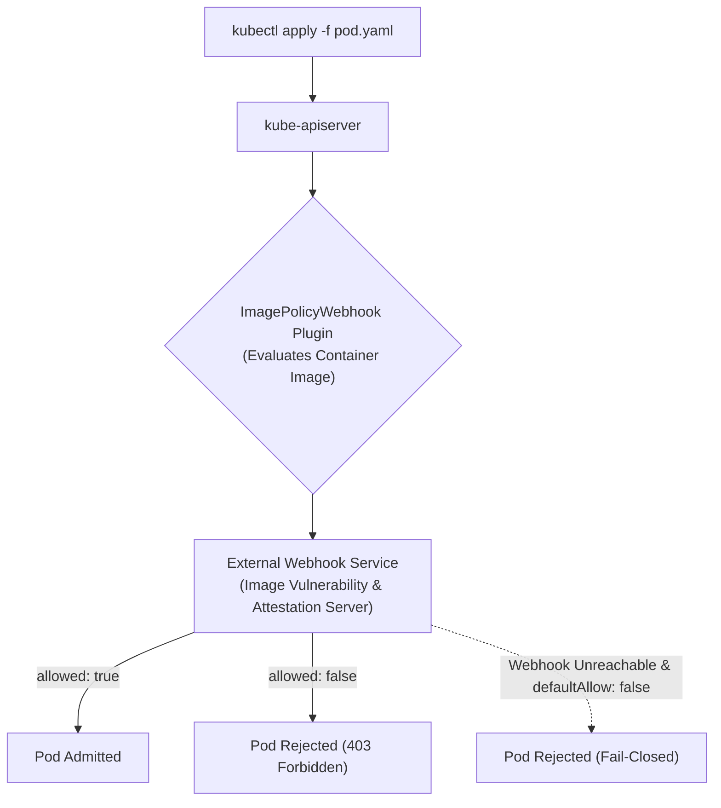

# Domain 5: Supply Chain Security — In-Depth Master Study Guide

> [!IMPORTANT]
> **Exam Weighting & Core Architecture Focus:** Domain 5 accounts for **20% of the Certified Kubernetes Security Specialist (CKS)** examination. Questions test your mastery of end-to-end supply chain security: minimizing container attack surfaces with multi-stage distroless builds, digest pinning, static manifest analysis (kubesec, trivy config), vulnerability scanning and SBOM generation with Trivy, cryptographic container signing with Sigstore Cosign, and Kubernetes admission enforcement via the `ImagePolicyWebhook` admission controller.

---

## 1. Minimizing Image Footprint & Multi-Stage Builds

The attack surface of a container image is directly proportional to the number of installed system binaries, package managers, and dynamic libraries.



### 1.1 Secure Multi-Stage Dockerfile Pattern

```dockerfile
# Stage 1: Build & Compile Environment
FROM golang:1.27-alpine AS builder

WORKDIR /src
COPY go.mod go.sum ./
RUN go mod download

COPY . .
# Compile statically linked binary with debugging symbols stripped (-ldflags="-w -s")
RUN CGO_ENABLED=0 GOOS=linux go build -ldflags="-w -s" -o /bin/api-server .

# Stage 2: Minimal Distroless Runtime Environment
# Pinned to multi-arch cryptographic sha256 digest
FROM gcr.io/distroless/static-debian12:nonroot@sha256:b8c9b82affbbb82a020bbcf998dad2ba9516944ac7e883524642a481a9505e9c

# Enforce execution under dedicated non-root UID (65532 is distroless nonroot)
USER nonroot:nonroot
WORKDIR /app

# Copy exclusively the compiled artifact from the builder stage
COPY --from=builder --chown=nonroot:nonroot /bin/api-server /app/api-server

EXPOSE 8080
ENTRYPOINT ["/app/api-server"]
```

### 1.2 Distroless vs. Alpine vs. Standard Debian

* **Distroless (`gcr.io/distroless/static`):** Contains **only your application and minimal runtime dependencies**. Has **zero shell (`/bin/sh`, `/bin/bash`)**, zero package managers (`apk`, `apt`), and zero standard UNIX utilities (`ls`, `curl`, `cat`). If an attacker injects commands, they cannot spawn an interactive shell.
* **Alpine Linux:** Minimal base OS (\~5 MB), but includes `/bin/sh` and `apk` package manager. If an attacker achieves RCE, they can execute `apk add curl nmap` to pivot across the internal network.
* **Digest Pinning:** Always pin container base images by immutable SHA-256 digest (`image@sha256:...`) rather than mutable tags (`:latest` or `:1.27`). Mutable tags can be maliciously overwritten in the upstream registry.

### 1.3 Dockerfile Security Antipatterns

* **Never use `ADD` when `COPY` suffices:** `ADD` can unpack local archives and download remote URLs automatically, introducing malicious tar bomb and SSRF risks.
* **Never store secrets in `ARG` or `ENV`:** Values passed via `ARG` or `ENV` persist permanently in container image layer metadata (`docker history`). Use BuildKit secret mounts instead:
  ```dockerfile
  RUN --mount=type=secret,id=npmrc,target=/root/.npmrc npm install
  ```
* **Use `.dockerignore`:** Exclude local `.git/`, `.env`, temporary keys, and test suites from being copied into the build context.

---

## 2. Static Analysis & Manifest Scanning (Kubesec & Kube-Linter)

Before deploying YAML manifests to a cluster, static analysis tools audit configurations against Kubernetes security benchmarks:

```bash
# Scan a manifest using Kubesec
kubesec scan /etc/kubernetes/manifests/web-pod.yaml

# Run Kubesec in Docker against a manifest
docker run -i kubesec/kubesec:512c5e0 scan /dev/stdin < deployment.yaml
```

* **High-Scoring Kubesec Rules:**
  * `ContainersUsage`: Container specifies CPU/Memory requests and limits.
  * `CapabilitiesDropALL`: Drops all Linux kernel capabilities.
  * `ReadOnlyRootFilesystem`: Root filesystem is read-only.
  * `RunAsNonRoot`: Container runs as an unprivileged UID.
  * `SeccompProfile`: Custom or `RuntimeDefault` seccomp profile applied.

---

## 3. Vulnerability Scanning with Trivy

Trivy is a comprehensive vulnerability and configuration scanner for container images, filesystems, and Git repositories.

```bash
# 1. Scan container image for High and Critical vulnerabilities only
trivy image --severity HIGH,CRITICAL nginx:1.21

# 2. CI/CD Pipeline Gating: Exit with non-zero code (fail build) if unfixed CVEs exist
trivy image --severity HIGH,CRITICAL --ignore-unfixed --exit-code 1 my-app:latest

# 3. Scan a directory of Kubernetes YAML manifests for misconfigurations
trivy config /home/k-henry/k8s-manifests/

# 4. Generate a Software Bill of Materials (SBOM) in SPDX format
trivy image --format spdx-json --output /tmp/app-sbom.json my-app:latest

# 5. Scan a container image directly from containerd CRI storage
trivy image --input /tmp/container-image.tar
```

---

## 4. Cryptographic Image Signing with Sigstore Cosign

Cosign enables signing, verifying, and storing cryptographic signatures in OCI-compliant container registries.



```bash
# 1. Generate an asymmetric key pair (cosign.key and cosign.pub)
cosign generate-key-pair

# 2. Sign the container image digest
cosign sign --key cosign.key us-central1-docker.pkg.dev/my-proj/repo/api@sha256:abc123...

# 3. Verify the cryptographic signature against the public key
cosign verify --key cosign.pub us-central1-docker.pkg.dev/my-proj/repo/api@sha256:abc123...
```

---

## 5. Kubernetes `ImagePolicyWebhook` Admission Controller

The `ImagePolicyWebhook` admission plugin intercepts pod creation requests at the `kube-apiserver` and queries an external webhook service to verify if the container image is approved for production.



### 5.1 Admission Configuration (`/etc/kubernetes/admission/admission-config.yaml`)

```yaml
apiVersion: apiserver.config.k8s.io/v1
kind: AdmissionConfiguration
plugins:
  - name: ImagePolicyWebhook
    configuration:
      imagePolicy:
        kubeConfigFile: /etc/kubernetes/admission/image-policy-webhook-kubeconfig.yaml
        allowTTL: 50
        denyTTL: 50
        retryBackOff: 500
        defaultAllow: false # Critical CKS Exam Setting: Fail-Closed!
```

* **`defaultAllow: false` vs. `true`:**
  * **`false` (Fail-Closed - Secure):** If the external webhook server is down or unreachable, all pod creation requests are **denied**.
  * **`true` (Fail-Open - Unsafe):** If the webhook server fails, pod requests are automatically allowed through without verification.

### 5.2 Webhook Kubeconfig (`/etc/kubernetes/admission/image-policy-webhook-kubeconfig.yaml`)

```yaml
apiVersion: v1
kind: Config
clusters:
  - cluster:
      certificate-authority: /etc/kubernetes/admission/webhook-ca.crt
      server: https://image-validator.security.svc:8443/image_policy
    name: validator-cluster
contexts:
  - context:
      cluster: validator-cluster
      user: api-server
    name: validator-context
current-context: validator-context
users:
  - name: api-server
    user:
      client-certificate: /etc/kubernetes/admission/api-server-client.crt
      client-key: /etc/kubernetes/admission/api-server-client.key
```

### 5.3 Configuring `kube-apiserver` Static Pod Manifest

Edit `/etc/kubernetes/manifests/kube-apiserver.yaml`:

```yaml
spec:
  containers:
    - command:
        - kube-apiserver
        - --enable-admission-plugins=NodeRestriction,ImagePolicyWebhook
        - --admission-control-config-file=/etc/kubernetes/admission/admission-config.yaml
      volumeMounts:
        - name: admission-config
          mountPath: /etc/kubernetes/admission
          readOnly: true
  volumes:
    - name: admission-config
      hostPath:
        path: /etc/kubernetes/admission
        type: Directory
```
