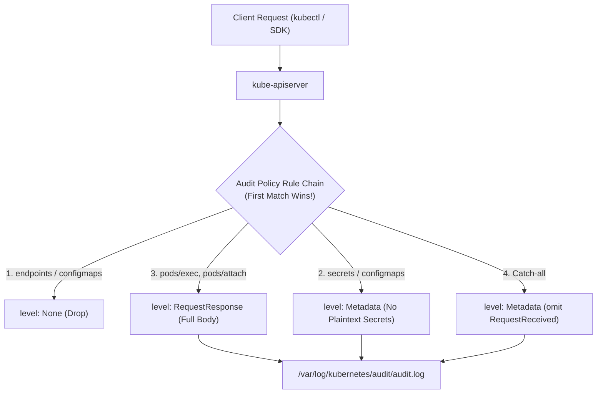
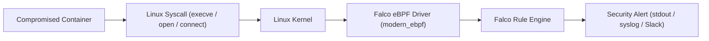

# Domain 6: Monitoring, Logging & Runtime Security — In-Depth Master Study Guide

> [!IMPORTANT]
> **Exam Weighting & Core Architecture Focus:** Domain 6 accounts for **20% of the Certified Kubernetes Security Specialist (CKS)** examination. Questions test your mastery of runtime threat detection: configuring Kubernetes API Server Audit Logging (`audit.k8s.io/v1` policies, flags, volume mounts), writing custom Falco runtime rules, troubleshooting Falco systemd services, analyzing live container drift, and executing forensic triage on compromised Pods.

---

## 1. Kubernetes API Server Audit Logging

Audit logs provide a chronological, tamper-evident security record of all HTTP requests processed by the Kubernetes API server.



### 1.1 The 4 Audit Stages & 4 Audit Levels

* **Audit Stages:**
  1. `RequestReceived`: Generated as soon as the request is received by the handler (before authentication and admission).
  2. `ResponseStarted`: Generated once response headers are sent (for streaming requests like `kubectl exec` and `watch`).
  3. `ResponseComplete`: Generated after the complete response body has been sent to the client.
  4. `Panic`: Generated if an unhandled panic occurred during request execution.

* **Audit Levels:**
  * **`None`:** Drops the event entirely; zero log entries generated.
  * **`Metadata`:** Logs request metadata only (user identity, timestamp, source IP, verb, URI, resource name, namespace) **without** the request or response bodies.
  * **`Request`:** Logs request metadata plus the complete request payload body.
  * **`RequestResponse`:** Logs request metadata, complete request body, and complete response body.

### 1.2 Production Audit Policy (`/etc/kubernetes/audit/policy.yaml`)

```yaml
apiVersion: audit.k8s.io/v1
kind: Policy
omitStages:
  - "RequestReceived"
rules:
  # Rule 1: Ignore high-volume read queries to noisy system endpoints
  - level: None
    users: ["system:kube-proxy"]
    verbs: ["watch"]
    resources:
      - group: ""
        resources: ["endpoints", "services"]

  - level: None
    verbs: ["get", "list", "watch"]
    resources:
      - group: ""
        resources: ["events", "endpoints", "configmaps"]

  # Rule 2: NEVER log secret payloads in plaintext! Enforce Metadata level only
  - level: Metadata
    resources:
      - group: ""
        resources: ["secrets"]

  # Rule 3: High-risk administrative actions logged at RequestResponse level
  - level: RequestResponse
    resources:
      - group: ""
        resources: ["pods/exec", "pods/attach", "pods/portforward"]

  # Rule 4: Catch-all rule for all other cluster requests
  - level: Metadata
```

### 1.3 Configuring `kube-apiserver` Static Pod Manifest

Edit `/etc/kubernetes/manifests/kube-apiserver.yaml`:

```yaml
spec:
  containers:
    - command:
        - kube-apiserver
        - --audit-policy-file=/etc/kubernetes/audit/policy.yaml
        - --audit-log-path=/var/log/kubernetes/audit/audit.log
        - --audit-log-maxage=30
        - --audit-log-maxbackup=10
        - --audit-log-maxsize=100
      volumeMounts:
        - name: audit-policy
          mountPath: /etc/kubernetes/audit/policy.yaml
          readOnly: true
        - name: audit-logs
          mountPath: /var/log/kubernetes/audit
          readOnly: false
  volumes:
    - name: audit-policy
      hostPath:
        path: /etc/kubernetes/audit/policy.yaml
        type: File # Must be File!
    - name: audit-logs
      hostPath:
        path: /var/log/kubernetes/audit
        type: DirectoryOrCreate
```

* **CKS Troubleshooting Alert:** If `kube-apiserver` fails to restart after modifying flags, check:
  1. Did you create `/etc/kubernetes/audit/policy.yaml` before adding the flag?
  2. Did you create the log directory `/var/log/kubernetes/audit` on the host?
  3. Check host container logs with `crictl ps -a` and `crictl logs <API_CONTAINER_ID>`.

### 1.4 Querying Audit Logs with `jq`

```bash
# Find all interactive exec commands executed into Pods
cat /var/log/kubernetes/audit/audit.log | jq -r '
  select(.verb=="create" and .objectRef.subresource=="exec") |
  "\(.requestReceivedTimestamp) | User: \(.user.username) | Pod: \(.objectRef.namespace)/\(.objectRef.name)"
'

# Find unauthorized attempts to delete cluster secrets
cat /var/log/kubernetes/audit/audit.log | jq -r '
  select(.objectRef.resource=="secrets" and .verb=="delete") |
  "\(.requestReceivedTimestamp) | User: \(.user.username) | Secret: \(.objectRef.namespace)/\(.objectRef.name) | Code: \(.responseStatus.code)"
'
```

---

## 2. Runtime Threat Detection with Sysdig Falco

Falco is an open-source runtime security tool that uses **eBPF probes** or kernel modules to intercept system calls and detect anomalous activity.



### 2.1 Anatomy of a Falco Rule

Falco rules are defined in `/etc/falco/falco_rules.local.yaml`:

```yaml
- rule: Shell Spawned Inside Production Container
  desc: Detects interactive shell execution inside any container (except debug namespaces)
  condition: >
    spawned_process and
    container and
    proc.name in (bash, sh, zsh, dash) and
    not k8s.ns.name in (kube-system, debugging)
  output: >
    CRITICAL: Shell spawned in container
    (user=%user.name user_id=%user.uid container_id=%container.id
    container_name=%k8s.pod.name ns=%k8s.ns.name cmd=%proc.cmdline)
  priority: CRITICAL
  tags: [container, shell, mitre_execution]
```

* **Key Falco Fields:**
  * `rule`: Unique, human-readable name of the security rule.
  * `condition`: Boolean expression using Falco filter syntax.
  * `output`: String format for alert messages with interpolated `%field` macros.
  * `priority`: `EMERGENCY`, `ALERT`, `CRITICAL`, `ERROR`, `WARNING`, `NOTICE`, `INFO`, `DEBUG`.

### 2.2 Top 5 High-Frequency CKS Falco Rules

* **1. Sensitive File Read (`/etc/shadow` access):**
  ```yaml
  - rule: Read Sensitive File
    condition: open_read and fd.name = "/etc/shadow" and container
    output: "Sensitive file opened for read (file=%fd.name proc=%proc.name)"
    priority: WARNING
  ```
* **2. Execution of Package Managers in Container:**
  ```yaml
  - rule: Package Management Process in Container
    condition: spawned_process and container and proc.name in (apt, apt-get, apk, yum, dnf)
    output: "Package manager executed inside container (proc=%proc.name pod=%k8s.pod.name)"
    priority: ERROR
  ```
* **3. Reading Service Account Token:**
  ```yaml
  - rule: Access Kubernetes Service Account Token
    condition: open_read and fd.name startswith "/var/run/secrets/kubernetes.io/serviceaccount/token" and not proc.name in (my-approved-app)
    output: "KSA Token Accessed (proc=%proc.name pod=%k8s.pod.name)"
    priority: NOTICE
  ```

### 2.3 Managing & Verifying Falco

```bash
# Validate Falco rules syntax before restarting service
falco --validate /etc/falco/falco_rules.local.yaml

# Restart Falco service
systemctl restart falco

# Inspect live alerts in systemd journal
journalctl -u falco -f -n 50
```

---

## 3. Container Immutability & Live Incident Forensics

When a container is suspected of compromise, SRE and security engineers must investigate without destroying forensic evidence.

### 3.1 Host-Level Container Investigation

```bash
# 1. Identify container ID and Pod name using crictl
crictl ps | grep suspicious-pod

# 2. Inspect container process PID on the host
crictl inspect <CONTAINER_ID> | jq .info.pid

# 3. Inspect running processes inside the container namespace from host
ps -ef | grep <PID>

# 4. Inspect file descriptor and executable path
ls -l /proc/<PID>/exe
cat /proc/<PID>/cmdline

# 5. Extract dropped malware executable directly from the host filesystem
cp /proc/<PID>/exe /tmp/forensic-evidence-binary
```

### 3.2 Isolating Compromised Pods

* **Do NOT immediately delete the Pod:** Deleting the Pod destroys volatile memory artifacts, uncommitted logs, and malware payloads residing in the ephemeral writable layer.
* **Isolate via NetworkPolicy:** Apply an isolation label to the Pod and deploy a NetworkPolicy with empty ingress and egress (`podSelector: {matchLabels: {quarantine: "true"}}`), severing network C2 channels while preserving the running container for memory analysis.
