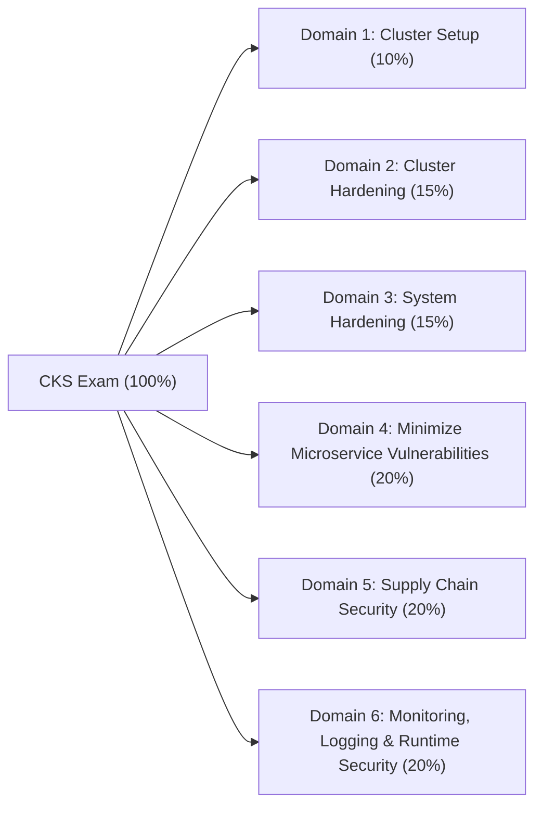

# Certified Kubernetes Security Specialist (CKS) — Complete Study & Lab Workspace

Welcome to the comprehensive study, lab, and practice exam repository for the **CNCF Certified Kubernetes Security Specialist (CKS)** certification. This workspace is aligned with the latest Linux Foundation / CNCF CKS curriculum and Kubernetes v1.30–v1.31+ security features, providing production-grade security architecture guides, hands-on labs, scenario quizzes, and full 16-task performance-based mock exams.

---

## Exam Overview & Quick Facts

| Attribute | Details |
| :--- | :--- |
| **Certification Name** | Certified Kubernetes Security Specialist (CKS) |
| **Prerequisite** | Active **Certified Kubernetes Administrator (CKA)** certification |
| **Exam Format** | Online, proctored, performance-based (100% hands-on CLI in remote clusters) |
| **Number of Tasks** | 15–20 performance-based tasks |
| **Duration** | 120 minutes (2 hours) |
| **Passing Score** | **67%** (670 / 1000) |
| **Kubernetes Version** | Kubernetes v1.31 (runs on Ubuntu 22.04 LTS nodes with `containerd`) |
| **Allowed Resources** | Official Kubernetes Documentation (`kubernetes.io/docs`, `kubernetes.io/blog`), Falco Docs (`falco.org/docs`), AppArmor Documentation, Trivy / Bom docs (1 browser tab) |

---

## CKS Curriculum Domains & Weighting



| Domain | Weight | Core Competencies | Study Materials |
| :--- | :---: | :--- | :--- |
| **Domain 1: Cluster Setup** | **10%** | Default-deny & multi-tier NetworkPolicies, DNS egress, Cloud Metadata (`169.254.169.254/32`) protection, CIS Benchmark (`kube-bench`), TLS Ingress, Platform Binary verification (`sha512sum`), Cilium L7/FQDN policies | [Study Guide](file:///home/k-henry/repos/technical/Certified_Kubernetes_Security_Specialist/Domain_1_Cluster_Setup/Study_Guide.md) \| [Exercises](file:///home/k-henry/repos/technical/Certified_Kubernetes_Security_Specialist/Domain_1_Cluster_Setup/Exercises.md) \| [Quiz 1](file:///home/k-henry/repos/technical/Certified_Kubernetes_Security_Specialist/Domain_1_Cluster_Setup/Quiz_1.md) \| [Quiz 2](file:///home/k-henry/repos/technical/Certified_Kubernetes_Security_Specialist/Domain_1_Cluster_Setup/Quiz_2.md) \| [Quiz 3](file:///home/k-henry/repos/technical/Certified_Kubernetes_Security_Specialist/Domain_1_Cluster_Setup/Quiz_3.md) |
| **Domain 2: Cluster Hardening** | **15%** | Restricting `kube-apiserver` access (`--anonymous-auth=false`, `NodeRestriction`), RBAC least privilege (removing `*` wildcards, `RoleBinding` conversion, Secret access auditing), ServiceAccount token hardening (`automountServiceAccountToken: false`, projected volumes), `kubeadm` security upgrades | [Study Guide](file:///home/k-henry/repos/technical/Certified_Kubernetes_Security_Specialist/Domain_2_Cluster_Hardening/Study_Guide.md) \| [Exercises](file:///home/k-henry/repos/technical/Certified_Kubernetes_Security_Specialist/Domain_2_Cluster_Hardening/Exercises.md) \| [Quiz 1](file:///home/k-henry/repos/technical/Certified_Kubernetes_Security_Specialist/Domain_2_Cluster_Hardening/Quiz_1.md) \| [Quiz 2](file:///home/k-henry/repos/technical/Certified_Kubernetes_Security_Specialist/Domain_2_Cluster_Hardening/Quiz_2.md) \| [Quiz 3](file:///home/k-henry/repos/technical/Certified_Kubernetes_Security_Specialist/Domain_2_Cluster_Hardening/Quiz_3.md) |
| **Domain 3: System Hardening** | **15%** | Minimizing host OS footprint, auditing open ports (`ss -tulpn`, `lsof`), stopping rogue systemd services, `ufw` host firewall, SSH & kernel `sysctl` hardening, **AppArmor** (`apparmor_parser -q`, `aa-status`), **Seccomp** (`/var/lib/kubelet/seccomp/profiles/`), Linux Capabilities (`drop: ["ALL"]`) | [Study Guide](file:///home/k-henry/repos/technical/Certified_Kubernetes_Security_Specialist/Domain_3_System_Hardening/Study_Guide.md) \| [Exercises](file:///home/k-henry/repos/technical/Certified_Kubernetes_Security_Specialist/Domain_3_System_Hardening/Exercises.md) \| [Quiz 1](file:///home/k-henry/repos/technical/Certified_Kubernetes_Security_Specialist/Domain_3_System_Hardening/Quiz_1.md) \| [Quiz 2](file:///home/k-henry/repos/technical/Certified_Kubernetes_Security_Specialist/Domain_3_System_Hardening/Quiz_2.md) \| [Quiz 3](file:///home/k-henry/repos/technical/Certified_Kubernetes_Security_Specialist/Domain_3_System_Hardening/Quiz_3.md) |
| **Domain 4: Minimize Microservice Vulnerabilities** | **20%** | **Pod Security Standards (PSS) & Pod Security Admission (PSA)** (`restricted`/`baseline`), Container `securityContext` (`readOnlyRootFilesystem`, `runAsNonRoot`), **OPA Gatekeeper** (`ConstraintTemplate` in Rego) & **Kyverno**, **RuntimeClass** (`gVisor` `runsc` / `Kata`), **etcd Encryption at Rest** (`EncryptionConfiguration`), **Istio** `PeerAuthentication` (`STRICT` mTLS) | [Study Guide](file:///home/k-henry/repos/technical/Certified_Kubernetes_Security_Specialist/Domain_4_Minimize_Microservice_Vulnerabilities/Study_Guide.md) \| [Exercises](file:///home/k-henry/repos/technical/Certified_Kubernetes_Security_Specialist/Domain_4_Minimize_Microservice_Vulnerabilities/Exercises.md) \| [Quiz 1](file:///home/k-henry/repos/technical/Certified_Kubernetes_Security_Specialist/Domain_4_Minimize_Microservice_Vulnerabilities/Quiz_1.md) \| [Quiz 2](file:///home/k-henry/repos/technical/Certified_Kubernetes_Security_Specialist/Domain_4_Minimize_Microservice_Vulnerabilities/Quiz_2.md) \| [Quiz 3](file:///home/k-henry/repos/technical/Certified_Kubernetes_Security_Specialist/Domain_4_Minimize_Microservice_Vulnerabilities/Quiz_3.md) |
| **Domain 5: Supply Chain Security** | **20%** | Multi-stage Dockerfiles (`distroless`, `USER 65532:65532`, `@sha256` digests), Static analysis (`kubesec`, `kube-linter`, `conftest`), **Trivy** CVE scanning (`trivy image --severity HIGH,CRITICAL`), **SBOM** generation (`bom`, `syft`, SPDX/CycloneDX), **Cosign** image signing, **ImagePolicyWebhook** admission controller | [Study Guide](file:///home/k-henry/repos/technical/Certified_Kubernetes_Security_Specialist/Domain_5_Supply_Chain_Security/Study_Guide.md) \| [Exercises](file:///home/k-henry/repos/technical/Certified_Kubernetes_Security_Specialist/Domain_5_Supply_Chain_Security/Exercises.md) \| [Quiz 1](file:///home/k-henry/repos/technical/Certified_Kubernetes_Security_Specialist/Domain_5_Supply_Chain_Security/Quiz_1.md) \| [Quiz 2](file:///home/k-henry/repos/technical/Certified_Kubernetes_Security_Specialist/Domain_5_Supply_Chain_Security/Quiz_2.md) \| [Quiz 3](file:///home/k-henry/repos/technical/Certified_Kubernetes_Security_Specialist/Domain_5_Supply_Chain_Security/Quiz_3.md) |
| **Domain 6: Monitoring, Logging & Runtime Security** | **20%** | **Kubernetes API Audit Logging** (`audit.k8s.io/v1` Policy, stages, levels, `kube-apiserver` volume mounts), **Falco** runtime rules (`/etc/falco/falco_rules.local.yaml`), **Tetragon** eBPF `TracingPolicy` (`Sigkill`), Immutable containers at runtime, Live container forensics (`crictl inspect`, `/proc/<pid>/root`) | [Study Guide](file:///home/k-henry/repos/technical/Certified_Kubernetes_Security_Specialist/Domain_6_Monitoring_Logging_Runtime_Security/Study_Guide.md) \| [Exercises](file:///home/k-henry/repos/technical/Certified_Kubernetes_Security_Specialist/Domain_6_Monitoring_Logging_Runtime_Security/Exercises.md) \| [Quiz 1](file:///home/k-henry/repos/technical/Certified_Kubernetes_Security_Specialist/Domain_6_Monitoring_Logging_Runtime_Security/Quiz_1.md) \| [Quiz 2](file:///home/k-henry/repos/technical/Certified_Kubernetes_Security_Specialist/Domain_6_Monitoring_Logging_Runtime_Security/Quiz_2.md) \| [Quiz 3](file:///home/k-henry/repos/technical/Certified_Kubernetes_Security_Specialist/Domain_6_Monitoring_Logging_Runtime_Security/Quiz_3.md) |

---

## Rapid Reference & Full-Length Mock Exams

* **[CKS Master Cheat Sheet](file:///home/k-henry/repos/technical/Certified_Kubernetes_Security_Specialist/CKS_Master_Cheat_Sheet.md)**: Copy-paste ready YAML templates, `kube-apiserver` static pod flags, host hardening commands, AppArmor/Seccomp profiles, `EncryptionConfiguration`, `AuditPolicy`, `ImagePolicyWebhook`, Falco syntax, and `trivy`/`bom` CLI invocations.
* **[Practice Exams Hub](file:///home/k-henry/repos/technical/Certified_Kubernetes_Security_Specialist/Practice_Exams/README.md)**:
  * **[Practice Exam 1](file:///home/k-henry/repos/technical/Certified_Kubernetes_Security_Specialist/Practice_Exams/Practice_Exam_1.md)** — 16 performance-based tasks (120 mins) covering core CKS scenarios across all 6 domains.
  * **[Practice Exam 2](file:///home/k-henry/repos/technical/Certified_Kubernetes_Security_Specialist/Practice_Exams/Practice_Exam_2.md)** — 16 performance-based tasks (120 mins) featuring Cilium L7 policies, Gatekeeper Rego, Istio mTLS, SBOMs, and Tetragon enforcement.
  * **[Practice Exam 3](file:///home/k-henry/repos/technical/Certified_Kubernetes_Security_Specialist/Practice_Exams/Practice_Exam_3.md)** — 16 performance-based tasks (120 mins) featuring advanced broken control-plane recovery, secret key rotation, and incident forensics.

---

## Recommended 4-Week Study Plan & Progress Tracker

### Week 1: Network & Cluster Foundations (Domains 1 & 2 — 25%)
- [ ] Read [Domain 1 Study Guide](file:///home/k-henry/repos/technical/Certified_Kubernetes_Security_Specialist/Domain_1_Cluster_Setup/Study_Guide.md)
- [ ] Complete all 6 labs in [Domain 1 Exercises](file:///home/k-henry/repos/technical/Certified_Kubernetes_Security_Specialist/Domain_1_Cluster_Setup/Exercises.md)
- [ ] Score 85%+ on [Domain 1 Quiz 1](file:///home/k-henry/repos/technical/Certified_Kubernetes_Security_Specialist/Domain_1_Cluster_Setup/Quiz_1.md), [Quiz 2](file:///home/k-henry/repos/technical/Certified_Kubernetes_Security_Specialist/Domain_1_Cluster_Setup/Quiz_2.md), and [Quiz 3](file:///home/k-henry/repos/technical/Certified_Kubernetes_Security_Specialist/Domain_1_Cluster_Setup/Quiz_3.md)
- [ ] Read [Domain 2 Study Guide](file:///home/k-henry/repos/technical/Certified_Kubernetes_Security_Specialist/Domain_2_Cluster_Hardening/Study_Guide.md)
- [ ] Complete all 6 labs in [Domain 2 Exercises](file:///home/k-henry/repos/technical/Certified_Kubernetes_Security_Specialist/Domain_2_Cluster_Hardening/Exercises.md)
- [ ] Score 85%+ on [Domain 2 Quiz 1](file:///home/k-henry/repos/technical/Certified_Kubernetes_Security_Specialist/Domain_2_Cluster_Hardening/Quiz_1.md), [Quiz 2](file:///home/k-henry/repos/technical/Certified_Kubernetes_Security_Specialist/Domain_2_Cluster_Hardening/Quiz_2.md), and [Quiz 3](file:///home/k-henry/repos/technical/Certified_Kubernetes_Security_Specialist/Domain_2_Cluster_Hardening/Quiz_3.md)

### Week 2: Host Kernel & Microservice Isolation (Domains 3 & 4 — 35%)
- [ ] Read [Domain 3 Study Guide](file:///home/k-henry/repos/technical/Certified_Kubernetes_Security_Specialist/Domain_3_System_Hardening/Study_Guide.md)
- [ ] Complete all 6 labs in [Domain 3 Exercises](file:///home/k-henry/repos/technical/Certified_Kubernetes_Security_Specialist/Domain_3_System_Hardening/Exercises.md)
- [ ] Score 85%+ on [Domain 3 Quiz 1](file:///home/k-henry/repos/technical/Certified_Kubernetes_Security_Specialist/Domain_3_System_Hardening/Quiz_1.md), [Quiz 2](file:///home/k-henry/repos/technical/Certified_Kubernetes_Security_Specialist/Domain_3_System_Hardening/Quiz_2.md), and [Quiz 3](file:///home/k-henry/repos/technical/Certified_Kubernetes_Security_Specialist/Domain_3_System_Hardening/Quiz_3.md)
- [ ] Read [Domain 4 Study Guide](file:///home/k-henry/repos/technical/Certified_Kubernetes_Security_Specialist/Domain_4_Minimize_Microservice_Vulnerabilities/Study_Guide.md)
- [ ] Complete all 6 labs in [Domain 4 Exercises](file:///home/k-henry/repos/technical/Certified_Kubernetes_Security_Specialist/Domain_4_Minimize_Microservice_Vulnerabilities/Exercises.md)
- [ ] Score 85%+ on [Domain 4 Quiz 1](file:///home/k-henry/repos/technical/Certified_Kubernetes_Security_Specialist/Domain_4_Minimize_Microservice_Vulnerabilities/Quiz_1.md), [Quiz 2](file:///home/k-henry/repos/technical/Certified_Kubernetes_Security_Specialist/Domain_4_Minimize_Microservice_Vulnerabilities/Quiz_2.md), and [Quiz 3](file:///home/k-henry/repos/technical/Certified_Kubernetes_Security_Specialist/Domain_4_Minimize_Microservice_Vulnerabilities/Quiz_3.md)

### Week 3: Supply Chain & Runtime Security (Domains 5 & 6 — 40%)
- [ ] Read [Domain 5 Study Guide](file:///home/k-henry/repos/technical/Certified_Kubernetes_Security_Specialist/Domain_5_Supply_Chain_Security/Study_Guide.md)
- [ ] Complete all 6 labs in [Domain 5 Exercises](file:///home/k-henry/repos/technical/Certified_Kubernetes_Security_Specialist/Domain_5_Supply_Chain_Security/Exercises.md)
- [ ] Score 85%+ on [Domain 5 Quiz 1](file:///home/k-henry/repos/technical/Certified_Kubernetes_Security_Specialist/Domain_5_Supply_Chain_Security/Quiz_1.md), [Quiz 2](file:///home/k-henry/repos/technical/Certified_Kubernetes_Security_Specialist/Domain_5_Supply_Chain_Security/Quiz_2.md), and [Quiz 3](file:///home/k-henry/repos/technical/Certified_Kubernetes_Security_Specialist/Domain_5_Supply_Chain_Security/Quiz_3.md)
- [ ] Read [Domain 6 Study Guide](file:///home/k-henry/repos/technical/Certified_Kubernetes_Security_Specialist/Domain_6_Monitoring_Logging_Runtime_Security/Study_Guide.md)
- [ ] Complete all 6 labs in [Domain 6 Exercises](file:///home/k-henry/repos/technical/Certified_Kubernetes_Security_Specialist/Domain_6_Monitoring_Logging_Runtime_Security/Exercises.md)
- [ ] Score 85%+ on [Domain 6 Quiz 1](file:///home/k-henry/repos/technical/Certified_Kubernetes_Security_Specialist/Domain_6_Monitoring_Logging_Runtime_Security/Quiz_1.md), [Quiz 2](file:///home/k-henry/repos/technical/Certified_Kubernetes_Security_Specialist/Domain_6_Monitoring_Logging_Runtime_Security/Quiz_2.md), and [Quiz 3](file:///home/k-henry/repos/technical/Certified_Kubernetes_Security_Specialist/Domain_6_Monitoring_Logging_Runtime_Security/Quiz_3.md)

### Week 4: Timed Exam Simulation & Speed Drills
- [ ] Drill all templates in [CKS Master Cheat Sheet](file:///home/k-henry/repos/technical/Certified_Kubernetes_Security_Specialist/CKS_Master_Cheat_Sheet.md)
- [ ] Complete [Practice Exam 1](file:///home/k-henry/repos/technical/Certified_Kubernetes_Security_Specialist/Practice_Exams/Practice_Exam_1.md) under strict 120-minute timer (Target: ≥ 75%)
- [ ] Complete [Practice Exam 2](file:///home/k-henry/repos/technical/Certified_Kubernetes_Security_Specialist/Practice_Exams/Practice_Exam_2.md) under strict 120-minute timer (Target: ≥ 80%)
- [ ] Complete [Practice Exam 3](file:///home/k-henry/repos/technical/Certified_Kubernetes_Security_Specialist/Practice_Exams/Practice_Exam_3.md) under strict 120-minute timer (Target: ≥ 85%)

---

## Essential Exam-Day Survival Rules

> [!IMPORTANT]
> **Always Backup `/etc/kubernetes/manifests/*.yaml` Before Editing!**
> Nearly 40% of CKS tasks require editing `/etc/kubernetes/manifests/kube-apiserver.yaml` (Audit Logging, EncryptionConfiguration, ImagePolicyWebhook, CIS Remediation, NodeRestriction). A single YAML indentation error or missing `volumeMount` will crash the API server. Always run:
> ```bash
> cp /etc/kubernetes/manifests/kube-apiserver.yaml /root/kube-apiserver.yaml.bak
> ```
> Never put your backup file inside `/etc/kubernetes/manifests/`—the `kubelet` watches every file in that directory and will try to launch a duplicate static pod!

> [!TIP]
> **Debug Broken Control Plane Static Pods with `crictl` and `/var/log/pods`**
> When `kube-apiserver` fails to start, `kubectl` will refuse connections (`The connection to the server ...:6443 was refused`). Do not panic! Check container logs directly using `crictl`:
> ```bash
> crictl ps -a | grep kube-apiserver
> crictl logs <container-id>
> # Or inspect pod logs directly on disk:
> tail -n 50 /var/log/pods/kube-system_kube-apiserver-*/kube-apiserver/*.log
> ```
