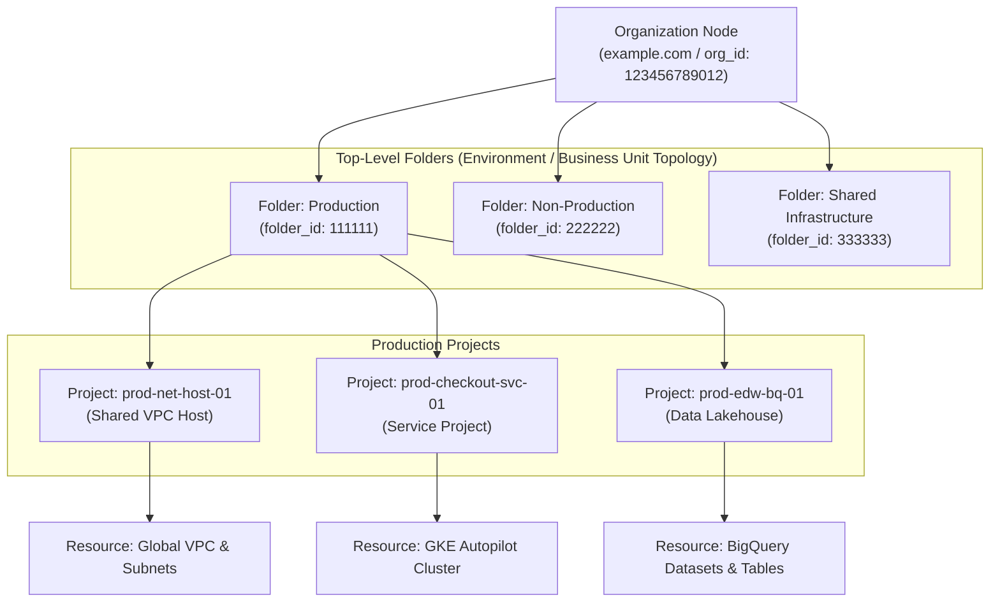
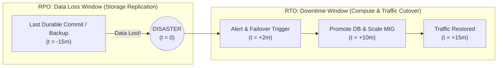
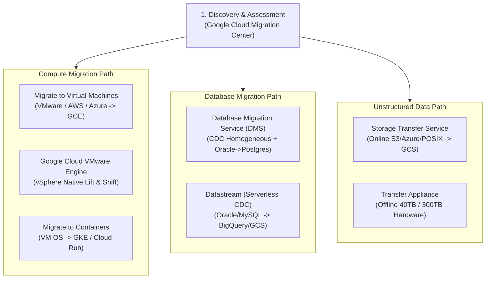

# Domain 1: Designing and Planning a Cloud Solution Architecture — Master-Level Study Guide (PCA)

> **Exam Weighting:** ~24% of the Google Cloud Certified: Professional Cloud Architect (PCA) Exam  
> **Core Focus:** Translating business, regulatory, and technical requirements into fault-tolerant, scalable, and cost-optimized cloud architectures across Google Cloud resource hierarchies, compute/storage services, FinOps models, and enterprise migration pathways.

---

## 1. Google Cloud Resource Hierarchy & Enterprise Governance

### 1.1 The Four-Tier Resource Hierarchy Internals
Google Cloud organizes all resources into a strict four-tier hierarchical tree that governs identity access management (IAM), Organization Policies, billing aggregation, and administrative boundaries:



* **Organization Node (Root)**
  * **Architecture & Scope:** Top-level root node of the Google Cloud hierarchy, mapped 1:1 to a verified domain in Google Workspace or Cloud Identity. Created automatically when a user from that domain initializes a project or enables the Organization resource.
  * **Critical Roles:**
    * `roles/resourcemanager.organizationAdmin`: Grants full control over IAM policies across the Organization and all descendant folders/projects. Does **not** automatically grant permission to create folders (`roles/resourcemanager.folderCreator`) or create projects (`roles/resourcemanager.projectCreator`), though an Organization Admin can grant those roles to themselves.
    * `roles/orgpolicy.policyAdmin`: Exclusively controls Organization Policy constraints (`constraints/*`). Separated from `organizationAdmin` to enforce separation of duties between identity administrators and compliance/governance teams.
  * **Exam Trap:** If a company acquires a subsidiary that already has its own Google Cloud Organization node, you cannot nest one Organization node inside another. You must either manage them as multi-org federated environments or migrate projects across Organizations using the Cross-Organization Project Migration process (`constraints/resourcemanager.allowedExportDestinations` and `constraints/resourcemanager.allowedImportSources`).

* **Folders**
  * **Architecture & Scope:** Intermediate grouping mechanism between the Organization and Projects. Supports nesting up to **10 levels deep** (with up to 300 folders under a single parent).
  * **Primary PCA Exam Use Case:** Isolating administrative domains and applying differentiated Organization Policies (e.g., applying strict `constraints/gcp.resourceLocations` to an `EU-Regulated` folder while leaving a `Global-Sandbox` folder unrestricted).
  * **Topology Patterns:**
    * **Environment-First (`Prod` -> `BusinessUnit` -> `Project`):** Recommended when security and compliance policies differ primarily between Production and Non-Production (e.g., Shared VPC separation between `prod` and `dev`).
    * **Business-Unit-First (`Retail` -> `Prod` -> `Project`):** Recommended for decentralized conglomerates or holding companies where each subsidiary owns its own P&L, IT governance, and security operations.
    * **Hybrid Matrix (`Shared-Services`, `Departments/BU-A/Prod`, `Sandbox`):** Standard enterprise landing zone pattern combining centralized networking/logging (`Shared-Services`) with departmental autonomy.

* **Projects**
  * **Architecture & Scope:** The fundamental trust, quota, API enablement, and billing boundary in Google Cloud. Every resource belongs to exactly one Project.
  * **Project Identifiers (Exam Classic):**
    * **Project Name:** Human-readable label (e.g., `Prod Checkout API`). Mutable at any time; not globally unique; never used in cryptographic or API resource URIs.
    * **Project ID:** Globally unique string chosen at creation (e.g., `cymbal-prod-checkout-8912`). **Immutable** after creation. Used in CLI commands, DNS names, and service account emails (`sa-name@project-id.iam.gserviceaccount.com`).
    * **Project Number:** Automatically generated 64-bit unique integer (e.g., `415104041262`). **Immutable**. Used internally by Google-managed Service Agents (e.g., `service-415104041262@compute-system.iam.gserviceaccount.com`).
  * **Exam Trap:** Never place both Production and Development workloads inside the same Project. Because IAM roles granted at the Project level apply to all resources in that project—and API quotas/rate limits are shared per project—a runaway load test in Development can exhaust project-wide BigQuery or Compute Engine API quotas and take down Production.

* **Resources**
  * **Architecture & Scope:** Leaf nodes such as Compute Engine VMs, GKE Clusters, Cloud Storage Buckets, BigQuery Datasets, and Pub/Sub Topics. Some resources (like BigQuery Datasets or Secret Manager Secrets) support fine-grained resource-level and sub-resource-level (Table/Row/Column) IAM bindings.

> [!IMPORTANT]
> **Billing Account Decoupling:** A Cloud Billing Account is **not** part of the Resource Hierarchy tree. A single Billing Account can pay for projects across multiple Folders or even multiple Organizations, and a project can be linked to different Billing Accounts over its lifecycle (`roles/billing.projectManager` on the project + `roles/billing.user` on the Billing Account).

---

### 1.2 Organization Policy Service (Constraints & Custom Constraints)
While IAM answers *"Who can take what action?"*, the **Organization Policy Service** answers *"What resource configurations are permitted to exist, regardless of who has IAM permissions?"*

* **List Constraints vs. Boolean Constraints**
  * **Boolean Constraints:** Enforce a binary `true`/`false` toggle.
    * `constraints/compute.disableSerialPortAccess`: Blocks interactive serial console access to VMs.
    * `constraints/iam.disableServiceAccountKeyCreation`: Blocks creation of external user-managed Service Account JSON keys (`gcloud iam service-accounts keys create`).
    * `constraints/storage.uniformBucketLevelAccess`: Mandates Uniform Bucket-Level Access (IAM-only) and disables legacy fine-grained Object ACLs on new Cloud Storage buckets.
  * **List Constraints:** Permit or deny a specific list of string values or resource hierarchies (`allow:` or `deny:`).
    * `constraints/gcp.resourceLocations`: Restricts the physical regions/multi-regions where resources can be provisioned (e.g., `in:eu-locations` for GDPR data residency).
    * `constraints/compute.vmExternalIpAccess`: Restricts which specific VM instances (by instance URI) are permitted to have public external IP addresses.
    * `constraints/compute.restrictSharedVpcSubnetworks`: Restricts which specific host project subnets a service project can attach workloads to.
    * `constraints/iam.allowedPolicyMemberDomains`: Restricts IAM role bindings exclusively to users belonging to specific Google Workspace / Cloud Identity customer IDs (prevents accidental sharing with `@gmail.com` accounts).

* **Hierarchy Evaluation & Inheritance Mechanics**
  * By default, Organization Policies inherit downward (`inheritFromParent: true`). For List constraints, if a parent Folder allows `["in:us-locations", "in:eu-locations"]` and a child Folder sets `inheritFromParent: false` (replace behavior) with `["us-central1"]`, only `us-central1` is permitted.
  * If a parent policy sets `inheritFromParent: true` on child nodes, list rules are merged (explicit `deniedValues` always win over `allowedValues`).
  * **Dry-Run Mode Organization Policies:** Architects can deploy an Organization Policy in **Dry-Run Mode** (`dryRunSpec`). Violations are audited in Cloud Audit Logs without blocking existing workloads or production CI/CD deployments, enabling zero-downtime compliance impact analysis before enforcing live constraints.

#### Production YAML & `gcloud` Example: Enforcing Data Residency & Blocking SA Keys
```yaml
# org-policy-eu-residency.yaml
name: folders/111111/policies/gcp.resourceLocations
spec:
  inheritFromParent: false
  rules:
    - values:
        allowedValues:
          - in:eu-locations
```

```bash
# Apply the EU Data Residency constraint to the Production EU Folder
gcloud org-policies set-policy org-policy-eu-residency.yaml

# Enforce Boolean constraint blocking Service Account Key creation across the Organization
gcloud resource-manager org-policies enable-enforce \
  constraints/iam.disableServiceAccountKeyCreation \
  --organization=123456789012

# Temporarily exempt a legacy migration project from SA key restriction (Override at Project level)
gcloud resource-manager org-policies disable-enforce \
  constraints/iam.disableServiceAccountKeyCreation \
  --project=legacy-sap-migration-01
```

> [!WARNING]
> **Retroactive Enforcement Trap:** Enabling most Organization Policies (such as `constraints/gcp.resourceLocations` or `constraints/iam.disableServiceAccountKeyCreation`) is **non-retroactive**. Existing VMs in `us-central1` or existing Service Account JSON keys continue to function! To remediate existing non-compliant resources, combine Organization Policies with **Security Command Center (Security Health Analytics)** or **Cloud Asset Inventory Feeds** triggers.

---

## 2. Cloud Architecture Framework Pillars & Design Trade-Offs

The Google Cloud Architecture Framework consists of six foundational pillars:
1. **Operational Excellence:** Automation (IaC via Terraform/Config Connector), CI/CD deployment velocity, observability (Cloud Monitoring, Logging, Trace), and blameless postmortems.
2. **Security, Privacy, and Compliance:** Zero-trust architecture (BeyondCorp/IAP), least-privilege IAM, defense-in-depth (VPC-SC, Cloud Armor), and encryption management (CMEK/EKM).
3. **Reliability:** Fault isolation across zones/regions, autoscaling, graceful degradation, chaos engineering, and quantifiable SLO/SLI/Error Budget governance.
4. **Cost Optimization (FinOps):** Right-sizing, CUDs/SUDs, Spot VMs, BigQuery slot autoscaling, and Cloud Storage lifecycle policies.
5. **Performance Optimization:** Machine family selection (C3/M3/A3), storage IOPS tiering (Hyperdisk Extreme vs PD-Balanced), caching (Memorystore/Cloud CDN), and database indexing/partitioning.
6. **Sustainability:** Selecting low-carbon regions (`Carbon Free Energy [CFE%]` metrics), minimizing idle compute via serverless/autoscaling, and batch job scheduling in green regions.

---

## 3. Reliability Mathematics: Availability, RTO/RPO, & CAP Theorem

### 3.1 Composite SLA Mathematics (Serial vs. Parallel Topologies)
When designing cloud architectures, total system availability is calculated from component SLAs:

* **Serial Dependency (All components must be up for the system to function):**
  $$A_{\text{total}} = A_1 \times A_2 \times \dots \times A_n$$
  * *Example:* An application running on a single Compute Engine VM ($99.9\%$ SLA) connected to a Zonal Cloud SQL instance ($99.5\%$ SLA):
    $$A_{\text{total}} = 0.999 \times 0.995 = 0.994005 \approx 99.4\% \text{ availability}$$

* **Parallel Redundancy (Active-Active across $N$ independent zones/regions where 1 surviving node suffices):**
  $$A_{\text{total}} = 1 - \prod_{i=1}^{N} (1 - A_i)$$
  * *Example:* Stateless workload deployed across two completely independent regions, each with $99.9\%$ regional availability:
    $$A_{\text{total}} = 1 - (1 - 0.999) \times (1 - 0.999) = 1 - (0.001)^2 = 1 - 0.000001 = 99.9999\% \text{ (Six 9s)}$$

* **Standard SLA Downtime Allowances Reference**
  * **$99.0\%$ (Two 9s):** $3.65\text{ days/year}$ ($7.30\text{ hours/month}$) — Single-instance VM with Standard Persistent Disk.
  * **$99.9\%$ (Three 9s):** $8.76\text{ hours/year}$ ($43.8\text{ minutes/month}$) — Single-instance VM with Balanced/SSD Persistent Disk (live migration enabled).
  * **$99.95\%$ (Three-and-a-half 9s):** $4.38\text{ hours/year}$ ($21.9\text{ minutes/month}$) — Regional Managed Instance Group (MIG) or Cloud SQL High Availability (Regional).
  * **$99.99\%$ (Four 9s):** $52.56\text{ minutes/year}$ ($4.38\text{ minutes/month}$) — Cloud Spanner Regional, Bigtable Multi-Cluster, HA VPN, or Multi-Region Cloud Storage.
  * **$99.999\%$ (Five 9s):** $5.26\text{ minutes/year}$ ($26.3\text{ seconds/month}$) — Cloud Spanner Multi-Region (`nam-eur-asia1`, `nam6`) or Firestore Multi-Region (`nam5`, `eur3`).

---

### 3.2 RTO & RPO Disaster Recovery Matrix
* **Recovery Point Objective (RPO):** Maximum acceptable duration of **data loss** measured backward in time from the disaster event ($t_{\text{disaster}} - t_{\text{last\_durable\_commit}}$). Driven purely by **data replication mechanics** (synchronous vs. asynchronous vs. periodic backup).
* **Recovery Time Objective (RTO):** Maximum acceptable duration of **service downtime** after a disaster occurs ($t_{\text{service\_restored}} - t_{\text{disaster}}$). Driven by **compute readiness, orchestration speed, and DNS/Load Balancer failover**.



* **Cold Standby (Backup & Restore)**
  * **RPO / RTO Profile:** RPO = Hours ($1\text{--}24\text{ hr}$); RTO = Hours ($2\text{--}24\text{ hr}$).
  * **GCP Architecture:** Scheduled Persistent Disk snapshots and database exports uploaded to Multi-Region Cloud Storage. No compute running in the DR region. Upon disaster, Cloud Build / Terraform provisions VPC/MIGs/Cloud SQL from scratch and restores snapshots.
  * **Primary PCA Exam Use Case:** Non-critical internal applications, archival systems, or strict minimum-budget DR requirements.

* **Warm Standby (Pilot Light)**
  * **RPO / RTO Profile:** RPO = Seconds to Minutes (Asynchronous replication); RTO = $5\text{--}30\text{ minutes}$.
  * **GCP Architecture:** Cross-region Cloud SQL Read Replica (or AlloyDB secondary cluster) continuously receiving asynchronous WAL replication in the DR region. Compute Engine Regional MIG runs at `min-replicas = 1` (or GKE Autopilot with minimal baseline pods). Upon disaster, promote the cross-region Read Replica to standalone primary, scale up the MIG, and update Cloud DNS or backend traffic weight.
  * **Primary PCA Exam Use Case:** Mission-critical enterprise applications requiring $<15\text{ minute}$ recovery without paying 2x compute costs 24/7.

* **Hot Standby (Active-Passive Multi-Region)**
  * **RPO / RTO Profile:** RPO = Near Zero ($<1\text{s}$ or $0$); RTO = Seconds to $<2\text{ minutes}$.
  * **GCP Architecture:** Full-scale production compute running in both Primary (`us-central1`) and Secondary (`us-east1`) regions. Global External Application Load Balancer routes $100\%$ of traffic to Primary while health-checking Secondary; failover occurs automatically when Primary health checks fail.

* **Multi-Region Active-Active (Zero RPO / Zero RTO)**
  * **RPO / RTO Profile:** RPO = $0$ (Zero data loss); RTO = $0$ (Instant transparent failover).
  * **GCP Architecture:** Global External Application Load Balancer (Anycast IP) routing users to the nearest healthy region (`us-central1` and `us-east1` both serving live read/write traffic simultaneously). Backed by **Cloud Spanner Multi-Region** or **Firestore Multi-Region** for strongly consistent global writes, or **Cloud Bigtable Multi-Cluster** for eventually consistent high-throughput writes.

---

### 3.3 CAP Theorem on Google Cloud & How TrueTime Defies Traditional Trade-offs
In distributed database theory, the **CAP Theorem** states that during a network partition ($P$), a distributed data store must choose between **Consistency ($C$)** (every read receives the most recent write or an error) and **Availability ($A$)** (every request receives a non-error response, without the guarantee that it contains the most recent write).

* **Cloud Spanner (External Consistency / CP that behaves like CA in practice)**
  * **Underlying Mechanism:** Uses **TrueTime**, a hardware-assisted synchronized clock API installed in every Google data center utilizing GPS receivers and atomic (rubidium) clocks. TrueTime bounds clock drift uncertainty ($\epsilon$) across all global machines to $1\text{--}7\text{ ms}$.
  * **Commit Wait:** When a transaction commits at timestamp $t$, Spanner waits $2\epsilon$ milliseconds before making the commit visible, guaranteeing that if Transaction $T_2$ starts after Transaction $T_1$ commits in real wall-clock time, $T_2$'s TrueTime timestamp is strictly greater than $T_1$'s ($t_2 > t_1$).
  * **Consensus:** Uses **Paxos** groups across zones/regions. Writes require a synchronous quorum of voting replicas (e.g., 2 of 3 in a regional config, or 3 of 5 voting replicas across 2 read-write regions + 1 witness region in a multi-region config). Lock-free read-only transactions can execute at any replica caught up to the requested TrueTime timestamp without locking!

* **Cloud Bigtable (CP within Single Cluster / AP across Replicated Clusters)**
  * **Underlying Mechanism:** Within a single cluster (single zone), all reads and writes go through a single tablet server node holding metadata pointers to Colossus (Google's distributed filesystem), providing **strong consistency** for single-row transactions.
  * **Multi-Cluster Replication:** Across multiple clusters (zones or regions), replication is **asynchronous (eventual consistency)** using Last-Writer-Wins (LWW) cell timestamps. If you need read-your-writes strong consistency on a multi-cluster Bigtable instance, you must configure the Bigtable **Application Profile** to use **Single-Cluster Routing** (sending all traffic to one primary cluster, with manual or automated failover only during outages) rather than Multi-Cluster Routing.

* **Cloud SQL & AlloyDB (CP within Region via Synchronous HA / Asynchronous Cross-Region)**
  * **Cloud SQL HA:** Uses **Regional Persistent Disk**, which synchronously replicates blocks across two zones in the same region (`RPO = 0` for intra-region zone failure). Cross-region Read Replicas use asynchronous storage/binlog replication (`RPO > 0`).
  * **AlloyDB HA:** Separates compute from a distributed, log-structured regional storage layer covering multiple zones automatically. Failover to a secondary zone takes $<60\text{ seconds}$ with zero data loss (`RPO = 0`), while cross-region secondary clusters replicate asynchronously.

---

## 4. FinOps: Pricing Models, CUDs vs. SUDs, & BigQuery Editions

### 4.1 Compute Engine Discount Mechanisms
* **Sustained Use Discounts (SUDs)**
  * **Architecture & Scope:** Automatic, zero-commitment discounts applied by Google Cloud when eligible machine types (`N1`, `N2`, `N2D`, `M1`, `M2`) run for more than $25\%$ of a billing month within a region.
  * **Savings:** Up to $20\%$ for `N2`/`N2D`/`M1`/`M2` and up to $30\%$ for `N1`.
  * **Exam Trap:** SUDs do **NOT** apply to `E2`, `C3`, `C3D`, `M3`, `A2`, `A3`, `G2`, or `Tau T2D`/`T2A` machine families! If an exam scenario uses `E2` or `C3` VMs running $24\times7$ and asks how to reduce costs without changing architecture, you must purchase **Committed Use Discounts (CUDs)** because SUDs provide $0\%$ discount on those families.

* **Resource-Based Committed Use Discounts (CUDs)**
  * **Architecture & Scope:** 1-year or 3-year contract committing to a specific quantity of **vCPUs, Memory (GB), Local SSDs, or GPUs** within a **specific region** and **specific machine series** (e.g., `100 N2 vCPUs` and `400 GB N2 RAM` in `us-central1`).
  * **Savings:** Up to $37\%$ (1-year) or $55\%$ (3-year) off on-demand rates; up to $70\%$ for memory-optimized (`M1`/`M2`/`M3`) 3-year commitments.
  * **Sharing Across Projects:** By default, CUDs apply only to the project where purchased unless **CUD Discount Sharing** is enabled on the Cloud Billing Account, which pools commitments across all projects linked to that Billing Account (using proportional or prioritized attribution).

* **Compute Flexible Committed Use Discounts (Spend-Based Compute CUDs)**
  * **Architecture & Scope:** 1-year ($28\%$ discount) or 3-year ($46\%$ discount) commitment to a minimum **hourly dollar spend (\$/hour)** on eligible Compute Engine resources.
  * **Flexibility Advantage:** Applies across **any region**, **any machine series** (`E2`, `N2`, `C3`, etc.), and even **Cloud Run** and **GKE Autopilot** compute usage!
  * **Primary PCA Exam Use Case:** Organizations undergoing active modernization (e.g., migrating from `N2` VMs in `us-east1` to `C3` VMs in `us-central1` or refactoring into GKE Autopilot/Cloud Run) that cannot lock into a single region or machine family.

* **Spot VMs (Formerly Preemptible VMs)**
  * **Architecture & Scope:** Spare Compute Engine capacity offered at **$60\%\text{--}91\%$ discount**. Unlike legacy Preemptible VMs (which had a hard 24-hour maximum runtime limit), **Spot VMs have no maximum runtime limit**—they run until capacity is reclaimed by Google Cloud or stopped by the user.
  * **Preemption Mechanics:** When Compute Engine reclaims capacity, it sends an ACPI G2 Soft Off signal (`SIGTERM`) and triggers a **30-second preemption window**. You can configure a `shutdown-script` metadata entry to flush checkpoints to Cloud Storage or drain container connections before `SIGKILL` terminates the VM.

---

### 4.2 BigQuery Pricing Architecture: On-Demand vs. Editions (Slot Reservations)
BigQuery decouples storage ($0.02\text{/GB/month}$ active logical storage; $0.01\text{/GB/month}$ long-term storage untouched for 90 consecutive days; or compressed physical storage billing) from compute (SQL query execution).

* **On-Demand Compute Pricing**
  * **Billing Unit:** Charged strictly per Terabyte (TB) of data scanned ($6.25\text{/TB}$, with the first $1\text{ TB/month}$ free). Up to 2,000 shared burst slots per project.
  * **Primary PCA Exam Use Case:** Spiky, unpredictable, or exploratory workloads with low average monthly query volume.
  * **Exam Trap:** Running `SELECT *` or failing to filter on a partitioned column scans the entire table. Putting `LIMIT 10` at the end of a BigQuery query **DOES NOT reduce the bytes scanned or cost** (unless the table is clustered and the query uses filter predicates that allow block pruning). Use `--maximum_bytes_billed` to prevent runaway query costs.

* **BigQuery Editions (Capacity / Slot-Based Pricing)**
  * **Standard Edition:** Pay-as-you-go slot autoscaling (scales in increments of 50 slots, billed per second with a 1-minute minimum, capped at 1,600 slots). Lacks 99.99% SLA, CMEK, and workload management reservations.
  * **Enterprise Edition:** Supports **Baseline Slots** + **Autoscaling Slots** + optional **1-year or 3-year Slot Commitments**. Includes `99.99%` SLA, CMEK, Column-level/Row-level security, and cross-user slot sharing across an Organization via Reservations (`QUERY`, `PIPELINE`, `ML_EXTERNAL`).
  * **Enterprise Plus Edition:** Adds Customer-Managed Encryption Keys with Cloud EKM, Assured Workloads (FedRAMP High / IL4), and **Managed Disaster Recovery** (cross-region failover of both compute slots and storage).

```sql
-- Create a BigQuery Enterprise Reservation with 200 Baseline Slots and 800 Max Autoscaling Slots
CREATE RESERVATION `admin-billing-proj.region-us.prod_analytics_res`
OPTIONS (
  slot_capacity = 200,
  autoscale_max_slots = 600, -- Total max slots = 200 baseline + 600 autoscale = 800
  edition = 'ENTERPRISE',
  ignore_idle_slots = false  -- False allows borrowing idle slots from other reservations in the admin project!
);

-- Assign the production EDW project to use this reservation for interactive queries
CREATE ASSIGNMENT `admin-billing-proj.region-us.prod_analytics_res.prod_edw_assign`
OPTIONS (
  assignee = 'projects/prod-edw-bq-01',
  job_type = 'QUERY'
);
```

---

## 5. Enterprise Cloud Migration Framework (The 6 Rs & Migration Tooling)

### 5.1 Migration Strategy Decision Matrix (The 6 Rs)
* **Rehost (Lift and Shift)**
  * **Definition:** Moving workloads from on-premises VMware/Hyper-V or AWS/Azure to Google Cloud VMs with zero code or architectural modifications.
  * **Target GCP Services:** Compute Engine VMs or **Google Cloud VMware Engine (GCVE)**.
  * **Primary PCA Exam Use Case:** Urgent data center lease expiration, COTS (Commercial Off-The-Shelf) software without source code, or risk-averse phase-1 migrations.
* **Replatform (Lift and Optimize)**
  * **Definition:** Making targeted infrastructure modernization changes during migration without rewriting core business logic.
  * **Target GCP Services:** Migrating self-managed PostgreSQL on EC2 to **Cloud SQL / AlloyDB** via Database Migration Service (DMS); containerizing Linux VMs into GKE/Cloud Run using **Migrate to Containers**.
* **Refactor / Re-architect (Cloud-Native Transformation)**
  * **Definition:** Decomposing monolithic applications into event-driven microservices, serverless functions, and globally distributed managed databases.
  * **Target GCP Services:** Cloud Run, GKE Autopilot, Cloud Spanner, Pub/Sub, Eventarc, Firestore.
* **Repurchase (Drop and Shop):** Replacing legacy custom software (e.g., self-hosted email or CRM) with SaaS (Google Workspace, Salesforce).
* **Retain:** Keeping mainframes (IBM z/OS) or specialized hardware on-premises while connecting them to GCP via Dedicated Interconnect.
* **Retire:** Decommissioning obsolete applications discovered during the **Google Cloud Migration Center** assessment phase.

---

### 5.2 Deep Dive: Compute, Database, & Storage Migration Services



* **Migrate to Virtual Machines (M4VM)**
  * **Architecture & Scope:** Agentless continuous background block-level replication from on-premises VMware vSphere, AWS EC2, or Azure VMs directly into Compute Engine Persistent Disks.
  * **Migration Lifecycle Phases:**
    1. **Onboarding & Replication:** Installs Migrate Connector appliance in vSphere (or connects via AWS/Azure APIs); begins initial seed + continuous delta block sync without impacting source VM uptime.
    2. **Test-Clone:** Spins up an isolated sandbox Compute Engine VM from replicated disk snapshots to validate boot, OS drivers, and network scripts without interrupting ongoing replication or touching production.
    3. **Cutover:** Gracefully shuts down the source VM, performs a final delta sync (minutes), and boots the production Compute Engine VM.

* **Database Migration Service (DMS)**
  * **Architecture & Scope:** Serverless, high-fidelity managed database migration service using **continuous Change Data Capture (CDC)** for near-zero downtime migrations.
  * **Supported Migration Paths:**
    * MySQL -> Cloud SQL for MySQL
    * PostgreSQL -> Cloud SQL for PostgreSQL or **AlloyDB for PostgreSQL**
    * SQL Server -> Cloud SQL for SQL Server
    * **Oracle -> Cloud SQL for PostgreSQL or AlloyDB for PostgreSQL** (includes AI-assisted schema & PL/SQL to PL/pgSQL code conversion workspace!).
  * **Connectivity Methods:** IP Allowlisting, Reverse SSH Tunnel, VPN/Interconnect with **Private Services Access (VPC Peering)**, or **Private Service Connect (PSC)** interfaces.
  * **Exam Trap:** DMS does **NOT** migrate to **Cloud Spanner** or **BigQuery**.
    * To migrate from Oracle/MySQL/PostgreSQL into **BigQuery**, use **Datastream** (serverless CDC to BigQuery/Cloud Storage).
    * To migrate from MySQL/PostgreSQL/Oracle/DynamoDB into **Cloud Spanner**, use **Spanner Migration Tool (SMT)** with **Dataflow** templates + **Datastream**.

* **Storage Transfer Service (STS) vs. Transfer Appliance**
  * **Bandwidth Transfer Time Calculation Formula:**
    $$T_{\text{seconds}} = \frac{\text{Data Size (Bytes)} \times 8\text{ bits/byte}}{\text{Available Bandwidth (bits/sec)} \times \text{Network Utilization Efficiency (typically } 0.8\text{)}}$$
    * *Rule of Thumb:*
      * $1\text{ Gbps}$ dedicated link moves $\approx 10\text{ TB/day}$ (at $90\%$ efficiency).
      * $10\text{ Gbps}$ link moves $\approx 100\text{ TB/day}$.
  * **Storage Transfer Service (Online):**
    * **Cloud-to-Cloud (Agentless):** Transfers directly from Amazon S3, Azure Blob Storage, or HTTP/HTTPS URL lists into Cloud Storage without deploying any VMs. Supports `Transfer only objects that have changed` (MD5/ETag comparison), scheduled recurring syncs, and optional deletion from source after verification.
    * **On-Premises POSIX to Cloud Storage (Agent-Based):** Deploys lightweight Docker containers (**STS Transfer Agents**) on on-premises Linux hosts coordinated via a Connection Pool to parallelize multi-Gbps uploads, auto-recover from network drops, and enforce bandwidth caps during business hours.
  * **Transfer Appliance (Offline Physical Hardware):**
    * **Capacities:** `TA40` ($40\text{ TB}$ raw usable) or `TA300` ($300\text{ TB}$ raw usable). Data is AES-256 encrypted on the appliance using a customer-managed KMS key before shipping back to Google.
    * **Decision Threshold:** Choose **Transfer Appliance** whenever total data volume exceeds what the customer's available uplink can transmit within their deadline (typically $>60\text{ TB}$ on a $<100\text{ Mbps}$ link, or $>1\text{ PB}$ when time-to-transfer via network exceeds $2\text{--}3\text{ weeks}$).

> [!TIP]
> **Hybrid Live Migration Pattern (Transfer Appliance + STS):** If a customer has $500\text{ TB}$ of active on-premises file data on a $200\text{ Mbps}$ link and cannot tolerate weeks of downtime:
> 1. Order two `TA300` **Transfer Appliances** to seed the baseline $500\text{ TB}$ offline.
> 2. Once Google uploads the appliance data to the Cloud Storage bucket, run **Storage Transfer Service (On-Premises Agents)** over the $200\text{ Mbps}$ network link to synchronize only the incremental files modified while the appliance was in transit!

---

## 6. Compute & Serverless Architecture Decision Patterns

### 6.1 Compute Engine Machine Families & Special Configurations
* **General-Purpose (`E2`, `N2`, `N2D`, `N4`, `Tau T2D`/`T2A`):**
  * `E2`: Cost-optimized dynamic underlying hardware allocation. Lowest TCO for web servers, microservices, and dev environments. No Sustained Use Discounts; does not support GPUs or Local SSDs.
  * `N2` / `N2D` / `N4`: Balanced price-performance with dedicated Intel/AMD processors; supports Custom Machine Types and Extended Memory.
  * `Tau T2D` (x86) / `T2A` (Arm Ampere Altra): Scale-out price-performance optimized for single-threaded or horizontal scale-out workloads (container clusters, media transcoding, CI/CD).
* **Compute-Optimized (`C2`, `C2D`, `C3`, `C3D`, `C4`, `H3`):**
  * Highest clock speeds and sustained all-core turbo for CPU-bound workloads: high-frequency trading (HFT), AAA multiplayer game servers, electronic design automation (EDA), and HPC.
* **Memory-Optimized (`M1`, `M2`, `M3`, `M4`, `X4`):**
  * Up to $32\text{ TB}$ of RAM per single VM (`X4`) with high memory-to-vCPU ratios. Certified specifically for **SAP HANA** and massive in-memory databases.
* **Accelerator-Optimized (`A2`, `A3`, `G2`):**
  * `A3`: NVIDIA H100 80GB GPUs with 3.2 Tbps GPUDirect-TCPX networking for massive LLM training and distributed generative AI.
  * `G2`: NVIDIA L4 Tensor Core GPUs optimized for cost-effective AI inference, video transcoding, and remote workstation graphics.

* **Sole-Tenant Nodes & Bring Your Own License (BYOL)**
  * **Architecture & Scope:** Dedicates an entire physical Compute Engine server exclusively to a single project (or shared across projects in a Shared VPC).
  * **Primary PCA Exam Use Case:**
    1. **Hardware Per-Core / Per-Socket Software Licensing (BYOL):** Windows Server, SQL Server, or Oracle licenses bound to physical cores/sockets requiring limited hardware re-allocation (**Node Affinity Labels** and **Server Maintenance Policy: Restart In-Place** instead of Live Migration to a new physical host).
    2. **Strict Regulatory Physical Isolation:** HIPAA, FedRAMP, or defense mandates forbidding multi-tenant hypervisor co-residency.

* **Shielded VMs & Confidential VMs**
  * **Shielded VMs:** Protects against bootkit and rootkit malware using Virtual Trusted Platform Module (`vTPM`), UEFI Secure Boot, and Integrity Monitoring. Enabled by default on modern images.
  * **Confidential VMs (Confidential Computing):** Encrypts data **in-use (inside RAM)** using AMD SEV (Secure Encrypted Virtualization), AMD SEV-SNP, or Intel TDX hardware memory encryption keys generated inside the CPU die. Even Google hypervisor administrators cannot read memory contents. Zero application code changes required!
