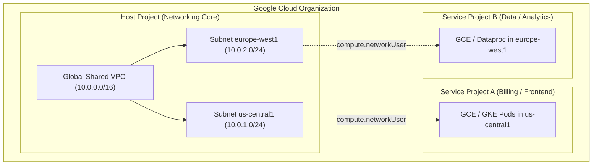
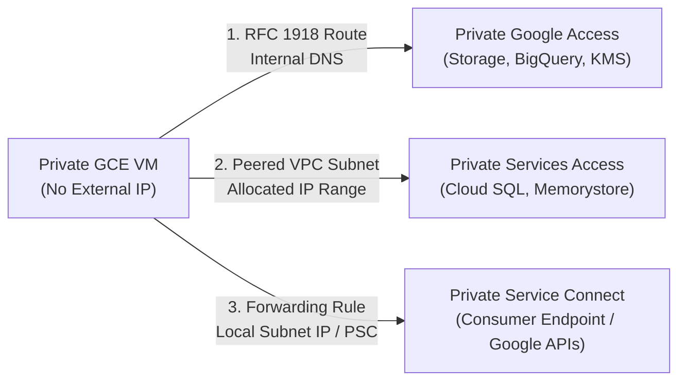
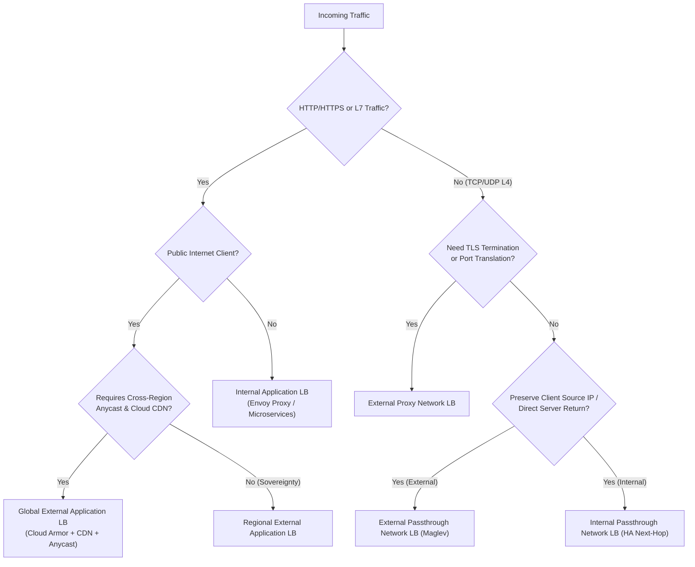
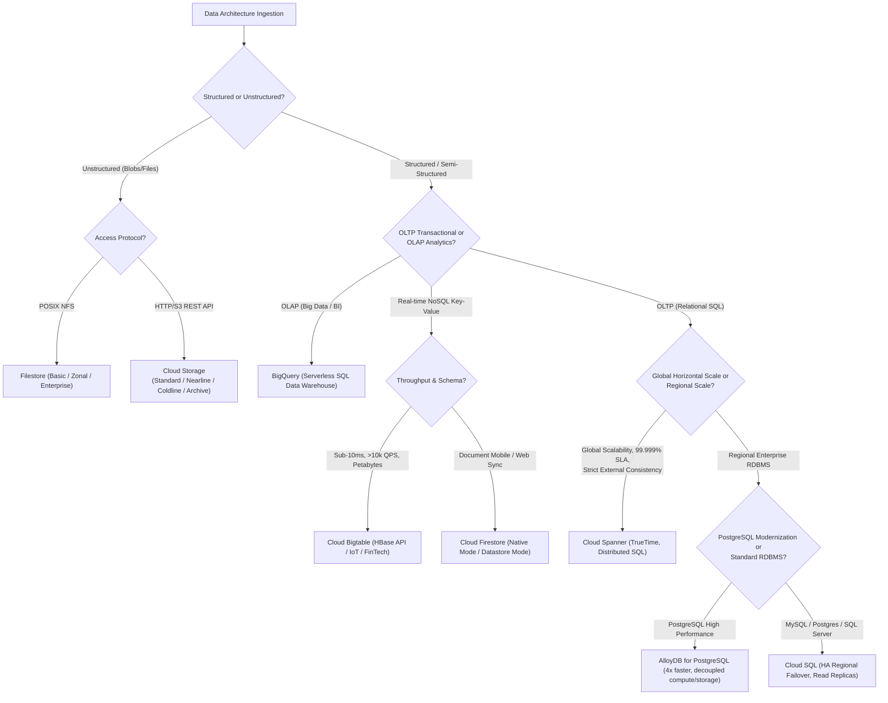

# Domain 2: Managing and Provisioning Infrastructure & Networking — Study Guide

> [!IMPORTANT]
> **Exam Weighting & Core Architecture Focus:** Domain 2 accounts for **~15% of the Google Cloud Certified Professional Cloud Architect (PCA)** examination. Questions in this domain test your mastery of enterprise multi-project networking topologies (Shared VPC, VPC Peering, Network Connectivity Center), hybrid cloud interconnectivity (HA VPN, Dedicated and Partner Interconnect 99.99% SLAs), private Google service integrations (Private Google Access, Private Services Access, Private Service Connect), global and regional load balancing architectures with Cloud Armor WAF, GKE infrastructure provisioning, and the enterprise database/storage selection matrix.

---

## 1. Enterprise VPC Architecture & Multi-Project Topology

Google Cloud Virtual Private Clouds (VPCs) are **global resources**, while subnets are **regional resources**. Compute instances in different zones or regions on the same VPC communicate privately over Google's global fiber backbone without internet transit, VPNs, or NAT gateways.



### 1.1 Shared VPC vs. VPC Network Peering vs. Network Connectivity Center (NCC)

* **Shared VPC**
  * **Architecture & Scope:** Centralized network administration across multiple projects within the **same Google Cloud Organization**. A central **Host Project** owns the VPC network, subnets, route tables, and firewall rules. **Service Projects** are attached to the host project.
  * **IAM Separation:** Central NetOps team has `compute.networkAdmin` in the Host Project. Developers in Service Projects have `compute.networkUser` granted **only on specific subnets** in the host project, plus `compute.instanceAdmin` in their own service project.
  * **GKE in Shared VPC Requirements:** Central NetOps must grant the Service Project GKE Service Agent (`service-<SERVICE_PROJECT_NUM>@container-engine-robot.iam.gserviceaccount.com`) the `container.hostServiceAgentUser` role on the Host Project, and `compute.networkUser` on the host subnets.
  * **Primary PCA Use Case:** Standard enterprise multi-tenant landing zone requiring centralized governance, unified firewall policies, and private cross-project communication.

* **VPC Network Peering**
  * **Architecture & Scope:** Connects two distinct VPC networks (can be in **different projects** and **different Organizations**) with RFC 1918 private IP connectivity.
  * **Non-Transitivity Rule:** Peering is strictly **non-transitive**. If VPC A peers with VPC B, and VPC B peers with VPC C, VPC A **cannot** communicate with VPC C through VPC B.
  * **CIDR Constraints:** Peered networks cannot have overlapping IP ranges. Subnets added after peering must not overlap with any subnet in the peered network.
  * **Route Exchange Flags:** Must explicitly enable `--import-custom-routes` and `--export-custom-routes` on both sides to exchange dynamic BGP routes from on-premises Cloud Routers.
  * **Primary PCA Use Case:** SaaS multi-tenant integrations, cross-organization partner connections, or temporary M&A infrastructure linking.

* **Network Connectivity Center (NCC)**
  * **Architecture & Scope:** Hub-and-spoke management model that uses Google's global network as an enterprise wide-area network (WAN). Connects branches, on-premises data centers, and multi-cloud environments using Google Cloud as the transit backbone.
  * **Spoke Types:** Supports Router Appliance spokes (third-party SD-WAN / virtual routers like Cisco, Palo Alto, Fortinet running on GCE), Cloud VPN spokes, Cloud Interconnect spokes, and VPC spokes.
  * **Transit Peering:** VPC spokes in NCC allow transitive data exchange across peered VPCs through the NCC hub, overcoming traditional VPC Peering non-transitivity limits.
  * **Primary PCA Use Case:** Global SD-WAN interconnectivity, multinational corporate branch-office connectivity, and enterprise multi-region transit networking.

```bash
# Provision a Shared VPC Host Project and attach a Service Project via gcloud
gcloud compute shared-vpc enable host-project-id

gcloud compute shared-vpc associated-projects add service-project-id \
    --host-project=host-project-id

# Grant developer service account permission to use the subnet in the Host Project
gcloud compute networks subnets add-iam-policy-binding prod-subnet-us-east1 \
    --project=host-project-id \
    --region=us-east1 \
    --member="serviceAccount:sa-deployer@service-project-id.iam.gserviceaccount.com" \
    --role="roles/compute.networkUser"
```

---

## 2. Private Google Access, Private Services Access & Private Service Connect

Enterprise security mandates that compute instances and database workloads operate in purely private subnets with **no external public IPv4 addresses**. Google Cloud provides three distinct private connectivity mechanisms:



* **Private Google Access (PGA)**
  * **Mechanism:** Subnet-level toggle (`privateIpGoogleAccess = true`). Allows VMs with only private IP addresses to reach default Google APIs and services using Google's public VIPs (`199.36.153.8/30` for `restricted.googleapis.com` or `199.36.153.4/30` for `private.googleapis.com`).
  * **DNS Requirements:** Configure Cloud DNS private zones for `*.googleapis.com` with CNAME pointing to `restricted.googleapis.com` (which restricts access to VPC Service Controls supported services) or `private.googleapis.com`.
  * **Traffic Path:** Stays entirely within Google's internal network; does not traverse the public internet.

* **Private Services Access (PSA)**
  * **Mechanism:** VPC Network Peering between your VPC and a Google-managed **Service Networking VPC** (holding Cloud SQL, AlloyDB, Memorystore Redis).
  * **Setup Steps:** Allocate a named RFC 1918 IP block (`gcloud compute addresses create ... --purpose=VPC_PEERING`), then establish a private connection (`gcloud services vpc-peerings connect`).
  * **Limitations:** Consumes your internal RFC 1918 IP space; subject to VPC Peering non-transitivity; cannot easily route on-premises traffic to PSA without exporting custom routes from Cloud Router.

* **Private Service Connect (PSC)**
  * **Mechanism:** Modern replacement for PSA and VPC Peering. Projects an external service (Google API, third-party partner service, or internal producer service) directly into the consumer's VPC as an **internal IP address (Endpoint forwarding rule)** in the consumer's own local subnet.
  * **Key Advantages:**
    * **No IP Overlap Constraints:** Consumer and producer VPCs can have overlapping RFC 1918 CIDRs! PSC uses Layer 4 source-NAT (SNAT) proxying.
    * **No Transitive Peering Limits:** Because the endpoint is a native IP in the consumer subnet, on-premises networks and spoke VPCs can reach it natively across VPN/Interconnect.
    * **Fine-Grained Security:** Uses Service Directory and IAM Consumer Accept/Reject lists (`projects/allowed-project-id`) for zero-trust governance.
  * **PSC Types:**
    * **PSC for Google APIs:** Local IP forwarding rule targeting `all-apis` or `vpc-sc`.
    * **PSC Endpoints (Forwarding Rules):** Local IP in consumer VPC pointing to a producer's **Service Attachment**.
    * **PSC Backends:** Connects a Google Cloud Load Balancer directly to a PSC Service Attachment.

### 2.1 Cloud NAT Architecture

Cloud NAT provides managed outbound internet connectivity for private VMs and GKE nodes without external public IPs.

* **High-Availability & Managed Scaling:** Cloud NAT is software-defined; it does not deploy gateway VMs or introduce single-point-of-failure choke points.
* **Port Allocation Modes:**
  * **Dynamic Port Allocation (Recommended):** Automatically scales the number of NAT source ports allocated per VM based on traffic patterns (minimum ports per VM up to maximum ports per VM), preventing port exhaustion while conserving IP addresses.
  * **Static Port Allocation:** Fixed number of ports per VM (default 64 ports per VM). *Trap:* If a VM exceeds its port limit, outbound connections fail with TCP connection timeouts.
* **Endpoint-Independent Mapping:** Allows applications to reuse the same external NAT IP and port mapping when connecting to different external destinations. Must be enabled for certain VoIP and STUN/TURN protocols.

---

## 3. Hybrid Connectivity: Cloud VPN & Cloud Interconnect

```mermaid
flowchart TD
    subgraph OnPrem["Corporate On-Premises Data Center"]
        Router1["Customer Router 1"]
        Router2["Customer Router 2"]
    end

    subgraph GCP["Google Cloud (HA VPN / Interconnect)"]
        CR1["Cloud Router 1 (BGP ASN 64513)"]
        CR2["Cloud Router 2 (BGP ASN 64513)"]
        VPC["Enterprise VPC"]
        CR1 --- VPC
        CR2 --- VPC
    end

    Router1 ==="Primary Circuit / Tunnel 0 (MED 100)"===> CR1
    Router1 -.->"Backup Circuit / Tunnel 1 (MED 200)"-.-> CR1
    Router2 ==="Primary Circuit / Tunnel 2 (MED 100)"===> CR2
    Router2 -.->"Backup Circuit / Tunnel 3 (MED 200)"-.-> CR2
```

### 3.1 Cloud VPN (Classic vs. HA VPN)

* **HA VPN (High Availability VPN):**
  * **SLA:** **99.99% service availability SLA** when configured with two dual-stack or IPv4 interfaces and 2 or 4 tunnels.
  * **Routing Protocol:** Strictly requires **Dynamic Routing via BGP (Border Gateway Protocol)** using Google **Cloud Router**. Static routing is NOT supported on HA VPN.
  * **Bandwidth:** 3 Gbps per tunnel (up to 250,000 packets per second). Tunnels can be combined to achieve higher aggregate throughput via ECMP (Equal-Cost Multi-Path).

### 3.2 Cloud Interconnect SLA Architectures

* **Dedicated Interconnect:** Direct physical fiber connection between customer cross-connect and Google Edge Colocation facility at 10 Gbps or 100 Gbps circuits.
* **Partner Interconnect:** Connects through a supported service provider (Equinix, Megaport, AT&T) when colocation is unavailable or bandwidth requirements are 50 Mbps to 50 Gbps.

* **99.9% Availability SLA Topology:**
  * Requires **2 Interconnect connections** in **1 colocation facility (metro)**, connected to **2 separate Google Edge Routers (EERs)**, termination at 1 or 2 Customer On-Premises Routers, with 1 Cloud Router in GCP.
  * *Failure Mode Covered:* Loss of a single Google edge router or single cross-connect circuit.

* **99.99% Availability SLA Topology (Production Enterprise Standard):**
  * Requires **4 Interconnect connections** across **2 distinct colocation facilities (two different metros)**.
  * Uses **2 separate Google Edge Routers in each metro** (total 4 EERs).
  * Terminates at **2 separate Customer On-Premises Routers** in each data center location.
  * In GCP: Requires **2 Cloud Routers in the same VPC** (one in each region/metro).
  * *Failure Mode Covered:* Complete catastrophic outage of an entire colocation facility or metropolitan fiber cut.

### 3.3 Active-Active vs. Active-Passive Routing with Cloud Router

* **Active-Active Routing (ECMP):**
  * Advertise identical BGP routes from on-premises routers with the **same Multi-Exit Discriminator (MED)** and same AS-Path length.
  * Cloud Router balances traffic across all available paths using 5-tuple flow hashing.
* **Active-Passive Routing (Failover):**
  * Cloud Router evaluates route priority using:
    1. **AS-Path Length:** Shorter AS-Path is preferred.
    2. **MED (Multi-Exit Discriminator):** Lower MED value is preferred (e.g., set primary tunnel MED to `100`, backup tunnel MED to `200`).
  * If the primary path goes down, BGP withdraws the primary route within 3 BGP keepalive intervals (or BFD sub-second timers), and traffic fails over instantly to the backup path.

---

## 4. Google Cloud Load Balancing (GCLB) Decision Matrix

Google Cloud Load Balancing is a software-defined, distributed managed service built on Google's Maglev and Andromeda SDN platforms.

* **Global External Application Load Balancer (HTTP/HTTPS)**
  * **Layer & Type:** Layer 7 Envoy-based reverse proxy using Anycast global IPv4/IPv6 addresses.
  * **Architecture:** Ingress traffic terminates at the Google Edge PoP nearest to the client. Traffic traverses Google's private low-latency fiber backbone to backend Instance Groups, NEGs (Network Endpoint Groups), or Cloud Run / App Engine.
  * **Capabilities:** Cross-region automatic failover, SSL offloading with Google-managed multi-domain SSL certificates, HTTP/2 and HTTP/3 (QUIC), WebSocket, gRPC, and URL map path/host routing.
  * **Security Integration:** Native integration with **Cloud Armor WAF** and **Cloud CDN**.

* **Regional External Application Load Balancer**
  * **Layer & Type:** Layer 7 regional proxy.
  * **Architecture:** Operates within a single Google Cloud region. Does not use Anycast IP; uses a regional external IP.
  * **Primary PCA Use Case:** Workloads with strict data residency regulations (e.g., GDPR, financial sovereignty) requiring all TLS termination and packet inspection to remain physically inside a specific geographic region.

* **Internal Application Load Balancer (Regional & Cross-Region)**
  * **Layer & Type:** Layer 7 internal Envoy-based proxy using private RFC 1918 IPs.
  * **Primary PCA Use Case:** Microservices architecture, private web tiers, and internal API gateway routing with header-based traffic splitting, canary releases, and fault injection.

* **External Passthrough Network Load Balancer**
  * **Layer & Type:** Layer 4 non-proxied (passthrough) load balancer using Maglev.
  * **Architecture:** Preserves the original client IP address directly at the VM backend (Direct Server Return / DSR). Return traffic bypasses the load balancer and routes directly to the internet via default internet gateway.
  * **Primary PCA Use Case:** High-performance gaming UDP servers, custom non-HTTP protocols, and legacy enterprise software requiring line-rate packet throughput.

* **Internal Passthrough Network Load Balancer**
  * **Layer & Type:** Layer 4 non-proxied internal load balancer.
  * **Architecture:** Zero-latency private load balancer. Can be configured as a next-hop route target in custom VPC route tables for high-availability third-party firewall appliances (Palo Alto, Fortinet) with symmetric hashing.



---

## 5. Compute Engine & GKE Infrastructure Provisioning

### 5.1 GKE Architecture: Autopilot vs. Standard

* **GKE Autopilot**
  * **Control Plane & Node Management:** Google manages the entire cluster: control plane, worker node provisioning, node OS patching, auto-upgrades, and scaling.
  * **Pricing Model:** Billed strictly per Pod resource request (vCPU, Memory, Ephemeral Storage). You do **NOT** pay for unallocated node capacity!
  * **Security Hardening:** Enforces hardened security settings by default: Shielded GKE Nodes, Dataplane V2 (Cilium eBPF), Linux capabilities dropped, managed Workload Identity enabled, no privileged containers without special exemptions.
  * **Primary PCA Use Case:** Default recommended operational model for container workloads unless specialized kernel extensions, custom node daemons, or unsupported hardware configs are required.

* **GKE Standard**
  * **Control Plane & Node Management:** Customer manages node pools, selects machine types, configures autoscaling limits, and manages OS image lifecycle.
  * **Pricing Model:** Billed per underlying Compute Engine VM instance in node pools, plus a flat cluster management fee ($0.10/hour).
  * **Customization:** Full access to node sysctl configurations, custom privileged DaemonSets, Windows Server containers, and specialized GPU/TPU accelerator topologies.

### 5.2 Private GKE Cluster Architecture

A production-grade GKE cluster must be configured as a **Private Cluster**:
1. **Nodes have only Private RFC 1918 IPs:** No public external IPs on worker nodes. Nodes pull container images from Artifact Registry via Private Google Access.
2. **Master Authorized Networks:** Restricts HTTPS access to the Kubernetes API server endpoint (`:443`) to specific corporate CIDRs or bastion jump boxes.
3. **Private Control Plane Endpoint:** Disables the public endpoint entirely. The API server can only be reached from within the VPC or via peered VPN/Interconnect connections.

---

## 6. Enterprise Storage & Database Decision Matrix



### 6.1 Relational Databases: Cloud SQL vs. AlloyDB vs. Cloud Spanner

* **Cloud SQL**
  * **Architecture & Engines:** Fully managed MySQL, PostgreSQL, and SQL Server.
  * **High Availability (HA):** Regional persistent disk replication with an active instance in Primary AZ and standby instance in Secondary AZ. Automatic failover completes in **60–120 seconds** with zero data loss ($RPO = 0$).
  * **Scalability:** Vertical scaling up to 96 vCPUs and 624 GB RAM. Read scaling via up to 10 Read Replicas (cross-region supported). *Limitation:* Single write node.

* **AlloyDB for PostgreSQL**
  * **Architecture:** Enterprise-grade PostgreSQL-compatible database. Decouples compute from storage using an intelligent distributed storage engine with multi-tier caching (Log-structured engine, Ultra-fast memory cache, Google-managed block store).
  * **Performance:** **4x faster for transactional workloads** and **up to 100x faster for analytical queries** than standard PostgreSQL.
  * **High Availability & Failover:** Failover completes in **under 10 seconds** without connection dropping (via built-in database proxy).
  * **Primary PCA Use Case:** Legacy on-premises Oracle and SQL Server migrations modernizing onto PostgreSQL with extreme throughput demands.

* **Cloud Spanner**
  * **Architecture:** Globally distributed, horizontally scalable NewSQL database combining ACID transactions and ANSI SQL with **TrueTime technology** (atomic clocks and GPS receivers in every Google data center).
  * **Consistency:** Strict **External Consistency (Serializable ACID)** across multiple regions and continents without locking bottlenecks.
  * **Availability SLA:** **99.999% (five nines)** availability for multi-region instance configurations ($< 5.26 \text{ minutes}$ downtime/year).
  * **Primary PCA Use Case:** Mission-critical global banking ledgers, multinational retail inventory, and gaming accounts requiring infinite horizontal write scalability with zero downtime.

### 6.2 NoSQL & Analytical Data Stores

* **Cloud Bigtable**
  * **Data Model & Interface:** Sparsely populated, persistent, multidimensional sorted map (HBase API).
  * **Performance & Scale:** Sub-10ms latency for massive sequential reads and writes. Ideal for datasets $> 1 \text{ TB}$ up to hundreds of petabytes.
  * **Schema Design Principles:**
    * **Row Key Design:** Data is sorted lexicographically by row key.
    * **Avoid Hotspotting:** *Trap:* Never use sequential integer IDs, monotonically increasing timestamps, or sequential domain names as the row key prefix! Always reverse domain names (`com.company.api`) or prepend hashed suffixes/field combinations (`tenant_id#metric#reverse_timestamp`).
  * **Primary PCA Use Case:** IoT telematics streaming, financial market tick data, ad-tech clickstreams, and real-time graph engines.

* **Cloud Firestore**
  * **Native Mode:** Document database with live real-time listeners, offline mobile SDK synchronization, multi-region replication, and strong consistency ($99.999\%$ SLA).
  * **Datastore Mode:** Optimized for server-side backend workloads requiring high throughput with auto-scaling to millions of QPS.

---

## 7. Cloud Storage (GCS) Architecture & Lifecycle Optimization

* **Storage Classes & Access Frequencies:**
  * **Standard Storage:** Hot data, web assets, active streaming, frequent reads. No minimum storage duration.
  * **Nearline Storage:** Accessed $< 1\text{x}$ per month. Minimum storage duration: **30 days**. Read retrieval fee applies.
  * **Coldline Storage:** Accessed $< 1\text{x}$ per quarter (90 days). Minimum storage duration: **90 days**. Read retrieval fee applies.
  * **Archive Storage:** Accessed $< 1\text{x}$ per year. Long-term compliance backups, disaster recovery cold snapshots. Minimum storage duration: **365 days**.
* **Autoclass:** Automatically transitions objects between Standard, Nearline, Coldline, and Archive classes based on each individual object's last access time, eliminating retrieval fees and manual lifecycle policy management.
* **Object Retention & Immutability:**
  * **Bucket Lock (Retention Policy):** Enforces write-once-read-many (WORM) compliance (SEC Rule 17a-4, FINRA). Once locked, retention period cannot be shortened or deleted by any principal, including the Project Owner or Google Support!
  * **Object Holds:** Temporary legal hold preventing deletion of specific objects during active audit/litigation.
