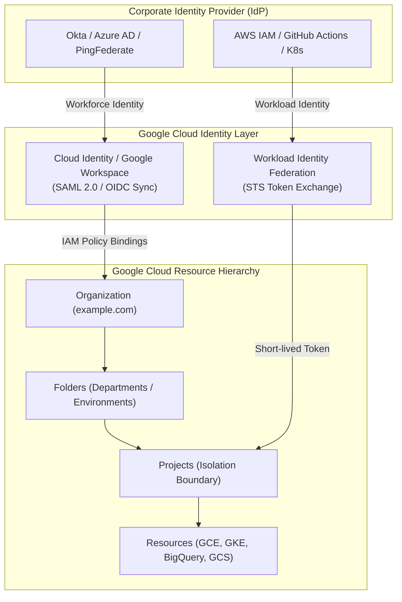
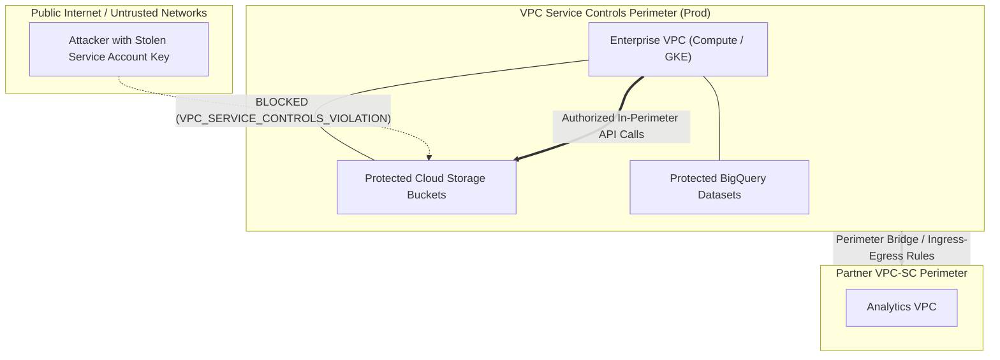
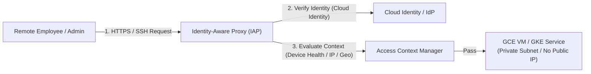

# Domain 3: Designing for Security, Identity, and Compliance — Study Guide

> [!IMPORTANT]
> **Exam Weighting & Core Architecture Focus:** Domain 3 accounts for **~21% of the Google Cloud Certified Professional Cloud Architect (PCA)** examination—making it the highest weighted individual domain on the test. Questions in this domain test your mastery of enterprise identity architecture (Cloud Identity, Workforce and Workload Identity Federation), zero-trust security (Identity-Aware Proxy, Cloud Armor WAF), cryptographic envelope encryption (Cloud KMS, CMEK, CSEK, Cloud EKM), data exfiltration defense with VPC Service Controls (VPC-SC), Sensitive Data Protection (DLP), and compliance auditability (Access Transparency, Access Approval, Security Command Center).

---

## 1. Enterprise Identity & IAM Architecture

Google Cloud Identity and Access Management (IAM) governs authentication (AuthN) and authorization (AuthZ) using the principle of least privilege across the resource hierarchy.



### 1.1 Workforce Identity vs. Workload Identity Federation (WIF)

* **Workforce Identity Federation:**
  * **Target:** Human users, contractors, and partners logging into Google Cloud Console or `gcloud` CLI.
  * **Mechanism:** Integrates external IdPs (Azure AD, Okta, Ping, SAML 2.0/OIDC) directly with Google Cloud IAM **without synchronizing user accounts into Cloud Identity**.
  * **Key Benefit:** Eliminates identity lifecycle duplication; external directory groups map directly to GCP IAM roles using attribute mappings and conditions.

* **Workload Identity Federation (WIF) for Applications:**
  * **Target:** Non-GCP workloads (AWS EC2/Lambda, GitHub Actions, Azure VMs, on-premises Kubernetes) authenticating to Google Cloud APIs.
  * **Antipattern Eliminated:** **Never export service account JSON private keys!** Service account keys are long-lived (valid for up to 10 years by default), prone to accidental GitHub commits, and cannot be centrally governed or audited effectively.
  * **Three-Step Token Exchange Architecture:**
    1. External workload queries its local metadata service for an OIDC ID token (e.g., AWS STS `GetCallerIdentity`, GitHub Actions `ACTIONS_ID_TOKEN_REQUEST_URL`).
    2. Workload sends the external token to the Google Cloud **Security Token Service (STS)** endpoint (`sts.googleapis.com`).
    3. STS validates the token against the **Workload Identity Pool & Provider**, returning a short-lived federated token that is exchanged for a short-lived Google Cloud Service Account OAuth 2.0 access token via `serviceusage.generateAccessToken`.

```bash
# Provision Workload Identity Pool and Provider for GitHub Actions
gcloud iam workload-identity-pools create "github-pool" \
    --project="prod-infra-project" \
    --location="global" \
    --display-name="GitHub Actions Pool"

gcloud iam workload-identity-pools providers create-oidc "github-provider" \
    --project="prod-infra-project" \
    --location="global" \
    --workload-identity-pool="github-pool" \
    --issuer-uri="https://token.actions.githubusercontent.com" \
    --attribute-mapping="google.subject=assertion.sub,attribute.repository=assertion.repository,attribute.ref=assertion.ref" \
    --attribute-condition="assertion.repository == 'my-org/my-production-repo'"

# Allow external identities in the pool to impersonate the target Service Account
gcloud iam service-accounts add-iam-policy-binding "deployer-sa@prod-infra-project.iam.gserviceaccount.com" \
    --role="roles/iam.workloadIdentityUser" \
    --member="principalSet://iam.googleapis.com/projects/PROJECT_NUMBER/locations/global/workloadIdentityPools/github-pool/attribute.repository/my-org/my-production-repo"
```

### 1.2 IAM Policy Inheritance, Deny Policies & Organization Policies

* **Policy Union Model:** Permissions are inherited downward down the resource hierarchy (`Organization` $\to$ `Folders` $\to$ `Projects` $\to$ `Resources`). A grant at an upper level **cannot be narrowed or removed** by an allow policy at a lower level.
* **IAM Deny Policies (v2 IAM):**
  * Evaluated **before** any IAM Allow policies.
  * Can block specific permissions (e.g., `iam.serviceAccounts.createKey`, `compute.instances.create`) for all principals, including Project Owners, across an entire Folder or Organization.
  * *Exam Distinction:* Deny policies do not support denying administrative roles directly; they deny specific granular permissions and support boolean CEL conditions (e.g., allow only if principal is a member of an authorized break-glass group).
* **Organization Policies (Guardrails):**
  * Hard programmatic constraints enforced across projects.
  * High-Frequency PCA Constraints:
    * `constraints/iam.disableServiceAccountKeyCreation`: Prevents developers from generating downloadable JSON keys.
    * `constraints/compute.vmExternalIpAccess`: Restricts creation of external public IP addresses on Compute Engine instances.
    * `constraints/compute.requireShieldedVm`: Enforces Secure Boot, vTPM, and Integrity Monitoring on all GCE instances.
    * `constraints/gcp.resourceLocations`: Enforces data residency by restricting resource creation strictly to approved regions (e.g., `in:us-locations` or `in:europe-locations`).

---

## 2. Cryptographic Key Management & Envelope Encryption

Google Cloud automatically encrypts all customer data at rest using AES-256 with Google-managed keys. When regulatory compliance (HIPAA, PCI-DSS, FedRAMP High, ITAR) mandates customer sovereignty, Google Cloud provides four encryption tiers:

```mermaid
flowchart TD
    Data["Customer Data to Encrypt"]
    DEK["Data Encryption Key (DEK)<br>Generated locally in-memory (AES-256)"]
    Data ---|"Encrypted with DEK"| DEK

    subgraph KeyManagement["Key Encryption Key (KEK) Management Options"]
        Default["1. Google-Managed Keys<br>(Zero Configuration / Default)"]
        CMEK["2. Customer-Managed Keys (CMEK)<br>(Cloud KMS / Hardware HSM / Multi-Region)"]
        CSEK["3. Customer-Supplied Keys (CSEK)<br>(Raw 256-bit Key in API Headers)"]
        EKM["4. Cloud External Key Manager (Cloud EKM)<br>(Keys Stored in External On-Prem HSM)"]
    end

    DEK -.->"Wrapped (Encrypted) by KEK"-.-> KeyManagement
```

### 2.1 Encryption Tiers Decision Matrix

* **Google-Managed Default Encryption**
  * **Key Management:** Google generates, stores, and automatically rotates both DEKs and KEKs.
  * **Customer Effort & Cost:** Zero operational overhead; included in base service price.
  * **Primary PCA Use Case:** Standard non-regulated enterprise workloads where default encryption at rest satisfies baseline security policies.

* **Customer-Managed Encryption Keys (CMEK)**
  * **Key Management:** Customer creates and manages Key Rings and CryptoKeys inside **Cloud KMS** (software, Cloud HSM FIPS 140-2 Level 3, or Cloud External Key Manager).
  * **Key Control:** Customer controls the key rotation schedule (e.g., automatic rotation every 90 days), IAM access to the key, and can **instantly revoke access or destroy the key version** to cryptographically shred all associated data across BigQuery, Cloud Storage, Compute Engine Persistent Disks, GKE, and Secret Manager.
  * **Integration Architecture:** Grant the target service's Google-managed Service Agent (e.g., `service-<PROJECT_NUM>@gcp-sa-bigquery.iam.gserviceaccount.com`) the `roles/cloudkms.cryptoKeyEncrypterDecrypter` role on the specific CryptoKey.

* **Customer-Supplied Encryption Keys (CSEK)**
  * **Key Management:** Customer generates raw 256-bit AES encryption keys on-premises and passes them in API request headers (or `csekKey` parameters in Compute Engine / Cloud Storage).
  * **Key Retention:** Google **never stores the raw CSEK key on persistent disk**; it exists only transiently in volatile RAM to service the request.
  * **Disaster Recovery Risk:** *Trap:* If the customer loses the raw key, Google Support has **zero ability to recover the data**. The data is permanently lost.

* **Cloud External Key Manager (Cloud EKM)**
  * **Key Management:** Keys reside physically outside Google Cloud in a third-party HSM (Thales, Fortanix, Entrust).
  * **Key Custody:** Cloud KMS routes cryptographic operations to the external HSM over an internet endpoint or private VPC connection.
  * **Primary PCA Use Case:** European banking data sovereignty laws requiring that encryption keys never enter the cloud provider's physical boundaries.

---

## 3. Perimeter Security: VPC Service Controls (VPC-SC)

VPC Service Controls creates a security perimeter around multi-tenant Google Cloud services (BigQuery, Cloud Storage, Cloud SQL, Secret Manager) to prevent unauthorized copying or data exfiltration—even if an attacker possesses legitimate IAM credentials.



### 3.1 VPC-SC Key Architectural Concepts

* **Service Perimeter:** Groups one or more Google Cloud projects and protected API services. API requests targeting resources inside the perimeter are evaluated:
  * If the request originates from a VPC network inside the perimeter: **Allowed**.
  * If the request originates from outside the perimeter (even with full `roles/owner` or `roles/storage.admin`): **Blocked** with a `403 VPC_SERVICE_CONTROLS_VIOLATION`.
* **Access Levels (Context-Aware Access):** Defined via **Access Context Manager**. Permits external clients (e.g., corporate laptops) to access protected perimeter resources based on:
  * Source public IPv4/IPv6 CIDR (corporate egress firewall).
  * Device policy (encrypted disk, screen lock, OS version, Chrome Enterprise managed device).
  * Geographic location (Geo-fencing).
* **Perimeter Bridges vs. Ingress/Egress Rules:**
  * **Perimeter Bridge:** Bidirectional link connecting projects in two separate perimeters. *Limitation:* All-or-nothing access between all resources in both perimeters.
  * **Directional Ingress & Egress Rules (Recommended):** Modern granular policy defining exact API methods, source identities, source networks, and destination resources permitted to cross the perimeter boundary.
* **Dry-Run Mode:**
  * **Mandatory Rollout Best Practice:** Never enforce a VPC-SC perimeter directly in production! Enable Dry-Run mode first.
  * In Dry-Run mode, all perimeter violations are logged to Cloud Logging (`cloudaudit.googleapis.com/policy_denied`) without actually blocking production traffic. NetOps reviews logs to identify missing service dependencies, then flips the perimeter to Enforced mode.

---

## 4. Zero Trust Security: BeyondCorp & Identity-Aware Proxy (IAP)

Identity-Aware Proxy (IAP) implements the BeyondCorp Zero Trust model by establishing a secure proxy layer in front of web applications and administrative ports without requiring traditional corporate VPNs.



### 4.1 IAP for HTTPS Web Applications

* **Mechanism:** Sits on the Global External Application Load Balancer backend service.
* **Flow:** When an unauthenticated user accesses the web application, IAP intercepts the request and redirects to Google's sign-in screen.
* **Context Evaluation:** Checks user identity, group membership, and Access Context Manager device health policies.
* **Header Assertion:** Upon successful authentication, IAP forwards the request to backend VMs or GKE pods, injecting cryptographic JWT headers (`x-goog-authenticated-user-jwt`) signed by Google, allowing backend services to verify user identity without writing custom auth code.

### 4.2 IAP for TCP Forwarding (Secure VM Administration)

* **Architecture:** Allows administrators to establish SSH (`:22`) and RDP (`:3389`) connections to GCE instances with **only private IP addresses**.
* **Zero Public IP / Zero Bastion Hosts:** Eliminates the operational overhead and attack surface of dedicated bastion/jump-box VMs.
* **Firewall Configuration:** Create a single ingress firewall rule allowing traffic from Google's IAP netblock **`35.235.240.0/20`** on ports 22 and 3389 to instances tagged with `allow-iap-ssh`.

```bash
# Connect to private VM securely through IAP TCP tunnel
gcloud compute ssh my-private-vm \
    --project="prod-infra-project" \
    --zone="us-central1-a" \
    --tunnel-through-iap
```

---

## 5. Cloud Armor WAF & Distributed Denial-of-Service (DDoS) Defense

Cloud Armor works in conjunction with the Global External Application Load Balancer to protect internet-facing applications against infrastructure DDoS, application DDoS, and OWASP Top 10 web vulnerabilities.

* **Infrastructure DDoS Mitigation (L3/L4):** Built into Google's global edge infrastructure. Absorbs massive volumetric UDP/SYN floods at the edge Point of Presence before traffic reaches customer VPCs.
* **Cloud Armor Security Policies (L7 WAF):**
  * **Pre-configured WAF Rules:** Defends against SQL Injection (SQLi), Cross-Site Scripting (XSS), Local File Inclusion (LFI), Remote Code Execution (RCE), and Log4j using modsecurity-compatible rulesets.
  * **Rate Limiting:** Prevents brute-force credential stuffing and API abuse by throttling requests per client IP or session cookie over a sliding time window (e.g., maximum 100 requests per 1-minute window).
  * **Geo-Blocking:** Restricts or allows traffic based on client country codes (`origin.region_code == 'CN' || origin.region_code == 'RU'`).
* **Adaptive Protection:** Machine learning engine that analyzes normal traffic baselines to detect Layer 7 application DDoS attacks. When an anomaly occurs, it alerts administrators and generates a recommended WAF rule signature that can be applied with a single click.

---

## 6. Sensitive Data Protection (Cloud DLP)

Sensitive Data Protection discovers, classifies, and de-identifies sensitive data across Cloud Storage, BigQuery, Cloud SQL, and streaming pipelines.

* **Built-in & Custom InfoTypes:** Detects over 150 standard sensitive data types including Credit Card Numbers (`CREDIT_CARD_NUMBER`), US SSNs (`US_SOCIAL_SECURITY_NUMBER`), HIPAA PHI identifiers, and IBANs, or custom InfoTypes via regular expressions and dictionaries.
* **De-Identification Transformation Techniques:**
  * **Cryptographic Hashing:** Replaces sensitive values with SHA-256 hashes for one-way verification.
  * **Cryptographic Tokenization (Pseudonymization):** Replaces sensitive values (credit card numbers) with reversible tokens encrypted using a surrogate key (`CryptoReplaceFfxFpeConfig`). Authorized users can re-identify data by providing the decryption key.
  * **Bucketing & Generalization:** Replaces exact values with ranges (e.g., changing exact age `34` to age range `30-40`) to preserve analytical utility while preventing individual identification.
  * **Masking:** Masks characters (e.g., masking credit card numbers to `************1234`).

---

## 7. Compliance, Audit Logging & Access Governance

### 7.1 Cloud Audit Logs Architecture

Google Cloud automatically generates four distinct audit logging streams:

* **Admin Activity Logs:** Records operations that create, modify, or delete metadata/resources (e.g., creating a VM, modifying IAM roles). **Enabled by default; free; retained for 400 days; cannot be disabled by any user.**
* **Data Access Logs:** Records operations that read or modify customer-provided data (e.g., reading an object from GCS, running a SQL query in BigQuery). **Disabled by default (except BigQuery)** due to high volume. Must be explicitly enabled in IAM audit configuration. Retained for **30 days** by default.
* **System Event Logs:** Records administrative events performed by Google Cloud systems (e.g., live migration of a GCE VM). Enabled by default; free.
* **Policy Denied Logs:** Records when a user or service account is denied access due to an Organization Policy or VPC Service Controls perimeter violation.

### 7.2 Access Transparency & Access Approval

* **Access Transparency:**
  * Emits near-real-time audit logs whenever **Google Cloud engineers or SREs** access customer content during customer support ticket triage, hardware maintenance, or security investigations.
  * Logs include the Google employee's justification, ticket reference number, and exact resources accessed.
* **Access Approval:**
  * Works in tandem with Access Transparency. Requires the customer to **cryptographically approve** a request before Google personnel can access customer content.
  * Integrates with corporate ticketing systems (ServiceNow, Jira) via Pub/Sub notifications.
