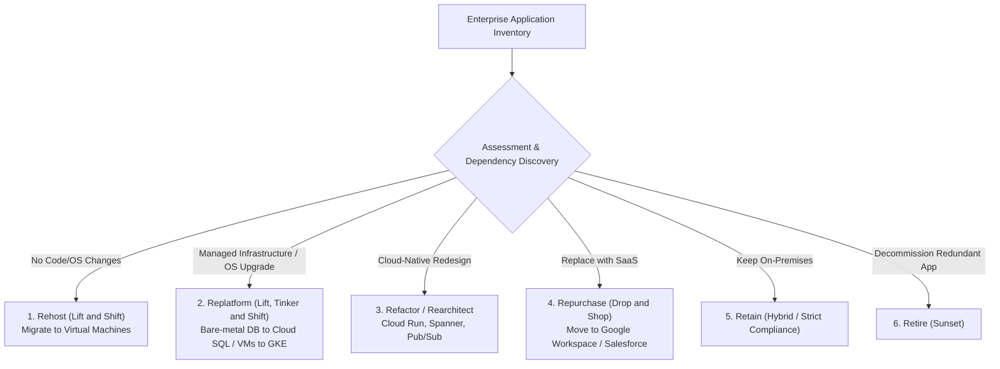
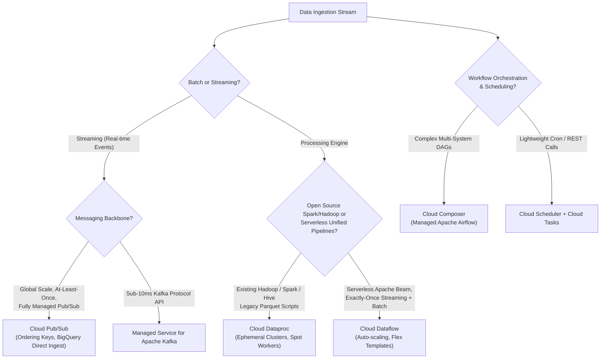
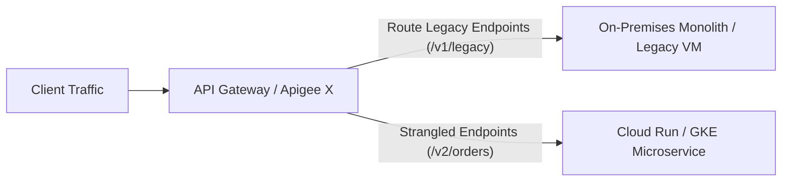

# Domain 4: Analyzing and Optimizing Technical and Business Processes — Study Guide

> [!IMPORTANT]
> **Exam Weighting & Core Architecture Focus:** Domain 4 accounts for **~19% of the Google Cloud Certified Professional Cloud Architect (PCA)** examination. Questions in this domain test your mastery of cloud FinOps (Committed Use Discounts, BigQuery Editions slot reservations, Spot VM architectures, billing exports to BigQuery), migration methodologies (the 6 Rs, Migrate to Virtual Machines, Database Migration Service CDC, Storage Transfer Service vs. Transfer Appliance calculation), data processing pipeline trade-offs (Dataproc vs. Dataflow vs. Pub/Sub vs. Cloud Composer), and enterprise modernization patterns (Strangler Fig, API management with Apigee X, decoupled event-driven architectures).

---

## 1. Cloud FinOps, Cost Optimization & Capacity Planning

Enterprise cloud architecture requires continuous financial governance to maximize ROI while maintaining performance and reliability SLAs.

```mermaid
flowchart TD
    subgraph Ingestion["Billing & Cost Ingestion Layer"]
        Billing["Cloud Billing Account"]
        Detailed["Detailed Usage Cost Export (Resource Labels)"]
        Pricing["Pricing Export"]
        Billing --> Detailed
        Billing --> Pricing
    end

    subgraph Analytics["FinOps Analytics & Attribution Engine"]
        BQ["BigQuery FinOps Dataset"]
        Detailed --> BQ
        Pricing --> BQ
        Looker["Looker Studio / Enterprise Dashboards"]
        BQ --> Looker
    end

    subgraph Actions["Automated Cost Optimization Actions"]
        CUD["1. Committed Use Discounts (Resource & Spend)"]
        Recommender["2. Active Assist Recommenders (Idle VMs, Unused Disks)"]
        Autoscale["3. Spot VMs + Ephemeral Autoscaling MIGs"]
        Lifecycle["4. GCS Autoclass & BigQuery Partitioning"]
        BQ -.-> Actions
    end
```

### 1.1 Committed Use Discounts (CUDs) vs. Sustained Use Discounts (SUDs)

* **Committed Use Discounts (CUDs):**
  * **Resource-Based CUDs:**
    * **Commitment:** 1-year or 3-year commitment for predictable compute hardware (vCPUs, memory, GPUs, Local SSDs) in a **specific region and machine series** (e.g., N2 in `us-central1`).
    * **Discount:** Up to **57% savings** off on-demand rates.
    * **Best For:** Static, predictable, baseline production infrastructure (e.g., long-running database VMs, stateful GKE node pools).
  * **Spend-Based CUDs:**
    * **Commitment:** 1-year or 3-year commitment to spend a minimum dollar amount per hour (e.g., \$100/hour) across eligible services.
    * **Discount:** Up to **52% savings**.
    * **Supported Services:** Compute Engine, Cloud Run, GKE Autopilot, Cloud SQL, AlloyDB, Cloud Spanner, BigQuery Editions.
    * **Best For:** Fast-evolving cloud environments transitioning between VM and serverless architectures across multiple regions.
  * **Discount Sharing:** Enable CUD sharing at the Cloud Billing Account level so unused discount capacity in one project is automatically applied to eligible usage in other projects within the organization.

* **Sustained Use Discounts (SUDs):**
  * **Automatic Savings:** Applies automatically to eligible Compute Engine instances (N1, N2, N2D, C2) that run for a significant portion of the billing month without any upfront commitment or contract.
  * **Scale:** Up to **30% discount** on instances running 100% of the month (graduated discount curve starting after an instance runs $>25\%$ of the month).

* **Spot VMs (formerly Preemptible VMs):**
  * **Pricing:** **60% to 91% discount** off standard on-demand pricing.
  * **Preemption Mechanism:** Compute Engine can reclaim Spot capacity at any time when needed for higher-priority on-demand workloads.
  * **Shutdown Notice:** Sends a **30-second ACPI shutdown signal** (or metadata event) before termination.
  * **Architectural Requirements:** Workloads must be completely stateless, idempotent, and fault-tolerant (e.g., batch transcoding, genomic analysis, Spark/Hadoop worker nodes, rendering farms).
  * **Managed Instance Group (MIG) Integration:** Configure MIGs with target capacity distribution (e.g., 20% on-demand baseline for stability + 80% Spot for burst scaling).

### 1.2 BigQuery FinOps & Compute Optimization

* **On-Demand vs. BigQuery Editions (Slot Reservations):**
  * **On-Demand Model:** Billed strictly on the volume of data scanned by queries (\$6.25 per TB).
    * *Cost Controls:* Enforce query partition filters (`require_partition_filter = true`), cluster tables by high-cardinality lookup columns, set project-level or user-level `maximum_bytes_billed` limits, and avoid `SELECT *`.
  * **BigQuery Editions (Standard, Enterprise, Enterprise Plus):**
    * **Compute Slots:** Billed on dedicated or autoscaling query execution capacity measured in **slots**.
    * **Autoscaling Reservations:** Configure baseline slots (e.g., 100 baseline slots for predictable steady-state workload) plus maximum autoscaling slots (e.g., up to 500 slots for peak business-hours bursts).
    * **Primary PCA Use Case:** Enterprise organizations with predictable multi-million-dollar monthly analytics queries requiring budget determinism and eliminating runaway on-demand query bills.

---

## 2. Enterprise Cloud Migration Framework (The 6 Rs)



### 2.1 Deep Migration Tooling Architecture

* **Migrate to Virtual Machines (formerly Velostrata):**
  * **Source Environments:** VMware vSphere on-premises, AWS EC2 instances, Azure VMs.
  * **Mechanism:** Continuous asynchronous block-level replication into Google Cloud.
  * **Zero-Downtime Test Clones:** Allows architects to launch a clone of the replicated VM in Compute Engine to validate application functionality, database integrity, and network connectivity **without interrupting or stopping the on-premises production VM**.
  * **Cutover Orchestration:** During the scheduled maintenance window, shuts down the on-premises instance, performs a final incremental delta sync, and boots the live Compute Engine instance with automatic driver injection.

* **Database Migration Service (DMS):**
  * **Engines:** MySQL, PostgreSQL, Oracle, and SQL Server migrating to Cloud SQL and AlloyDB.
  * **Minimal Downtime Migration:** Performs an initial full database snapshot followed by **continuous Change Data Capture (CDC)** (using native database replication streams like PostgreSQL `pglogical` or MySQL binary logs).
  * **Cutover:** Applications are switched to the Cloud SQL endpoint once replication lag reaches near-zero seconds.

* **Storage Transfer Service (STS) vs. Transfer Appliance Calculation:**
  * When migrating massive datasets (petabytes) from on-premises or other clouds (AWS S3, Azure Blob) into Cloud Storage, calculate transfer time:
    $$T = \frac{\text{Data Size (Bytes)}}{\text{Available Dedicated Bandwidth (Bytes/sec)}}$$
  * **Decision Cutoff Rule:**
    * If dataset is $< 50 \text{ TB}$ OR dedicated network bandwidth can complete the transfer within acceptable business timelines ($< 1 \text{ week}$): Use **Storage Transfer Service (STS)** over dedicated interconnect or internet.
    * If dataset is $> 100 \text{ TB}$ and available network bandwidth is constrained ($< 1 \text{ Gbps}$ uplink, requiring weeks or months of continuous transfer): Ship a physical **Transfer Appliance** (40 TB or 300 TB usable capacity), load the data locally at line rate, and ship it to Google's data center for direct ingest.

---

## 3. Data Processing Architecture: Processing & Messaging Decision Matrix

Enterprise analytics and real-time processing architectures require selecting the appropriate engine based on data volume, velocity, operational model, and API standards:



### 3.1 Dataproc vs. Dataflow vs. Pub/Sub vs. Cloud Composer

* **Cloud Dataproc**
  * **Technology:** Managed Apache Spark, Hadoop, Hive, Presto, and Flink.
  * **Architecture:** Deploys master and worker Compute Engine instances. Supports **Ephemeral Clusters** that spin up for a specific batch job and terminate immediately upon completion.
  * **Cost Optimization:** Utilize **Spot VMs for worker nodes** while keeping master nodes on standard on-demand VMs. Store data in **Cloud Storage (`gs://` connector)** rather than HDFS so compute clusters can be shut down without data loss.
  * **Primary PCA Use Case:** Migrating existing on-premises Hadoop/Spark codebases to Google Cloud with zero code refactoring.

* **Cloud Dataflow**
  * **Technology:** Fully managed, serverless implementation of **Apache Beam**.
  * **Key Capabilities:** Unified processing model for both **batch and streaming** data with **exactly-once processing semantics**.
  * **Dynamic Autoscaling:** Automatically scales worker VMs and rebalances streaming pipeline partitions without pipeline restarts or downtime.
  * **Primary PCA Use Case:** Real-time event stream processing, continuous ETL into BigQuery, complex sliding/session window aggregations, and modern unified data pipelines.

* **Cloud Pub/Sub**
  * **Technology:** Globally distributed, horizontally scalable asynchronous messaging service.
  * **Guarantees:** At-least-once message delivery. Can enforce strict in-order message delivery per subscriber by attaching an **Ordering Key**.
  * **Direct Push Subscriptions:** Supports direct serverless ingestion into **BigQuery** and **Cloud Storage** without deploying intermediate compute workers (Dataflow/Cloud Run).

* **Cloud Composer**
  * **Technology:** Fully managed workflow orchestration platform built on **Apache Airflow**.
  * **Architecture:** Coordinates complex multi-step dependency graphs (DAGs) spanning cross-cloud pipelines (e.g., extract from Salesforce $\to$ transform in Dataproc $\to$ load into BigQuery $\to$ trigger Vertex AI model training $\to$ notify Slack).

---

## 4. Application Modernization Patterns



### 4.1 The Strangler Fig Pattern

* **Objective:** Incrementally replace specific services of a legacy monolithic application with modern cloud-native microservices without risky, high-blast-radius "big bang" rewrites.
* **Implementation Architecture:**
  1. Deploy an intelligent reverse proxy or API gateway (**Apigee X** or **Cloud API Gateway**) in front of the legacy monolith.
  2. Implement a new microservice in **Cloud Run** or **GKE** representing a specific isolated business capability (e.g., `/api/checkout` or `/api/inventory`).
  3. Reconfigure the API gateway to route traffic for that specific URI path to the new cloud-native microservice, while leaving all other endpoints routing to the on-premises monolith.
  4. Repeat until all functional domains have been carved out, at which point the legacy monolith is safely decommissioned.

### 4.2 Apigee X vs. Cloud API Gateway

* **Cloud API Gateway:**
  * Lightweight, fully managed proxy built on Envoy.
  * Designed for securing and rate-limiting internal serverless backends (Cloud Run, Cloud Functions).
  * Enforces API keys, JWT authentication, and OpenAPI v2 specs.
* **Apigee X:**
  * Enterprise API management platform designed for multinational organizations exposing public and partner APIs.
  * Provides comprehensive developer portal management, API monetization, advanced traffic shaping, token mediation (SAML to JSON), fine-grained analytics, and integration with Cloud Armor and Cloud CDN.
