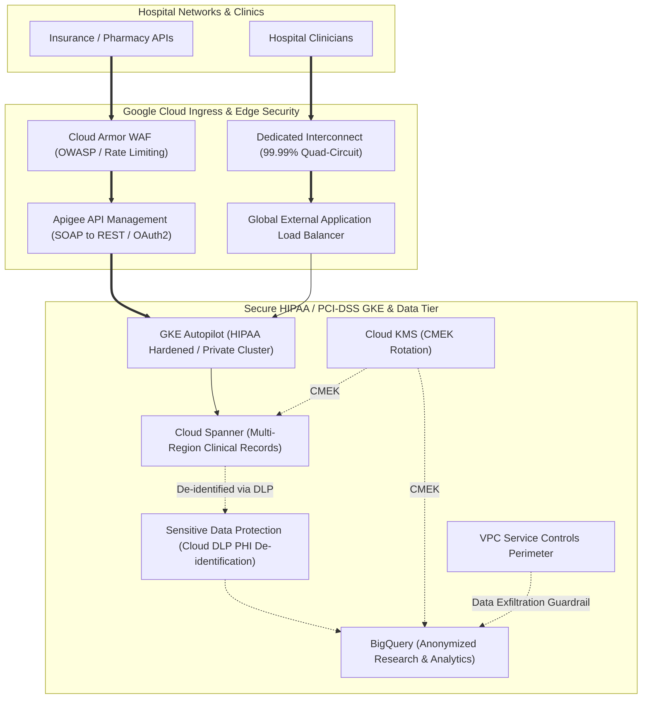
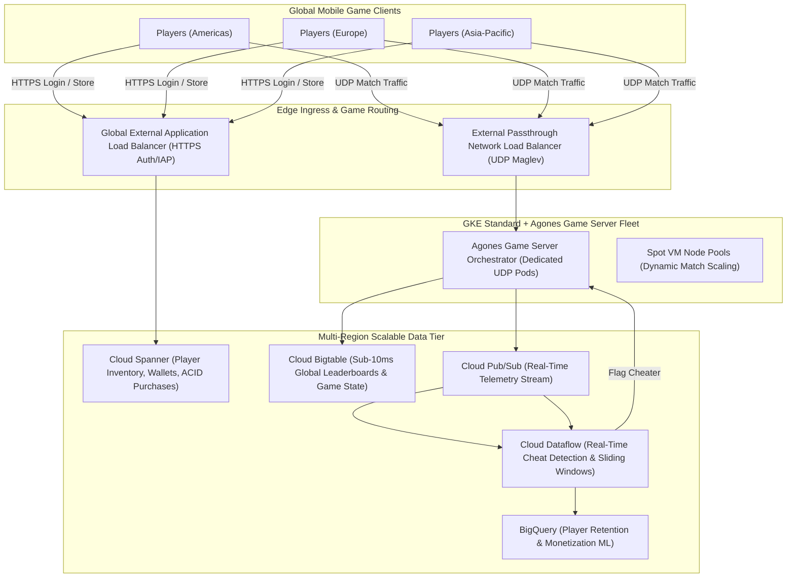
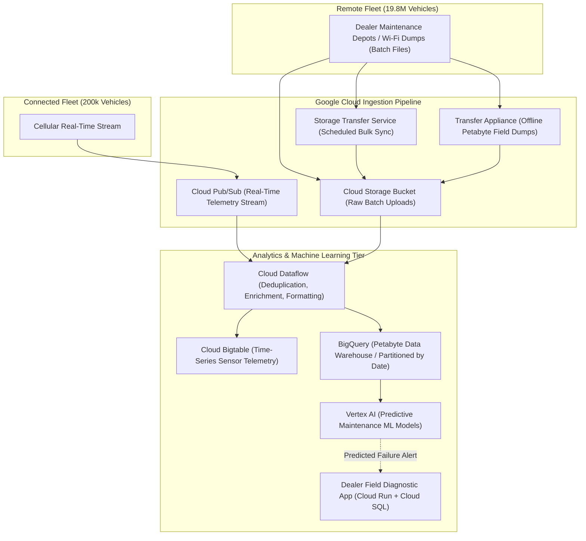
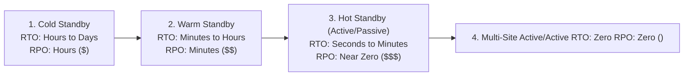
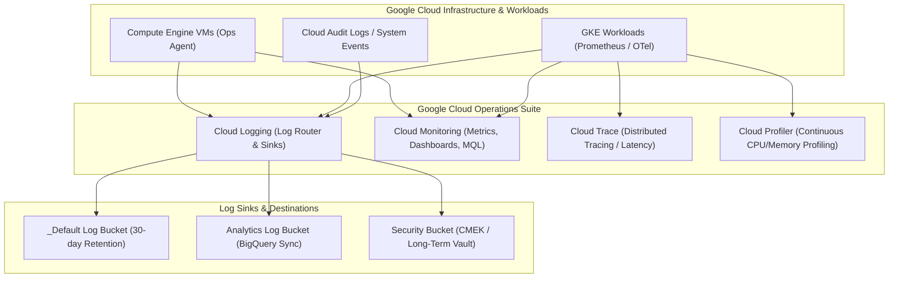

# Domain 5: Reliability, Operations & Official Case Studies — Study Guide

> [!IMPORTANT]
> **Exam Weighting & Case Study Significance:** Domain 5 accounts for **~21% of the Google Cloud Certified Professional Cloud Architect (PCA)** examination. A significant portion of exam questions directly reference Google's official published case studies: **EHR Healthcare**, **Mountkirk Games**, **TerramEarth**, and **Helicopter Racing League (HRL) / Cymbal Direct**. Questions evaluate your ability to analyze legacy enterprise constraints, map technical requirements to target reference architectures, design resilient multi-region disaster recovery systems ($RTO/RPO$), and implement Google Cloud Operations observability suites.

---

## 1. Deep Dive Architectural Teardowns of the 4 Official PCA Case Studies

### 1.1 Case Study 1: EHR Healthcare

* **Company Profile & Mission:** Leading provider of Electronic Health Record (EHR) software, patient portals, medical imaging systems, and insurance claims processing for hospitals across North America.
* **Existing Environment & Bottlenecks:**
  * Two colocation data centers with aging SAN/NAS storage arrays experiencing disk failure bottlenecks during morning clinical shifts.
  * Monolithic web and backend applications running on VMware vSphere with complex manual deployment scripts.
  * Intermittent connectivity between hospitals and data centers causes patient record synchronization failures.
  * Strict regulatory requirements: **HIPAA** (Protected Health Information / PHI) and **PCI-DSS** (patient billing).
* **Target Business & Technical Requirements:**
  * **99.99% Availability SLA** for critical clinical patient chart lookups.
  * Modernize legacy SOAP interfaces to secure, rate-limited RESTful APIs for third-party insurance payers and pharmacy networks.
  * Implement centralized data de-identification to enable machine learning research without exposing patient PHI.
  * Maintain complete auditability of all data access, including cloud provider engineering access.

* **Recommended Architecture & Exam Traps:**
  * **API Modernization:** Use **Apigee X** to expose RESTful interfaces, enforce OAuth 2.0 / MTLS authentication, and mediate legacy SOAP XML requests without rewriting on-premises backend logic.
  * **Compute Platform:** Deploy microservices to **GKE Autopilot** (or GKE Private Standard with Shielded Nodes) to satisfy HIPAA infrastructure compliance with automated security patching.
  * **Compliance & Sovereignty:** Deploy **Customer-Managed Encryption Keys (CMEK)** via Cloud KMS with automatic 90-day rotation. Enforce **VPC Service Controls** around BigQuery and Cloud Storage to prevent PHI exfiltration. Enable **Access Transparency** and **Access Approval** to cryptographically govern Google Support access.
  * **PHI De-identification:** Run **Sensitive Data Protection (Cloud DLP)** pipelines using deterministic pseudonymization (CryptoReplaceFfxFpeConfig) before moving records to BigQuery for medical research.

---

### 1.2 Case Study 2: Mountkirk Games

* **Company Profile & Mission:** Premier mobile game studio known for casual multiplayer titles, launching a fast-paced real-time PvP multiplayer mobile battle arena game.
* **Existing Environment & Bottlenecks:**
  * Previous games ran on single-region MySQL instances that suffered severe database lock contention and crashed during viral player adoption spikes.
  * Monolithic backend servers struggled with global multiplayer matchmaking latency.
  * Real-time game telemetry, cheat detection, and monetization metrics were delayed by 24+ hours due to legacy batch ETL scripts.
* **Target Business & Technical Requirements:**
  * Support rapid global player scaling from 10,000 to **tens of millions of concurrent players** with zero scheduled downtime.
  * Dynamically scale dedicated game server instances running over **low-latency UDP**.
  * Deliver sub-10ms global leaderboard updates and real-time fraud/cheat detection.
  * Optimize infrastructure costs by shutting down idle capacity during off-peak hours.

* **Recommended Architecture & Exam Traps:**
  * **Dedicated Game Servers:** Use **GKE Standard with Agones** (open-source Kubernetes game server controller) running dedicated UDP game sessions. *Trap:* Cloud Run does not support incoming UDP traffic; External Passthrough Network Load Balancer (Maglev) is required for low-latency line-rate UDP forwarding.
  * **Game Server Scaling:** Use **Spot VMs in secondary GKE node pools** for match servers to reduce compute costs by up to 90%, while keeping matchmaking logic on on-demand nodes.
  * **Database Split:**
    * Use **Cloud Spanner** for player authentication, persistent profiles, virtual currency wallets, and in-app transactions requiring strict ACID consistency and 99.999% multi-region uptime.
    * Use **Cloud Bigtable** for high-throughput, low-latency ($<10\text{ ms}$) leaderboards, player telemetry, and match state. *Trap:* Never use Cloud SQL for global multi-region write scaling.
  * **Real-Time Analytics:** Stream in-game telemetry to **Cloud Pub/Sub** $\to$ **Cloud Dataflow** (sliding-window anomaly detection for aimbots and speed hacks) $\to$ **BigQuery** for long-term player behavior analytics.

---

### 1.3 Case Study 3: TerramEarth

* **Company Profile & Mission:** Global industrial equipment manufacturer with 20 million connected agricultural, construction, and mining vehicles operating across 6 continents.
* **Existing Environment & Bottlenecks:**
  * 200,000 vehicles have continuous cellular connectivity and upload sensor data in real-time.
  * 19.8 million vehicles operate in remote mining pits and rural farms with **no cellular connectivity**; data is buffered locally on equipment flash storage and uploaded in massive batches via Wi-Fi when vehicles return to maintenance depots.
  * Ingesting 200 petabytes of sensor data per year. Legacy data warehouse takes weeks to run maintenance queries, causing equipment to break down in the field before repairs can be scheduled.
* **Target Business & Technical Requirements:**
  * Ingest real-time and massive bulk batch telemetry securely and cost-effectively.
  * Build predictive maintenance models using **Vertex AI** to identify part failures **before field breakdowns occur**, targeting 99.9% vehicle uptime.
  * Enable field dealers to query equipment health diagnostics via secure mobile APIs.
  * Keep operational and storage costs predictable at petabyte scale.

* **Recommended Architecture & Exam Traps:**
  * **Dual Ingestion Strategy:**
    * Real-time connected vehicles publish sensor readings directly to **Cloud Pub/Sub**.
    * Remote vehicles upload local batch files to local depot servers, which sync to **Cloud Storage** using **Storage Transfer Service (STS)**. For remote regions with poor bandwidth, use **Transfer Appliance**.
  * **Stream & Batch Convergence:** Process both Pub/Sub streams and GCS batch files using a single unified **Cloud Dataflow** pipeline (Apache Beam).
  * **Storage Engine Selection:**
    * Store raw time-series sensor readings in **Cloud Bigtable** using smart row keys (`equipment_id#sensor_type#reverse_timestamp`) to avoid hotspotting while enabling fast range scans.
    * Load aggregated data into **BigQuery** (partitioned by day and clustered by `equipment_type` and `dealer_id`) for analytical SQL queries and predictive model training.
  * **Predictive AI:** Train predictive maintenance models in **Vertex AI** that output anomaly scores to alert dealers before a hydraulic pump or turbine fails.

---

### 1.4 Case Study 4: Helicopter Racing League (HRL) / Cymbal Direct

* **Company Profile & Mission:** Global sports league broadcasting high-speed helicopter races with telemetry sensors, high-definition video feeds, and real-time fan predictions.
* **Existing Environment & Bottlenecks:**
  * Global audience streaming video feeds simultaneously; regional servers crashed during championship finals.
  * Video processing and AI-driven race analytics (predicting helicopter overtake probability) took hours, missing the live broadcast window.
  * Fans complained of high latency on live prediction leaderboards.
* **Target Business & Technical Requirements:**
  * Stream ultra-low-latency HD/4K video to millions of concurrent international viewers.
  * Real-time video frame analysis using pre-trained computer vision models to identify helicopter positions and display augmented telemetry overlays.
  * Global fan voting and predictions platform with instantaneous leaderboard sync.

* **Recommended Architecture & Exam Traps:**
  * **Video Edge Delivery:** **Global External Application Load Balancer** fronted by **Cloud CDN** with media streaming optimizations and **Cloud Armor** DDoS protection.
  * **Real-Time Video Analytics:** Stream video feeds into **Cloud Run** or **GKE with GPU accelerator node pools**, orchestrating **Vertex AI Vision** pipelines to generate real-time race telemetry overlays.
  * **Fan Interaction Tier:** Deploy fan prediction APIs on **Cloud Run** backed by **Cloud Firestore Native Mode** (utilizing real-time mobile client synchronization and snapshot listeners for instant leaderboard updates).
  * **Race State & Timing:** Store official race timings and ledger balances in **Cloud Spanner** for multi-region consistency ($99.999\%$ availability).

---

## 2. Disaster Recovery (DR) & Multi-Region Resilience Engineering

Enterprise disaster recovery plans are quantified using two fundamental engineering metrics:
1. **Recovery Time Objective (RTO):** Maximum acceptable duration of system downtime after an incident occurs before business operations must be fully restored.
2. **Recovery Point Objective (RPO):** Maximum acceptable age of data that can be lost due to an incident (measured in time units of lost transactions).

### 2.1 Disaster Recovery Tiers Decision Matrix

* **Cold Standby (Backup & Restore)**
  * **RTO:** Hours to Days | **RPO:** Hours
  * **Cost Index:** Lowest (\$)
  * **Architecture:** Compute instances are **NOT** running in the DR region. Data is backed up periodically using automated Cloud Storage multi-region bucket sync or Compute Engine persistent disk scheduled snapshots. Infrastructure is codified in **Terraform** and provisioned on-demand upon disaster declaration.
  * **Primary PCA Use Case:** Internal non-critical back-office batch tools, development environments, and archival systems.

* **Warm Standby (Pilot Light / Scaled Down)**
  * **RTO:** Minutes to Hours | **RPO:** Minutes
  * **Cost Index:** Medium (\$\$)
  * **Architecture:** Core data tier is **live and continuously replicating** to the DR region (e.g., Cloud SQL Cross-Region Read Replica or AlloyDB secondary cluster). A scaled-down compute tier runs continuously in the secondary region (e.g., GKE node pool or MIG with minimum size 1).
  * **Failover Mechanism:** Upon primary failure, a Cloud Function promotes the Cloud SQL read replica to primary and scales up the GCE MIG / GKE node pool to 100% capacity.

* **Hot Standby (Active/Passive)**
  * **RTO:** Seconds to Minutes | **RPO:** Near Zero
  * **Cost Index:** High (\$\$\$)
  * **Architecture:** Fully provisioned production-scale compute and database infrastructure running in the secondary region. Database uses synchronous or near-instant asynchronous cross-region replication.
  * **Failover Mechanism:** **Cloud DNS Failover Routing Policy** (or Load Balancer backend health checking) automatically switches traffic to the secondary region upon consecutive health check failures.

* **Multi-Region Active/Active**
  * **RTO:** Zero | **RPO:** Zero
  * **Cost Index:** Enterprise Premium (\$\$\$\$)
  * **Architecture:** Workload runs concurrently across multiple Google Cloud regions. All regions actively process live user transactions simultaneously.
  * **Key Enablers:**
    * Ingress via **Global External Application Load Balancer** with Anycast IP routing users to the nearest healthy region.
    * Database tier powered by **Cloud Spanner Multi-Region** (providing external consistency and synchronous Paxos replication across regions with $99.999\%$ availability).

---

## 3. Cloud Operations Suite (Observability & Monitoring)

### 3.1 Cloud Logging Architecture: Log Router & Sinks

* **Log Buckets:**
  * **`_Required` Bucket:** Stores Admin Activity, System Events, and Access Transparency logs. Free; retained for **400 days**; cannot be modified or deleted.
  * **`_Default` Bucket:** Stores all other incoming log entries (application logs, GKE stdout/stderr). Retained for **30 days** by default (can be extended up to 3650 days).
* **Log Exclusion Filters:**
  * **Cost Optimization Trap:** High-volume debug logs (`severity < NOTICE`) or noisy health check requests (`httpRequest.userAgent =~ "GoogleHC"`) can generate massive unexpected logging bills.
  * Create an **Exclusion Filter** on the `_Default` sink to discard high-volume non-essential logs before they are ingested and billed.
* **Aggregated Sinks (Organization & Folder Level):**
  * Allows security operations (SecOps) to collect and route audit logs from all current and future projects in the organization into a centralized, locked security project.
  * Must include the `--include-children` flag in `gcloud logging sinks create`.

### 3.2 Cloud Monitoring (Alerting & Metric Thresholds)

* **Google Cloud Ops Agent:** Unified agent for Compute Engine combining `Fluent Bit` (high-throughput logging) and `OpenTelemetry Collector` (system and application metrics like memory, swap, and disk inode usage).
* **Managed Service for Prometheus (GMP):** Fully managed, serverless Prometheus service for GKE and Compute Engine. Allows monitoring teams to keep existing PromQL alerts and Grafana dashboards without managing Prometheus server scaling or storage.
* **Alerting Notification Channels & Incident Response:** Integrates with PagerDuty, Slack, Webhooks, and Pub/Sub to trigger automated Cloud Functions runbook remediations.

### 3.3 Cloud Trace & Cloud Profiler

* **Cloud Trace:** Distributed tracing system that collects latency data from microservice architectures. Identifies exact microservice bottlenecks by tracking HTTP and gRPC request propagation across multi-tier GKE and Cloud Run clusters.
* **Cloud Profiler:** Continuous, low-overhead CPU and memory profiling tool ($<5\%$ CPU overhead) running inside production container workloads. Generates interactive flame graphs identifying exact lines of source code consuming excessive heap memory or CPU cycles.
