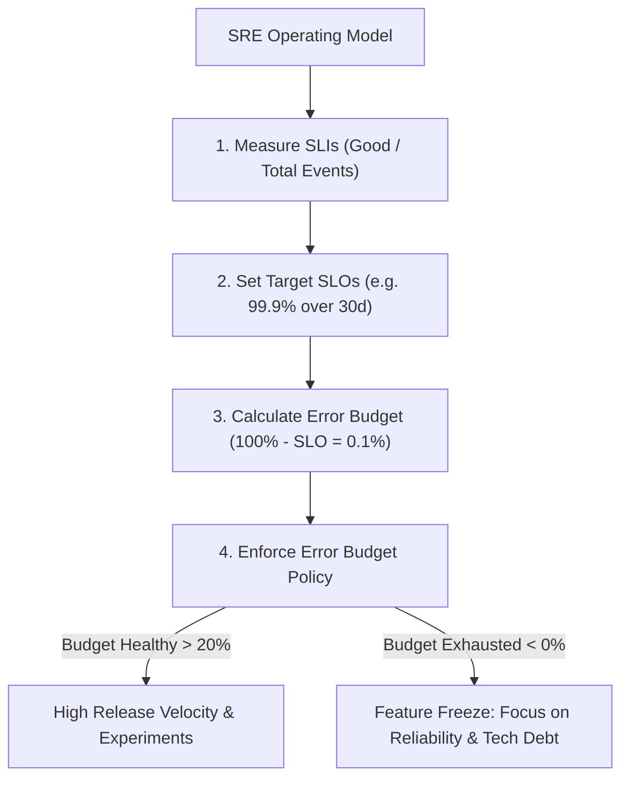

# Domain 1: Applying SRE Principles to a Service — In-Depth Master Study Guide

**Exam Weight:** 22% of GCP Professional Cloud DevOps Engineer  
**Core Competencies:** Service Level Indicators (SLIs), Service Level Objectives (SLOs), Service Level Agreements (SLAs), Error Budget Policies, Burn-Rate Alerting, Toil Identification & Reduction, Capacity Planning, and Chaos Engineering.

---

## 1. Google Site Reliability Engineering Foundations

Site Reliability Engineering (SRE) is what happens when you ask a software engineer to design an operations team. The primary goal of SRE is to maximize service feature velocity while maintaining an agreed-upon reliability threshold.

### 1.1 The Golden Hierarchy: SLI vs SLO vs SLA
1. **Service Level Indicator (SLI):** A carefully defined quantitative measure of some aspect of the level of service that is provided.
   - Example: The proportion of valid HTTPS requests to `/checkout` that return status code `< 500` and respond in $< 250\text{ ms}$, measured at the Google Cloud External Load Balancer.
2. **Service Level Objective (SLO):** A target value or range of values for a service level that is measured by an SLI over a defined compliance period.
   - Example: $99.9\%$ of valid requests are successful over a rolling 30-day compliance window.
3. **Service Level Agreement (SLA):** An explicit or implicit contract with your users that includes consequences of meeting (or missing) the SLOs they contain (financial penalties, bill credits, or contractual breach). SREs never write SLAs; SLAs are written by legal and business executives, and internal SLOs are always strictly tighter than public SLAs.

### 1.2 The Math of Error Budgets
An error budget represents the acceptable margin of unreliability:

$$\text{Error Budget} = 100\% - \text{SLO}$$

| SLO Target (30-day Rolling) | Error Budget (%) | Allowed Downtime / Errors (30 Days) |
| :---: | :---: | :---: |
| **99.0% (Two 9s)** | 1.0% | 7 hours, 12 minutes ($432\text{ min}$) |
| **99.9% (Three 9s)** | 0.1% | 43.2 minutes |
| **99.95%** | 0.05% | 21.6 minutes |
| **99.99% (Four 9s)** | 0.01% | 4.32 minutes |

### 1.3 Error Budget Policy & Enforcement
An error budget policy is a socially agreed contract between product development and SRE teams:
- **Budget > 20% Remaining:** Product teams deploy freely; dark launches, A/B experiments, and high-frequency canary deployments are encouraged.
- **Budget < 0% (Exhausted):** Production deployment freeze. Only P0 security fixes and reliability improvements may be deployed until the budget recovers or the 30-day window clears.

---

## 2. Multi-Window Multi-Burn-Rate Alerting (Google SRE Standard)

Traditional alerting based on static thresholds (e.g., `Error Rate > 1% for 5m`) produces alert fatigue during minor spikes or fails to detect slow burns that silently consume 100% of the budget.

$$\text{Burn Rate} = \frac{\text{Observed Error Rate}}{\text{Allowed Budget Error Rate}}$$

| Severity | Target Alert Window | Budget Consumed | Burn Rate | Short Window Confirmation | Notification Target |
| :--- | :---: | :---: | :---: | :---: | :--- |
| **Critical / Page** | 1 Hour | 2% | **$14.4\times$** | 5 Minutes | PagerDuty / On-Call SRE |
| **Critical / Page** | 6 Hours | 5% | **$6.0\times$** | 30 Minutes | PagerDuty / On-Call SRE |
| **Warning / Ticket** | 24 Hours | 10% | **$3.0\times$** | 2 Hours | Issue Tracker / Ticket |
| **Warning / Ticket** | 3 Days | 10% | **$1.0\times$** | 6 Hours | Issue Tracker / Ticket |

*Short-window confirmation prevents paging when an error spike clears before the SRE can wake up.*

---

## 3. Toil Identification, Budgeting & Reduction

Google defines **Toil** as work tied to running a production service that tends to be:
- Manual, repetitive, and automatable.
- Devoid of enduring value (does not permanently improve the system).
- Linearly scaling with service growth (doubling service traffic doubles the work).

### 3.1 The 50% Toil Rule
Google SRE caps toil at **$50\%$ of an engineer's time**. The remaining $50\%+$ must be spent on engineering projects that reduce future toil, improve reliability, or build automation.

### 3.2 Toil Reduction Strategies
1. **Self-Service Platforms:** Replace manual ticket requests with declarative infrastructure APIs (e.g. Backstage IDP, Terraform, Config Sync).
2. **Automated Runbooks:** Automate recurring remediation actions with Cloud Run jobs or Cloud Workflows.
3. **Chaos Engineering:** Inject intentional network latency or node crashes using Chaos Mesh or Gremlin to discover failure modes before outages occur.
