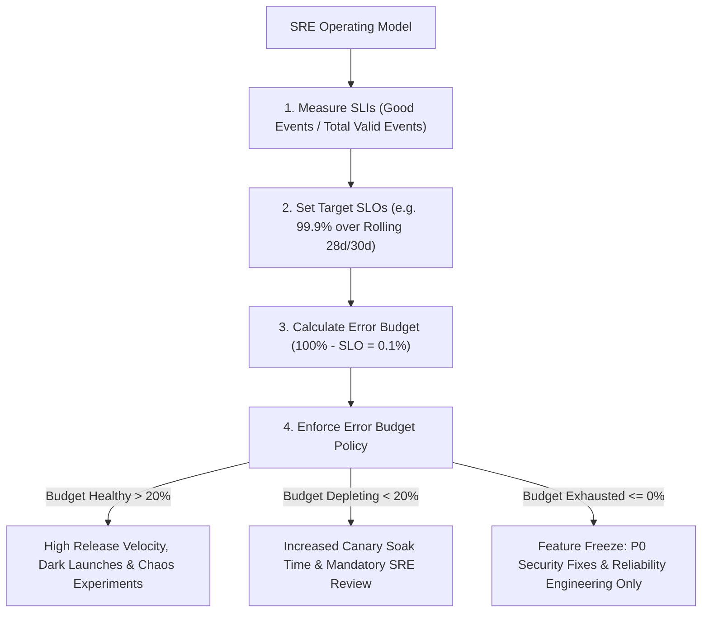
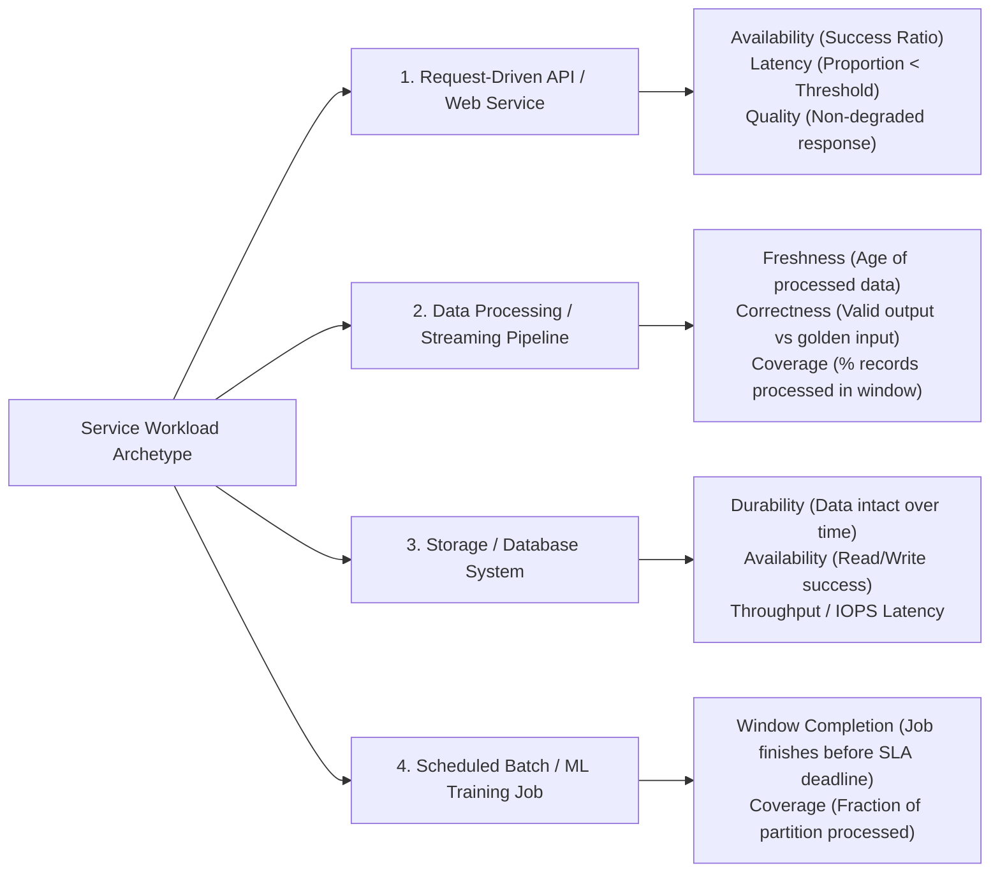

# Domain 1: Applying SRE Principles to a Service — Master-Level Study Guide

> [!IMPORTANT]
> **Exam Weighting & Core Focus:** Domain 1 accounts for **22% of the Google Cloud Certified Professional Cloud DevOps Engineer** exam. Questions in this domain test your mastery of Service Level Indicator (SLI) selection and mathematical engineering, Request-Based vs. Window-Based SLIs, Good/Total vs. Distribution Cutoffs, Service Level Objective (SLO) design, Error Budget calculation and enforcement policies, Multi-Window Multi-Burn-Rate alerting in Cloud Monitoring, Toil quantification and elimination, Capacity Planning, Load Testing, and Chaos Engineering.

---

## 1. Google Site Reliability Engineering Foundations

Site Reliability Engineering (SRE) treats operations as a software engineering problem. Rather than relying on manual intervention or rigid change-management gates to maintain stability, SRE uses **quantitative reliability targets (SLOs)** and **error budgets** to convert political tension between Product Development (who want maximum feature velocity) and Operations (who want zero outages) into an objective, data-driven feedback loop.



### 1.1 The Golden Hierarchy: SLI vs. SLO vs. SLA

* **Service Level Indicator (SLI)**
  * **Definition & Formula:** A carefully defined quantitative metric measuring a specific aspect of service behavior experienced by the user, expressed as a ratio of **good events** to **total valid events**, multiplied by $100\%$:
    $$\text{SLI} = \frac{\text{Good Events}}{\text{Total Valid Events}} \times 100\%$$
  * **Engineering Requirements:** Must range strictly from $0\%$ to $100\%$. Must exclude invalid client noise (such as unauthenticated `HTTP 401/403` or malformed `HTTP 400` requests) when measuring server-side availability, unless authentication itself is the service under test.
  * **Measurement Vantage Point:** Measure as close to the **user experience** as feasible (e.g., Synthetic Blackbox Prober $\to$ Global External Application Load Balancer metrics $\to$ Service Mesh Istio/Envoy telemetry $\to$ Application process metrics).
  * **Exam Trap:** Never use raw infrastructure metrics (`CPU Utilization < 80%`, `Memory Used < 75%`, or `Pod Restart Count == 0`) as SLIs! High CPU utilization is benign if user requests continue returning `HTTP 200` within latency targets; conversely, CPU can sit at $2\%$ during a complete deadlock outage where $100\%$ of requests fail.

* **Service Level Objective (SLO)**
  * **Definition & Formula:** A binding target threshold or range for an SLI evaluated over a formal compliance period (`rolling` or `calendar` window):
    $$\text{SLO}: \quad \text{SLI} \ge \text{Target}\% \quad \text{over Compliance Window } W$$
  * **Compliance Windows in GCP:**
    * **Rolling Window (`rollingPeriod`):** Dynamically evaluates the trailing $N$ days (e.g., `28d` or `30d`). Preferred for detecting continuous reliability trends and prevents artificial "budget resets" on the 1st of the month. Note: A **28-day rolling window** is frequently favored in Google SRE because it always contains an exact multiple of 4 full weeks (8 weekend days and 20 weekdays), eliminating calendar skew.
    * **Calendar Window (`calendarPeriod`):** Resets on fixed calendar boundaries (`DAY`, `WEEK`, `FORTNIGHT`, `MONTH`). Used when aligning directly with monthly business review cycles or billing periods.
  * **Target Calibration Philosophy:** Choose the **lowest reliability target that keeps users happy**. Over-engineering a service to achieve $99.999\%$ when users cannot perceive the difference above $99.9\%$ wastes engineering capital, slows feature delivery, and hides downstream client retry bugs.

* **Service Level Agreement (SLA)**
  * **Definition & Scope:** An explicit legal and commercial contract between a service provider and external paying customers that specifies consequences (financial rebates, service credits, or contract termination rights) if availability or latency falls below an agreed threshold.
  * **Relationship to Internal SLO:** The internal **SLO must always be strictly tighter (higher percentage / lower latency)** than the external SLA (e.g., Internal SLO = $99.95\%$, External SLA = $99.9\%$). This creates an early-warning buffer so SREs page, mitigate, and freeze feature releases before breaching the legal SLA.
  * **Exam Trap:** SREs do **not** draft SLAs; Product Management and Legal teams own SLAs. Furthermore, free-tier or internal non-revenue services almost always require **SLOs** to guide engineering priorities, even when they have **no SLA**.

---

## 2. SLI Taxonomy & Workload Archetype Mapping

Google SRE standardizes SLIs around user journeys rather than low-level system counters. Choosing the right SLI category depends on the workload archetype:



### 2.1 Detailed SLI Definitions by Workload Type

* **Request-Driven Services (HTTP/REST APIs, gRPC Microservices, Web Frontends)**
  * **Availability SLI:** Proportion of *valid* requests (`HTTP 2xx`, `3xx`, and client-caused `4xx` excluding `429 Too Many Requests` if rate-limiting is unintentional) that do not return server errors (`HTTP 5xx` or gRPC status `INTERNAL`, `UNAVAILABLE`, `DEADLINE_EXCEEDED`).
    $$\text{Availability SLI} = \frac{\text{Count}(\text{HTTP } 2\text{xx} + 3\text{xx} + 4\text{xx}_{\text{client}})}{\text{Count}(\text{All Valid Requests})}$$
  * **Latency SLI:** Proportion of valid requests served faster than an explicit latency threshold $T$ (e.g., $< 300\text{ ms}$ for interactive UI calls).
    * *Critical SRE Rule:* Always express Latency SLIs as a **fraction of events below a cutoff threshold** (e.g., *"99% of requests complete in $< 200\text{ ms}$ over 28 days"*), rather than alerting on a periodically computed `p99` gauge metric, so that high-traffic hours are weighted proportionally against low-traffic hours.
  * **Quality SLI:** If a service degrades gracefully under load (e.g., returning static cached product recommendations instead of personalized ML recommendations), Availability remains $100\%$, so a **Quality SLI** tracks the proportion of responses served without graceful degradation.

* **Asynchronous Data Processing & Streaming Pipelines (Dataflow, Pub/Sub, Kafka, BigQuery Ingestion)**
  * **Freshness SLI:** Proportion of valid data items processed and made visible downstream within $M$ seconds of event creation (End-to-End Watermark / System Lag):
    $$\text{Freshness SLI} = \frac{\text{Records visible within } \le 60\text{s of ingestion}}{\text{Total valid ingested records}}$$
  * **Correctness SLI:** Proportion of pipeline outputs that match expected schema and business calculation rules (verified by injecting synthetic golden canary records into the stream and validating their output checksums).
  * **Coverage SLI:** Proportion of expected input data records or micro-batches successfully processed within a given processing window without routing to a Dead-Letter Queue (DLQ).

* **Storage & Stateful Systems (Cloud Spanner, Cloud SQL, Cloud Storage, Bigtable)**
  * **Durability SLI:** Proportion of stored objects or rows that can be read back intact without bit-rot or loss over a compliance window.
  * **Read/Write Latency & Availability SLIs:** Measured separately for reads vs. writes because read paths (often cached) and write paths (requiring quorum commit/replication) fail independently.

---

## 3. Cloud Monitoring Service Monitoring API & SLI Mathematical Structures

Google Cloud Monitoring provides a native **Service Monitoring API** (`monitoring.googleapis.com/v3/projects/{project}/services/{service}/serviceLevelObjectives`) with out-of-the-box integration for **GKE**, **Istio / Cloud Service Mesh**, **App Engine**, and **Cloud Run**, plus custom definitions for any workload.

### 3.1 Request-Based SLIs vs. Window-Based SLIs

* **Request-Based SLIs (`requestBased`)**
  * **Mathematical Mechanism:** Counts individual good events vs. total valid events across the entire compliance window:
    $$\text{Request-Based SLI} = \frac{\sum_{t \in W} \text{Good Events}_t}{\sum_{t \in W} \text{Total Events}_t}$$
  * **Traffic Volume Weighting:** Busy peak hours (e.g., $100,000\text{ req/min}$ at noon) naturally carry $100\times$ more weight in the 30-day SLO calculation than idle 3:00 AM hours ($1,000\text{ req/min}$).
  * **Two Supported Sub-Types in GCP Service Monitoring:**
    1. **`goodTotalRatio` (`TimeSeriesRatio`):** Uses two separate `DELTA` or `CUMULATIVE` counter metrics (e.g., `goodServiceFilter` vs. `totalServiceFilter`, or `badServiceFilter` vs. `totalServiceFilter`). Ideal for **Availability SLIs**.
    2. **`distributionCut` (`DistributionCut`):** Uses a single `DISTRIBUTION` metric (such as `loadbalancing.googleapis.com/https/total_latencies` or `run.googleapis.com/request_latencies`) and counts the proportion of histogram bucket observations falling within `range: { min: 0, max: 300.0 }`. Ideal for **Latency SLIs**.
  * **Primary Exam Use Case:** The default, preferred choice whenever customer impact scales directly with request volume.

* **Window-Based SLIs (`windowsBased`)**
  * **Mathematical Mechanism:** Divides the compliance period into discrete evaluation intervals of length `windowPeriod` (e.g., `60s` or `300s`). Each window is evaluated against a boolean criterion (`goodBadMetricFilter` or `metricMeanInRange` / `metricSumInRange`) and binary-scored as **1 (Good Window)** or **0 (Bad Window)**:
    $$\text{Window-Based SLI} = \frac{\text{Count of Good Windows}}{\text{Total Number of Windows in Period}}$$
  * **Traffic Volume Weighting:** Every time window carries equal weight regardless of traffic volume. A 5-minute outage at 3:30 AM affecting 12 users burns the exact same error budget ($5 / 43,200 = 0.0115\%$) as a 5-minute outage on Black Friday noon affecting 500,000 users.
  * **Primary Exam Use Case:** Low-traffic during off-hours where customers still expect guaranteed uptime (e.g., an enterprise B2B payment gateway with contractual uptime per minute, or a synthetic uptime check running once per minute).
  * **Exam Trap:** If a question asks how to prevent a 10-minute midnight outage (when only 5 requests occurred and failed) from being completely masked by 10 million successful daytime requests, switch from a **Request-Based SLI** to a **Window-Based SLI**!

### 3.2 Production GCP Service Monitoring SLO JSON Payloads

#### Blueprint A: Request-Based Availability SLO (`goodTotalRatio`)
```json
{
  "displayName": "99.9% Rolling 28-Day Checkout API Availability",
  "goal": 0.999,
  "rollingPeriod": "2419200s",
  "serviceLevelIndicator": {
    "requestBased": {
      "goodTotalRatio": {
        "goodServiceFilter": "metric.type=\"loadbalancing.googleapis.com/https/request_count\" resource.type=\"https_lb_rule\" resource.label.\"url_map_name\"=\"prod-checkout-lb\" metric.label.\"response_code_class\"<\"500\"",
        "totalServiceFilter": "metric.type=\"loadbalancing.googleapis.com/https/request_count\" resource.type=\"https_lb_rule\" resource.label.\"url_map_name\"=\"prod-checkout-lb\""
      }
    }
  }
}
```

#### Blueprint B: Request-Based Latency SLO (`distributionCut`)
```json
{
  "displayName": "99.0% Requests < 250ms over Rolling 30 Days",
  "goal": 0.99,
  "rollingPeriod": "2592000s",
  "serviceLevelIndicator": {
    "requestBased": {
      "distributionCut": {
        "distributionFilter": "metric.type=\"run.googleapis.com/request_latencies\" resource.type=\"cloud_run_revision\" resource.label.\"service_name\"=\"payment-processor\"",
        "range": {
          "min": -Infinity,
          "max": 250.0
        }
      }
    }
  }
}
```

#### Blueprint C: Window-Based Latency SLO (`windowsBased` with `metricMeanInRange`)
```json
{
  "displayName": "99.5% of 1-Minute Windows with Mean Latency < 150ms",
  "goal": 0.995,
  "calendarPeriod": "MONTH",
  "serviceLevelIndicator": {
    "windowsBased": {
      "windowPeriod": "60s",
      "metricMeanInRange": {
        "timeSeries": "metric.type=\"custom.googleapis.com/orders/db_query_latency\" resource.type=\"k8s_container\"",
        "range": {
          "min": 0.0,
          "max": 150.0
        }
      }
    }
  }
}
```

---

## 4. Error Budget Mathematics & Policies

### 4.1 Error Budget Calculation Formulas

An **Error Budget** is the complement of the SLO target:
$$\text{Error Budget Ratio} = 1 - \text{SLO}$$

* **Time-Based Error Budget (for Window-Based SLIs or Complete Outages):**
  $$\text{Allowed Downtime} = \text{Window Duration} \times (1 - \text{SLO})$$
  For a 30-day compliance period ($30 \times 24 \times 60 = 43,200\text{ minutes}$):

- **99.0% (Two 9s)**
  - Error Budget: 1.0%
  - Allowed Downtime / Errors (30 Days): 7 hours, 12 minutes ($432\text{ min}$)
- **99.5%**
  - Error Budget: 0.5%
  - Allowed Downtime / Errors (30 Days): 3 hours, 36 minutes ($216\text{ min}$)
- **99.9% (Three 9s)**
  - Error Budget: 0.1%
  - Allowed Downtime / Errors (30 Days): 43.2 minutes ($2,592\text{ sec}$)
- **99.95%**
  - Error Budget: 0.05%
  - Allowed Downtime / Errors (30 Days): 21.6 minutes ($1,296\text{ sec}$)
- **99.99% (Four 9s)**
  - Error Budget: 0.01%
  - Allowed Downtime / Errors (30 Days): 4.32 minutes ($259.2\text{ sec}$)
- **99.999% (Five 9s)**
  - Error Budget: 0.001%
  - Allowed Downtime / Errors (30 Days): 25.92 seconds

* **Event-Based Error Budget (for Request-Based SLIs):**
  $$\text{Allowed Bad Requests} = \text{Total Valid Requests in Window} \times (1 - \text{SLO})$$
  * *Worked Exam Calculation:* Suppose an API serves $50,000,000$ valid requests over a 30-day period and has an availability SLO of $99.95\%$.
    1. $\text{Error Budget Ratio} = 1 - 0.9995 = 0.0005$ ($0.05\%$).
    2. $\text{Total Allowed Failed Requests} = 50,000,000 \times 0.0005 = 25,000\text{ errors}$.
    3. If a canary deployment bug causes $15,000$ `HTTP 500` responses before rollback, it has consumed $\frac{15,000}{25,000} = 60\%$ of the monthly error budget, leaving $10,000$ errors ($40\%$) remaining.

* **Composite / Multi-Component Serial Dependency Math:**
  When a user request synchronously traverses $N$ independent microservices in series, the maximum theoretical composite availability is the **product** of each dependency's SLO:
  $$\text{SLO}_{\text{composite}} = \prod_{i=1}^{N} \text{SLO}_i$$
  * *Example:* If an API Gateway ($99.9\%$) calls an Auth Service ($99.9\%$), an Order Service ($99.9\%$), and a Cloud SQL instance ($99.95\%$):
    $$\text{SLO}_{\text{composite}} = 0.999 \times 0.999 \times 0.999 \times 0.9995 \approx 0.9965 \text{ (or } 99.65\%)$$
  * *Architectural Consequence:* You **cannot** promise a $99.99\%$ SLO for a synchronous user path that relies on a non-cached critical dependency with a $99.9\%$ SLO unless you decouple the dependency asynchronously (e.g., Pub/Sub queue), add multi-region active-active failover, or serve degraded cached responses when the dependency fails.

### 4.2 Error Budget Policy Governance

An **Error Budget Policy** is a written, executive-sponsored document drafted jointly by Product Management, Engineering Leadership, and SRE **before** an outage occurs. It specifies objective triggers and mandatory actions:

1. **Single Incident Consumption Trigger (> 20% Budget Burned in One Outage):**
   * Mandatory blameless postmortem must be drafted within 48 hours and reviewed with engineering leadership.
   * At least one **P0/P1 preventative engineering action item** must be placed at the top of the next sprint backlog.
2. **Error Budget Exhaustion Trigger ($\le 0\%$ Remaining in 28/30-Day Window):**
   * **Immediate Feature Freeze:** All general feature deployments and risky experiments are halted.
   * **Permitted Exceptions:** Only **P0 urgent security vulnerability patches**, **legal/compliance mandates**, and **engineering changes directly improving reliability or fixing the root cause of the outage** may be deployed.
   * **SRE Golden Rule on Escalation:** If a Product VP demands to push a major launch despite an exhausted error budget, the decision escalates to the **Executive Sponsor (CTO / VP of Engineering)**. If the CTO grants a one-time exception or permanently relaxes the SLO target, SRE documents the risk acceptance. If the team chronically misses its SLO and has zero error budget, SRE may return pager ownership to the development team ("handing back the pager") until the service meets production readiness standards.

---

## 5. Multi-Window Multi-Burn-Rate Alerting (The Google SRE Standard)

### 5.1 Why Naive Threshold and Single-Window Alerts Fail

 Alerting on raw error rates over short windows (e.g., `HTTP 5xx > 0.1% for 5 minutes`) suffers from four fatal flaws:
1. **Poor Reset Time:** Once the spike ends, a long-window alert stays firing for hours even after the system recovers; a short-window alert fires on transient 2-minute network blips that consume less than $0.3\%$ of the monthly error budget.
2. **Low Precision (Alert Fatigue):** Paging an engineer at 2:00 AM for a brief error rate spike that resolves itself in 90 seconds destroys on-call sustainability.
3. **Blindness to Slow Burns:** A threshold set high enough to avoid false positives (e.g., `Error Rate > 5%`) will completely miss a steady $0.3\%$ error rate on a $99.9\%$ SLO service—which silently burns $300\%$ of the monthly error budget ($100\%$ exhausted in 10 days)!

### 5.2 Burn Rate Mathematical Derivation

**Burn Rate** measures how fast a service is consuming its error budget relative to a uniform consumption rate across the entire compliance window:

$$\text{Burn Rate} = \frac{\text{Observed Error Rate in Alerting Window}}{\text{Allowed Error Rate } (1 - \text{SLO})}$$

* At a **Burn Rate of $1.0\times$**, the service will exhaust exactly $100\%$ of its 30-day ($720\text{-hour}$) error budget in exactly $30\text{ days}$ ($720\text{ hours}$).
* To calculate the **Time to Complete Exhaustion** at burn rate $B$:
  $$\text{Time to Exhaust } 100\% \text{ Budget} = \frac{\text{Compliance Period (720 hours)}}{B}$$
* To calculate the **Percentage of 30-Day Budget Consumed** during an alerting window of duration $W_{\text{hours}}$ at burn rate $B$:
  $$\text{Budget Consumed (\%)} = \frac{B \times W_{\text{hours}}}{720\text{ hours}} \times 100\%$$
* Conversely, given a target **Budget Consumed fraction $C$** over an observation window $W_{\text{hours}}$, the required **Burn Rate Threshold $B$** is:
  $$B = \frac{C \times 720\text{ hours}}{W_{\text{hours}}}$$

- **Critical / Page (1-Hour Fast Burn)**
  - Target Alert Window: 1 Hour
  - Budget Consumed: 2%
  - Burn Rate: **$14.4\times$**
  - Short Window Confirmation: 5 Minutes
  - Notification Target: PagerDuty / On-Call SRE
- **Critical / Page (6-Hour Medium Burn)**
  - Target Alert Window: 6 Hours
  - Budget Consumed: 5%
  - Burn Rate: **$6.0\times$**
  - Short Window Confirmation: 30 Minutes
  - Notification Target: PagerDuty / On-Call SRE
- **Warning / Ticket (24-Hour Slow Burn)**
  - Target Alert Window: 24 Hours
  - Budget Consumed: 10%
  - Burn Rate: **$3.0\times$**
  - Short Window Confirmation: 2 Hours
  - Notification Target: Issue Tracker / Ticket
- **Warning / Ticket (3-Day Slow Burn)**
  - Target Alert Window: 3 Days
  - Budget Consumed: 10%
  - Burn Rate: **$1.0\times$**
  - Short Window Confirmation: 6 Hours
  - Notification Target: Issue Tracker / Ticket

> [!TIP]
> **How to Memorize the Google SRE Burn Rate Numbers for the Exam:**
> * **1-Hour Fast Burn ($14.4\times$):** $\frac{2\% \text{ of } 720\text{h}}{1\text{h}} = \frac{0.02 \times 720}{1} = \mathbf{14.4\times}$. Short window is $\frac{1}{12}$ of the long window: $\frac{60\text{m}}{12} = \mathbf{5\text{m}}$.
> * **6-Hour Medium-Fast Burn ($6.0\times$):** $\frac{5\% \text{ of } 720\text{h}}{6\text{h}} = \frac{0.05 \times 720}{6} = \mathbf{6.0\times}$. Short window is $\frac{1}{12}$ of the long window: $\frac{360\text{m}}{12} = \mathbf{30\text{m}}$.
> * **Why Multi-Window (Long AND Short Window)?** The **Long Window (`1h` or `6h`)** ensures a statistically significant chunk of error budget ($2\%$ or $5\%$) has actually been burned before waking a human. The **Short Window (`5m` or `30m`)** confirms that errors are **still actively occurring right now** at $\ge 14.4\times$ or $\ge 6.0\times$ burn rate. The alert only fires when **BOTH** windows exceed the burn rate threshold (`Long_Window_Burn >= 14.4 AND Short_Window_Burn >= 14.4`), so the alert resets within 5 minutes after mitigation instead of lingering for 55 minutes!

### 5.3 GCP Cloud Monitoring Burn-Rate Alerting Configuration

In Google Cloud Monitoring, once an SLO is defined via the Service Monitoring API, you query its burn rate using the built-in **Time Series Selector (SLO Burn Rate retriever)**:
`select_slo_burn_rate("projects/{PROJECT_ID}/services/{SERVICE_ID}/serviceLevelObjectives/{SLO_ID}", "{LOOKBACK_PERIOD}")`

```hcl
# Terraform: Multi-Window Fast-Burn Alert Policy (1h / 5m @ 14.4x Burn Rate)
resource "google_monitoring_alert_policy" "checkout_slo_fast_burn_page" {
  display_name = "CRITICAL: Checkout API 99.9% SLO Fast Burn (14.4x over 1h & 5m)"
  combiner     = "AND" # CRITICAL: Must evaluate BOTH 1h and 5m windows simultaneously!

  conditions {
    display_name = "Long Window: 1-Hour Burn Rate > 14.4x (2% Budget)"
    condition_threshold {
      filter          = "select_slo_burn_rate(\"projects/prod-fin-01/services/checkout-api/serviceLevelObjectives/avail-999-28d\", \"3600s\")"
      comparison      = "COMPARISON_GT"
      threshold_value = 14.4
      duration        = "0s"
    }
  }

  conditions {
    display_name = "Short Window: 5-Minute Burn Rate > 14.4x (Active Confirmation)"
    condition_threshold {
      filter          = "select_slo_burn_rate(\"projects/prod-fin-01/services/checkout-api/serviceLevelObjectives/avail-999-28d\", \"300s\")"
      comparison      = "COMPARISON_GT"
      threshold_value = 14.4
      duration        = "0s"
    }
  }

  notification_channels = [google_monitoring_notification_channel.pagerduty_sre.name]

  alert_strategy {
    auto_close = "1800s"
  }
}
```

---

## 6. Toil Identification, Quantification & Elimination

### 6.1 Defining Characteristics of Toil vs. Engineering Work

Google SRE defines **Toil** as operational work tied to running a production service that exhibits the following traits:
* **Manual & Repetitive**
  * **Toil:** Running a script manually via SSH to clear full `/var/log` disks every Tuesday; manually approving routine firewall port requests; copy-pasting database credentials into Kubernetes Secrets.
  * **Not Toil (Overhead / Engineering):** Writing a quarterly strategic roadmap, attending team retrospectives, or conducting a one-off architecture migration (these are *administrative overhead* or *engineering*, not toil).
* **Automatable (No Human Judgment Required)**
  * **Toil:** Executing a documented 12-step runbook verbatim whenever a non-critical Kafka consumer lags, or manually promoting a canary rollout after looking at a dashboard.
  * **Not Toil:** Leading incident command during a novel multi-region Cloud Spanner cascading failure requiring creative architectural trade-offs.
* **Tactical & Devoid of Enduring Value**
  * **Toil:** Leaves the service in the exact same architectural state after completion ("keeping the lights on").
  * **Engineering Work:** Permanently improves the system (e.g., implementing an operator or Cloud Workflows automation that eliminates the entire class of manual work forever).
* **Scales Linearly with Service Growth ($O(N)$)**
  * **Toil:** If doubling the number of GKE clusters or microservices doubles the human hours spent provisioning namespaces, rotating certificates, or tuning HPA manifests, that work is **toil**.

### 6.2 The 50% Toil Cap & SRE Remediation Loop

> [!WARNING]
> **The Google SRE 50% Rule:** Toil must be strictly capped at **$\le 50\%$ of each SRE's time** (and ideally $< 30\%$). At least **$50\%$ of SRE time** must be dedicated to **software engineering projects** that eliminate future toil, build self-service automation, or improve service reliability and observability.

When toil exceeds $50\%$, an SRE team enters "ops bankruptcy" (firefighting all day with zero time left to fix the root causes of the fires). To recover:
1. **Measure & Quantify Toil:** Track interrupts, tickets, and pages per on-call shift in issue-tracking metadata; categorize the top 3 toil generators by engineering hours burned per week.
2. **Eliminate Noisy Alerts:** Delete non-actionable alerts, convert symptom-less threshold alerts into SLO burn-rate alerts, and raise auto-remediation tickets instead of paging humans.
3. **Build Self-Service Platforms & Declarative Automation:** Replace human ticket queues with **Config Sync (GitOps)**, **Terraform with Workload Identity Federation**, **Certificate Manager**, and **External Secrets Operator**.
4. **Push Back to Development ("Spillback"):** If an application generates excessive operational toil due to poor engineering quality or lack of automated deployment tooling, temporarily transfer on-call/ticket load back to the product engineering team until toil returns below $50\%$.

---

## 7. Capacity Planning, Load Testing & Chaos Engineering

### 7.1 Organic vs. Inorganic Growth & Capacity Planning

Capacity planning ensures a service meets its latency and availability SLOs under both baseline and peak demand without wasting cloud spend:

* **Organic Growth**
  * **Definition:** Natural, gradual increase in resource consumption driven by user adoption, seasonal traffic cycles, or organic business expansion.
  * **Forecasting Mechanism:** Time-series statistical regression and seasonality modeling using historical Cloud Monitoring request rate and resource utilization data exported to BigQuery.
* **Inorganic Growth**
  * **Definition:** Sudden, step-function spikes in demand caused by planned business events, marketing launches, flash sales, new feature rollouts, or enterprise customer onboarding.
  * **Forecasting Mechanism:** Cannot be predicted from historical metrics alone! Requires cross-functional collaboration with Product Management and Marketing, load testing (`Locust`, `k6`, `JMeter`), and pre-warming infrastructure or requesting **GCP Regional/Zonal Quota increases** ahead of the launch.

### 7.2 N+1 and N+2 Redundancy & The Thundering Herd Trap

Suppose a regional service running across 3 zones (`us-central1-a`, `us-central1-b`, `us-central1-c`) requires **600 CPU cores** to handle peak traffic while maintaining its latency SLO at a maximum safe utilization of **$60\%$ CPU**:
* **Why $100\%$ Utilization in Each Zone Fails During a Zonal Outage:**
  * If each of the 3 zones provisions exactly 200 cores running at $100\%$ utilization ($3 \times 200 = 600$ cores), losing **one zone (`N+1` failure)** dumps all 600 cores worth of traffic onto the remaining 2 zones (400 cores total $\to 150\%$ overload). Autoscalers take 60–180 seconds to provision new GCE nodes or pull large container images, causing cascading timeouts and total regional outage!
* **Calculating N+1 Zonal Capacity:**
  * With 3 zones, if 1 zone fails, the remaining **2 zones** must immediately absorb $100\%$ of peak traffic without exceeding critical saturation ($80\%$–$85\%$ max utilization):
    $$\text{Minimum Capacity per Zone (3 Zones, N+1)} = \frac{\text{Total Peak Demand}}{2 \times \text{Max Safe Utilization}}$$
    For 600 cores peak load at $75\%$ emergency cap: $\frac{600}{2 \times 0.75} = 400\text{ cores per zone}$ ($1,200\text{ cores total}$ across 3 zones, running at $50\%$ normal baseline utilization).

### 7.3 Load Testing vs. Stress Testing vs. Chaos Engineering

* **Load Testing (Verification of SLOs at Expected Peak)**
  * **Objective:** Prove that the system meets its **99.9% Availability and p99 Latency SLOs** at projected peak traffic (e.g., $2\times$ normal Black Friday load) and verify that **Horizontal Pod Autoscalers (HPA)**, **Cluster Autoscaler / Node Auto-Provisioning**, and **Cloud SQL read replicas** scale smoothly.
  * **Production Replay / Shadow Traffic:** Mirror live production traffic asynchronously to a staging or dark canary deployment (`envoy` traffic mirroring) to test with realistic payload distributions without impacting users.
* **Stress / Breakpoint Testing (Finding the Hard Ceiling)**
  * **Objective:** Continuously ramp up load past $2\times, 5\times, 10\times$ until the service breaks to identify the **first bottleneck** (e.g., Cloud SQL `max_connections` exhaustion, Cloud NAT ephemeral port exhaustion, or GKE conntrack table saturation) and verify that **load shedding** (`HTTP 429` or `503`) degrades gracefully rather than crashing the entire cluster.
* **Chaos Engineering & DiRT (Disaster Recovery Testing)**
  * **Objective:** Proactively inject controlled faults into staging or production environments (following Google's **DiRT — Disaster Recovery Testing** methodology) to validate automated failover, circuit breakers, and human runbooks *before* an unexpected outage occurs.
  * **Core Chaos Engineering Guardrails (Exam Must-Know):**
    1. **Hypothesis-Driven:** Formulate a clear steady-state hypothesis measured by your **SLI/SLO** (e.g., *"Terminating all pods in `us-central1-a` will consume $< 0.5\%$ of the monthly error budget while Traffic Director shifts load to `us-central1-b` within 10 seconds"*).
    2. **Minimize Blast Radius:** Start in non-production or a tiny canary slice of production traffic during business hours with SREs watching live dashboards.
    3. **Automated Abort ("Big Red Button") & Error Budget Check:** **Never** run chaos experiments in production if the service's **Error Budget is exhausted ($\le 0\%$)** or nearly depleted! Configure automated kill-switches that immediately halt fault injection if the short-window SLO burn rate exceeds threshold.

---

## 8. Domain 1 Exam Scenarios & Decision Matrix

* **Scenario 1: High-Traffic Service Masking Nighttime Outages**
  * **Situation:** An e-commerce checkout API serves 10M requests between 8 AM and 8 PM and only 1,000 requests between 2 AM and 4 AM. A 30-minute total outage at 3 AM causes 500 failed requests, barely denting the request-based 99.9% SLO ($10,000$ allowed errors), yet enterprise partners complain that nightly batch syncs fail.
  * **Architectural Solution:** Replace or supplement the Request-Based SLI with a **Window-Based SLI (`windowsBased`)** using 1-minute or 5-minute windows, or create a dedicated separate SLO for the batch sync endpoint so low-volume hours carry equal weight.

* **Scenario 2: Alert Fatigue from Transient Error Spikes**
  * **Situation:** On-call SREs are paged 4 times a night by an alert policy configured as `HTTP 5xx rate > 0.1% for 1 minute`. By the time the engineer logs in, the spike has already resolved, and the monthly 99.9% error budget is still 94% intact.
  * **Architectural Solution:** Replace the static threshold alert with a **Multi-Window Multi-Burn-Rate Alert Policy** in Cloud Monitoring (`14.4x` burn rate over **1 hour AND 5 minutes** for paging; `6x` burn rate over **6 hours AND 30 minutes** for paging; `1x`–`3x` burn rate over **24h–72h** for non-paging tickets).

* **Scenario 3: Chronic Toil Exceeding 70% of SRE Capacity**
  * **Situation:** An SRE team spends 75% of every week manually restarting stuck GKE pods, resizing persistent volumes, and executing manual deployment steps for a legacy microservice, leaving zero time for automation.
  * **Architectural Solution:** Enforce the **50% Toil Cap**. Quantify toil via ticket tagging, implement Kubernetes Liveness/Readiness probes and automated storage expansion to eliminate the top manual interrupts, and **spill back (hand back)** excess operational ticket load or pager duties to the application development team until toil drops below 50%.

* **Scenario 4: Product Team Wants to Launch Major Feature During Zero Error Budget**
  * **Situation:** A service with a 99.95% SLO suffered a 30-minute outage last week, leaving `-38%` remaining error budget. Product Management wants to deploy a major schema-changing release today.
  * **Architectural Solution:** Enforce the **Error Budget Policy**: halt all non-essential feature releases and restrict deployments strictly to **P0 security patches** and **reliability improvements** until the rolling window recovers positive budget—or require formal **Executive Sponsor escalation** if business leadership chooses to override the policy.
