# Domain 2: Building & Implementing CI/CD Pipelines — In-Depth Master Study Guide

**Exam Weight:** 25% of GCP Professional Cloud DevOps Engineer  
**Core Competencies:** Cloud Build pipelines, Artifact Registry management, Google Cloud Deploy (delivery pipelines, targets, releases, rollouts), Skaffold declarative definitions, Progressive delivery (Canary, Blue-Green, Shadow/Mirroring, Rolling), and GitOps with Config Sync.

---

## 1. Google Cloud Native CI/CD Pipeline Architecture

Modern software delivery on Google Cloud decouples **Continuous Integration (CI)** from **Continuous Delivery (CD)**:
- **CI Tier (Cloud Build):** Compiles code, runs unit and static security tests, builds container images via Kaniko/Docker, and pushes immutable digest-pinned images to Artifact Registry.
- **CD Tier (Google Cloud Deploy):** Manages release progression across environments (dev $\to$ staging $\to$ prod), canary traffic shifting, automated rollbacks, and approvals.

```mermaid
flowchart LR
    Dev["Developer Git Push"] --> Trigger["Cloud Build Trigger"]
    Trigger --> Kaniko["Build Container (Kaniko Cache)"]
    Kaniko --> Sec["Artifact Analysis (Vulnerability Scan)"]
    Sec --> AR["Artifact Registry (Digest Tagging)"]
    AR --> Deploy["Cloud Deploy Release"]
    Deploy --> TargetDev["Target: Dev Cluster"]
    TargetDev --> TargetStg["Target: Staging Cluster"]
    TargetStg -->|Canary 10% -> 50% -> 100%| TargetProd["Target: Production Cluster"]
```



---

## 2. Google Cloud Deploy: Core Concepts & CRD Architecture

Google Cloud Deploy is an opinionated, serverless continuous delivery service for GKE, Cloud Run, and GKE Enterprise.

### 2.1 Key Resources
1. **Delivery Pipeline (`DeliveryPipeline`):** Defines the sequence of deployment stages (targets) and deployment strategy (e.g., canary percentage steps).
2. **Target (`Target`):** The specific runtime infrastructure destination (a GKE cluster, a Cloud Run location, or a custom target).
3. **Release (`Release`):** A point-in-time snapshot of the delivery pipeline configuration, rendering artifacts (via Skaffold), and container image digests. Once created, a release is immutable.
4. **Rollout (`Rollout`):** The operational execution of deploying a specific Release to a specific Target.

### 2.2 Progressive Deployment Strategies in Cloud Deploy
- **Standard Rolling Update:** Incrementally updates pods using standard Kubernetes rolling update mechanics (`maxUnavailable`, `maxSurge`).
- **Canary Strategy:** Automatically creates canary and stable services, shifts traffic across stages (e.g. 10%, 25%, 50%, 100%), and evaluates verification hooks before promotion.
  ```yaml
  strategy:
    canary:
      runtimeConfig:
        kubernetes:
          serviceNetworking:
            service: order-svc
            deployment: order-app
      canaryDeployment:
        percentages: [10, 25, 50]
        verify: true
  ```
- **Blue-Green Strategy:** Runs two identical production environments simultaneously, routing 100% of live traffic to the green deployment once smoke tests pass.

---

## 3. Skaffold in Cloud Deploy

Google Cloud Deploy relies on **Skaffold** as its rendering engine.
- Developers use `skaffold.yaml` locally for fast inner-loop development (`skaffold dev`).
- Cloud Deploy invokes Skaffold in the cloud during release creation (`skaffold render`) and deployment (`skaffold apply`), applying environment-specific Kustomize overlays or Helm values based on profiles.

---

## 4. Artifact Registry & Supply Chain Security

Google Cloud **Artifact Registry** replaces deprecated Container Registry (GCR):
- Supports standard OCI containers, Maven, npm, Python (PyPI), and Apt/Yum packages.
- Integrates with **Artifact Analysis** for automatic vulnerability scanning (CVE detection).
- Enforces **Binary Authorization**: GKE clusters verify cryptographic signatures (attestations) created during Cloud Build before admitting container images to production.
