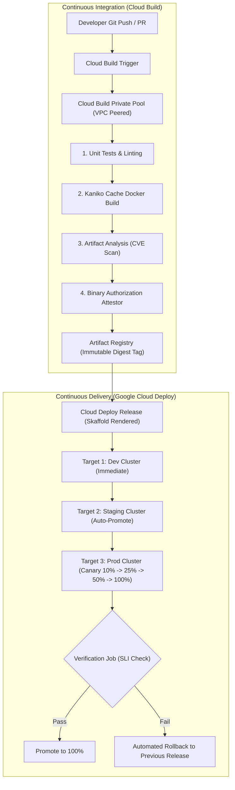

# Domain 2: Building & Implementing CI/CD Pipelines — In-Depth Master Study Guide

> [!IMPORTANT]
> **Exam Weighting & Core Architecture Focus:** Domain 2 accounts for **25% of the Google Cloud Certified Professional Cloud DevOps Engineer** examination—the largest single domain on the exam. Questions test your mastery of automated build architectures (Cloud Build, Private Pools, Kaniko caching, Secret Manager), artifact governance (Artifact Registry repository topologies, cleanup policies, vulnerability scanning), release progression with Google Cloud Deploy (delivery pipelines, targets, canary traffic shifting, post-deploy verification jobs, rollbacks), Skaffold configuration profiles, and GitOps fleet synchronization with Config Sync.

---

## 1. Google Cloud Native CI/CD Pipeline Architecture

Modern software delivery on Google Cloud decouples **Continuous Integration (CI)** from **Continuous Delivery (CD)** to maintain strict boundary isolation, prevent pipeline credential leakage, and enforce immutable release artifacts.



---

## 2. Google Cloud Build: Enterprise Pipeline Engineering

Google Cloud Build is a serverless, highly scalable platform that executes builds on Google-managed infrastructure or customer-managed private VPC networks.

### 2.1 Default Worker Pool vs. Private Pools

* **Default Worker Pool**
  * **Network Isolation:** Runs on a Google-managed multi-tenant VPC with internet access.
  * **Compute Flexibility:** Fixed machine types (`e2-medium`, `e2-standard-2` up to `e2-standard-32`).
  * **Limitations:** Cannot directly access private RFC 1918 internal resources (e.g., GKE private clusters, internal database instances, on-premises GitLab repositories over Interconnect) without exposing them to the public internet.

* **Cloud Build Private Pools (Enterprise Standard)**
  * **Network Isolation:** Fully private, single-tenant worker VMs deployed in a Google-owned VPC network that connects to your customer VPC via **Private Services Access (PSA) VPC Peering**.
  * **Internal Access:** Can reach private GKE control plane endpoints, internal Git servers, on-premises systems over VPN/Interconnect, and internal Nexus/Artifactory servers.
  * **Static Egress IP:** Can be routed through a dedicated Cloud NAT gateway to provide **deterministic static outbound IP addresses** for whitelisting at third-party SaaS vendors.
  * **Custom Compute Sizing:** Supports high-CPU/high-memory machine types (up to `e2-highcpu-32` or custom machine series) with configurable disk sizes.

```bash
# Provision a Cloud Build Private Pool peered to a Shared VPC
gcloud compute addresses create "cloud-build-psa-range" \
    --global \
    --purpose=VPC_PEERING \
    --prefix-length=24 \
    --network="projects/host-project-id/global/networks/prod-shared-vpc"

gcloud services vpc-peerings connect \
    --service=servicenetworking.googleapis.com \
    --ranges="cloud-build-psa-range" \
    --network="projects/host-project-id/global/networks/prod-shared-vpc"

gcloud builds worker-pools create "prod-private-pool" \
    --project="prod-ci-project" \
    --region="us-central1" \
    --peered-network="projects/host-project-id/global/networks/prod-shared-vpc" \
    --worker-machine-type="e2-standard-8" \
    --worker-disk-size=100
```

### 2.2 Advanced `cloudbuild.yaml` Engineering

```yaml
steps:
  # Step 1: Run unit tests concurrently using parallel step execution (waitFor: ['-'])
  - name: 'golang:1.27-alpine'
    id: 'unit-tests'
    entrypoint: 'go'
    args: ['test', '-v', '-race', './...']
    waitFor: ['-']

  # Step 2: Secret Manager Integration & Database Migration (runs in parallel with tests)
  - name: 'migrate/migrate'
    id: 'db-migrate-dryrun'
    entrypoint: 'sh'
    args:
      - '-c'
      - '/migrate -path ./migrations -database "$$DB_URI" up 1'
    secretEnv: ['DB_URI']
    waitFor: ['-']

  # Step 3: Fast container build using Kaniko layer caching
  - name: 'gcr.io/kaniko-project/executor:latest'
    id: 'build-container'
    args:
      - '--destination=us-central1-docker.pkg.dev/$PROJECT_ID/app-repo/web-service:$COMMIT_SHA'
      - '--destination=us-central1-docker.pkg.dev/$PROJECT_ID/app-repo/web-service:latest'
      - '--cache=true'
      - '--cache-ttl=168h'
    waitFor: ['unit-tests', 'db-migrate-dryrun']

  # Step 4: Create Cloud Deploy Release automatically upon build success
  - name: 'google/cloud-sdk:latest'
    id: 'create-deploy-release'
    entrypoint: 'gcloud'
    args:
      - 'deploy'
      - 'releases'
      - 'create'
      - 'release-$SHORT_SHA'
      - '--delivery-pipeline=order-pipeline'
      - '--region=us-central1'
      - '--images=app-image=us-central1-docker.pkg.dev/$PROJECT_ID/app-repo/web-service:$COMMIT_SHA'
    waitFor: ['build-container']

availableSecrets:
  secretManager:
    - versionName: projects/$PROJECT_ID/secrets/staging-db-connection/versions/latest
      env: 'DB_URI'

options:
  pool:
    name: 'projects/$PROJECT_ID/locations/us-central1/workerPools/prod-private-pool'
  logging: CLOUD_LOGGING_ONLY
```

---

## 3. Artifact Registry Governance & Supply Chain Security

Google Cloud Artifact Registry is the central store for enterprise container images, language packages (Maven, npm, Python), and OS packages.

### 3.1 Repository Topologies

* **Standard Repositories:** Standard private repositories storing customer-built Docker/OCI container images and language packages.
* **Remote Repositories (Pull-Through Cache):**
  * Acts as an authenticated caching proxy for public registries (Docker Hub, npmjs, Maven Central, PyPI).
  * *Benefits:* Shields CI/CD pipelines from upstream third-party rate limits, outages, or deleted public packages. Enforces local vulnerability scanning on public artifacts before use.
* **Virtual Repositories:** Aggregates multiple upstream standard and remote repositories behind a single URL endpoint. Prioritizes internal corporate repositories while falling back to remote caches.

### 3.2 Cleanup Policies (FinOps Storage Governance)

Artifact Registry supports automated lifecycle cleanup policies to prevent ballooning storage costs:

```json
[
  {
    "name": "delete-untagged-older-than-14d",
    "action": {"type": "Delete"},
    "condition": {
      "tagState": "UNTAGGED",
      "olderThan": "1209600s"
    }
  },
  {
    "name": "keep-most-recent-20-releases",
    "action": {"type": "Keep"},
    "mostRecentVersions": {
      "numberOfVersions": 20
    }
  }
]
```

### 3.3 Artifact Analysis & Software Bill of Materials (SBOM)

* **Automatic Vulnerability Scanning:** Scans container image layers for Common Vulnerabilities and Exposures (CVEs) upon push to Artifact Registry.
* **Continuous Analysis:** Continuously re-scans stored container images against updated vulnerability databases as new zero-day CVEs are published.
* **Software Bill of Materials (SBOM):** Generates machine-readable manifests (SPDX or CycloneDX) detailing every third-party library, package version, and OS dependency embedded inside the container.

---

## 4. Google Cloud Deploy & Progressive Delivery Strategies

Google Cloud Deploy is an opinionated, fully managed continuous delivery platform that eliminates custom deployment shell scripts and orchestrates release progression across environments.

### 4.1 Cloud Deploy Core Concepts

* **Delivery Pipeline (`DeliveryPipeline`):** Declares the sequential order of deployment targets (e.g., `dev` $\to$ `staging` $\to$ `production`) and delivery strategies.
* **Target (`Target`):** The destination compute environment (a GKE cluster, a Cloud Run region, or a custom compute target).
* **Release (`Release`):** An immutable point-in-time snapshot of the pipeline, rendered Kubernetes/Cloud Run manifests (produced via Skaffold), and container image digests.
* **Rollout (`Rollout`):** The active execution of deploying a specific Release to a specific Target.

### 4.2 Progressive Canary Deployment with Automated Verification

```yaml
apiVersion: deploy.cloud.google.com/v1
kind: DeliveryPipeline
metadata:
  name: core-order-pipeline
serialPipeline:
  stages:
    - targetId: dev-cluster
      profiles: [dev]
    - targetId: staging-cluster
      profiles: [staging]
    - targetId: prod-cluster
      profiles: [prod]
      strategy:
        canary:
          runtimeConfig:
            kubernetes:
              serviceNetworking:
                service: order-frontend-svc
                deployment: order-frontend-deploy
          canaryDeployment:
            percentages: [10, 25, 50]
            verify: true
            postdeploy:
              actions: ["smoke-test-action"]
```

### 4.3 Deployment Strategies Comparison

* **Rolling Deployment:**
  * **Mechanism:** Progressively replaces old pods with new pods within the same Kubernetes Deployment using `maxSurge` and `maxUnavailable`.
  * **Pros/Cons:** Minimal resource overhead ($10-25\%$ extra capacity). Does not support fine-grained canary traffic routing or automated verification gating.

* **Canary Deployment:**
  * **Mechanism:** Routes a small percentage of live user traffic (e.g., 10%) to the new version while 90% remains on the stable version.
  * **Verification:** Evaluates error rate and latency SLIs via Cloud Monitoring or automated Skaffold verification jobs. If SLIs remain healthy, traffic is promoted (25% $\to$ 50% $\to$ 100%). If error budget burns excessively, Cloud Deploy triggers an **automatic rollback**.

* **Blue-Green Deployment:**
  * **Mechanism:** Deploys the new release (Green) alongside the running release (Blue) at 100% capacity in parallel.
  * **Cutover:** Once smoke tests validate the Green environment, the load balancer service endpoint switches 100% of user traffic instantaneously from Blue to Green.
  * **Pros/Cons:** Instant cutover and instantaneous rollback. Requires 200% compute capacity during the deployment window.

* **Traffic Mirroring (Shadow Deployment):**
  * **Mechanism:** Clones live production traffic at the load balancer or service mesh level (Envoy / Istio / Gateway API) and sends a copy to the new version without returning the shadow responses to real users.
  * **Pros/Cons:** Zero risk to user experience; tests real-world production load and edge-case transactions against experimental code.

---

## 5. Skaffold & Environment Profile Architecture

Google Cloud Deploy uses **Skaffold** as its rendering engine. Skaffold standardizes inner-loop local development and outer-loop CI/CD deployments using a single `skaffold.yaml` file:

```yaml
apiVersion: skaffold/v4beta7
kind: Config
metadata:
  name: order-service
build:
  artifacts:
    - image: app-image
      docker:
        dockerfile: Dockerfile
manifests:
  rawYaml:
    - k8s/base/*.yaml

profiles:
  - name: dev
    manifests:
      kustomize:
        paths: [k8s/overlays/dev]

  - name: staging
    manifests:
      kustomize:
        paths: [k8s/overlays/staging]

  - name: prod
    manifests:
      kustomize:
        paths: [k8s/overlays/prod]
    verify:
      - name: prometheus-sli-check
        container:
          name: sli-verifier
          image: curlimages/curl:latest
          command: ["sh", "-c"]
          args:
            - |
              STATUS=$(curl -s http://prometheus-k8s:9090/api/v1/query?query=http_requests_5xx_rate | grep -o 'value":\[.*\]')
              echo "SLI Metric Result: $$STATUS"
```

---

## 6. GitOps Fleet Management with Config Sync

For enterprise Kubernetes environments with hundreds of clusters across regions and hybrid clouds, manual or imperative pipeline deployments create configuration drift. Google Cloud provides **Config Sync** as part of GKE Enterprise.

* **Reconciliation Loop:** Config Sync continuously monitors a central Git repository containing declarative Kubernetes manifests (NetworkPolicies, ResourceQuotas, RBAC, Deployments) and synchronizes them to GKE clusters.
* **Drift Remediation:** If a developer manually modifies a cluster resource using `kubectl edit` or `kubectl delete`, Config Sync detects the out-of-band mutation and **reverts the change back to the Git source-of-truth within seconds**.
* **CRD Architecture:**
  * **`RootSync`:** Cluster-wide synchronization managed by the central platform/SRE team. Controls namespaces, admission controllers, and baseline network policies.
  * **`RepoSync`:** Namespace-scoped synchronization delegated to individual application development teams. Allows app developers to manage their own Pods and Services without cluster-admin permissions.
