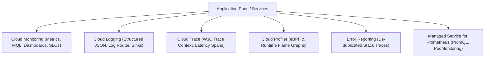

# Domain 3: Implementing Service Monitoring Strategies — In-Depth Master Study Guide

**Exam Weight:** 20% of GCP Professional Cloud DevOps Engineer  
**Core Competencies:** Cloud Monitoring (Dashboards, Alerting, MQL), Cloud Logging (Log Router, Log Sinks, Log-based metrics, Log scopes), Google Cloud Managed Service for Prometheus (GMP), Cloud Trace (distributed tracing, trace contexts), Cloud Profiler (continuous CPU/heap profiling), and Error Reporting.

---

## 1. Google Cloud Operations Suite Overview

Observability in Google Cloud unifies the three pillars of observability into a cohesive managed operations suite:



---

## 2. Cloud Monitoring & Monitoring Query Language (MQL)

### 2.1 Core Concepts
- **Time Series:** A sequence of timestamped values measured on a monitored resource.
- **Metric Types:**
  - `GAUGE`: Instantaneous value (e.g. current memory utilization).
  - `DELTA`: Change over a time interval (e.g. count of requests in a minute).
  - `CUMULATIVE`: Value that increases monotonically over time (e.g. total requests since container start).
- **MQL (Monitoring Query Language):**
  Allows evaluating complex ratios, aggregations, and windowing:
  ```mql
  fetch k8s_container
  | metric 'kubernetes.io/container/cpu/core_usage_time'
  | filter (resource.namespace_name == 'production')
  | group_by [resource.pod_name], rate(val())
  | every 1m
  ```

### 2.2 Google Cloud Managed Service for Prometheus (GMP)
- Completely serverless, globally scalable Prometheus-compatible monitoring.
- In-cluster collection via the **PodMonitoring** CRD:
  ```yaml
  apiVersion: monitoring.googleapis.com/v1
  kind: PodMonitoring
  metadata:
    name: order-api-monitor
    namespace: orders
  spec:
    selector:
      matchLabels:
        app: order-api
    endpoints:
      - port: metrics
        interval: 15s
  ```

---

## 3. Cloud Logging Architecture: Router, Buckets & Sinks

### 3.1 Log Ingestion & Routing
1. **Log Router:** Evaluates all incoming log entries against inclusion and exclusion filters.
2. **Log Buckets:** Default storage with configurable retention periods (e.g. 30 days default in `_Default`, 400 days in custom buckets).
3. **Log Sinks:** Exports logs to external destinations for analytics or compliance:
   - **BigQuery:** Long-term SQL analytics and compliance audits.
   - **Cloud Storage:** Cheap, immutable cold archive.
   - **Cloud Pub/Sub:** Real-time streaming into SIEM (Splunk, Datadog) or custom processors.

### 3.2 Log-Based Metrics
- **Counter Metrics:** Count log entries matching a filter (e.g. count occurrences of `"payment_gateway_timeout"`).
- **Distribution Metrics:** Extract numeric values from structured JSON log payloads (e.g. latency extracted from `jsonPayload.latency_ms`) to compute percentiles ($P50$, $P95$, $P99$).

---

## 4. Distributed Tracing & Continuous Profiling

### 4.1 Cloud Trace
- Collects distributed latency data across microservices.
- Propagates context using W3C Trace Context standard (`traceparent`).
- Visualizes end-to-end request latency bottlenecks across RPCs and database calls.

### 4.2 Cloud Profiler
- Low-overhead ($< 1\%$ CPU/memory overhead) continuous profiling in production.
- Collects call-stack statistics for CPU, heap memory, allocated memory, and thread contention.
- Renders flame graphs to identify specific functions or lines of code consuming CPU cycles.
