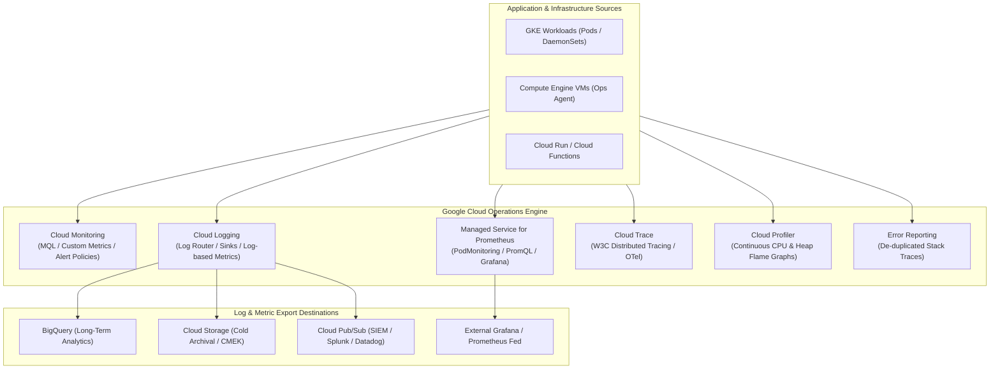
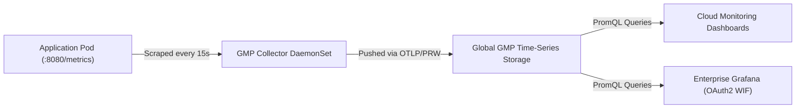
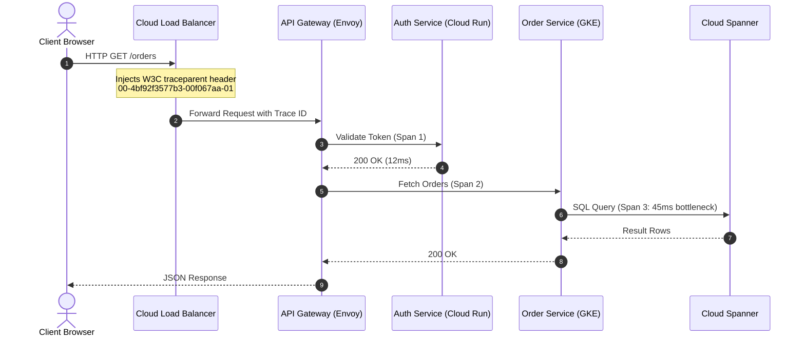

# Domain 3: Implementing Service Monitoring Strategies — In-Depth Master Study Guide

> [!IMPORTANT]
> **Exam Weighting & Core Architecture Focus:** Domain 3 accounts for **20% of the Google Cloud Certified Professional Cloud DevOps Engineer** examination. Questions test your mastery of end-to-end full-stack observability: Cloud Monitoring (MQL queries, metric kinds, alert condition evaluation, synthetic uptime checks), Managed Service for Prometheus (GMP, `PodMonitoring` vs. `ClusterPodMonitoring`), Cloud Logging (structured JSON schema, Log Router sinks, aggregated organizational sinks, log-based counter & distribution metrics), distributed tracing with Cloud Trace (W3C trace context propagation, OpenTelemetry), continuous runtime profiling with Cloud Profiler flame graphs, and de-duplicated Error Reporting.

---

## 1. Google Cloud Operations Suite Architectural Topology



---

## 2. Cloud Monitoring & Metric Architecture

### 2.1 Metric Kinds & Value Types

* **Metric Kinds:**
  * **`GAUGE`:** An instantaneous measurement at a specific point in time (e.g., current CPU utilization, current active database connections, current available disk space).
  * **`DELTA`:** The change or delta recorded over a specific time interval (e.g., number of incoming HTTP requests completed over the past 60 seconds).
  * **`CUMULATIVE`:** A continuously increasing counter since resource startup (e.g., total network bytes received since VM boot). To use in alerting, must apply a rate transformation (`rate()`).
* **Value Types:**
  * `BOOL`, `INT64`, `DOUBLE`, `STRING`, and `DISTRIBUTION` (contains summary statistics: count, mean, sum of squared deviations, and histogram bucket counts).

### 2.2 Monitoring Query Language (MQL) vs. PromQL

* **Monitoring Query Language (MQL):**
  * Expresses table-oriented pipeline transformations (`fetch` $\to$ `filter` $\to$ `group_by` $\to$ `every` $\to$ `condition`).
  * Ideal for calculating complex ratios between different metric types (e.g., calculating HTTP error rate as 5xx requests divided by total requests):

```mql
fetch k8s_container
| metric 'kubernetes.io/container/cpu/core_usage_time'
| filter (resource.namespace_name == 'production')
| group_by [resource.pod_name], rate(val())
| every 1m
| condition val() > 0.85 'cores'
```

* **Calculating SLO Error Ratios via MQL:**

```mql
{ fetch https_lb_rule
  | metric 'loadbalancing.googleapis.com/https/request_count'
  | filter response_code_class == 500
  | group_by [resource.backend_target_name], 1m, sum(val())
; fetch https_lb_rule
  | metric 'loadbalancing.googleapis.com/https/request_count'
  | group_by [resource.backend_target_name], 1m, sum(val()) }
| ratio
| every 1m
| condition val() > 0.01
```

---

## 3. Google Cloud Managed Service for Prometheus (GMP)

Managed Service for Prometheus provides a fully managed, globally scalable drop-in replacement for self-hosted Prometheus servers without the operational burden of managing disk capacity, Thanos/Cortex federation, or long-term storage retention.

### 3.1 Managed Collection Architecture



### 3.2 `PodMonitoring` vs. `ClusterPodMonitoring` CRDs

* **`PodMonitoring` (Namespace-Scoped):**
  * Scrapes target Pods located strictly within the **same namespace** as the `PodMonitoring` resource.
  * Used by development teams to declare monitoring endpoints for their own microservices.

```yaml
apiVersion: monitoring.googleapis.com/v1
kind: PodMonitoring
metadata:
  name: payment-service-monitor
  namespace: payment-system
spec:
  selector:
    matchLabels:
      app: payment-processor
  endpoints:
    - port: metrics
      path: /metrics
      interval: 15s
      metricRelabeling:
        - action: keep
          sourceLabels: [__name__]
          regex: "http_requests_.*|jvm_memory_.*"
```

* **`ClusterPodMonitoring` (Cluster-Scoped):**
  * Scrapes target Pods across **all namespaces** matching a label selector.
  * Used by platform and SRE teams to monitor cluster-wide infrastructure DaemonSets, ingress controllers, or service meshes (e.g., `ingress-nginx`, `istio-proxy`, `fluent-bit`).

---

## 4. Cloud Logging Architecture, Log Router & Log-Based Metrics

### 4.1 Structured JSON Logging Schema

To enable high-cardinality log parsing, tracing correlation, and alerting without brittle regex parsers, applications must emit structured JSON to `stdout`/`stderr`:

```json
{
  "severity": "ERROR",
  "message": "Payment processing failed: upstream timeout",
  "httpRequest": {
    "requestMethod": "POST",
    "requestUrl": "/api/v1/checkout",
    "status": 504,
    "latency": "2.412s"
  },
  "logging.googleapis.com/trace": "projects/my-prod-project/traces/4bf92f3577b34da6a3ce929d0e0e4736",
  "logging.googleapis.com/spanId": "00f067aa0ba902b7",
  "serviceContext": {
    "service": "checkout-service",
    "version": "v2.1.4"
  },
  "labels": {
    "customer_tier": "enterprise",
    "region": "us-central1"
  }
}
```

### 4.2 Log Router Sinks & Organization-Level Aggregation

All logs enter the Cloud Logging API and pass through the **Log Router**:

* **Log Buckets:**
  * **`_Required` Bucket:** Ingests Admin Activity, System Events, and Access Transparency logs. Free; retained for 400 days; cannot be turned off.
  * **`_Default` Bucket:** Ingests all standard application and compute logs. Retained for 30 days by default (configurable up to 3650 days).
* **Exclusion Filters:** Discard high-volume non-critical logs (e.g., debug messages, health checks) at the Log Router boundary before ingestion and billing:
  ```
  resource.type="k8s_container" AND severity="DEBUG"
  ```
* **Aggregated Sinks (Organization & Folder Level):**
  * SRE and SecOps teams configure aggregated sinks to export logs from all current and future projects in an organization to a centralized security lake:

```bash
gcloud logging sinks create org-security-audit-sink \
    bigquery.googleapis.com/projects/security-lake-project/datasets/audit_logs \
    --organization=123456789012 \
    --include-children \
    --log-filter='logName:"cloudaudit.googleapis.com"'
```

### 4.3 Log-Based Metrics: Counter vs. Distribution

* **Counter Log-Based Metric:**
  * Increments a counter each time a log line matches a specific filter query.
  * *Use Case:* Counting exact occurrences of application exceptions (e.g., `jsonPayload.errorCode = "PAYMENT_GATEWAY_TIMEOUT"`).
* **Distribution Log-Based Metric:**
  * Extracts numeric values from JSON log fields into histogram distribution buckets.
  * *Use Case:* Extracting custom latency or payload size values from third-party software that does not emit native metrics.

---

## 5. Distributed Tracing with Cloud Trace & OpenTelemetry

Microservice architectures spanning dozens of network hops require distributed tracing to pinpoint latency bottlenecks.



* **W3C Trace Context Standard:**
  * Passed in the `traceparent` HTTP header: `version-trace_id-parent_id-trace_flags` (e.g., `00-4bf92f3577b34da6a3ce929d0e0e4736-00f067aa0ba902b7-01`).
* **Sampling Strategies:**
  * Because tracing 100% of billions of requests generates massive network and storage overhead, distributed tracing systems use **head-based or adaptive rate sampling** (e.g., 1 trace per second, or 1% sample rate).
* **Cloud Trace Capabilities:**
  * Generates waterfall latency analysis across cross-project microservices.
  * Displays latency distributions and identifies regression between software releases ($p50$, $p95$, $p99$ degradation).

---

## 6. Continuous In-Production Profiling with Cloud Profiler

Traditional profilers require stopping the application or cause severe performance degradation ($20-50\%$), making them unusable in production. **Cloud Profiler** uses statistical sampling and OS timers to profile production workloads continuously with **$<5\%$ CPU and memory overhead**.

### 6.1 Profile Types

* **CPU Time:** Total CPU execution time spent by functions.
* **Wall Time:** Total elapsed clock time (including time spent waiting for I/O, network locks, or sleep).
* **Heap Memory Allocation:** Total bytes of memory allocated during the profiling interval (identifies garbage collection thrashing).
* **Heap Live Size:** Amount of memory currently occupied by live objects in heap memory (identifies memory leaks).
* **Threads / Contention:** Time spent waiting on mutexes, locks, or goroutine synchronization.

### 6.2 Analyzing Flame Graphs

```
┌──────────────────────────────────────────────────────────────┐
│                      main.ServeHTTP (100%)                   │
├───────────────────────────────┬──────────────────────────────┤
│    checkout.ProcessOrder (75%)│      auth.ValidateJWT (25%)  │
├───────────────────────────────┼──────────────────────────────┤
│  json.Marshal (55% BOTTLENECK)│ sql.Query (20%)              │
└───────────────────────────────┴──────────────────────────────┘
```

* **Visual Interpretation:**
  * **Horizontal Axis:** Represents the percentage of resources consumed (wider boxes consume more CPU or memory).
  * **Vertical Axis:** Represents the call stack depth.
  * **Optimization Target:** Look for **wide horizontal plateaus** at the top of the flame graph. A wide box at the top indicates a leaf function consuming large CPU or memory directly (e.g., excessive JSON serialization or cryptographic hashing) that can be refactored to unlock massive throughput gains.
