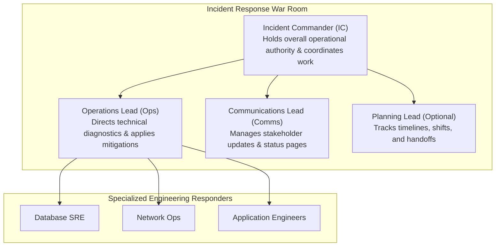
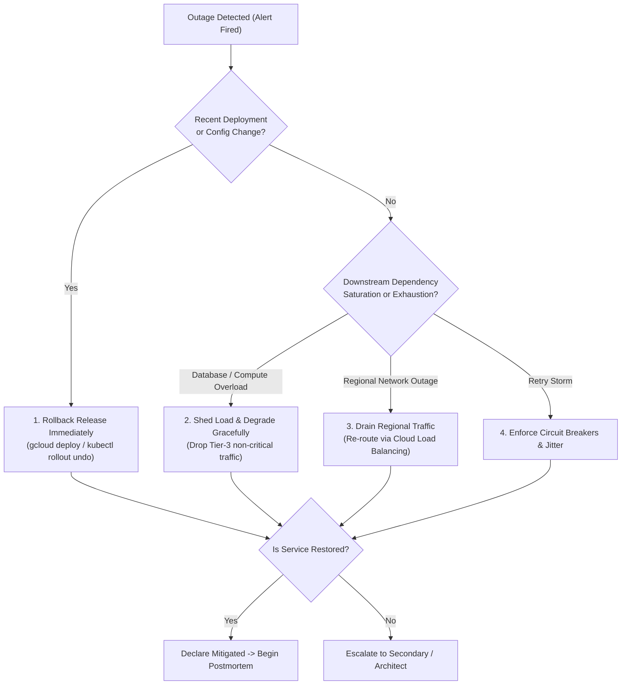

# Domain 4: Managing Service Incidents — In-Depth Master Study Guide

> [!IMPORTANT]
> **Exam Weighting & Core Architecture Focus:** Domain 4 accounts for **18% of the Google Cloud Certified Professional Cloud DevOps Engineer** examination. Questions test your mastery of emergency incident response protocols, the Google SRE Incident Command System (ICS), blast radius mitigation techniques (traffic draining, load shedding, circuit breakers, exponential backoff with jitter), automated rollbacks, and the cultural and operational execution of blameless postmortems with systemic root cause analysis (5 Whys) and action item tracking.

---

## 1. The Google SRE Incident Command System (ICS)

During high-severity production outages, panic, conflicting commands, and uncoordinated debugging significantly prolong Mean Time to Recover (MTTR). Google SRE adapts the **Incident Command System (ICS)**—a command-and-control framework originally developed for wildfire and civil emergency response.



### 1.1 Core Incident Roles & Responsibilities

* **Incident Commander (IC):**
  * **Operational Role:** Holds ultimate decision-making authority during the active outage. Sets priorities, assigns roles, and declares incident closure.
  * **Cardinal Rule:** **The IC does NOT write code, inspect logs, or execute CLI commands!** Stepping into hands-on debugging causes the IC to lose the high-level operational picture.
  * **Authority:** Can authorize high-risk actions (e.g., failing over an entire database cluster, rolling back releases, shedding non-paying customer traffic) without waiting for executive approval.

* **Operations Lead (Ops):**
  * **Operational Role:** Leads the technical triage and hands-on investigation.
  * Assigns specific diagnostic tasks to specialized engineers (e.g., "Network SRE: verify BGP route withdrawal; Database SRE: check lock contention on Cloud Spanner").
  * Evaluates and applies mitigations approved by the IC.

* **Communications Lead (Comms):**
  * **Operational Role:** The single voice of truth communicating externally to customers and internally to executive leadership.
  * Publishes regular status page updates on a strict schedule (every 15–30 minutes) regardless of whether new technical progress has occurred.
  * Shields hands-on engineers from executive interruptions and inquiries.

* **Planning Lead:**
  * Coordinates responder shift rotations, tracks long-term resource allocations during extended outages (>6 hours), and records timeline events for the postmortem.

### 1.2 Severity Levels & Escalation Criteria

```
Severity Level  Business Impact                               Response SLA      Paging Scope
─────────────────────────────────────────────────────────────────────────────────────────────
Sev 0 / P0      Catastrophic global outage; complete core     < 5 minutes       Immediate page to
                service unavailability; severe financial/     (24/7/365)        IC, Ops, Comms, &
                reputational loss; massive data loss risk.                      Executive Team.

Sev 1 / P1      Critical customer-facing degradation; single   < 15 minutes      Immediate page to
                region down; core feature unavailable with no  (24/7/365)        Primary On-Call
                immediate workaround; rapid SLO burn.                           Engineers.

Sev 2 / P2      Moderate service impairment; non-critical     < 1 hour          Ticket / Chat alert
                feature degraded (e.g., reporting portal);     (Business Hours)  to on-duty team.
                workaround available; minor SLO burn.

Sev 3 / P3      Minor bug, cosmetic defect, or internal toil; < 1 business day  Standard backlog
                zero customer impact.                                            ticket.
```

---

## 2. Mitigation Strategies Over Root-Cause Investigation

The fundamental axiom of Google Site Reliability Engineering:
$$\textbf{Mitigate First, Investigate Later}$$

During an active outage, the sole objective is to **restore service health and stop error budget consumption**. Spending hours identifying the exact software line that caused a null-pointer exception while users experience a 500 error is an operational failure.



### 2.1 Blast Radius Mitigation Techniques

* **1. Automated & Fast Rollbacks:**
  * If an outage begins shortly after a release: **Roll back instantly**.
  * On GKE: `kubectl rollout undo deployment/order-service -n production`.
  * On Cloud Deploy: `gcloud deploy rollouts rollback <ROLLOUT_NAME> --delivery-pipeline=<PIPELINE> --region=<REGION>`.

* **2. Traffic Draining (Cloud Load Balancing):**
  * When a single region or zone is degraded, drain traffic at the Global External Application Load Balancer level before investigating VM issues.
  * Set backend capacity to 0% or remove the affected regional MIG/NEG from the backend service. Configure `connectionDraining.drainingTimeoutSec` so active in-flight requests finish gracefully while all new traffic routes to healthy regions.

* **3. Load Shedding & Graceful Degradation:**
  * When downstream systems (e.g., databases) face saturation, the application must drop non-critical requests to preserve core business functionality:
    * **Tier 1 (Critical):** Core authentication and checkout transactions (100% prioritized).
    * **Tier 2 (Important):** User profile updates, search suggestions (throttled).
    * **Tier 3 (Non-Essential):** Personalized recommendation carousels, analytics beacons, email notifications (dropped immediately).

* **4. Circuit Breakers & Exponential Backoff with Jitter:**
  * **Circuit Breaker:** Sits between caller and callee. When consecutive downstream failures exceed a threshold (e.g., 5 failures in 10s), the circuit **opens**, immediately returning fallback errors without burdening the failing backend.
  * **Thundering Herd Hazard:** If thousands of retrying clients execute backoff at exact identical intervals ($1s, 2s, 4s, 8s$), their retry requests hit the recovering database in simultaneous coordinated waves, instantly crashing it again.
  * **Full Jitter Algorithm:** Add uniform randomness to spread out retries:
    $$T_{\text{sleep}} = \text{random}(0, \min(T_{\text{max}}, T_{\text{base}} \cdot 2^{\text{attempt}}))$$

---

## 3. The Blameless Postmortem Culture

A postmortem is a formal retrospective document written following any incident that burns significant error budget, impacts customers, or results in data loss.

### 3.1 The Blameless Premise

* **Human error is a symptom of system design failure, not the root cause.**
* If an engineer executed `DROP DATABASE` on production, the engineer is **not** to blame. The engineering organization failed because:
  1. The database did not require dual-key multi-party approval for destructive commands.
  2. The production and development database credentials were indistinguishable.
  3. Safe rollback scripts and automated point-in-time recovery were missing.
* Punishing individuals fosters a culture of concealment where engineers hide near-misses, slowing organizational learning and guaranteeing catastrophic recurrence.

### 3.2 Anatomy of an Enterprise Postmortem Document

```markdown
# Incident Postmortem: 2026-10-14 Global Checkout API 500 Errors

## 1. Incident Metadata
- **Date & Time:** 2026-10-14 14:22 UTC to 15:05 UTC (Duration: 43 minutes)
- **Severity:** Sev 1
- **Incident Commander:** Jane Doe (Staff SRE)
- **Operations Lead:** John Smith (Senior Platform Engineer)
- **Customer Impact:** 18% of global checkout attempts failed with HTTP 500; ~$140,000 in uncompleted carts.
- **SLO Impact:** Consumed 68% of 30-day 99.9% availability error budget.

## 2. Incident Timeline (All times UTC)
- **14:15:** Release `v3.12.0` promoted to production GKE cluster via Cloud Deploy.
- **14:22:** Cloud Monitoring multi-window burn rate alert fires (14.4x burn rate detected).
- **14:25:** On-call SRE paged; declares Sev 1; Incident Command System initiated.
- **14:31:** Ops Lead identifies connection pool exhaustion on primary Cloud SQL instance.
- **14:35:** IC orders immediate rollback to release `v3.11.4`.
- **14:41:** Rollout completes; Cloud SQL connection count drops back to baseline.
- **15:05:** Error rate normalizes below 0.01%; IC declares incident mitigated.

## 3. Root Cause Analysis (The 5 Whys)
1. **Why did checkouts fail?** The checkout microservice could not acquire database connections.
2. **Why were connections exhausted?** Release `v3.12.0` leaked database connections during failed coupon validations.
3. **Why did coupon validations leak connections?** An unhandled HTTP timeout in the third-party partner client omitted the `finally { connection.close() }` block.
4. **Why was this not caught in staging?** Integration tests simulated successful coupon validations only, never partner network timeouts.
5. **Why was there no connection limit guardrail?** The service lacked a managed connection pool proxy (Cloud SQL Auth Proxy / PgBouncer) enforcing maximum connection caps per pod.

## 4. What Went Well, What Went Poorly, Where We Got Lucky
- **Well:** Cloud Monitoring multi-window burn-rate alerts notified on-call within 7 minutes.
- **Poorly:** Cloud Deploy rollback took 6 minutes due to missing container image local caching.
- **Lucky:** The outage occurred during off-peak European hours; peak US shopping began 2 hours later.

## 5. Action Items (SMART Framework)
1. **Prevent:** Deploy Cloud SQL Auth Proxy with client connection pool limits (Owner: SRE Team / Target: Sprint 44 / High Priority).
2. **Detect:** Add synthetic chaos test in CI validating connection closure on simulated 504 gateway timeouts (Owner: QA Team / Target: Sprint 45).
3. **Mitigate:** Pre-cache base container images on GKE nodes using Image Streaming to accelerate rollback times from 6 minutes to <60 seconds (Owner: Platform Team / Target: Sprint 46).
```

---

## 4. Error Budget Policies & Operational Feedback Loops

The postmortem is useless without an enforceable **Error Budget Policy** that aligns product development incentives with platform reliability:

* **Error Budget $> 0\%$ (Healthy):** Product development teams ship features at maximum velocity; experimental deployments and canaries are permitted.
* **Error Budget Exhausted ($100\%$ Burned):**
  * **Feature Freeze:** Halts all new feature deployments to production.
  * **SRE Redirection:** 100% of engineering sprint capacity is redirected to reliability, technical debt elimination, test coverage, and implementing outstanding postmortem action items.
  * **Exceptions:** Only critical security patches and postmortem remediation bug-fixes may be deployed during a feature freeze.
