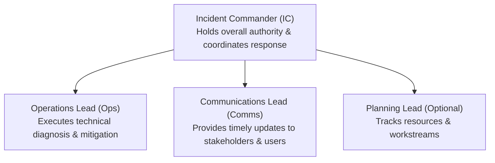

# Domain 4: Managing Service Incidents — In-Depth Master Study Guide

**Exam Weight:** 18% of GCP Professional Cloud DevOps Engineer  
**Core Competencies:** Incident response lifecycle, Incident Command System (ICS), Roles (Incident Commander, Operations Lead, Communications Lead), Triage & Mitigation strategies, Alert routing and on-call rotations, Blameless postmortems, and Root cause analysis (5 Whys).

---

## 1. The SRE Incident Management Framework

When a high-severity production outage occurs, ad-hoc chaos lengthens Mean Time to Recover (MTTR). Google SRE implements an **Incident Command System (ICS)** adapted from emergency response protocols.

### 1.1 Core Incident Roles
1. **Incident Commander (IC):**
   - Holds ultimate authority during the incident.
   - Assigns roles and delegates tasks; does NOT actively debug code or run commands (avoids getting lost in the details).
   - Keeps the team focused, manages escalations, and declares incident closure.
2. **Operations Lead (Ops):**
   - The primary hands-on engineer executing investigative commands, applying rollbacks, scaling instances, or modifying firewall rules.
   - Reports technical findings back to the IC.
3. **Communications Lead (Comms):**
   - Writes and publishes periodic updates on public status pages and internal executive Slack channels every 15–30 minutes.
   - Shields the technical responders from executive inquiries.

---

## 2. Mitigation Over Root-Cause Identification

The governing rule of incident response:
$$\textbf{Mitigate First, Investigate Later}$$

- During an active outage, the sole objective is to **restore service health** to end users as fast as possible.
- If a recent release correlates with the failure: **Roll back immediately**. Do not spend 45 minutes reading diffs trying to understand *why* the bug exists while customers suffer downtime.
- Common Immediate Mitigations:
  1. Roll back the last Cloud Deploy release or Git commit.
  2. Throttle or shed non-essential background traffic (load shedding).
  3. Route traffic away from a degraded region via Cloud Load Balancing.
  4. Scale compute or database capacity horizontally.

---

## 3. The Blameless Postmortem Culture

A postmortem is a structured retrospective written after a critical incident. Google SRE strictly enforces that postmortems must be **blameless**:
- **Premise:** Human error is a *symptom* of poorly designed systems, missing automated guardrails, or inadequate tooling—never the root cause.
- If an engineer accidentally deleted a production database table, the fault lies with the missing permission guardrails, lack of confirmation prompts, or absence of automated backups—not the human finger on the keyboard.

### 3.1 Postmortem Structure
1. **Metadata:** Date, authors, severity, duration, customer impact.
2. **Incident Timeline:** Precise UTC timestamps of trigger, detection, escalation, mitigation, and recovery.
3. **Root Cause Analysis (5 Whys):** Digging past the immediate symptom to identify systemic and organizational deficiencies.
4. **Action Items (P0 / P1 / P2):** Preventative engineering tasks with assigned owners and due dates (e.g. "Add automated canary gate in Cloud Deploy").
