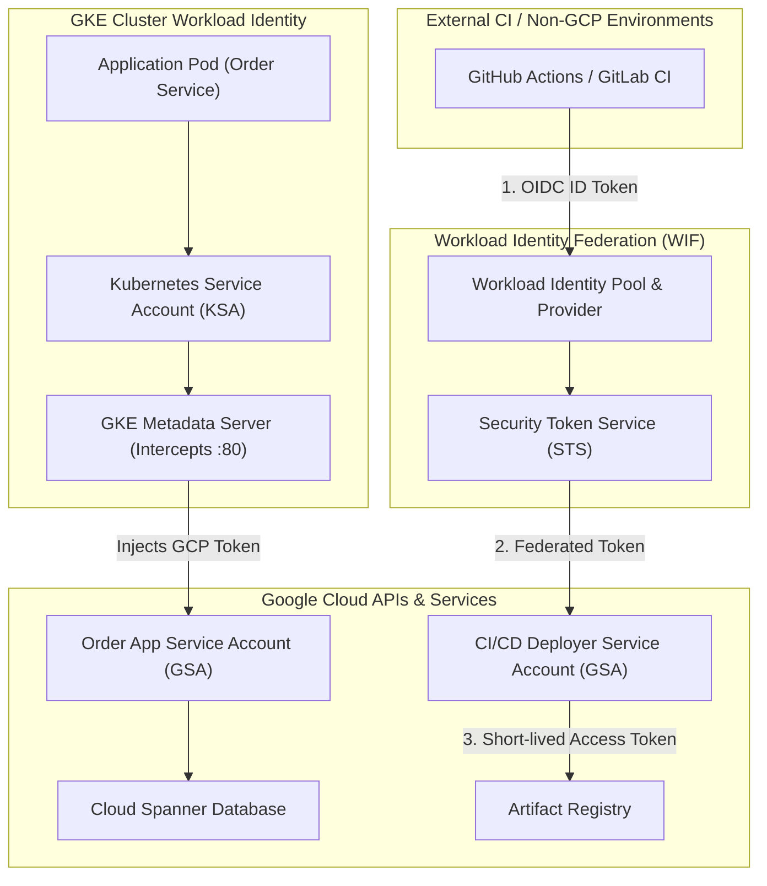
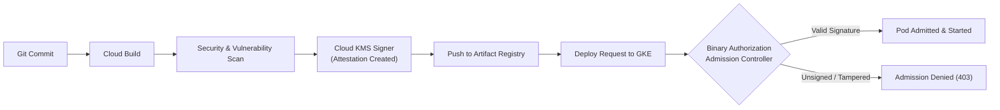
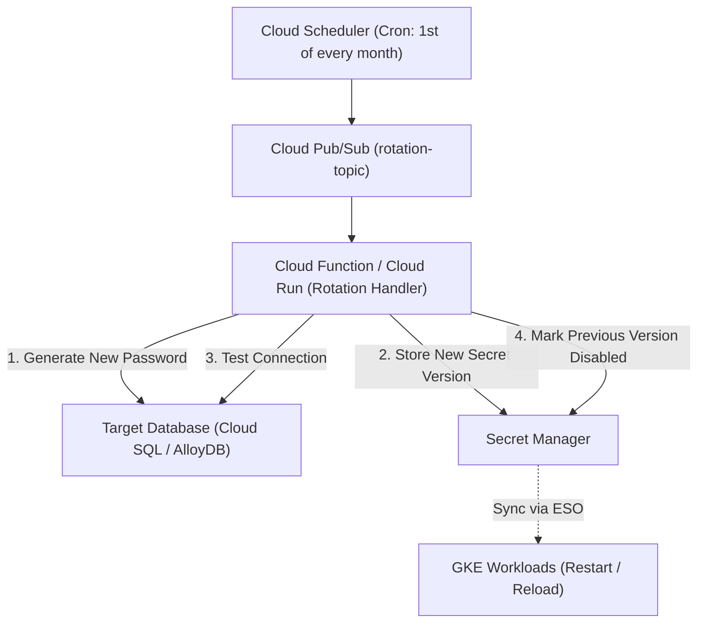

# Domain 5: Security, Governance & SRE Operations — Study Guide

> [!IMPORTANT]
> **Exam Weighting & Core Architecture Focus:** Domain 5 accounts for **~15% of the Google Cloud Certified Professional Cloud DevOps Engineer** examination. Questions test your mastery of automated security controls in SRE workflows: Workload Identity Federation for external CI/CD pipelines and GKE workloads, end-to-end software supply chain security (SLSA levels, Binary Authorization policy enforcement, Cloud KMS container signing, Continuous Validation), Secret Manager automated rotation patterns, Kubernetes Dataplane V2 network policies, Cloud Audit Logs, and Organization Policy guardrails.

---

## 1. Enterprise IAM & Workload Identity for DevOps & SRE

Automated CI/CD pipelines and microservices must operate under the principle of least privilege without relying on long-lived, high-risk static credentials.



### 1.1 GKE Workload Identity Federation Deep Dive

* **Security Vulnerability Eliminated:** Eliminates downloading service account JSON keys or storing them in Kubernetes Secrets.
* **Mechanism:** Enables Kubernetes Service Accounts (KSAs) to impersonate Google Service Accounts (GSAs) transparently:
  1. The **GKE Metadata Server** runs as a DaemonSet on every node, intercepting pod metadata requests to `http://169.254.169.254` and `http://metadata.google.internal`.
  2. When a container inside a pod makes a request to a Google Cloud API SDK, the SDK queries the local metadata server.
  3. The metadata server verifies the calling Pod's KSA token against the cluster API server and exchanges it for a short-lived Google Cloud OAuth2 access token for the bound GSA.

```bash
# 1. Create Google Service Account (GSA)
gcloud iam service-accounts create "order-processor-gsa" \
    --project="prod-app-project"

# 2. Grant GSA least-privilege permissions on target resources
gcloud projects add-iam-policy-binding "prod-app-project" \
    --member="serviceAccount:order-processor-gsa@prod-app-project.iam.gserviceaccount.com" \
    --role="roles/spanner.databaseUser"

# 3. Allow KSA to impersonate GSA via Workload Identity Pool
gcloud iam service-accounts add-iam-policy-binding "order-processor-gsa@prod-app-project.iam.gserviceaccount.com" \
    --role="roles/iam.workloadIdentityUser" \
    --member="principal://iam.googleapis.com/projects/PROJECT_NUMBER/locations/global/workloadIdentityPools/prod-app-project.svc.id.goog/subject/ns/production/sa/order-processor-ksa"

# 4. Annotate Kubernetes Service Account (KSA)
kubectl annotate serviceaccount order-processor-ksa \
    --namespace=production \
    iam.gke.io/gcp-service-account=order-processor-gsa@prod-app-project.iam.gserviceaccount.com
```

---

## 2. Software Supply Chain Security & Binary Authorization

Modern DevOps security requires validating code provenance and container integrity from source commit to production runtime.



### 2.1 SLSA Framework (Supply-chain Levels for Software Artifacts)

* **SLSA Level 1:** Build process is automated via build scripts; build provenance is generated.
* **SLSA Level 2:** Build executes on a hosted, version-controlled build service (Cloud Build); provenance is authenticated.
* **SLSA Level 3:** Build executes on an isolated, ephemeral build platform with non-falsifiable provenance; source and dependencies are hermetic and cryptographically verifiable.

### 2.2 Binary Authorization Architecture

Binary Authorization is a deploy-time admission controller for GKE and Cloud Run that guarantees only cryptographically attested images can run in production.

* **Attestors & Notes:** An Attestor represents an authority (e.g., Security Team, QA Team, Vuln Scanner) that signs an image. Attestations are stored as metadata in **Container Analysis (Grafeas)** notes.
* **Cloud KMS Asymmetric Signing:** Attestors sign the digest of the built container image (`@sha256:...`) using an asymmetric Cloud KMS key (`EC_SIGN_P256_SHA256`).
* **Evaluation Modes:**
  * **`ENFORCING`:** Pod creation requests without valid cryptographic signatures are blocked at the Kubernetes API admission phase.
  * **`DRYRUN_AUDIT_LOG_ONLY`:** Evaluates policies and emits violation audit logs to Cloud Logging without blocking production deployments (essential for phased rollout).
* **Breakglass Mode:** In severe P0 outages where emergency hotfix containers must bypass signature verification, engineers append `breakglass: true` annotations. The container is admitted immediately, and an alert is dispatched to SecOps with mandatory audit trails.
* **Continuous Validation (CV):** Continuously monitors running Pods post-deployment. If a vulnerability is discovered or an attestation is revoked, CV alerts SREs or terminates drifted Pods.

---

## 3. Secret Governance & Automated Rotation



### 3.1 Google Secret Manager Best Practices

* **Zero Plaintext Secrets in Config:** Never inject database passwords or API tokens into environment variables in plaintext YAML manifests or Git repositories.
* **Granular IAM:** Grant workloads access only to specific secret versions (`roles/secretmanager.secretAccessor` on a specific secret, rather than project-wide).
* **Automated Rotation Architecture:**
  1. Configure Secret Manager with a `rotation` schedule and target Pub/Sub topic.
  2. When the schedule fires, Secret Manager publishes a message to Pub/Sub.
  3. A Cloud Function generates a new credential, adds it as a secondary password in the database, pushes the new secret version to Secret Manager, validates database connectivity, and disables the old secret version.

---

## 4. Kubernetes Network Policies & Dataplane V2

Google Kubernetes Engine uses **Dataplane V2**, an eBPF-powered network virtualization engine built on Cilium:

* **eBPF Socket-Level Load Balancing:** Replaces legacy Linux `iptables` with eBPF programs loaded directly into the Linux kernel, scaling to thousands of services with line-rate packet processing and zero lookup latency.
* **Deep Network Visibility & Logging:** Enables real-time logging of allowed and denied network connections directly into Cloud Logging without deploying heavy third-party sidecar proxies.
* **Zero Trust Pod Segmentation:** Enforces default-deny ingress and egress policies across namespaces:

```yaml
apiVersion: networking.k8s.io/v1
kind: NetworkPolicy
metadata:
  name: default-deny-all-ingress
  namespace: payment-system
spec:
  podSelector: {}
  policyTypes:
    - Ingress
---
apiVersion: networking.k8s.io/v1
kind: NetworkPolicy
metadata:
  name: allow-frontend-to-payment
  namespace: payment-system
spec:
  podSelector:
    matchLabels:
      app: payment-api
  ingress:
    - from:
        - namespaceSelector:
            matchLabels:
              kubernetes.io/metadata.name: frontend-system
          podSelector:
            matchLabels:
              app: web-gateway
      ports:
        - protocol: TCP
          port: 8443
```

---

## 5. Audit Logging, SRE Governance & Organization Policies

### 5.1 Cloud Audit Logs Reference

* **Admin Activity Logs:** Emits audit logs whenever metadata or configuration is created or modified. **Always enabled, free, 400-day retention, immutable.**
* **Data Access Logs:** Emits logs on API read/write operations against customer content. Disabled by default (except BigQuery). Must be explicitly enabled in IAM configuration when auditing sensitive data compliance (HIPAA, PCI).
* **Policy Denied Logs:** Emits logs when an API call is blocked due to an Organization Policy or VPC Service Controls perimeter violation.

### 5.2 Mandatory SRE Organization Policy Constraints

* **`constraints/iam.disableServiceAccountKeyCreation`:** Enforces the complete ban on downloading static service account JSON keys organization-wide.
* **`constraints/compute.vmExternalIpAccess`:** Blocks compute instances from acquiring public IPv4 addresses, mandating Cloud NAT and IAP.
* **`constraints/compute.requireShieldedVm`:** Enforces Secure Boot, virtual Trusted Platform Module (vTPM), and Kernel Integrity Monitoring on all Compute Engine instances.
* **`constraints/gcp.resourceLocations`:** Restricts resource provisioning to approved geographical regions to enforce legal data residency mandates.
