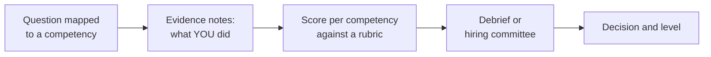
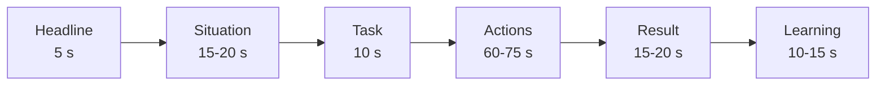
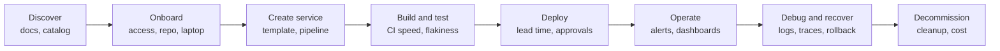
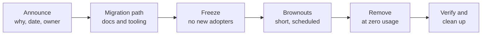
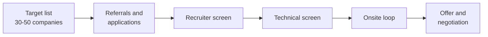

# PE Domain 10: Behavioral, Product Sense & Career Strategy — Deep-Dive Study Guide

> [!IMPORTANT]
> **Interview Emphasis:** Very High
>
> **Where it shows up:** recruiter and phone screens ("tell me about yourself", motivation, level calibration), dedicated behavioral and hiring-manager rounds, the collaboration and leadership slice of every onsite interview, product-sense prompts inside IDP system design rounds, take-home presentation Q&A, and the offer and leveling conversation.
>
> **What "strong" sounds like:** Specific, recent stories told in about two minutes, each with a one-sentence headline, a clear "I" inside the "we", real numbers with a stated measurement method, and an honest lesson that changed how you work. On product questions, you treat developers as customers: you start from their jobs and friction, prioritize with evidence, measure adoption and outcomes rather than output, and you can explain how you would sunset what you built.

---

## 1. How Behavioral and Hiring-Manager Rounds Are Evaluated

Technical rounds decide whether you can do the job. Behavioral and hiring-manager rounds usually decide whether you get the offer, and at what level. For platform roles they carry extra weight because the job is fundamentally about influence: a platform team rarely has authority over the teams it serves, so interviewers look hard for evidence that you can get engineers to change how they work without a mandate.

### 1.1 What a Structured Interview Actually Is

Most mid-size and large companies run some form of structured interview:

1. **Competency-mapped questions.** Each interviewer is assigned two or three competencies (or leadership principles) and picks questions from a bank designed to elicit evidence for them.
2. **Evidence-based notes.** The interviewer writes down what you did, what you decided, and what happened, as close to verbatim as they can. Adjectives ("seemed confident") are discouraged; facts are what survive the debrief.
3. **Rubric scoring.** Each competency is scored independently against written anchors, for example "drove alignment across multiple teams with competing goals" versus "executed a plan someone else defined".
4. **Debrief or hiring committee.** Interviewers compare evidence. Strong evidence on one competency rarely offsets a clear gap on another, and the level is decided from the scope of the evidence, not from your current title.



The practical consequence: **your job is to hand the interviewer quotable evidence.** A vague story ("we improved deployments a lot") gives them nothing to write down. A story with a decision, a trade-off, and a number ("I chose Argo CD ApplicationSets over per-team Argo CD instances because we had one platform team and 14 product teams; median lead time went from about two days to 45 minutes") fills their notes for them.

> [!NOTE]
> Hypothetical questions ("What would you do if a team refused to adopt your platform?") and behavioral questions ("Tell me about a time a team refused...") test the same competency in different ways, and behavioral questions are much harder to bluff. When you get a hypothetical, answer it, then anchor it in experience: "Here's what I'd do, and here's a time I did something similar."

### 1.2 The Four Leveling Signals

Across companies, the same four dimensions separate mid, senior, and staff evidence. Interviewers listen for them in every story, whether or not they say so.

| Signal | What they listen for | Mid-level evidence | Senior evidence | Staff evidence |
| :--- | :--- | :--- | :--- | :--- |
| **Scope** | How big was the problem you owned? | A task or feature inside a team project | A multi-month project or a platform capability, end to end | A multi-team or org-wide problem across quarters |
| **Ambiguity** | How defined was the problem when it reached you? | Clear requirements | A fuzzy goal you turned into a plan | You found the problem; nobody had framed it yet |
| **Influence** | Whose behavior changed because of you? | Your own team's | Several teams', without authority over them | The org's defaults, standards, or strategy |
| **Impact** | What measurably changed? | You shipped the thing | A metric the business cares about moved | Several metrics moved and teams work differently |

Section 7 goes deeper on leveling and on signaling the level you are targeting.

### 1.3 How Company Styles Differ

Treat these as lenses, not scripts. Every company adapts its process, and processes change.

| Style | What is publicly known | How it feels in the room | How to prepare |
| :--- | :--- | :--- | :--- |
| **Amazon** | 16 published Leadership Principles (LPs) are the basis for evaluation. Amazon's own interview guidance recommends the STAR format, measurable results, and "I" statements. A **Bar Raiser**, an interviewer from outside the hiring team, joins loops as an objective third party. | Each interviewer owns a few LPs and often asks for more than one story per LP. Expect relentless drill-down: "What did you do? What data did you use? What would you do differently?" | Two stories for every LP you are likely to be assigned; every story has data and a lesson; practice the third and fourth follow-up. |
| **Google** | Former SVP of People Operations Laszlo Bock described four hiring attributes in *Work Rules!*: general cognitive ability, role-related knowledge, (emergent) leadership, and "Googleyness" (for example comfort with ambiguity, intellectual humility, conscientiousness). Google has also published guidance on structured interviewing through its re:Work site. Names and definitions have been refined over time. | A mix of hypothetical and behavioral questions; interviewers score independently; decisions are reviewed by people who were not in the room. | Think out loud so your reasoning is visible; show emergent leadership (stepping in when needed and stepping back when not); show how you handle ambiguity and collaborate. |
| **Startups and scale-ups** | Usually less formal: a founder, CTO, or hiring manager conversation plus a values or culture chat. | Breadth, ownership, speed, and judgment under constraint. The unspoken question is "Would I want this person next to me during a 2 a.m. outage?" | Stories where you built from zero, made pragmatic trade-offs, and owned operations; be ready to say what you would *not* build. |
| **Large enterprise and regulated** | Competency frameworks, often panel interviews, sometimes scored on HR-designed rubrics. | Stakeholder management, change control, compliance, delivering safely inside process. | Stories with governance (audits, change management, risk) and influence across many groups. |

#### Mapping Amazon's 16 Leadership Principles to Platform Stories

Amazon's current list has 16 principles. You do not need to memorize the wording (Amazon recruiters have said publicly that they do not test memorization), but you do need a story for each one you might be asked about.

| # | Leadership Principle | Platform story that fits |
| :--- | :--- | :--- |
| 1 | Customer Obsession | Interviewed developers before building a golden path, and changed the roadmap based on what you heard |
| 2 | Ownership | Fixed the systemic cause of a recurring incident that sat outside your team's formal remit |
| 3 | Invent and Simplify | Collapsed 14 bespoke pipeline variants into one reusable workflow |
| 4 | Are Right, A Lot | A technical bet (autoscaler, GitOps tool, CNI) made with incomplete data that held up, and how you checked it |
| 5 | Learn and Be Curious | Learned a new domain quickly (eBPF, a new IaC tool) to unblock a decision |
| 6 | Hire and Develop the Best | Mentored engineers into incident commanders; redesigned an interview loop |
| 7 | Insist on the Highest Standards | Introduced production readiness reviews; refused to ship a flaky migration tool |
| 8 | Think Big | Wrote a multi-year platform vision that leadership funded |
| 9 | Bias for Action | Made a reversible call mid-incident without waiting for consensus |
| 10 | Frugality | Cut compute spend with right-sizing, Spot, and Graviton without a reliability hit |
| 11 | Earn Trust | Owned your mistake in a postmortem; rebuilt trust with a team the platform had burned |
| 12 | Dive Deep | Traced p99 latency to DNS (`ndots`) or conntrack exhaustion while the dashboards looked fine |
| 13 | Have Backbone; Disagree and Commit | Pushed back on a cluster-wide service mesh rollout, then committed fully once the decision was made |
| 14 | Deliver Results | Finished a cluster upgrade program before the end of standard support |
| 15 | Strive to be Earth's Best Employer | Cut pager load and toil so on-call stopped burning people out |
| 16 | Success and Scale Bring Broad Responsibility | Hardened the software supply chain or cut compute waste because your scale magnified the impact |

> [!TIP]
> **Interview Angle:** Interviewers are not grading your stories against a values poster; they are collecting evidence for specific competencies. A senior candidate makes the competency obvious up front ("This is a story about getting adoption without a mandate") and leaves room for follow-ups instead of trying to cover everything in the first answer.

> [!CAUTION]
> Reciting leadership principles or company values back to the interviewer ("I'm very customer obsessed") scores nothing. Only behavior in a specific past situation counts as evidence.

---

## 2. Answer Frameworks

### 2.1 STAR, STAR+L, and CARL

| Framework | Parts | Use it for | Watch out for |
| :--- | :--- | :--- | :--- |
| **STAR** | Situation, Task, Action, Result | The default for "Tell me about a time..." questions; Amazon's own guidance recommends it | Spending half the answer on Situation and Task |
| **STAR+L** | STAR plus Learning | Failures, conflict, incidents, and anything likely to draw "What would you do differently?" | A generic learning ("communication is important") is worse than none |
| **CARL** | Context, Action, Result, Learning | Shorter answers when the task is obvious from the context; phone screens | Make your role explicit inside the Context, since there is no Task step |

STAR+L is the safest default for this workspace: the Learning step pre-empts the most common follow-up, and it is where senior candidates show self-awareness.

### 2.2 The Two-Minute Structure

Aim for about two minutes on the first telling, then let the interviewer steer. A workable time budget:



- **Headline (one sentence):** what the story is about and why it matters. "I led the move of 120 services off Jenkins in nine months; the hard part was getting 14 teams to migrate without a mandate."
- **Situation:** only the context needed to understand the stakes: scale, constraint, what was broken. No org-chart tours.
- **Task:** your specific responsibility. "I owned the migration plan and tooling; my manager owned the budget conversation."
- **Actions:** three or four actions, each with the *why*. This is where the evidence lives, so give it most of the time.
- **Result:** numbers with a baseline, plus one non-numeric outcome (a process that stuck, a team that changed how it works).
- **Learning:** one specific thing you now do differently, ideally with evidence that you have done it since.

An annotated two-minute answer to "Tell me about a time you improved developer experience" (an example; build yours from your own work):

```text
[Headline]  I cut CI wait time for about 120 engineers by more than half by treating
            the build system as a product instead of an infrastructure chore.
[Situation] Our median PR pipeline took 22 minutes. Slow CI was the top complaint in
            our quarterly developer survey, and engineers were batching changes to
            avoid it.
[Task]      I was the platform engineer assigned to CI. Nobody had defined "fast
            enough", so part of my job was deciding what to measure.
[Actions]   First I instrumented the pipelines, because the complaints were anecdotal.
            I exported per-step timings and found about 60% of the time was dependency
            installs and Docker layer rebuilds on cold runners. I proposed remote build
            caching and warm, autoscaled runners, and wrote a one-page cost estimate,
            because finance had rejected a vague "faster CI" request before. I rolled it
            out to two volunteer teams first, fixed a cache-key bug they found, then made
            it the default in our reusable workflow so every team got it with zero changes.
[Result]    Median pipeline time went from 22 to 9 minutes within six weeks. Slow CI fell
            from first to fifth in the next survey. Runner spend rose about 8%, which we
            offset by scaling idle runners to zero overnight.
[Learning]  I now instrument before I propose. The data changed the solution -- I had
            assumed test parallelism was the bottleneck -- and it made the budget
            conversation easy.
```

### 2.3 Quantifying Impact

Numbers make evidence quotable, but only if they are honest and you can explain where they came from.

- **Always give a baseline:** "from 22 to 9 minutes", not "reduced by 13 minutes".
- **Name the unit and the population:** "median PR pipeline time across 140 services" beats "builds got faster".
- **Prefer medians and percentiles** for durations and latency, and say "median" or "p90" out loud.
- **Pick the right category:** time (lead time, time to restore, onboarding), cost (monthly spend, unit cost), reliability (incident count, SLO attainment), adoption (services on the golden path), satisfaction (survey score), risk (findings, audit exceptions).
- **Use approximations honestly:** "roughly", "about", and ranges are fine. Invented precision ("37.4%") that you cannot back up is not.

Section 4.4 covers quantification techniques with worked arithmetic.

### 2.4 "I" vs "We"

Interviewers are hiring you, not your team. Amazon's interview guidance explicitly asks for "I" statements, and every structured interviewer needs to separate your contribution from the team's.

- Use **"we"** for the shared goal and shared results: "We needed to get off Jenkins before the hardware refresh."
- Use **"I"** for the decisions you made and the actions you took: "I designed the wave plan. I wrote the converter. I ran the office hours."
- Credit others precisely, which also signals seniority: "Priya built the runner autoscaling; I made the case for funding it and handled the rollout to the first two teams."

> [!CAUTION]
> There are two opposite traps. **All "we"**: the interviewer cannot tell what you did and has nothing to score. **All "I"** for obviously team-sized work: it reads as inflated, or as someone who does not collaborate. The fix for both is the same: name your role precisely.

### 2.5 How Much Context to Give

- One or two sentences of situation, unless the stakes are not obvious.
- Translate internal names: not "the Hermes migration" but "our homegrown deploy tool, which 90 services depended on".
- Spell out company-specific acronyms; skip jargon the interviewer may not share.
- If a story needs a lot of setup, it is probably the wrong story for a two-minute answer. Pick another, or simplify.

### 2.6 Handling Drill-Down Follow-Ups

Experienced interviewers "peel the onion": they keep asking follow-ups until they reach the edge of what you actually did and know. Prepare every story three follow-ups deep.

| Follow-up type | What they ask | How to prepare |
| :--- | :--- | :--- |
| Role isolation | "What exactly did you do, versus the team?" | List your personal actions for each story |
| Decision rationale | "Why that approach? What else did you consider?" | Two rejected alternatives and why you rejected them |
| Data | "How did you measure that? Over what period?" | The source of every number (dashboard, survey, bill) |
| Conflict | "Who disagreed? How did you resolve it?" | The strongest objection and how you handled it |
| Setback | "What went wrong along the way?" | One mid-project problem and your response |
| Counterfactual | "What would have happened if you hadn't done it?" | The cost of inaction |
| Reflection | "What would you do differently?" | One or two specific changes (see 2.7) |
| Scale | "Would that work with ten times the services or teams?" | What breaks first, and how you would change the approach |

If you do not know or do not remember, say so and reason from what you do know: "I don't remember the exact number. It was between 30 and 40 services, and here's how we counted them." Precise-sounding guesses unravel on the next question.

### 2.7 "What Would You Do Differently?"

A strong answer has three parts: a specific change, the reason for it, and evidence that you have applied it since.

- Weak: "Nothing, it went well." (No self-awareness.)
- Weak: "I'd communicate more." (Generic; applies to every project ever.)
- Strong: "I'd have put the migration tooling in front of the first wave instead of building it after wave one stalled. I lost about a month hand-holding teams through manual conversions. On the secrets migration the following year I built the converter first, and the first wave finished in half the time."

### 2.8 Failure Stories That Show Growth

A good failure story has real consequences, your own decision at its center, and a changed mechanism, not just a resolution to "be more careful".

| Criterion | Weak failure story | Strong failure story |
| :--- | :--- | :--- |
| Stakes | "I missed a minor deadline." | "A quarter of team effort produced a self-service database platform that only three teams used." |
| Ownership | "The vendor changed their API." | "I skipped user research because I was sure I knew what teams needed." |
| Mechanism | "I learned to be more careful." | "I now run discovery interviews and a paper prototype before committing a quarter of effort." |
| Evidence of growth | None | "The next initiative started with eight interviews and reached 70% adoption in two quarters." |

> [!TIP]
> **Interview Angle:** Failure questions test self-awareness and whether you create psychological safety for others. A senior answer owns the decision, quantifies the cost, shows the systemic fix, and does not over-apologize. Choose a failure from at least a year ago so you can show what changed afterward.

> [!CAUTION]
> Disguised strengths ("I work too hard", "I care too much about quality") and failures that were entirely someone else's fault both read as evasive. So does a failure with no consequences.

---

## 3. Platform-Engineer Competencies and Question Map

Platform interviews probe the same competencies as any senior engineering loop, but the stories they want are about serving internal customers, driving adoption, and running shared infrastructure safely.

### 3.1 The Question Map

| Competency | What they're probing | Typical questions | Platform story that fits | Senior signal |
| :--- | :--- | :--- | :--- | :--- |
| Customer obsession (developers as customers) | Do you build for real developer needs? | "How do you decide what developers need?" / "Tell me about a time user feedback changed your plan." | Developer interviews before a golden path; friction logs; a survey that changed the roadmap | Starts from developer jobs and evidence, not technology preferences |
| Influence without authority | Can you change other teams' behavior? | "Tell me about a time you convinced a team you didn't manage." | Getting a security team to accept policy-as-code instead of ticket review | Builds coalitions; uses data and pilots; shares credit |
| Driving adoption | Can you get people onto the platform? | "Tell me about a time you drove adoption of a new tool." | Golden path from 13% to 69% of services | Treats adoption as the product metric; removes switching cost |
| Handling resistance | Do you understand why people resist? | "Tell me about engineers who didn't want what you built." | A team refusing to leave bespoke Helm charts | Diagnoses the cause; separates legitimate needs from preference |
| Prioritization and saying no | Can you make and defend trade-offs? | "Every team says they're top priority; what do you do?" / "Tell me about a time you said no." | Declining per-team clusters; offering namespaces plus dedicated nodes | Says no to the solution and yes to the problem; makes trade-offs visible |
| Ownership and incident leadership | Do you step up and drive to root cause? | "Tell me about an incident you led." | Sev-1 caused by an expired certificate; IC role; systemic fix | Calm command, clear roles and comms, mechanism-level follow-up |
| Technical decision-making (ADRs) | How do you make and record big decisions? | "Tell me about a hard technical decision." | ADR choosing Crossplane vs Terraform for self-service | Criteria first, options, reversibility, recorded rationale |
| Large migrations | Can you move many teams safely? | "Tell me about a migration you led." | Jenkins to GitHub Actions and Argo CD; kops to EKS | Waves, tooling, rollback, deadlines, the long tail |
| Cross-team collaboration | Do you work well across org boundaries? | "Tell me about working with a difficult partner team." | Network change process moved from tickets to GitOps pull requests | Aligns on shared goals; designs clean interfaces between teams |
| Mentoring and raising the bar | Do you multiply others? | "How have you helped others grow?" | An incident-commander training and shadow rotation | Measurable growth in others; standards that outlive you |
| Ambiguity | Can you structure an undefined problem? | "Tell me about the most ambiguous problem you've worked on." | "Shipping is slow, fix it" with no scope | Defines the problem with data before solving it |
| Conflict and disagreement | Can you disagree productively? | "Tell me about a disagreement with a senior engineer." | Service mesh debate settled by agreed criteria and a spike | Disagrees with data, commits once decided, keeps the relationship |
| Failure | Are you self-aware, and do you learn? | "Tell me about your biggest mistake." | An admission webhook with `failurePolicy: Fail` that blocked deploys | Owns it, quantifies impact, changed a mechanism |
| Delivering under pressure | Can you deliver when time is short? | "Tell me about a tight deadline." | Cluster upgrades before the end of standard support | Ruthless scoping, risk management, proactive communication |

### 3.2 Platform-Specific Notes on the Hardest Competencies

**Developers as customers.** The strongest signal is that you discovered something you did not expect. "I interviewed eight teams and learned that the portal they asked for wasn't the problem; the three-day wait for a database was" is far more convincing than "I always listen to my users". See the [Domain 1 Study Guide](../Domain_1_Platform_Foundations_IDP/Study_Guide.md) for platform-as-a-product fundamentals.

**Driving adoption.** Adoption is the platform's revenue. Talk about removing switching cost (generated migration pull requests, converters), making the paved road the easiest road (defaults that bring free dashboards, alerts, and autoscaling), champions inside product teams, and published adoption metrics. Mandates are a last resort for security or compliance baselines, and even then you ship tooling alongside the mandate.

**Handling resistance.** Resistance usually has one of five causes. Name the cause before choosing a response:

| Cause of resistance | What you hear | Response that works |
| :--- | :--- | :--- |
| Switching cost | "We don't have time this quarter." | Do the migration for them (generated pull requests), or schedule it with their roadmap |
| Missing capability | "Your template doesn't support gRPC or our batch jobs." | Build or accept a contribution for it, or offer an escape hatch with guardrails |
| Trust | "The last platform migration broke production for us." | Pilot with them, publish SLOs, and give them a rollback |
| Timing | "We're in a launch freeze." | Agree a date after the freeze; do not negotiate during it |
| Identity and ownership | "We built our own pipeline and we like it." | Invite them to co-own part of the platform; credit their ideas publicly |

**Incident leadership.** In platform interviews the incident story is close to mandatory. Show incident commander behaviors: declare early, assign roles (incident commander, operations lead, communications lead), keep a timeline, communicate on a fixed cadence, mitigate before root-causing, and run a blameless postmortem whose action items change mechanisms (alerts, automation, ownership) rather than people. The operational side is in the [Domain 6 Study Guide](../Domain_6_Observability_SRE/Study_Guide.md), with end-to-end incident command protocols detailed in Section 3 of this guide.

**Technical decisions and ADRs.** Senior candidates describe decisions in terms of criteria, options, and reversibility, and they write them down. A common lightweight format is Michael Nygard's architecture decision record (title, status, context, decision, consequences), often extended with the alternatives considered:

```markdown
# ADR-014: Self-service databases via Crossplane

- Status: Accepted (2026-03-04)
- Deciders: Platform team; reviewed by Security and two stream-aligned tech leads

## Context
Teams wait about three days for an RDS instance through tickets. We need self-service
with guardrails (encryption, backups, tagging) and continuous drift correction.

## Decision
Expose a `Database` API as a Crossplane composite resource, delivered by Argo CD.
Keep Terraform for foundational, slow-changing infrastructure (accounts, VPCs).

## Consequences
+ Developers request a database with a pull request to their own repo; it is reconciled continuously.
- Two IaC tools to operate; the team must build Crossplane debugging skills.
- Revisit in two quarters: adoption, median provisioning time, operator toil.

## Alternatives considered
1. Terraform modules plus a pull-request automation bot: familiar, but no continuous reconciliation.
2. A Backstage template that files a ticket: fast to build, but keeps the human bottleneck.
```

**Large migrations.** The structure interviewers want to hear: inventory and segmentation, a migration path with tooling, a pilot, waves ordered by risk and willingness, a clear definition of done, rollback at each step, visible progress, and a plan for the long tail (the last 10% of services always takes disproportionate effort). The delivery mechanics are in the [Domain 5 Study Guide](../Domain_5_CICD_GitOps_Delivery/Study_Guide.md).

> [!TIP]
> **Interview Angle:** For platform roles, expect at least one question each on adoption, incident leadership, and saying no. If your story bank has one story covering all three, you are under-prepared. Interviewers also listen to whether you describe developers as people with jobs to do or as "users who need to comply".

> [!CAUTION]
> "I mandated it and it got done" is a weak adoption story even when it is true. If a mandate was involved, tell the part where you made compliance cheap (the tooling, the migration pull requests, the office hours) and how you knew teams were actually better off.

---

## 4. Building a Story Bank

### 4.1 Why a Story Bank, and How Big

Across a full loop you will be asked somewhere between ten and twenty behavioral questions, often with overlapping themes, and some interviewers will ask for a second example of the same competency. Improvising under that load produces rambling and repetition. A bank of 12–15 stories, each rehearsed in a 60-second and a two-minute version and mapped to two to four competencies, lets you answer almost any behavioral question with a prepared story.

Rules of thumb:

- **Recency:** prefer the last two or three years. Older stories are fine for failures (they let you show growth over time) and for your single biggest piece of work.
- **Variety:** at least two incidents, two migrations or large projects, two influence or adoption stories, a conflict with a peer, a conflict with a manager, a failure, a mentoring story, an ambiguity story, and a time you said no.
- **Range of outcomes:** not every story should be a triumph. Interviewers trust a bank that includes partial successes.
- **No repeats within a loop:** keep a note of which story you told to which interviewer. Interviewers compare notes in the debrief.

### 4.2 Mining Your Experience

Most engineers undercount their stories because they remember projects, not moments. Walk through these prompts with your calendar, pull request history, incident tracker, and old performance reviews open:

| Source | Prompts | Typical competencies |
| :--- | :--- | :--- |
| Incidents and outages | Which incidents did you lead or root-cause? Which postmortem action items did you own? | Incident leadership, ownership, diving deep |
| Migrations | What did you move from A to B? Who didn't want to move? | Migrations, adoption, resistance, delivery |
| Automation wins | Which manual process did you eliminate? Which ticket type disappeared? | Toil reduction, customer obsession |
| Cost savings | What did you shut down, right-size, or re-architect for cost? | Frugality, data-driven decisions |
| Platform launches | What did you build that other engineers used? How did adoption go? | Product sense, adoption, influence |
| Decisions | Which design docs or ADRs did you write? Which were rejected? | Technical decisions, disagreement |
| People | Who did you mentor, onboard, or interview? Who did you clash with? | Mentoring, conflict, earning trust |
| Pressure | Which deadlines were immovable (audit, end of support, contract)? | Delivering under pressure, prioritization |
| Mistakes | What did you break? What did you build that nobody used? | Failure, learning |
| Ambiguity | When were you handed a vague goal such as "make deploys faster"? | Ambiguity, ownership |

Performance reviews and promotion packets are a gold mine: they were written to record impact, and they often contain the numbers you have since forgotten.

### 4.3 The Story-to-Question Matrix

Map every story to the competencies it can answer. An empty column tells you which stories to mine next; a column with a single mark is a risk, because you may be asked for a second example.

The bank below belongs to a fictional senior DevOps engineer at a SaaS company with about 400 engineers on AWS and EKS. It models coverage, not content: replace every row with your own work.

Legend: **Cust** customer obsession; **Infl** influence, adoption, resistance; **Prio** prioritization, saying no; **Inc** ownership, incident leadership; **Dec** technical decisions; **Mig** migrations, delivery under pressure; **Conf** conflict, collaboration; **Fail** failure; **Ment** mentoring, raising the bar; **Amb** ambiguity.

| # | Story (working title) | Cust | Infl | Prio | Inc | Dec | Mig | Conf | Fail | Ment | Amb |
| :--- | :--- | :---: | :---: | :---: | :---: | :---: | :---: | :---: | :---: | :---: | :---: |
| S1 | Jenkins to GitHub Actions and Argo CD for 120 services | | X | | | X | X | X | | | |
| S2 | Sev-1: expired certificate on the partner API | | | | X | | | | | | |
| S3 | EKS upgrade program before the end of standard support | | | X | | | X | | | | |
| S4 | Compute spend cut with Karpenter, Spot, and Graviton | X | | | | X | | | | | |
| S5 | Golden-path template adoption from 13% to 69% | X | X | | | | | | | | |
| S6 | Disagreement with a staff engineer about a service mesh | | | | | X | | X | | | |
| S7 | Saying no to per-team EKS clusters | X | | X | | X | | X | | | |
| S8 | Training incident commanders: IC pool from 3 to 9 | | | | X | | | | | X | |
| S9 | Self-service database platform that few teams used | X | | | | | | | X | | |
| S10 | Admission webhook with `failurePolicy: Fail` blocked deploys | | | | X | | | | X | | |
| S11 | "Shipping is slow": value-stream analysis with no defined scope | X | | X | | | | | | | X |
| S12 | Network change process moved from tickets to GitOps pull requests | | X | | | | | X | | | |
| S13 | EC2 vCPU quota exhaustion during a traffic peak | | | | X | | | | | | X |
| S14 | Self-service namespace and AWS account vending | X | | | | X | | | | | |
| S15 | Critical feedback on my design docs; changed how I write proposals | | X | | | | | | X | X | |

Use a story card for each row so the details survive between practice sessions:

```text
STORY CARD  S#: <working title>                                   Year: ____
Headline (one sentence):
Competencies (2-4):                    Amazon LPs (if targeting Amazon):
Situation (two sentences, with scale):
Task (my specific responsibility):
Actions (3-4, each with the WHY):
  1.
  2.
  3.
Result (baseline -> outcome, and where the number comes from):
Learning (what I do differently now + where I have applied it since):
Follow-ups prepared:
  Alternatives rejected:               Strongest objection:
  What went wrong midway:              What I would do differently:
60-second version rehearsed [ ]        2-minute version rehearsed [ ]
```

### 4.4 Quantification Techniques (Without Inflating Numbers)

Most engineers did not measure the right thing at the time. You can still quantify honestly by reconstructing from records and stating your method. All figures below are illustrative.

| Impact type | Formula | Worked example | Where to find the data |
| :--- | :--- | :--- | :--- |
| Time saved | Minutes saved per occurrence × occurrences per day × people | CI median fell from 22 to 9 minutes: 13 min × 3 blocking runs per day × 120 engineers = 4,680 min, about 78 engineer-hours of pipeline wait per day | CI analytics, pipeline logs |
| Cost saved | (Before − after) monthly spend, annualized | EKS compute from $182k to $121k per month: $61k per month, about $732k per year (about a third) | AWS Cost Explorer, Cost and Usage Report, OpenCost |
| Reliability | Time to restore or incident count, before vs after, same window length | Median time to restore for Sev-1 and Sev-2 incidents from 74 to 31 minutes (23 incidents before, 19 after, two quarters each) | Incident tracker, paging-tool exports |
| Adoption | Adopting units ÷ eligible units | Golden path: 18 of 140 services (13%) to 97 of 140 (69%) in two quarters | Backstage catalog, repository scans |
| Toil | Tickets per week, before vs after | Infrastructure provisioning tickets from about 45 to about 8 per week | Jira or ServiceNow queries |
| Onboarding | Time to first production deploy | New service: 9 days to 1 day | Template timestamps, first-deploy events |
| Delivery | DORA metrics | Change lead time from about two days to about 45 minutes | Deployment events, Git history |

Honesty guardrails:

1. **State the method:** "median PR pipeline duration over the four weeks before versus the four weeks after the rollout".
2. **Separate wait time from productivity:** "about 78 engineer-hours of pipeline wait per day" is defensible; "saved $2 million in productivity" is not, because engineers do not sit idle during every wait.
3. **Attribute shared outcomes:** if Karpenter and a seasonal traffic dip both lowered spend, say so and estimate your share.
4. **Use ranges when unsure:** "between 30 and 40 services".
5. **Do not compound:** do not add CI time savings to lead-time improvements as if they were independent.
6. **If you never measured it,** say how you would have, or use an honest proxy: "We didn't track it formally, but requests of that type went from daily to roughly monthly."
7. **Respect confidentiality:** use percentages and ratios ("cut spend by about a third") rather than figures your employer treats as confidential.

> [!TIP]
> **Interview Angle:** The most common follow-up to any number is "How did you measure that?" Interviewers are less impressed by large numbers than by candidates who know the denominator, the time window, and the confounders. "About a third, but part of that was a traffic dip, so I'd claim roughly a quarter" earns more trust than a bigger, cleaner number.

> [!CAUTION]
> Inflated numbers are the fastest way to lose a structured interview. Drill-down questions are designed to find the edge of your knowledge, and a number you cannot explain makes the interviewer discount everything else you said, including the parts that were true.

---

## 5. Product Sense for Platform Roles

Platform teams build products for internal customers who usually cannot buy from a competitor but can always route around you: shadow tooling, copy-pasted pipelines, the team that "just uses the console". Product-sense questions test whether you will build what developers need, measure whether it worked, and manage the platform's lifecycle, including retirement. For the foundations (platform as a product, the thinnest viable platform, golden paths), see the [Domain 1 Study Guide](../Domain_1_Platform_Foundations_IDP/Study_Guide.md).

### 5.1 Discovery Tools

**Jobs-to-be-done (JTBD).** The idea, popularized by Clayton Christensen and co-authors in *Competing Against Luck*, is that customers "hire" a product to make progress in a specific circumstance. For platforms, write jobs in this form:

```text
When I <circumstance>, I want to <job>, so I can <outcome>.

When I start a new service, I want a repo, pipeline, and staging deploy that already
meet our standards, so I can ship a first version this week without filing tickets.

When I'm paged at 3 a.m. for my service, I want one place that shows recent deploys,
dependencies, and dashboards, so I can decide within minutes whether to roll back.
```

Jobs keep you honest: "a Backstage portal" is a solution; "find who owns a service and where its runbook is during an incident" is a job, and a portal is only one way to do it.

**Developer journey maps.** Walk the whole lifecycle and measure friction at each stage:



For each stage, ask: what does the developer do, how long does it take, where do they wait on another team, and what do they complain about? Evidence sources include shadowing a developer for a day, friction logs (a developer narrates every snag while doing a real task), CI and deploy telemetry, and surveys.

**Other evidence.** Categorize support-channel questions and tickets (the top five categories are a draft roadmap), run office hours, hold onboarding retros with new hires, and instrument platform usage (which templates, APIs, and docs pages are actually used).

### 5.2 Prioritization With RICE

RICE, created by Sean McBride at Intercom, scores each initiative as **(Reach × Impact × Confidence) ÷ Effort**. Impact uses a fixed scale (3 massive, 2 high, 1 medium, 0.5 low, 0.25 minimal), Confidence is a percentage (100% high, 80% medium, 50% low), and Effort is measured in person-months.

An illustrative platform quarter, with Reach measured as engineers affected per quarter:

| Initiative | Reach | Impact | Confidence | Effort (person-months) | RICE score |
| :--- | ---: | ---: | ---: | ---: | ---: |
| CI build caching and warm runners | 300 | 2 | 80% | 3 | 160 |
| Docs-as-code migration (TechDocs) | 300 | 0.5 | 80% | 2 | 60 |
| Golden-path template v2 (OpenTelemetry and SLO defaults) | 80 | 1 | 80% | 2 | 32 |
| Ephemeral preview environments | 150 | 2 | 50% | 8 | 18.75 |
| Self-service PostgreSQL | 40 | 3 | 50% | 6 | 10 |

How a senior candidate uses the table:

- **RICE is an input to a conversation, not the decision.** Self-service PostgreSQL scores last, but if database requests are the platform team's largest source of interrupts, its value includes freed platform capacity, which "reach" does not capture.
- **Low confidence means "do discovery", not "drop it".** A two-week spike or five user interviews can move preview environments from 50% to 80% confidence and change the ranking.
- **Keep a separate must-do lane** outside the scoring: security patches, compliance deadlines, end-of-support upgrades.
- **Publish the scores and the reasoning** so teams whose request lost can see why. That does more for trust than any single feature.

Other lenses worth naming: cost of delay (what does waiting a quarter cost?), basic expectations versus delighters (nobody thanks you for reliable CI, but everyone notices when it breaks), and capacity allocation (reserving a fixed share of each quarter for reliability and toil reduction).

### 5.3 Measuring Platform Success

Measure outcomes for developers and the business, not platform output.

| Layer | What to measure | Examples |
| :--- | :--- | :--- |
| Delivery outcomes | DORA software delivery metrics | Change lead time, deployment frequency, failed deployment recovery time, change fail rate, deployment rework rate |
| Developer experience | Perception plus system data | Quarterly survey (ease of deploying, CI satisfaction), feedback-loop times, cognitive-load signals |
| Adoption | Voluntary use of platform capabilities | Share of eligible services on the golden path; new services created from templates; active users |
| Efficiency | Toil and waiting removed | Ticket volume by type; time to first deploy; provisioning lead time |
| Platform reliability | The platform's own SLOs | CI availability, deploy success rate, platform API availability |
| Cost | Unit economics | Cost per service, per deploy, per environment; idle spend |

Frameworks to name accurately:

- **DORA** (dora.dev) currently describes five software delivery metrics: change lead time, deployment frequency, failed deployment recovery time, change fail rate, and deployment rework rate.
- **SPACE** (Forsgren et al., 2021) has five dimensions: satisfaction and well-being, performance, activity, communication and collaboration, and efficiency and flow. Its central warning is that no single metric captures productivity.
- **DevEx** (Noda, Storey, Forsgren, and Greiler, 2023) focuses on three dimensions, feedback loops, cognitive load, and flow state, measured with both developer perceptions and workflow data.

> [!CAUTION]
> Vanity metrics sink product-sense answers: number of templates, number of catalog entities, tickets closed, plugins installed. A platform with 50 templates and 10% adoption is failing. Also never use platform telemetry to rank individual developers; it destroys trust and invites gaming.

### 5.4 Answering the Five Classic Product Prompts

Each prompt has a reusable skeleton. State the skeleton briefly, then go deep on two or three steps with specifics.

**"How would you decide what to build?"**

1. Clarify the goal: which business outcome is the platform meant to move (speed, reliability, cost, compliance)?
2. Discover: interviews across different kinds of teams, ticket analysis, journey-map friction, telemetry.
3. Frame jobs and problems, not solutions; size each by reach and pain.
4. Prioritize transparently (RICE or similar, plus a must-do lane) and pick the thinnest viable version.
5. Define success metrics and capture a baseline before building; pilot with a design-partner team.
6. Close the loop: publish the roadmap, what you are not doing, and why.

**"How do you measure success?"** Lead with the layers in 5.3: one outcome metric (lead time or time to first deploy), one adoption metric, one satisfaction metric, and one platform SLO, plus the guardrail that the data is never used to rank individuals. Name the baseline you would capture before launch.

**"A team refuses to adopt."**

1. Talk to them first and work out which cause of resistance (3.2) applies.
2. Separate legitimate gaps (a missing capability) from preference.
3. Options, in order: close the gap; offer a supported escape hatch with minimum standards (security baseline, observability, ownership metadata); let them co-own an extension; accept that they are off the paved road with explicit responsibilities.
4. Mandate only non-negotiable baselines such as security and compliance, and pair the mandate with tooling and a timeline.
5. Treat the refusal as product feedback and check whether other teams share it.

**"Design the onboarding experience."** Clarify whose onboarding (a new engineer or a new service). Define the target ("a new engineer ships a change to production in their first week"; "a new service reaches production in under a day"), map the journey, remove waits (pre-provisioned access, templates, a sandbox), provide a guided first task and a buddy, and measure time to first commit, time to first deploy, and a 30-day survey.

**"How would you sunset X?"**



Inventory every consumer using telemetry rather than a registry alone. Publish a deprecation notice with the reason and a date. Ship the replacement and migration tooling *before* the deadline clock starts, block new adoption, and do the migration yourself for the long tail where that is cheap. Run short, scheduled brownouts to flush out hidden dependencies, keep an exceptions process with leadership visibility, and remove only once usage is zero. Publish the burndown of remaining consumers weekly.

> [!TIP]
> **Interview Angle:** Product-sense prompts are often hidden inside IDP system design rounds ("Design a developer portal for 500 engineers"). Candidates who ask "Who are the users and what are their top three problems?" before drawing boxes score higher on the product dimension. Senior answers also say what they would *not* build in the first quarter.

> [!CAUTION]
> Two classic traps: building what the platform team finds interesting (a service mesh nobody asked for), and reaching for a mandate as the first lever. Both produce "adoption" that disappears the moment enforcement stops.

---

## 6. Hiring-Manager Round Specifics

### 6.1 What the Hiring Manager Is Deciding

The hiring manager usually owns the final recommendation and often has a strong say in the level. Beyond the competencies, they are asking themselves:

- Can I give this person our hardest problem, and will they own it?
- Will they make the team better, or will they need managing?
- Do they want *this* job, or any job? (Retention risk.)
- Where do they fit on our ladder, and what will they need from me?

Expect a mix of "tell me about yourself", motivation questions, a deep dive into one or two projects, a few behavioral questions, a product or strategy question about their platform, and time for your questions, which they evaluate too.

### 6.2 The 90-Second "Tell Me About Yourself"

This answer frames the whole conversation, so it deserves a script. At a typical speaking pace of roughly 130–160 words per minute, 90 seconds is about 200–230 words.

| Part | Time | Content |
| :--- | :--- | :--- |
| Present | ~15 s | Current role, scope, and environment in one or two sentences |
| Past highlights | ~40 s | Two achievements with numbers that match the job description |
| The thread | ~20 s | The pattern across your work that leads to platform engineering |
| Future | ~15 s | Why this role, specifically, is the next step |

Example for a cloud engineer moving into platform engineering (207 words; [Exercise 2](Exercises.md) has DevOps and SRE versions and a template):

> "I'm a cloud engineer at a fintech with about 250 engineers, where I own our AWS foundation: around 60 accounts in AWS Organizations, the network, and the Terraform modules every team builds on.
>
> Two highlights. First, I replaced our ticket-based account and network requests with self-service account vending: a team opens a pull request, and about 20 minutes later they have an account with guardrails, networking, and SSO access. Provisioning went from roughly a week to under an hour, and my team got back about a day a week we had been spending on tickets. Second, I led our move of 40 services onto EKS, including the multi-tenancy model we still use: a namespace per team, quotas, and policy guardrails.
>
> What connects those is that my most valuable work has been turning expert-only infrastructure into something any engineer can use safely. Platform engineering is that work as a discipline, with product thinking around it, and I want to do it full time.
>
> That's why this role stood out. You're building a paved road on EKS, and the posting says self-service is the priority for next year, which is exactly the problem I've been working on. I'd like to hear where your developers feel the most friction today."

Notice what it leaves out: a chronological résumé walk, every tool you have touched, and anything personal that does not serve the story.

### 6.3 "Why Platform Engineering?"

A strong answer has three parts: evidence that you already do platform work, what specifically attracts you (leverage, product thinking, developer experience), and awareness of what the job really involves (adoption, saying no, operating shared infrastructure).

- Weak: "It's the next evolution of DevOps and there's a lot of demand for it."
- Strong: "The most satisfying work I've done is the work that multiplied other engineers: the golden path, the CI speed-up. I've also seen the failure modes, platforms run as ticket queues or pushed through by mandate. I want to be on a team that treats developers as customers and measures adoption, because that's the version of this job I'm best at."

### 6.4 "Why This Company?"

Spend 30–60 minutes researching each company, and use what you find specifically:

- Engineering blog posts, conference talks (KubeCon, PlatformCon), and open-source repositories maintained by their engineers.
- Public postmortems and status-page history.
- The verbs in the job description: build, scale, migrate, operate, own.
- The product and its scale drivers (traffic, data volume, regulation), which shape what the platform must do.

Then connect one fact about them to one of your stories: "Your post about adopting Argo CD mentioned multi-cluster sprawl; I solved a similar problem with ApplicationSets and a cluster-generator pattern."

### 6.5 Motivation Questions

| Question | Strong approach | Avoid |
| :--- | :--- | :--- |
| "Why are you leaving?" | Forward-looking: what you want more of | Criticizing your employer or manager |
| "What do you want in your next role?" | Specific: scope, product mindset, team practices | "Growth" with no detail |
| "Where do you see yourself in three to five years?" | A direction (senior or staff IC, platform leadership) that this role advances | A plan that obviously leaves this role within a year |
| "What do you need from a manager?" | Honest working preferences, with examples | "Someone who leaves me alone" |

### 6.6 Questions That Reveal Whether a Platform Team Is Healthy

Your questions are evaluated, and they are your best defense against joining a dysfunctional team.

| Ask | A healthy answer sounds like | Red flag |
| :--- | :--- | :--- |
| "How do you measure whether the platform is succeeding?" | Adoption, lead time, developer survey results, platform SLOs | "Tickets closed", or "We don't really" |
| "Roughly what share of the team's time goes to tickets and interrupts?" | Measured, bounded, handled by a rotation, trending down | "Most of it", or "Hard to say" |
| "Is there a platform product manager? If not, who does discovery and roadmapping?" | A PM, or a named engineer or manager who does user research | "Whoever shouts loudest", or "The VP decides" |
| "What does on-call look like: pages per week, rotation size?" | Few, actionable pages; a fair rotation; postmortems with follow-through | Constant pages, a couple of heroes, no follow-up |
| "How do teams adopt new platform capabilities?" | Pull: templates, migration tooling, champions | Mandates only |
| "What changed after your last major incident?" | Concrete mechanisms that shipped | Blame, or nothing |
| "What's something on the roadmap you decided not to do?" | A clear answer with reasons | No answer, which means no prioritization |
| "How are platform engineers leveled and promoted?" | A written ladder and a recent example | "We don't really do levels" at a company of any size |

### 6.7 Red Flags in a Platform Team

- **Platform team as ticket queue.** Most work arrives as tickets, there is no self-service roadmap, and success is measured by ticket throughput.
- **No product mindset.** No user research, no adoption metrics, no roadmap; the team builds what it finds interesting or what the loudest stakeholder demands.
- **Hero culture.** One or two people who "know everything", praised for all-nighters; incidents ended by heroics rather than prevented by mechanisms.
- **Mandate-only adoption.** Platform usage is enforced, not earned, and product teams quietly route around it.
- **Renamed, not changed.** The operations team became "platform" but kept the same charter, staffing, and interrupt load.
- **No ownership boundaries.** The platform team is accountable for every service's failures but has no say in how services are built.

> [!TIP]
> **Interview Angle:** Hiring managers judge the quality of your questions. Asking how they measure platform success, or what share of the work is tickets, signals that you think like a platform product owner, and the answers tell you whether you would be building a product or staffing a help desk.

> [!CAUTION]
> Do not ask questions answered on the first page of their careers site, and take compensation questions to the recruiter rather than the hiring manager. Never criticize your current employer, even when asked directly why you are leaving.

---

## 7. Leveling: Mid vs Senior vs Staff

### 7.1 Expectations by Level

Career ladders differ between companies, and titles do not map one-to-one (one company's "senior" can be another's "staff"), but the shape is consistent.

| Dimension | Mid-level | Senior | Staff |
| :--- | :--- | :--- | :--- |
| Scope | Features and tasks within a team's project | A multi-month project or platform capability, end to end | Multi-team or org-wide problems spanning quarters |
| Autonomy | Works from a defined plan; checks in regularly | Self-directed; knows when and how to escalate | Sets direction for others; manages up and across |
| Ambiguity | Clear problem, some open questions about the solution | Fuzzy goal, turned into a plan | Finds and frames problems nobody owns yet |
| Influence | Own team | Several teams, without authority | The org's defaults, standards, and strategy |
| Technical depth and breadth | Solid in one or two areas | Deep in a domain, broad across the platform stack | Deep where it matters, broad enough for org-level trade-offs |
| Typical platform artifact | A Terraform module, a CI workflow, a dashboard | A golden path, a migration program, an SLO framework | A multi-year platform strategy, org-wide technical standards |
| Multiplying others | Helps teammates | Mentors; raises the team's standards | Grows senior engineers; shapes hiring and engineering culture |
| Interview evidence | Clean execution, solid debugging | Trade-offs, influence, measurable outcomes | Org-level outcomes, ambiguous starting points, others multiplied |

### 7.2 Signaling the Level You Are Targeting

- **Ask early.** Ask the recruiter which level the role is calibrated for and whether the loop can assess a range. Many companies set the level from the loop's evidence, not from the title in the posting.
- **Choose stories at the target scope.** For senior, most stories should involve several teams and a measurable outcome. For staff, at least half should start ambiguous and end with org-level change.
- **Use decision language.** "I decided X because Y; the trade-off was Z" signals more seniority than "we did X".
- **Show the multiplier.** Mention what continued without you: the process, the template, the people you trained.
- **Say what you did not do.** Senior candidates explain what they deprioritized, and why.

> [!CAUTION]
> **Down-leveling** usually comes from story scope, not technical skill. Ten excellent stories about your own execution read as mid-to-senior regardless of your years of experience. If you are targeting senior, nearly every story needs someone other than you whose behavior changed.

### 7.3 Staff Archetypes and Staff Work

Will Larson's *Staff Engineer* describes four common staff-plus archetypes (summarized on staffeng.com):

| Archetype | Larson's description (paraphrased) | Platform example |
| :--- | :--- | :--- |
| Tech Lead | Guides the approach and execution of a particular team | Leads the platform team's technical direction and delivery |
| Architect | Responsible for direction, quality, and approach within a critical area | Owns the multi-cluster or delivery architecture across the org |
| Solver | Digs deep into arbitrarily complex problems and finds a path forward | Moves between the hardest reliability and migration problems |
| Right Hand | Extends an executive's attention, borrowing their scope and authority | Works for the head of infrastructure across several platform teams |

Tanya Reilly's *The Staff Engineer's Path* organizes staff work around three pillars: big-picture thinking, project execution, and leveling up the engineers around you. Her talk and essay "Being Glue" is worth reading if much of your impact comes from coordination work that is easy to overlook. Name that work explicitly in your stories and connect it to outcomes, or it will not be credited.

> [!TIP]
> **Interview Angle:** For a senior platform role, interviewers expect you to own a capability end to end and influence several teams. Staff-style behaviors (setting standards, writing strategy, sponsoring others) are a plus, but claim them only with evidence. If asked "What level are you targeting?", answer directly and back it with scope: "Senior. My recent work has been leading cross-team programs like the CI migration, and I'm building toward staff-level scope."

---

## 8. Career Transition Strategy

### 8.1 From DevOps, SRE, or Cloud Engineering to Platform Engineering

| Background | Transferable strengths | Gaps to close | Stories to emphasize |
| :--- | :--- | :--- | :--- |
| DevOps engineer | CI/CD, IaC, automation, toolchain breadth | Product thinking, abstraction and API design, saying no | Automation that became self-service; pipeline standardization |
| SRE | Incident leadership, SLOs, observability, capacity planning | Building for adoption rather than enforcing; owning a roadmap | Incident turned into a platform fix; SLO tooling that teams adopted |
| Cloud engineer or architect | AWS depth, landing zones, networking, security | Kubernetes operations depth, developer-facing interfaces, iterative delivery | Account vending, guardrails as code, cost programs |
| Systems administrator or operations | Linux, networking, troubleshooting | Software engineering rigor, Kubernetes, GitOps | Automation that removed toil; deep troubleshooting |

The gaps most often probed for platform roles are **product thinking** (Section 5), **software engineering rigor** (writing and testing Go or Python tools, operators, and CLIs; see the [Domain 9 Study Guide](../Domain_9_Coding_Automation/Study_Guide.md)), and **designing abstractions developers actually like** (Domain 1 and the [Domain 8 Study Guide](../Domain_8_System_Design/Study_Guide.md)).

### 8.2 Using Certifications Well

Certifications open doors; stories get offers. CKA, CKS, AWS Certified DevOps Engineer – Professional, and AWS Certified Solutions Architect – Professional help with recruiter screens and resume filters and give you shared vocabulary, but no loop is decided by them.

- List them on one line near the top of your resume and on LinkedIn. Do not make them your headline achievement.
- Turn them into stories: "While studying for the CKS, I audited our clusters against the CIS Kubernetes Benchmark and fixed the findings that mattered" is a story about initiative, not a credential.
- Expect depth probes in certified areas; holding a CKS invites Kubernetes security questions. Refresh with this workspace's deep dives: [Domain 2 (Linux & Networking)](../Domain_2_Linux_Networking_Fundamentals/Study_Guide.md), [Domain 3 (Kubernetes)](../Domain_3_Kubernetes_Platform_Engineering/Study_Guide.md), and [Domain 7 (Security & Governance)](../Domain_7_Security_Governance_FinOps/Study_Guide.md).

### 8.3 Portfolio Projects

A public portfolio matters most when your day-job work is confidential or when you are changing role families. The highest-signal project for platform roles is a **homelab internal developer platform**: Backstage (catalog and a software template), Argo CD (GitOps delivery), Crossplane (a self-service infrastructure API), and observability (Prometheus and Grafana with per-service dashboards and SLOs), all reproducible on a laptop with kind. The spec, milestones, and architecture are in Exercise 6 of the [workbook](Exercises.md).

What makes it count:

- **ADRs** for every significant decision, including what you rejected.
- **A README written for a developer customer**, not an operator: "Create a new service in five minutes."
- **Measured outcomes**, even in a lab: time from template to running service, manual steps removed.
- **Public write-ups:** a blog post or two explaining the trade-offs, and a short demo video.

### 8.4 Resume Bullets That Get Interviews

The formula: **action verb + scope + technology + quantified outcome**. It is a variant of the "accomplished X, as measured by Y, by doing Z" formula popularized by Laszlo Bock.

| Before | After |
| :--- | :--- |
| Responsible for CI/CD pipelines. | Led migration of 120 services across 14 teams from Jenkins to GitHub Actions and Argo CD, cutting median merge-to-production time from ~2 days to under 1 hour. |
| Worked on Kubernetes cost optimization. | Reduced EKS compute spend by about a third (~$61k/month) by introducing Karpenter, Spot for stateless workloads, and Graviton instances, with no SLO regressions. |
| Built Terraform modules. | Built a versioned Terraform module library (VPC, EKS, RDS) used by 30+ teams, replacing copy-pasted code and cutting new-environment setup from 2 weeks to 2 days. |
| On-call for production systems. | Served as incident commander for 12 Sev-1/Sev-2 incidents; created an IC training and shadow rotation that grew the IC pool from 3 to 9 engineers. |
| Helped developers with onboarding. | Designed a Backstage golden-path template that cut new-service time to production from 9 days to 1 day; adopted by 69% of services within two quarters. |

Rules: one or two lines per bullet, past tense, no "responsible for", no tool lists without outcomes, and every number defensible in an interview. Ten more rewrites are in Exercise 3 of the [workbook](Exercises.md).

### 8.5 GitHub and LinkedIn Signals

- **GitHub:** pin three to six repositories with real READMEs (the problem, an architecture diagram, how to run it, ADRs, what you would do next). CI badges and tests signal engineering rigor. A homelab IDP repository plus one small tool (a CLI, an operator, a policy library) is enough.
- **LinkedIn:** a headline that names the target role and stack ("Platform Engineer | Kubernetes, AWS, GitOps, Developer Experience"); an About section that mirrors your 90-second pitch; experience bullets that match your resume; occasional posts linking your write-ups.
- **Consistency:** recruiters cross-check. Titles, dates, and numbers must match across your resume, LinkedIn, and what you say in interviews.

### 8.6 Community

- **CNCF:** projects, technical advisory groups and working groups (the platforms working group under TAG App Delivery published the CNCF Platforms White Paper and the Platform Engineering Maturity Model), and the community Slack. Contributing docs or examples to a project you already use is a credible, low-barrier start.
- **KubeCon + CloudNativeCon:** CNCF's flagship conferences, held in several regions each year. Talks are published online, so you can study platform case studies for free.
- **PlatformCon:** an annual, largely virtual conference run by the platformengineering.org community, with in-person live days in some cities.
- **Local meetups:** Kubernetes and cloud native community groups, DevOps meetups, AWS user groups. A 20-minute talk about your homelab IDP or a migration you led is one of the strongest public signals you can create.

### 8.7 Running a Job-Search Pipeline

Run the search like a delivery pipeline: limited work in progress, clear stages, conversion rates, and a weekly review.



Track each company in a spreadsheet with these columns: tier (A dream, B strong, C practice), role and level, source (referral, inbound recruiter, cold application), current stage, next action and date, contacts, and notes from each conversation. Review it weekly and ask where you drop out. Low screen conversion usually points to your resume or your targeting; low onsite conversion usually points to your story bank or technical depth.

Ask for referrals specifically and make them easy: "Would you be comfortable referring me for the Senior Platform Engineer role? Here's my resume and a two-line summary you can paste." A referral usually guarantees that a human reads your resume.

### 8.8 Scheduling Interviews So Practice Comes First

- **Sequence by tier.** Schedule C-tier (practice) companies first, then B, then A. Your first loops will be your weakest; make them the ones that matter least.
- **Run mocks before the first real loop.** Use the [mock interview loop](../Mock_Interviews/README.md), especially [Mock Interview 8: Behavioral and Hiring Manager](../Mock_Interviews/Mock_Interview_8_Behavioral_Hiring_Manager.md), and record results in the [Mock Interview Log](../Mock_Interviews/Mock_Interview_Log.md).
- **Cluster onsites** for A- and B-tier companies within two or three weeks so offers overlap. Competing offers are your strongest negotiation lever (Section 9).
- **Ask recruiters about timelines** on the first call. It is normal to ask to push an onsite back a week or two to prepare, and to ask a company to speed up when you have an offer elsewhere.
- **Protect your energy.** Two onsite loops a week is a sensible ceiling for most people; leave a buffer day before an A-tier loop.

> [!TIP]
> **Interview Angle:** "Why are you looking?" and "Where else are you interviewing?" are standard recruiter questions. Answer the first with what you want more of. Answer the second honestly and briefly ("a few platform roles at similar-stage companies; I expect decisions in about three weeks"); it signals demand without playing games.

> [!CAUTION]
> Leading with certifications and tool lists instead of outcomes is the most common resume mistake for DevOps-to-platform candidates. "Kubernetes, Terraform, Argo CD, Backstage" tells a recruiter what you touched, not what changed because of you.

---

## 9. Offers and Negotiation Basics

This section is deliberately general. Compensation varies widely by company, level, and location, so use current market data rather than any number you read in a study guide.

### 9.1 Total Compensation Components

Compare offers on total compensation and on the job itself, never on base salary alone.

| Component | What to ask | Notes |
| :--- | :--- | :--- |
| Base salary | What is the range for this level and location? | Ranges are usually fixed per level, so the level matters more than haggling within a range |
| Annual bonus | What is the target percentage? How is it determined? How has it paid out historically? | A target is not a guarantee |
| Equity at a public company (RSUs) | Grant value, vesting schedule, cliff, refresh policy | Schedules differ (even versus back-loaded); refreshers matter from year three onward |
| Equity at a private company (options or RSUs) | Number of shares, total shares outstanding, strike price, latest valuation, exercise window after leaving | Illiquid until an exit; treat the value as speculative |
| Sign-on bonus | Amount, payment timing, clawback terms | Often used to offset unvested equity you would leave behind |
| Relocation and location policy | Package or stipend; remote, hybrid, or office expectations | Remote pay may be adjusted by location |
| Benefits | Retirement matching, health coverage, leave policies | Can differ substantially between offers |
| On-call | Is on-call compensated? Rotation size and load? | Directly relevant to platform roles |
| Learning | Conference, certification, and training budget | KubeCon trips and certification renewals cost money |

### 9.2 Level vs Title

- **The level sets the compensation range and the expectations; the title is a label.** "Senior Platform Engineer" at one company can map to another company's mid-level or staff.
- Always ask: "What level is this offer, and how does it map to your career ladder? What does the next level require?"
- A higher level with a smaller first-year number can be worth more over three years (larger refreshers, a shorter path to the next promotion). A level that is too low is the hardest thing to fix after you join.

### 9.3 Team Health Is Part of the Offer

Before accepting, make sure you have answers to the questions in 6.6: on-call load, the share of work that is tickets, whether the team has a product mindset, who your manager is, how stable the team is, and what your first project would be. A strong offer for a ticket-queue platform team can cost you more in career growth than it pays.

### 9.4 Negotiation Principles

1. **Negotiate after the offer, not before.** Before the offer, focus on level and fit. If asked for expectations early, give a researched total-compensation range, or say you would like to understand the level and scope first.
2. **Do your research.** Use the company's posted salary range (many jurisdictions now require ranges in job postings), conversations with peers, and crowdsourced data such as Levels.fyi. Compare like for like: same level, location, and component.
3. **Competing offers are the strongest lever.** That is why interview scheduling (8.8) matters. Never invent or inflate an offer; you may be asked for documentation, and the industry is small.
4. **Anchor carefully.** If you name a number, base it on data, express it as total compensation, and be ready to explain it. An unsupported or extreme anchor costs credibility.
5. **Settle the level first.** If the offer is below the level you targeted, ask what evidence would support the higher level, or ask for an early level review. This is often worth more than a pay bump.
6. **Negotiate the package, not one number.** If base salary is fixed by the range, sign-on, equity, start date, or a scheduled level review may still move.
7. **Use calibrated questions and tactical empathy,** in the sense of Chris Voss's *Never Split the Difference*: "What flexibility do you have on the equity portion?" "How can we close the gap between this and my other offer?" Acknowledge the recruiter's constraints; within those constraints they are usually on your side.
8. **Be enthusiastic and specific.** "I'm excited about this team. If we can get to X, I'm ready to sign this week" gives the recruiter something concrete to take to their approval chain.
9. **Get everything in writing,** including level, start date, sign-on clawback terms, and equity details.
10. **Handle deadlines calmly.** For an exploding offer, ask for a reasonable extension and explain why. Most companies would rather wait a week than lose a candidate they have already decided to hire.

> [!TIP]
> **Interview Angle:** Recruiters notice how you negotiate, and so may your future manager. Collaborative, data-backed, and decisive ("If we can get here, I'll sign") lands far better than many rounds of small asks.

> [!CAUTION]
> Do not accept on the call. Thank them, ask for the written offer with full details, and agree on a time to follow up. And do not negotiate against yourself: once you have stated your ask, wait for their response.

---

## 10. The Staff Platform Engineer Career Blueprint

Moving from senior to staff is a multi-year shift from owning projects to changing how an organization builds software. The plan for that shift lives in **[Staff_Track/README.md](../Staff_Track/README.md)**: quarterly milestones from October 2026 to October 2029, each gated on evidence rather than quiz scores. The staff archetypes (tech lead, architect, solver, right hand) are covered in §7.3 above.

One staff skill gets its own template here because you will use it constantly: writing for executives.

### 10.1 The 1-Page Executive Memo Template

Staff Engineers must communicate with executives (CTO, VP of Product, CFO) in their native language: business outcomes, risk mitigation, and capital allocation.

```markdown
# EXECUTIVE BRIEFING: Enterprise Migration to Kubernetes Fleet & IDP
**To:** CTO, VP of Engineering, CFO
**From:** Staff Platform Architect
**Date:** 2026-10-20
**Subject:** 3-Year Platform Transformation Proposal

## Executive Summary
Engineering lead time from code commit to production currently averages 14 days across our 45 product teams, resulting in lost market share to competitors. This proposal outlines the transition to an Internal Developer Platform (IDP) with automated Golden Paths, reducing lead time to under 2 hours while lowering annual cloud infrastructure spend by $420,000 (28%).

## Strategic Business Impact
1. **Developer Velocity:** Cut new microservice provisioning from 3 weeks to 15 minutes.
2. **Reliability & Security:** Eliminate manual production access; enforce zero-trust identity and automated CVE patching.
3. **Financial Return (ROI):** Payback period of 7 months based on Karpenter consolidation and eliminated developer toil.

## Financial & Resourcing Requirements
- **Headcount:** 4 Platform Engineers + 1 Technical Product Manager (reallocated internally).
- **Tooling Budget:** $65,000/yr for commercial IDP portal and observability SaaS.
- **Projected Net 3-Year Savings:** $1,150,000.

## Recommendations & Next Steps
Approve Phase 1 execution starting November 2026, targeting initial rollout to 3 lighthouse teams by Q1 2027.
```

---

## 11. 60-Second Recap

- Behavioral and hiring-manager rounds decide offers and levels; structured interviewers collect quotable evidence for specific competencies.
- Level is read from four signals in your stories: scope, ambiguity, influence, and impact.
- Amazon evaluates against 16 Leadership Principles, recommends STAR, uses Bar Raisers, and drills deep; Google's attributes have been described as cognitive ability, role-related knowledge, emergent leadership, and Googleyness; startups test breadth, ownership, and judgment.
- Default to STAR+L in about two minutes: headline, brief situation and task, actions with reasons, a measured result, and a specific learning.
- Say "we" for the goal and "I" for your own decisions and actions, and credit others precisely.
- Prepare every story three follow-ups deep: your role, alternatives, measurement, objections, what you would do differently.
- Build 12–15 stories that cover every platform competency, check the matrix for gaps, and never tell the same story to two interviewers in one loop.
- Quantify with baselines, units, and methods; claim wait time removed, not imaginary productivity; honest ranges beat fake precision.
- Platform product sense means jobs-to-be-done, journey maps, RICE as an input with a separate must-do lane, and success measured as adoption plus outcomes (DORA, SPACE, DevEx), never vanity metrics.
- Adoption beats mandates: diagnose the cause of resistance, remove switching cost, and make the paved road the easiest road.
- The 90-second pitch is present role, two quantified highlights, the thread to platform engineering, and why this role.
- Ask questions that reveal team health: success metrics, share of ticket work, a platform PM, on-call load, and what they decided not to build.
- Certifications open doors and stories get offers; a homelab IDP with ADRs and public write-ups is the strongest portfolio signal.
- Schedule practice companies first and cluster your top-choice onsites so offers overlap.
- Negotiate the level first, then total compensation, collaboratively and honestly, and get it in writing.

---

## Further Reading

- Tanya Reilly, *The Staff Engineer's Path: A Guide for Individual Contributors Navigating Growth and Change* (O'Reilly, 2022)
- Will Larson, *Staff Engineer: Leadership Beyond the Management Track* (2021); the archetypes are summarized at https://staffeng.com/guides/staff-archetypes/
- Matthew Skelton and Manuel Pais, *Team Topologies: Organizing Business and Technology Teams for Fast Flow* (IT Revolution; second edition, 2025)
- Amazon, Leadership Principles: https://www.amazon.jobs/content/en/our-workplace/leadership-principles
- Will Larson, *An Elegant Puzzle: Systems of Engineering Management* (Stripe Press, 2019)
- Chris Voss with Tahl Raz, *Never Split the Difference: Negotiating As If Your Life Depended On It* (2016)
- Camille Fournier and Ian Nowland, *Platform Engineering: A Guide for Technical, Product, and People Leaders* (O'Reilly, 2024)
- Laszlo Bock, *Work Rules!: Insights from Inside Google That Will Transform How You Live and Lead* (2015)
- Clayton M. Christensen, Taddy Hall, Karen Dillon, and David S. Duncan, *Competing Against Luck: The Story of Innovation and Customer Choice* (2016)
- Colin Bryar and Bill Carr, *Working Backwards: Insights, Stories, and Secrets from Inside Amazon* (2021)
- Nicole Forsgren, Margaret-Anne Storey, Chandra Maddila, Thomas Zimmermann, Brian Houck, and Jenna Butler, "The SPACE of Developer Productivity," *ACM Queue* (2021)
- Abi Noda, Margaret-Anne Storey, Nicole Forsgren, and Michaela Greiler, "DevEx: What Actually Drives Productivity," *ACM Queue* (2023)
- DORA, software delivery performance metrics: https://dora.dev/guides/dora-metrics/
- CNCF TAG App Delivery, Platforms White Paper (https://tag-app-delivery.cncf.io/whitepapers/platforms/) and Platform Engineering Maturity Model (https://tag-app-delivery.cncf.io/whitepapers/platform-eng-maturity-model/)
- Sean McBride, "RICE: Simple prioritization for product managers" (Intercom): https://www.intercom.com/blog/rice-simple-prioritization-for-product-managers/
- Michael Nygard, "Documenting Architecture Decisions" (2011): https://www.cognitect.com/blog/2011/11/15/documenting-architecture-decisions
- Tanya Reilly, "Being Glue": https://noidea.dog/glue
