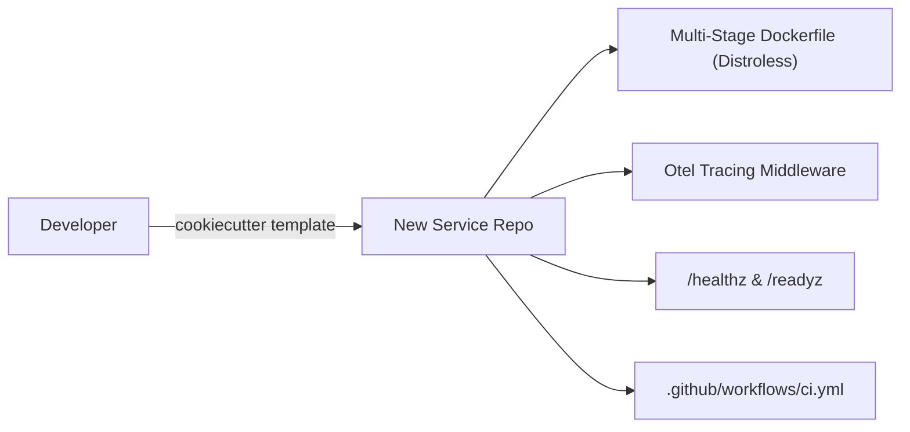
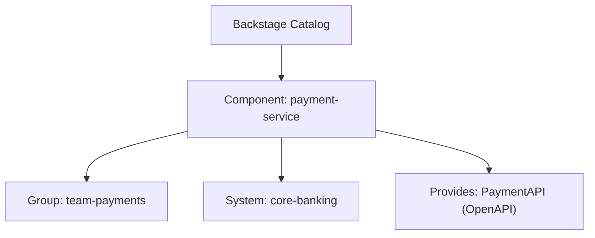

# PE Domain 1: Platform Foundations & IDPs — Hands-On Labs & Exercises

Six hands-on labs designed to build, measure, and scale platform capabilities and internal developer platforms.

---

## Lab 1: Developer Friction Audit & Journey Mapping

### Objective
Map a stream-aligned team's end-to-end journey from "idea" to "running in production", quantify extraneous cognitive load, identify bottlenecks, and calculate the team's Cognitive Load Index (CLI).

### Scenario
An organization has 35 backend developers. Deploying a new microservice requires interacting with 4 separate teams, writing 3 distinct configuration formats, and waiting an average of 14 calendar days.

### Step-by-Step Execution

1. **Construct the Baseline Journey Map:**
   Break down the developer journey into 7 core phases: Discover, Scaffold, Build, Test, Provision, Deploy, and Observe.

| Phase | Current Action | Tool / Interface | Human Hand-off? | Wait Time |
| :--- | :--- | :--- | :---: | :--- |
| **Discover** | Search Wiki for naming conventions & ports | Confluence | No | 2 hours |
| **Scaffold** | Copy-paste from an existing team repo | Git clone | No | 4 hours |
| **Build & Test** | Copy GitHub Actions YAML from another service | Git / YAML | No | 3 hours |
| **Provision DB** | Submit Jira ticket for RDS Postgres database | Jira | **Yes (DBA)** | 4 days |
| **IAM & Network** | Submit ticket for IAM role and security group | Jira | **Yes (SecOps)**| 5 days |
| **Deploy** | Request namespace creation & Argo CD app setup | Slack / Ticket | **Yes (DevOps)**| 3 days |
| **Observe** | Configure Datadog alerts & dashboards manually | Datadog UI | No | 4 hours |

2. **Calculate Total Cycle Time vs. Active Time:**
   - **Active Working Time:** 2h + 4h + 3h + 4h = 13 hours.
   - **Wait Time (Toil / Latency):** 4d + 5d + 3d = 12 business days (96 working hours).
   - **Flow Efficiency:** `(Active Time / Total Time) = 13 / 109 ≈ 11.9%`.

3. **Formulate the Platform Intervention Plan (Golden Path):**
   - Eliminate all three human hand-offs using self-service declarations.
   - Replace copy-paste repo cloning with a certified Backstage/Cookiecutter template.
   - Wire Crossplane / Terraform Controller for database and IAM self-service.

### Interview Talking Points
- "When analyzing developer workflows, I don't start by prescribing tools; I conduct a developer friction audit to measure flow efficiency. In one initiative, we found developers had an 11% flow efficiency due to hand-offs to DBAs and SecOps. By turning those hand-offs into self-service platform APIs, we cut onboarding lead time from 14 days to under 30 minutes."

---

## Lab 2: Scaffolding a Production-Grade Service Template

### Objective
Create an automated golden path scaffolding template with embedded security guardrails, multi-stage Docker builds, OpenTelemetry hooks, health probes, and CI/CD pipelines.

### Architecture


### Step-by-Step Implementation

1. **Create the Project Skeleton:**
   ```bash
   mkdir -p /tmp/service-template/{{cookiecutter.service_slug}}
   cd /tmp/service-template
   ```

2. **Define `cookiecutter.json`:**
   ```json
   {
     "service_name": "Order Service",
     "service_slug": "{{ cookiecutter.service_name.lower().replace(' ', '-') }}",
     "owner_team": "team-checkout",
     "port": 8080,
     "include_otel": true
   }
   ```

3. **Create the Standard Go Service (`main.go`):**
   ```go
   package main

   import (
       "encoding/json"
       "fmt"
       "log"
       "net/http"
       "os"
       "os/signal"
       "syscall"
       "time"
   )

   type HealthResponse struct {
       Status    string `json:"status"`
       Timestamp string `json:"timestamp"`
       Service   string `json:"service"`
   }

   func main() {
       port := os.Getenv("PORT")
       if port == "" {
           port = "{{cookiecutter.port}}"
       }

       mux := http.NewServeMux()
       mux.HandleFunc("/healthz", func(w http.ResponseWriter, r *http.Request) {
           w.Header().Set("Content-Type", "application/json")
           w.WriteHeader(http.StatusOK)
           json.NewEncoder(w).Encode(HealthResponse{
               Status:    "healthy",
               Timestamp: time.Now().UTC().Format(time.RFC3339),
               Service:   "{{cookiecutter.service_slug}}",
           })
       })

       server := &http.Server{
           Addr:         ":" + port,
           Handler:      mux,
           ReadTimeout:  5 * time.Second,
           WriteTimeout: 10 * time.Second,
           IdleTimeout:  120 * time.Second,
       }

       go func() {
           log.Printf("Starting {{cookiecutter.service_slug}} on port %s", port)
           if err := server.ListenAndServe(); err != nil && err != http.ErrServerClosed {
               log.Fatalf("Server error: %v", err)
           }
       }()

       // Graceful shutdown handling SIGTERM/SIGINT
       stop := make(chan os.Signal, 1)
       signal.Notify(stop, syscall.SIGTERM, syscall.SIGINT)
       <-stop

       log.Println("Shutting down gracefully...")
       server.Close()
   }
   ```

4. **Add Minimal Multi-Stage Dockerfile:**
   ```dockerfile
   FROM golang:1.24-alpine AS builder
   WORKDIR /app
   COPY . .
   RUN CGO_ENABLED=0 GOOS=linux go build -ldflags="-w -s" -o /service main.go

   FROM gcr.io/distroless/static-debian12:nonroot
   WORKDIR /
   COPY --from=builder /service /service
   USER 65532:65532
   EXPOSE {{cookiecutter.port}}
   ENTRYPOINT ["/service"]
   ```

### Verification
Generate a service using cookiecutter and verify it compiles and runs in a rootless container:
```bash
cookiecutter /tmp/service-template --no-input service_name="Payment Gateway"
cd payment-gateway
go run main.go &
curl -s http://localhost:8080/healthz | jq .
kill %1
```

---

## Lab 3: Running Backstage Locally with Software Catalog and Scaffolder

### Objective
Configure a local Backstage instance, define `catalog-info.yaml` with metadata, register a custom software component, and configure a Backstage Scaffolder Template.

### Architecture


### Step-by-Step Implementation

1. **Define the Catalog Descriptor (`catalog-info.yaml`):**
   ```yaml
   apiVersion: backstage.io/v1alpha1
   kind: Component
   metadata:
     name: payment-service
     description: Handles credit card and ACH payment transactions
     tags:
       - go
       - payments
       - pci-dss
     annotations:
       github.com/project-slug: internal-org/payment-service
       backstage.io/techdocs-ref: dir:.
   spec:
     type: service
     lifecycle: production
     owner: team-payments
     system: core-banking
     providesApis:
       - payment-v1-api
   ---
   apiVersion: backstage.io/v1alpha1
   kind: Group
   metadata:
     name: team-payments
     description: Checkout and Payments Engineering Team
   spec:
     type: team
     profile:
       displayName: Payments Team
       email: payments@example.com
     children: []
   ```

2. **Define a Backstage Software Scaffolder Template (`template.yaml`):**
   ```yaml
   apiVersion: scaffolder.backstage.io/v1beta3
   kind: Template
   metadata:
     name: standard-microservice-template
     title: Production Go Microservice
     description: Scaffolds a production-ready Go service with Distroless container, CI/CD, and Argo CD GitOps
     tags:
       - go
       - golden-path
   spec:
     owner: platform-team
     type: service
     parameters:
       - title: Service Configuration
         required:
           - name
           - owner
         properties:
           name:
             title: Service Name
             type: string
             description: Unique name of the service
           owner:
             title: Owning Team
             type: string
             description: Team in the catalog that owns this service
     steps:
       - id: fetch-base
         name: Fetch Base Skeleton
         action: fetch:template
         input:
           url: ./skeleton
           values:
             name: ${{ parameters.name }}
             owner: ${{ parameters.owner }}
       - id: publish-github
         name: Publish to GitHub
         action: publish:github
         input:
           allowedHosts: ['github.com']
           description: Scaffolded by Platform Portal
           repoUrl: github.com?owner=internal-org&repo=${{ parameters.name }}
           defaultBranch: main
       - id: register-catalog
         name: Register in Software Catalog
         action: catalog:register
         input:
           catalogInfoUrl: https://github.com/internal-org/${{ parameters.name }}/blob/main/catalog-info.yaml
   ```

### Verification
Validate the YAML syntax using `yamllint` or Backstage CLI linter:
```bash
python3 -c "import yaml; yaml.safe_load(open('catalog-info.yaml'))"
echo "YAML syntax validated."
```

---

## Lab 4: Implementing Platform SLOs & Burn Rate Tracking

### Objective
Instrument an internal platform service (such as an internal developer API or Scaffolder) with Prometheus metrics, establish Service Level Objectives (SLOs), and write multi-window multi-burn-rate alert rules.

### Prometheus Alerting Rules (`platform-slos.yaml`)
```yaml
apiVersion: monitoring.coreos.com/v1
kind: PrometheusRule
metadata:
  name: platform-api-slo-alerts
  namespace: platform-system
spec:
  groups:
    - name: platform-api-slo
      rules:
        # Calculate 5-minute and 1-hour error rates
        - record: job:platform_api_requests:error_rate5m
          expr: |
            sum(rate(http_requests_total{job="platform-api",status=~"5.."}[5m]))
            /
            sum(rate(http_requests_total{job="platform-api"}[5m]))

        - record: job:platform_api_requests:error_rate1h
          expr: |
            sum(rate(http_requests_total{job="platform-api",status=~"5.."}[1h]))
            /
            sum(rate(http_requests_total{job="platform-api"}[1h]))

        # Alert if burning 14.4x budget (2% burn in 1 hour) -> Critical page
        - alert: PlatformApiHighErrorBudgetBurn
          expr: |
            (job:platform_api_requests:error_rate5m > (14.4 * (1 - 0.999)))
            and
            (job:platform_api_requests:error_rate1h > (14.4 * (1 - 0.999)))
          for: 2m
          labels:
            severity: page
            tier: platform
          annotations:
            summary: "Platform API burning error budget at 14.4x rate"
            description: "High error rate on Platform API is consuming >2% of monthly budget in 1 hour."
```

### Verification
Test rule validity using `promtool`:
```bash
promtool check rules platform-slos.yaml
```

---

## Lab 5: Golden Path Drift Detection & Automated Remediation

### Objective
Write an automated Python audit script that queries Git repositories across an organization, identifies repositories lagging behind the golden path base image or CI workflow version, and automatically opens a remediation Pull Request.

### Implementation Script (`fleet_remediate.py`)
```python
#!/usr/bin/env python3
import json
import re
import sys

TARGET_IMAGE = "gcr.io/distroless/static-debian12:nonroot"
LATEST_VERSION = "v2.4.0"

def audit_dockerfile(content: str) -> bool:
    # Returns True if Dockerfile is on the modern Golden Path image
    for line in content.splitlines():
        if line.strip().startswith("FROM") and TARGET_IMAGE in line:
            return True
    return False

def audit_ci_workflow(content: str) -> bool:
    # Returns True if CI workflow uses modern standard
    return "internal-platform/ci-workflows/.github/workflows/standard-service.yml@" + LATEST_VERSION in content

def generate_remediation_diff(dockerfile_content: str) -> str:
    # Replaces legacy base images
    lines = []
    for line in dockerfile_content.splitlines():
        if line.strip().startswith("FROM") and "alpine" in line and "builder" not in line:
            lines.append(f"FROM {TARGET_IMAGE}")
        else:
            lines.append(line)
    return "\n".join(lines)

if __name__ == "__main__":
    sample_dockerfile = """FROM golang:1.24-alpine AS builder
WORKDIR /app
COPY . .
RUN go build -o /app/server .

FROM alpine:3.18
COPY --from=builder /app/server /server
CMD ["/server"]
"""
    is_compliant = audit_dockerfile(sample_dockerfile)
    print(f"Sample Dockerfile compliant: {is_compliant}")
    if not is_compliant:
        remediated = generate_remediation_diff(sample_dockerfile)
        print("--- Remediation Applied ---")
        print(remediated)
```

### Verification
Run the script to confirm detection and replacement:
```bash
python3 fleet_remediate.py
```

---

## Lab 6: Drafting a Platform Team Charter & Architecture Decision Record (ADR)

### Objective
Create a formalized Platform Team Charter establishing scope, interaction boundaries, customer personas, and an ADR (Architecture Decision Record) selecting an IDP technology.

### Deliverable 1: Platform Charter (`CHARTER.md`)
```markdown
# Platform Engineering Team Charter

## Mission
To empower stream-aligned product engineering teams to autonomously, rapidly, and securely build, deploy, and operate customer-facing services without requiring ticket-based infrastructure interventions.

## Customers (Personas)
- Core Backend Engineers (Go, Java)
- Frontend Engineers (Next.js, CDN routing)
- Data Engineers (Spark, Kafka streaming)

## Scope
- **IN SCOPE:** Developer Portal, Golden Path Scaffolding Templates, Core Kubernetes Cluster Runtime (EKS), Ingress/Gateway API, Shared CI/CD Workflows, Workload IAM & Secret Brokerage, Centralized Observability Collectors.
- **OUT OF SCOPE:** Writing application business logic, application debugging, database schema optimizations, on-call pager duty for domain microservices.

## Interaction Modes
- **X-as-a-Service:** Primary mode for all production platform capabilities.
- **Collaboration:** Limited to 4-week time-boxed discovery engagements with max 2 lighthouse teams.
- **Facilitating:** Weekly 1-hour open office hours and migration workshops.
```

### Deliverable 2: ADR 001 - Selecting Portal Architecture (`ADR-001.md`)
```markdown
# ADR 001: Selection of Internal Developer Portal Technology

## Status
Accepted

## Context
With 180 engineers across 24 product teams, knowledge discovery and service ownership are severely fragmented. We require a centralized software catalog and self-service scaffolder.

## Options Considered
1. **Backstage (Self-Hosted Open Source)**
2. **SaaS Developer Portal (Port / Cortex)**
3. **Internal Custom CLI + GitHub Markdown Wiki**

## Decision
We select **Port (SaaS)** for the initial 18-month phase.

## Consequences & Justification
- **Positive:** Zero dedicated frontend/Node.js engineering staff required; instant integration with GitHub, Jira, and Kubernetes; reduces time-to-value from 9 months to 4 weeks.
- **Negative:** Subscription SaaS cost (~$15/dev/month); vendor lock-in on portal data model.
- **Mitigation:** All catalog metadata is defined declaratively as `port.yaml` in product Git repos, ensuring full portability if we migrate to Backstage in the future.
```
