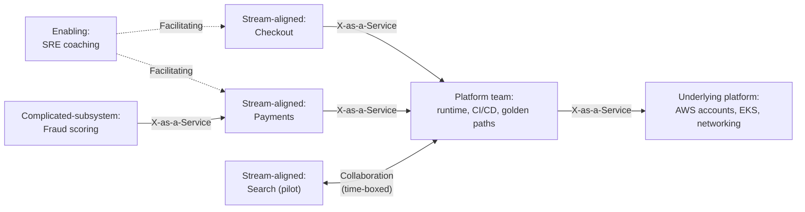
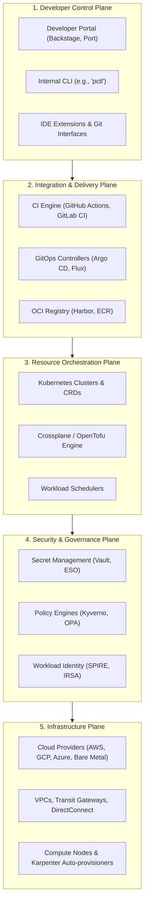
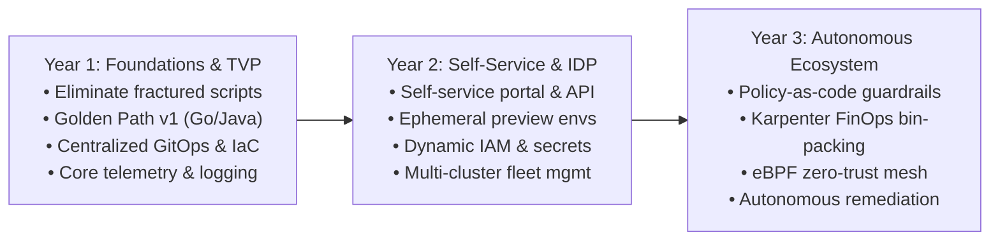
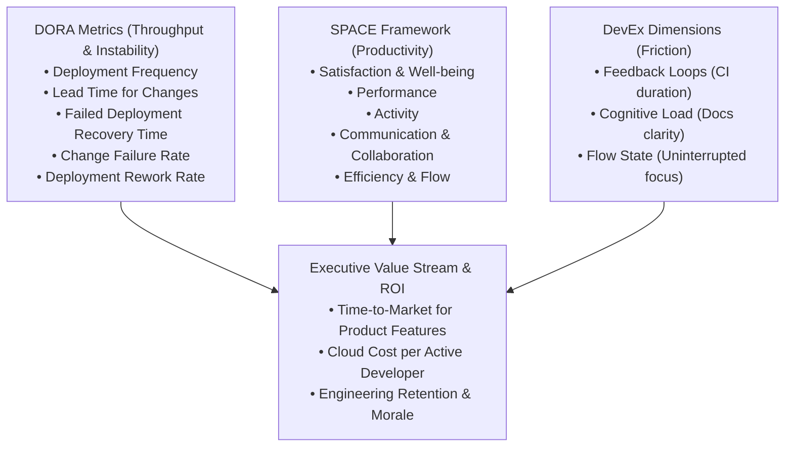

# PE Domain 1: Platform Foundations & Internal Developer Platforms — Deep-Dive Study Guide

> [!IMPORTANT]
> **Interview Emphasis:** Very High
>
> **Where it shows up:** Phone screen ("what is platform engineering?"), hiring-manager and behavioral rounds (product thinking, adoption, saying no), system design ("design an IDP for a 200-engineer company", see [Mock Interview 5](../Mock_Interviews/Mock_Interview_5_System_Design_IDP.md)), technical deep dives (Backstage, golden paths, platform APIs), and take-homes (platform strategy or roadmap document).
>
> **What "strong" sounds like:** You describe the platform as a product with customers, outcomes, and a roadmap, not as a pile of tools. You can name the cognitive load you remove, the interaction mode you use with each team, how you know adoption is voluntary, and what you will deliberately *not* build. You know what Backstage really costs to run, and you can explain when a portal is premature.

---

## 1. What Platform Engineering Is

### 1.1 The evolution: ops, DevOps, SRE, platform engineering

| Era | Core idea | What broke |
| :--- | :--- | :--- |
| **Separate dev and ops** (pre-2009) | Developers write code, operations runs it; handoffs by ticket | Slow releases, "works on my machine", blame across the wall |
| **DevOps** (term popularized from 2009) | Shared ownership, automation, fast feedback. Amazon's Werner Vogels summarized the ownership model as "you build it, you run it" (ACM Queue interview, 2006) | Every team now owns a full cloud-native toolchain, and the expertise doesn't scale |
| **SRE** (Google, book published 2016) | Run operations as a software problem: SLOs, error budgets, toil limits | Solves reliability, not the "how do 40 teams each ship safely" problem |
| **Platform engineering** (mainstream since ~2021) | A dedicated team builds a **self-service internal platform, run as a product**, so stream-aligned teams can own their services without becoming infrastructure experts | Fails when the "platform team" is the old ops team with a new name |

Platform engineering does not replace DevOps. It is one way to make DevOps work for hundreds of engineers: teams keep owning their services end to end, but they consume paved capabilities instead of building their own.

### 1.2 The cognitive-load problem of "you build it, you run it"

To ship one service to production in 2026, a team may need to understand: Dockerfiles and base images, Kubernetes manifests or Helm, Terraform or Crossplane for the database, IAM roles and IRSA/Pod Identity, VPC and security groups, CI YAML, GitOps promotion, OpenTelemetry, dashboards and alerts, SBOMs and image signing, secrets management, policy exceptions, and cost tags.

Each item is reasonable on its own. Together they are a second job. Typical symptoms:

- **Slow delivery.** Weeks pass between "repo created" and "first production deploy".
- **Inconsistent security.** Forty teams make forty IAM designs, and some are wrong.
- **Duplicated effort.** Each team writes its own Helm chart, CI pipeline, and alert rules.
- **Shadow platform teams.** The most infrastructure-savvy developer on each team becomes the de facto ops person. That is uncounted platform work, done badly and without a roadmap.

Platform engineering keeps ownership with the teams and changes the cost of doing the right thing: **the secure, observable, compliant path should also be the easiest path.**

### 1.3 Definitions you should quote accurately

The CNCF **Platforms White Paper** (TAG App Delivery) defines a platform:

> "A platform for cloud-native computing is an integrated collection of capabilities defined and presented according to the needs of the platform's users. It is a cross-cutting layer that ensures a consistent experience for acquiring and integrating typical capabilities and services for a broad set of applications and use cases."

The CNCF **Platform Engineering Maturity Model** defines the practice: "Platform engineering is the practice of planning and providing such computing platforms to developers and users", and it covers all parts of platforms and their capabilities, "their people, processes, policies and technologies", along with the business outcomes that drive them.

Key ideas from the white paper:

| Theme | What the paper says (paraphrased) |
| :--- | :--- |
| **Capabilities** | Web portals, provisioning APIs, golden path templates and docs, build/test automation, delivery and verification automation, dev environments, observability, infrastructure services, data services, messaging/events, identity and secrets, security services, artifact storage |
| **Attributes of a good platform** | Platform as a product; user experience; documentation and onboarding; self-service; reduced cognitive load for users; optional and composable; secure by default |
| **Thinnest layer** | Seek "the thinnest viable platform layer over implementations from managed providers". A very simple platform can be a wiki page linking to provisioning procedures |
| **Platform team's job** | Owns the *interfaces to and experiences with* capabilities (portals, APIs, docs, templates, CLIs), and generally does not run commodity compute, network, or storage itself |
| **Challenges** | Treat platforms as products built with users; choose priorities and first partner teams carefully; win leadership support by showing value-stream impact |

> [!NOTE]
> An **internal developer platform (IDP)** is the whole set of capabilities: APIs, automation, templates, infrastructure abstractions, docs. An **internal developer portal** (Backstage, Port, Cortex) is one *interface* to it. Interviewers listen for whether you keep the two apart.

### 1.4 Platform engineering vs DevOps vs SRE vs cloud engineering

| | DevOps | SRE | Platform Engineering | Cloud Engineering |
| :--- | :--- | :--- | :--- | :--- |
| **What it is** | Culture and practices (CALMS: culture, automation, lean, measurement, sharing) | Engineering discipline for reliability | Product discipline that builds self-service internal platforms | Specialty in designing and running cloud foundations |
| **Primary customer** | The whole delivery organization | End users, through service reliability | Internal developers (and data scientists, SREs, and increasingly AI agents) | The organization's infrastructure consumers, often including the platform team |
| **Core outputs** | Shared ownership, CI/CD, automation | SLOs, error budgets, incident response, capacity plans, toil reduction | Golden paths, platform APIs, templates, portal, docs, support model | Landing zones, account vending, network topology, IAM baselines, IaC modules |
| **Measured by** | DORA metrics | SLO attainment, toil %, incident metrics | Adoption, developer experience, delivery and quality improvements, cost per service | Security posture, cost, foundational reliability |
| **Failure mode** | A "DevOps team" that becomes a new silo | Renamed ops team that only carries pagers | Renamed ops team handling tickets; a portal with no platform behind it | Snowflake accounts; a bottleneck for every network or IAM change |

> [!TIP]
> **Interview Angle:** "How is platform engineering different from DevOps?" Lead with the relationship, not a rivalry: "DevOps is the operating model, shared ownership with fast feedback. Platform engineering is how we make that model affordable at scale. A product-managed platform team takes repeated, undifferentiated work off stream-aligned teams through self-service, so 'you build it, you run it' doesn't mean every team also builds its own Kubernetes, CI, and IAM stack." Then give one concrete example of cognitive load you removed.

### 1.5 What platform engineers actually do day to day

| Activity | Concrete examples | Share of a typical week (varies widely) |
| :--- | :--- | :--- |
| **Build capabilities** | Terraform/Crossplane modules, Kubernetes controllers, reusable CI workflows, Backstage templates and plugins, CLIs | Largest share |
| **Operate the platform** | EKS fleet upgrades, CI runner capacity, Argo CD, portal uptime, on-call for platform incidents | Significant and constant |
| **Support and enablement** | `#platform-help` rotation, office hours, pairing with a team on a hard migration | Should be bounded on purpose |
| **Discovery** | Developer interviews, friction logs, shadowing onboarding, reviewing support-ticket themes | Small but continuous |
| **Migrations** | Jenkins to GitHub Actions, EC2 to EKS, deprecating old base images | Spikes by quarter |
| **Governance** | Policy as code (Kyverno/OPA), guardrails, exception workflows | Ongoing |
| **Measurement and communication** | Adoption dashboards, DORA/DevEx reporting, release notes, demos | Small but visible |

### 1.6 The "renamed ops team" anti-pattern

The most common failure is an infrastructure or ops team renamed "Platform Engineering" with nothing else changed.

| Signal | Renamed ops team | Real platform team |
| :--- | :--- | :--- |
| **How work arrives** | Tickets: "please create an S3 bucket" | Roadmap built from research; recurring tickets become self-service features |
| **Success metric** | Tickets closed, SLA on tickets | Adoption, lead time, developer satisfaction, fewer tickets per team |
| **Product role** | None; whoever shouts loudest gets priority | Product manager or explicit product owner; published roadmap |
| **Interface** | Humans and Jira | APIs, templates, CLI, portal, docs |
| **Adoption** | Mandated | Mostly pulled; mandates limited to real compliance needs |
| **Knowledge** | Lives in the team's heads | Encoded in golden paths and docs |

---

## 2. Team Topologies

*Team Topologies* (Matthew Skelton and Manuel Pais; 2019, second edition 2025) gave platform engineering its vocabulary. Expect at least one interview question that uses it.

### 2.1 Four fundamental team types

| Team type | Purpose | Example | Warning sign |
| :--- | :--- | :--- | :--- |
| **Stream-aligned** | Delivers value end to end for one stream of work (product, user journey, customer segment) | Checkout team owns checkout from UI to database | Waits on other teams for most changes |
| **Platform** | Provides internal services that stream-aligned teams consume *self-service*, reducing their cognitive load | Developer platform team: runtime, CI/CD, templates, observability defaults | Its backlog is other teams' tickets |
| **Enabling** | Specialists who help other teams learn a new capability, then step away | SRE coaching team helping teams adopt SLOs | Becomes a permanent dependency or does the work for teams |
| **Complicated-subsystem** | Owns a part that needs deep specialist knowledge | Video codec, pricing engine, ML ranking model | Created for an ordinary component, adding a handoff for no reason |

### 2.2 Three interaction modes

| Mode | What it looks like | When to use | Expected duration |
| :--- | :--- | :--- | :--- |
| **Collaboration** | Two teams work closely together on a shared goal | Discovering a new capability (for example, the first service on a new runtime) | Temporary, weeks to a few months; costly |
| **X-as-a-Service** | One team consumes another's offering with minimal coordination | Mature platform capabilities | Long-lived; the default for platform consumption |
| **Facilitating** | One team helps another learn or remove an obstacle | Enabling team teaching a practice; platform engineers running a migration clinic | Temporary |

A healthy platform runs **collaboration → X-as-a-Service**: work closely with two or three pilot teams to discover what the capability should be, then harden it into a self-service product and step back.



### 2.3 Conway's Law and the inverse Conway maneuver

**Conway's Law** (Melvin Conway, 1968): a system's design tends to mirror the communication structure of the organization that builds it.

The **inverse Conway maneuver** turns this around: shape the teams and their interfaces to match the architecture you want.
- If you want a clean, self-service platform API, you need a platform team with a **clear boundary and a team API** (docs, versioning, support channel), not a shared pool of ops people embedded everywhere.
- If every product team must talk to the database team, the network team, and the security team to ship, the architecture will grow three handoffs. The platform's job is to replace those conversations with interfaces.

### 2.4 Cognitive load: intrinsic, extraneous, germane

Team Topologies borrows John Sweller's cognitive load theory:

| Type | Meaning | Developer example | Platform goal |
| :--- | :--- | :--- | :--- |
| **Intrinsic** | Inherent difficulty of the task | Understanding Go concurrency, or idempotent payment retries | Leave it alone; it is the job |
| **Extraneous** | Load imposed by the environment, adding no value | Finding out how to get a DNS record; writing six YAML dialects; guessing which Slack channel owns IAM | **Eliminate it.** This is the platform's main target |
| **Germane** | Effort spent learning the domain and building lasting understanding | Learning the business rules of refunds; designing the checkout data model | Free up capacity so teams spend more time here |

### 2.5 Thinnest Viable Platform (TVP)

The **TVP** is the smallest set of APIs, documentation, and tools that measurably speeds up the teams using it.

| Stage | TVP looks like | Move to the next stage when |
| :--- | :--- | :--- |
| **0** | Wiki: "how we deploy", supported patterns, who to ask | The same questions recur weekly |
| **1** | Templates and shared CI workflows in Git | Teams copy-paste and drift |
| **2** | Self-service APIs (Terraform modules behind PR automation, Kubernetes CRDs) | Provisioning still needs humans in the loop |
| **3** | Portal over the APIs, plus a catalog with ownership | Discovery and ownership become the bottleneck at scale |

---

## 3. Platform as a Product

### 3.1 Developers are customers, but captive ones
Internal customers usually cannot switch vendors, so unhappy developers don't churn, they **work around you**. They build shadow pipelines, hand-roll Terraform, or keep the old Jenkins alive. Use **jobs-to-be-done** framing: developers don't want "a Kubernetes namespace", they want to "get my new service serving production traffic safely, with alerts, before the sprint review".

### 3.2 User research methods: Friction logs, Journey mapping, Ticket mining
- **Journey Maps:** Trace the 7 core stages (Discover, Scaffold, Build, Test, Provision, Deploy, Observe) to compute Flow Efficiency.
- **Friction Logs:** Log every snag with a timestamp and severity while executing a real developer workflow.
- **Support Channel Mining:** Group `#platform-help` threads into thematic clusters monthly.

### 3.3 Prioritization: RICE & Cost of Delay (CD3)
- **RICE Score:** `(Reach × Impact × Confidence) / Effort`
- **Cost of Delay (CD3):** Identifies urgent economic costs of postponing critical changes (security vulnerabilities, end-of-life runtimes).

### 3.4 Platform SLOs & Error Budgets

| Capability | SLI | Example objective |
| :--- | :--- | :--- |
| **CI Runner Fleet** | Fraction of pipeline runs that start within 60s of trigger | 99% over 28 days |
| **CI Execution** | Fraction of runs failing for platform reasons (runner crash, cache outage) | < 1% |
| **Deploy API / GitOps** | Fraction of successful syncs completing within 10 min of merge | 99% |
| **Golden Path Template** | Fraction of scaffolder runs that complete and produce a green first build | 98% |
| **Provisioning API** | p90 time from request to ready for a standard Postgres instance | < 20 min |
| **Portal** | Availability of catalog and search pages | 99.5% (business hours weighted) |

---

## 4. Golden Paths & Paved Roads

### 4.1 Concept and History
The term **"Paved Road"** was coined by Netflix to describe a supported, well-architected, and fully automated path for developing and deploying software. Spotify popularized the term **"Golden Path"**.

> "A Golden Path is a supported, opinionated path of least resistance. It is not an enforced mandate or a straightjacket. It is a highway: you can drive on it safely at high speed, but if your mission requires off-roading, you are permitted to do so provided you assume the responsibility of doing your own maintenance."

### 4.2 Golden Path vs. Golden Cage

| Dimension | Golden Path (Healthy) | Golden Cage (Anti-pattern) |
| :--- | :--- | :--- |
| **Philosophy** | Paved road of least resistance | Strict mandate, no divergence tolerated |
| **Off-roading** | Allowed with clear boundaries (team owns operational burden) | Forbidden by gatekeeping committees or hard policy blocks |
| **Evolution** | Fast-evolving; incorporates community pull requests and innovations | Static; evolves only when central team has bandwidth |
| **Developer Agency** | High; developers feel empowered and accelerated | Low; developers feel treated as untrusted assembly-line workers |
| **Innovation** | High; teams can experiment with novel architectures | Stifled; impossible to adopt new technologies without months of bureaucracy |

### 4.3 Escape Hatch Architecture
When a team has an unconventional use case (e.g., specialized GPU training, high-frequency C++ daemon):
1. **Contract-Based Off-Roading:** As long as the container honors the **Platform Contract** (`/healthz` probes, OpenTelemetry trace propagation, JSON logs to stdout, non-root user, memory limits), the platform schedules and routes to it.
2. **Tiered Support SLA:** Standard Golden Path services receive 24/7 framework and runtime support. Off-road workloads receive infrastructure/cluster-level support only; runtime and application debugging remain with the service team.
3. **Paved-Road On-Ramp:** When 3+ teams build similar custom solutions, the platform team collaborates with them to turn that pattern into an official Golden Path.

### 4.4 Combating Template Rot & Drift
Static templates fork on day one. To combat Day-2 drift:
- **Callable CI Workflows:** Application repositories reference shared workflows (`uses: internal-platform/ci-workflows/.github/workflows/standard-service.yml@v2`).
- **Fleet PR Bots:** Use automated bots (Renovate, Dependabot, custom GitHub scripts) to open batch upgrade PRs for base images, Helm charts, and dependencies.
- **Service Scorecards:** Display live alignment scores in the developer portal to track and gamify fleet compliance.

---

## 5. Internal Developer Platform (IDP) Architecture

### 5.1 The 5 Planes of an IDP



### 5.2 Backstage Deep-Dive
**Backstage** is the CNCF open-source developer portal framework.
1. **Software Catalog:** Central metadata database tracking Components, Systems, Domains, and APIs via `catalog-info.yaml` files.
2. **Software Templates (Scaffolder):** Declarative YAML recipes that fetch skeletons, render variables, create Git repositories, and register services in the catalog.
3. **TechDocs:** Docs-like-code solution compiling Markdown stored in service repositories into a unified web documentation interface.
4. **Plugins:** Modular React frontend and Node.js backend extensions for CI/CD status, Kubernetes monitoring, PagerDuty, and cost tracking.

> [!WARNING]
> **Backstage Operational Reality:** Backstage is an SDK, not an off-the-shelf product. It requires ongoing TypeScript/React and Node.js engineering bandwidth to maintain dependencies and develop custom plugins. Organizations under 150 engineers should strongly evaluate SaaS portals (Port, Cortex) or a CLI/Git-based approach before committing to Backstage.

---

## 6. Measuring Platform Success: DORA, SPACE & DevEx

### 6.1 DORA Metrics (Delivery Performance)

| DORA Metric | Definition | Elite Standard | Low Performer | Platform Lever |
| :--- | :--- | :--- | :--- | :--- |
| **Deployment Frequency** | How often code is successfully deployed to production | On demand (multiple per day) | Once per month to 6 months | Automated GitOps pipelines, canary rollouts, decoupled feature flags |
| **Lead Time for Changes** | Time from code commit to running in production | Less than 1 hour | Greater than 1 month | CI runner fleets, build caching, automated testing guardrails |
| **Change Failure Rate** | Percentage of deployments causing a production failure | 0% – 15% | 46% – 60% | Automated policy checks, canary analysis, ephemeral test environments |
| **Failed Deployment Recovery Time** | Time required to restore service after a failure | Less than 1 hour | Greater than 1 week | 1-click GitOps rollback (`git revert`), automated health probes |

### 6.2 SPACE Framework
- **S - Satisfaction & Well-being:** Developer NPS, tool satisfaction surveys, burnout indicators.
- **P - Performance:** System quality, uptime, business impact.
- **A - Activity:** Output volume (commits, PRs, deployments) — used with caution to avoid perverse incentives.
- **C - Communication & Collaboration:** PR review turnaround, knowledge sharing, onboarding ramp time.
- **E - Efficiency & Flow:** Focus time, low CI wait times, lack of interruptions.

### 6.3 DevEx Framework
Focuses on developer cognitive perception:
1. **Feedback Loops:** Sub-minute local test execution and fast CI feedback.
2. **Cognitive Load:** Intuitive APIs, transparent defaults, and excellent documentation.
3. **Flow State:** Uninterrupted work blocks and reliable environments.

---

## 7. Platform Adoption, Migrations & Governance

### 7.1 Driving Voluntary Adoption
- **Lighthouse Teams:** Partner with 1–2 influential, struggling product teams in *Collaboration* mode. Deliver a 10x improvement in their delivery speed. Let them advocate to peers.
- **Inverted Gravity:** Ensure the Golden Path is so effortless that manual infrastructure work feels intolerably tedious.
- **Community Evangelism:** Demos, office hours, hackathons, and internal tech blogs.

### 7.2 Migration Strategies
- **Strangler Fig Pattern:** Incrementally replace parts of the legacy deployment pipeline rather than risking a single big-bang cutover.
- **Fleet-Wide PR Campaigns:** Write automated scripts to open pull requests across 200+ repositories, updating configs or SDKs with full test validation.
- **Brownout Exercises:** Temporarily disable legacy systems during announced daytime windows to expose hidden dependencies before final decommission.

---

## 8. Failure Modes & Anti-Patterns

1. **The "Build It and They Will Come" Fallacy:** Building a complex platform in an ivory tower without user research.
2. **The Renamed Ops Silo:** Slapping a "Platform Team" label on an ops team that still processes Jira tickets manually.
3. **Portal Without a Platform:** Polishing a gorgeous UI while underlying provisioning is still completely manual or broken.
4. **The Monolithic Abstraction:** Writing massive custom wrappers over cloud APIs that quickly become brittle, buggy, and obsolete.
5. **Mandating Without Empathy:** Forcing teams onto an immature platform via executive decree, poisoning engineering culture.

---

## 9. Staff-Level Platform Strategy & 3-Year Roadmap Execution

Stepping from Senior to Staff Platform Engineer requires shifting from *solving technical problems* to *shaping organizational architecture and engineering velocity across hundreds of developers*. A Staff Platform Engineer designs systems that make entire engineering organizations deliver faster, safer, and with lower cognitive load.

### 9.1 The 3-Year Platform Evolution Strategy

When leading a platform initiative over a multi-year horizon, organizations typically progress through three distinct architectural phases:



| Dimension | Year 1: Thinnest Viable Platform (TVP) | Year 2: Automated Self-Service IDP | Year 3: Autonomous Platform Ecosystem |
| :--- | :--- | :--- | :--- |
| **Developer Interaction** | Standardized Git repo templates; opinionated CI/CD workflows. | Self-service web portal (Backstage/Port) and unified Platform CLI. | Conversational/declarative intent-based APIs; automatic environment instantiation. |
| **Infrastructure Plane** | Shared multi-tenant Kubernetes clusters; centralized Terraform modules. | Crossplane / HCP Terraform API-driven resource provisioning on demand. | Ephemeral infrastructure; automated node rightsizing; zero idle staging resources. |
| **Delivery Model** | Push-based CI pipelines with manual approval gates. | Pull-based GitOps (Argo CD) with automated canary verification (Argo Rollouts). | Progressive delivery with automated anomaly detection, auto-rollback, and ring deployments. |
| **Security & Identity** | Static long-lived secrets in Vault; manual security reviews. | Ephemeral workload identity (SPIFFE/SPIRE, OIDC), automated secret rotation. | Zero-trust service mesh; automated continuous compliance and cryptographic SBOM signing. |
| **Success Metric** | Lead time to first deploy reduced from 3 weeks to 2 days. | 80% voluntary adoption across all stream-aligned teams; DORA Elite tier. | Zero-downtime fleet upgrades; 30% reduction in cloud unit cost per transaction. |

---

### 9.2 Enterprise RFC & ADR Architecture Governance

A Staff Engineer establishes architectural alignment across multiple cross-functional teams without resorting to executive mandates. The primary instrument for this is the **Request for Comments (RFC)** and **Architecture Decision Record (ADR)** process.

#### The Staff Platform RFC Framework
Every major platform initiative (e.g., migrating to Argo CD, introducing Backstage, adopting Cilium eBPF) must begin with a structured RFC containing:
1. **Executive Summary & Business Context:** Why does this problem matter to company revenue, engineering velocity, or compliance?
2. **User Personas & Pain Points:** Direct quotes and telemetry from product engineers suffering under the current architecture.
3. **Non-Goals:** Explicitly stating what the platform team will *not* solve to prevent scope creep.
4. **Proposed Architecture:** Detailed C4 model diagrams showing control planes, data planes, APIs, and data stores.
5. **Trade-off Matrix (The "Rejected Alternatives"):** Comparing at least 3 viable options (e.g., Build in-house vs. Backstage vs. Port vs. Status Quo) with pros, cons, and operational cost.
6. **Security, Compliance & Cost Impact:** IAM boundary analysis, audit logging, and projected AWS/cloud infrastructure spend.
7. **Rollout & Rollback Strategy:** Phase 0 (dogfooding), Phase 1 (lighthouse teams), Phase 2 (opt-in migration), Phase 3 (legacy deprecation with automated PR campaigns).

#### Architecture Decision Records (ADRs)
While RFCs are collaborative proposals, ADRs are permanent, version-controlled records in git capturing decisions and context:
```markdown
# ADR-042: Adoption of Crossplane for Database Self-Service
- **Status:** Accepted (Date: 2026-04-12)
- **Deciders:** Staff Platform Architect, Lead SRE, Security Director
- **Context:** Developers wait 14 days for DBA tickets to provision RDS Postgres. Terraform pipelines run by developers cause state lock contention and leak credentials.
- **Decision:** Expose a Kubernetes Custom Resource (`CompositeDatabaseDefinition`) managed via Crossplane in the platform control plane.
- **Consequences:**
  - Positive: Database provisioning lead time drops to 90 seconds; security guardrails enforced via native CEL policies.
  - Negative: Platform team must operate and monitor Crossplane controllers and CRD reconciliation loops.
```

---

### 9.3 The Buy vs. Build vs. Adopt Open-Source Framework

Staff engineers prevent multi-million-dollar platform failures by applying a rigorous financial and operational lens to platform investments:

$$\text{TCO} = \text{License Cost} + (\text{FTE Engineers} \times \text{Fully Loaded Cost}) + \text{Opportunity Cost of Delayed Features}$$

| Option | Ideal Scenario | Hidden Traps / Failure Modes | Staff Decision Rule |
| :--- | :--- | :--- | :--- |
| **Build In-House** | Core competitive advantage unique to your business domain (e.g., proprietary financial trading engine). | The "Not Invented Here" syndrome. Custom UI platforms (e.g., home-grown portals) rot within 18 months as engineers leave. | **Never build commodity capabilities.** Only build if no commercial or OSS tool solves 70% of the problem. |
| **Adopt Open-Source** | Strong community backing (CNCF Graduated/Incubating), clear standards, active ecosystem (e.g., Kubernetes, Argo CD, Cilium). | Open source is "free like a puppy, not free like beer." You own the operational toil, upgrades, security patching, and scaling bugs. | Adopt if the team has the engineering depth to debug upstream code and operate the control plane. |
| **Buy Commercial SaaS** | Commodity infrastructure, developer portal (Port, Cortex), or specialized security scanning (Snyk, Wiz). | High annual seat costs; vendor lock-in; complex data residency / VPC peering hurdles. | Buy when time-to-market is critical and operating the software consumes >2 FTEs without adding competitive advantage. |

---

### 9.4 Advanced DevEx Telemetry: DORA + SPACE + DevEx 360

A Staff Engineer bridges the gap between low-level telemetry and executive business impact by operationalizing a 360-degree Developer Experience dashboard:



#### Measuring Platform Friction Quantitatively
- **P95 PR Validation Latency:** Target $< 10$ minutes. If CI queues exceed 15 minutes, developers context-switch, degrading engineering velocity.
- **Onboarding Lead Time:** Target $< 4$ hours from laptop unboxing to first deployed canary commit in staging.
- **Golden Path Friction Score:** Quarterly developer survey measuring Net Promoter Score (NPS) of the platform CLI and portal. Target NPS $\ge +45$.

---

## 10. Essential Bookshelf & Further Reading

1. **Team Topologies** by Matthew Skelton and Manuel Pais (IT Revolution, 2nd Edition 2025). The foundational guide on team boundaries, cognitive load, and organizational interfaces.
2. **Platform Engineering: A Guide for Technical, Product, and People Leaders** by Camille Fournier and Ian Nowland (O'Reilly, 2024). The comprehensive handbook for building and running modern platform teams.
3. **Accelerate: Building and Scaling High Performing Technology Organizations** by Nicole Forsgren, Jez Humble, and Gene Kim (IT Revolution, 2018). The definitive science behind DORA metrics.
4. **Site Reliability Engineering: How Google Runs Production Systems** by Betsy Beyer et al. (O'Reilly, 2016). Master-class on error budgets, toil reduction, and running operations as software.
5. **The DevOps Handbook (2nd Edition)** by Gene Kim et al. (IT Revolution, 2021). The foundational Three Ways and enterprise continuous delivery patterns.
6. **CNCF Platforms White Paper & Maturity Model** (CNCF TAG App Delivery). The cloud-native community standard on platform definitions, planes, and capability progression.
