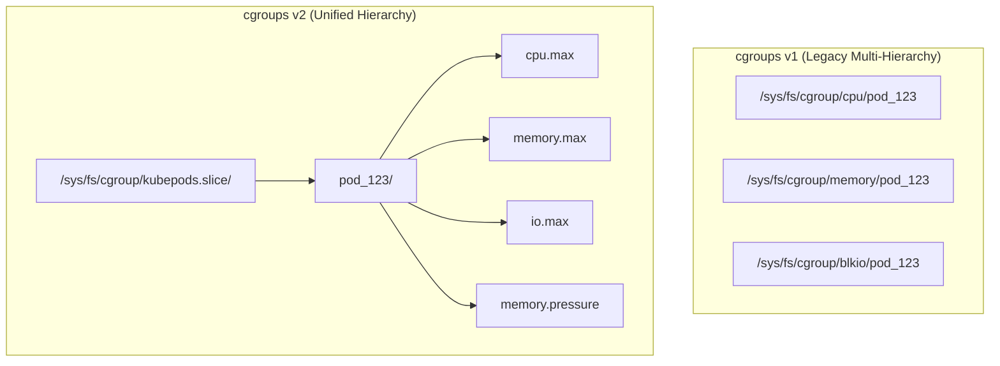
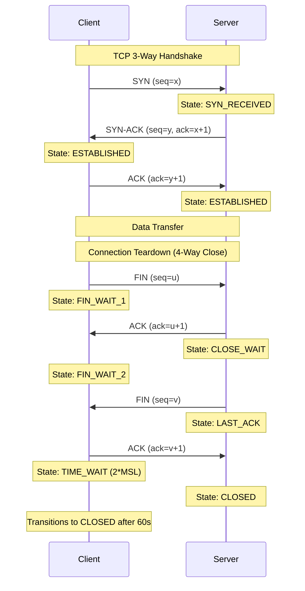
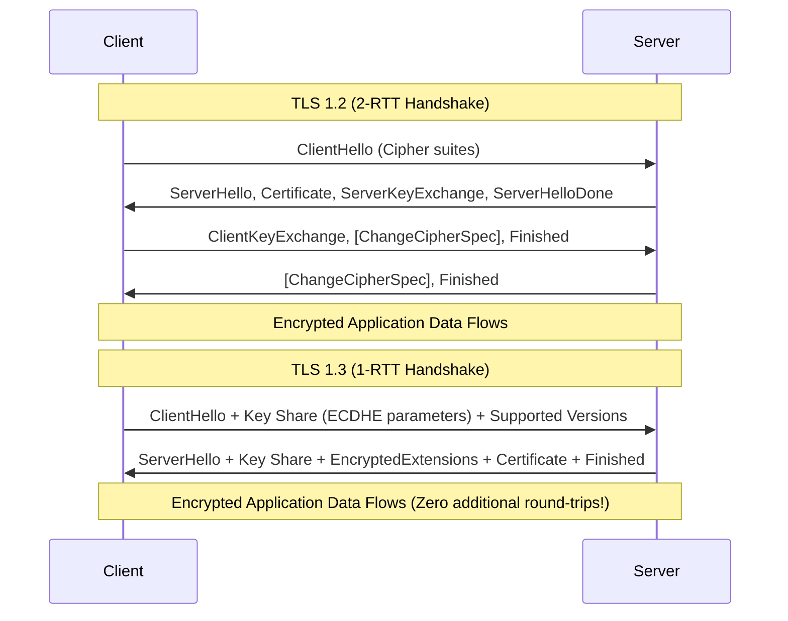
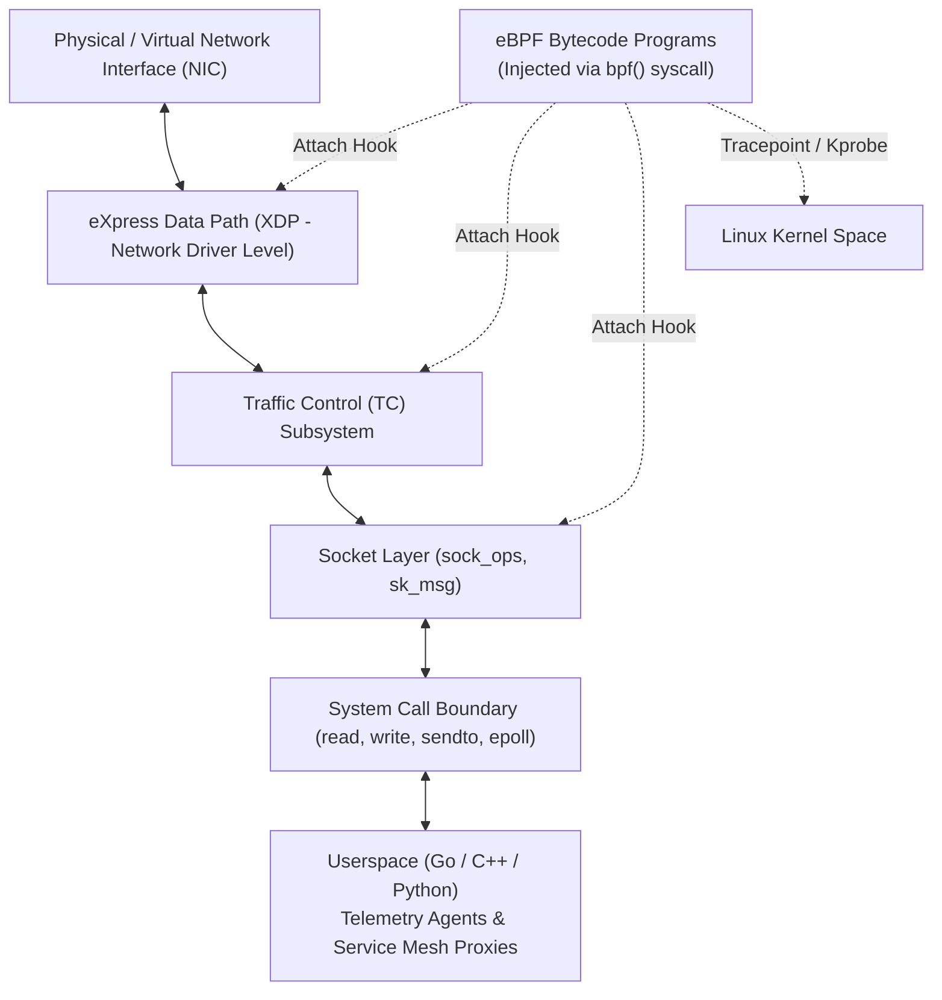

# PE Domain 2: Linux, Networking & Systems Fundamentals — Deep-Dive Study Guide

> [!IMPORTANT]
> **Interview Emphasis:** Very High
>
> **Where it shows up:** Technical phone screen (Linux breadth), troubleshooting & live debugging rounds (simulated node/pod outages), Kubernetes deep dives (container runtimes, CNI, kube-proxy, CoreDNS), and system design (network topologies, L4/L7 load balancing).
>
> **What "strong" sounds like:** You don't treat containers as magic boxes; you explain them precisely as Linux processes isolated by kernel **namespaces** and throttled by **cgroups**. You trace packets down to the socket, through network namespaces, veth pairs, netfilter/iptables, routing tables, and eBPF programs. You can effortlessly deliver the 18-step "curl an HTTPS URL" walkthrough with zero hesitation.

---

## 1. Processes, Signals & Process Lifecycles

### 1.1 The Linux Process Model
A Linux process is represented in the kernel by the `task_struct` structure. Every process has:
- A unique Process ID (**PID**).
- A Parent Process ID (**PPID**).
- Resource descriptors (file descriptors, memory maps, signal handlers).
- Execution credentials (UID, GID, capability sets).

### 1.2 Process Creation: `fork()`, `vfork()`, `clone()`, and `execve()`
- `fork()`: Creates a child process as an exact duplicate of the parent using **Copy-On-Write (COW)** page tables.
- `vfork()`: Suspends parent and shares memory space until `execve()` is called (historical, rarely used now).
- `clone()`: The generalized system call underlying thread creation (pthreads) and Linux namespaces. Flags like `CLONE_NEWPID`, `CLONE_NEWNET`, `CLONE_NEWNS` create isolated container environments.
- `execve()`: Replaces the current process image with a new binary executable, resetting stack, heap, and registers while preserving open file descriptors (unless `O_CLOEXEC` is set).

### 1.3 PID 1, Zombie Processes & Subreapers
In Unix, **PID 1** (init/systemd in the host; the container entrypoint in a container) has two unique kernel duties:
1. **Reaping Zombies:** When a child process terminates, it enters the `TASK_DEAD` / `Z` (Zombie) state. Its memory is freed, but its exit status remains in the process table so its parent can read it via `waitpid()`. If the parent dies without calling `waitpid()`, the child becomes an **orphan** and is reparented to PID 1 (or the nearest `PR_SET_CHILD_SUBREAPER`). PID 1 must continuously call `wait()` to clear these entries.
2. **Signal Handling:** The Linux kernel treats PID 1 specially: signals without explicit handlers installed by PID 1 are discarded. If a container's entrypoint is a naive binary that does not register a `SIGTERM` handler, `docker stop` or `kubectl delete pod` will wait 30 seconds before forcibly killing it with `SIGKILL`.

> [!CAUTION]
> **Container Trap: The Shell Form in Dockerfiles.**
> `ENTRYPOINT ./my-app` runs `/bin/sh -c ./my-app`. Shell (`sh`) becomes PID 1 and typically does not forward signals to `./my-app`. Always use the exec array syntax: `ENTRYPOINT ["/my-app"]` or use a lightweight init system like `tini` / `dumb-init`.

### 1.4 Signal Semantics
Signals are asynchronous kernel notifications sent to a process:

| Signal | Number | Default Action | Catchable? | Usage in Platform Engineering |
| :--- | :---: | :--- | :---: | :--- |
| **SIGHUP** | 1 | Terminate | Yes | Configuration reload (e.g., NGINX, Prometheus). |
| **SIGINT** | 2 | Terminate | Yes | Terminal interrupt (`Ctrl+C`). |
| **SIGQUIT**| 3 | Core Dump | Yes | Terminal quit (`Ctrl+\`). |
| **SIGKILL**| 9 | Unconditional Kill | **No** | Kernel immediate termination; cannot be intercepted or cleaned up. |
| **SIGUSR1**| 10 | Terminate | Yes | Application-defined (log rotation, status dump). |
| **SIGUSR2**| 12 | Terminate | Yes | Application-defined. |
| **SIGTERM**| 15 | Terminate | Yes | Graceful shutdown request sent by Kubernetes/Docker. |
| **SIGCHLD**| 17 | Ignore | Yes | Kernel notification to parent that a child terminated. |
| **SIGSTOP**| 19 | Stop Process | **No** | Pauses execution (used by debuggers). |

---

## 2. Memory Subsystem & The Linux OOM Killer

### 2.1 Virtual vs. Physical Memory
Linux uses demand-paged virtual memory:
- **Virtual Memory (VIRT):** Total memory address space mapped by the process (shared libraries, allocated but unwritten memory, memory-mapped files).
- **Resident Set Size (RES / RSS):** Actual physical RAM currently held by the process.
- **Shared Memory (SHR):** Memory shared with other processes (e.g., glibc shared library pages).
- **Page Cache:** Kernel memory holding cached disk blocks. Memory allocated to page cache is reclaimed instantly when processes demand anonymous RAM.

### 2.2 Anonymous Memory vs. File-Backed Memory
- **Anonymous Memory:** Heap, stack, and uninitialized data. Cannot be reclaimed without being written to swap space.
- **File-Backed Memory:** Executable code pages and memory-mapped files. Can be dropped immediately when physical memory is tight because it can be re-read from disk.

### 2.3 The Out-Of-Memory (OOM) Killer
When total allocated memory exceeds physical RAM (and swap) and the kernel cannot reclaim sufficient pages from caches, the kernel invokes `out_of_memory()`.

#### The `oom_score` Algorithm:
The kernel calculates a score from 0 to 1000 for each candidate process based on:
`points = (process_rss / total_ram) * 1000`
It then adjusts this score using `/proc/[pid]/oom_score_adj` (ranging from -1000 to +1000):
`final_score = points + oom_score_adj`

| `oom_score_adj` Value | Meaning in Kubernetes QoS |
| :---: | :--- |
| **-1000** | OOM-immune (daemons like `sshd`, kubelet, container runtime). |
| **-997** | **Guaranteed Pod:** `limits` == `requests` for all containers. |
| **Computed (2 to 999)** | **Burstable Pod:** `requests` < `limits`. Higher memory consumers get killed first. |
| **+1000** | **BestEffort Pod:** No `requests` or `limits` defined. Killed immediately under memory pressure. |

> [!NOTE]
> **Container Exit Code 137:** A process killed by signal 9 (`SIGKILL`) exits with code `128 + 9 = 137`. In Kubernetes, `OOMKilled: true` accompanied by exit code 137 confirms the kernel OOM killer terminated the container.

---

## 3. CPU Subsystem & CFS Throttling

### 3.1 Completely Fair Scheduler (CFS)
The standard Linux CPU scheduler is CFS. In containerized environments, CPU resource limits are enforced using **CFS Bandwidth Control**:
- `cpu.cfs_period_us`: The enforcement time window (typically default to `100,000` microseconds = 100ms).
- `cpu.cfs_quota_us`: The total CPU runtime all threads of the cgroup may consume within that period.

$$\text{CPU Cores Allowed} = \frac{\text{cfs\_quota\_us}}{\text{cfs\_period\_us}}$$

Example: `limits.cpu: 500m` translates to `cfs_quota_us: 50000` and `cfs_period_us: 100000`.

### 3.2 The Multi-Threaded CFS Throttling Trap
Consider a multi-threaded application (e.g., Java JVM, Go with `GOMAXPROCS=16`, or Node.js worker pool) running on a node with 16 physical cores, configured with `limits.cpu: 2`.
1. The container has a quota of `200ms` per `100ms` period.
2. If 16 worker threads burst simultaneously on 16 cores, they consume `16 × 12.5ms = 200ms` of CPU time in just **12.5 milliseconds**.
3. For the remaining **87.5 milliseconds** of the period, the Linux kernel completely suspends all threads in the cgroup.
4. **Symptom:** Application latency spikes to 100ms+ (p99 degradation), while average CPU utilization appears low (<20%).
5. **Detection:** Inspect `/sys/fs/cgroup/cpu/cpu.stat` (cgroups v1) or `cpu.stat` (cgroups v2) for `nr_throttled` and `throttled_time`.

---

## 4. Linux Namespaces & cgroups v1 vs. cgroups v2

### 4.1 The 8 Linux Namespaces
A container is not a virtual machine. It is a normal host process whose view of system resources is partitioned by namespaces:

| Namespace | System Call Flag | Isolates |
| :--- | :--- | :--- |
| **PID** | `CLONE_NEWPID` | Process IDs. Container sees its entrypoint as PID 1. |
| **NET** | `CLONE_NEWNET` | Network interfaces, IP routing tables, iptables, socket ports. |
| **MNT** | `CLONE_NEWNS` | Mount points and filesystem hierarchy (used with `pivot_root`). |
| **IPC** | `CLONE_NEWIPC` | System V IPC objects, POSIX message queues, shared memory. |
| **UTS** | `CLONE_NEWUTS` | Hostname and NIS domain name. |
| **USER**| `CLONE_NEWUSER`| User and group IDs (maps unprivileged user inside container to root). |
| **CGROUP**| `CLONE_NEWCGROUP`| Cgroup root directory view. |
| **TIME**| `CLONE_NEWTIME`| System boot and monotonic clocks. |

### 4.2 cgroups v1 vs. cgroups v2
Control Groups (**cgroups**) limit, account for, and isolate the resource usage (CPU, memory, disk I/O, network) of collections of processes.



#### Major Advantages of cgroups v2:
1. **Unified Hierarchy:** A single tree where every process belongs to exactly one cgroup.
2. **Pressure Stall Information (PSI):** First-class kernel metrics (`cpu.pressure`, `memory.pressure`, `io.pressure`) quantifying resource starvation before OOM kills occur.
3. **Accurate Writeback Accounting:** Memory-buffered disk writes are properly charged to the originating cgroup (broken in v1).
4. **Rootless Containers:** Unprivileged users can manage their own nested cgroups safely.

---

## 5. Networking Fundamentals & The Linux TCP/IP Stack

### 5.1 The TCP 3-Way Handshake & State Machine


### 5.2 Critical Socket States in Platform Debugging
- **`TIME_WAIT`:** The active closer enters `TIME_WAIT` for $2 \times \text{MSL}$ (Maximum Segment Lifetime, default 60 seconds). Ensures late-arriving packets do not corrupt subsequent connections on the same 4-tuple `(src_ip, src_port, dst_ip, dst_port)`.
  - *Fixing TIME_WAIT storms:* Enable connection keepalives, use HTTP connection pooling, or enable `net.ipv4.tcp_tw_reuse = 1`.
- **`CLOSE_WAIT`:** The passive receiver received a FIN and acknowledged it, but the local application code has **not called `close()` on the socket descriptor**.
  - *Warning:* A buildup of `CLOSE_WAIT` is **always an application bug** (leaked connection, deadlock, unhandled exception in thread pool).
- **SYN Backlog Queues:**
  - `tcp_max_syn_backlog`: Size of the half-open SYN queue. If full, incoming SYN packets are dropped (or SYN cookies are issued if `net.ipv4.tcp_syncookies = 1`).
  - `somaxconn`: Maximum length of the listen queue for fully established sockets waiting for `accept()`.

---

## 6. Container & Kubernetes Networking

### 6.1 Pod Network Isolation: The Veth Pair
Every Kubernetes Pod with `hostNetwork: false` has its own isolated Network Namespace.
1. The Container Network Interface (**CNI**) plugin creates a **Virtual Ethernet (veth) pair**.
2. One end (`eth0`) is placed inside the Pod's network namespace.
3. The peer end (`vethXXXX`) remains in the host's root network namespace, attached to a bridge (e.g., `cbr0`, `bridge`) or managed directly by an eBPF program / routing table (e.g., Cilium, Calico, AWS VPC CNI).

### 6.2 Packet Forwarding: iptables vs. nftables vs. IPVS vs. eBPF (Cilium)

| Mechanism | Lookup Complexity | State Invalidation | Scaling Limit | Technology |
| :--- | :---: | :--- | :---: | :--- |
| **iptables (kube-proxy)** | $O(N)$ sequential evaluation | Full chain lock & rebuild on every Service/Endpoint change | ~5,000 Services | Netfilter kernel chains (`KUBE-SERVICES`) |
| **nftables (kube-proxy)** | $O(1)$ verdict-map lookup | Incremental, transactional rule updates | Far beyond iptables | `nf_tables` kernel subsystem (`--proxy-mode=nftables`) |
| **IPVS (kube-proxy)** | $O(1)$ hash map lookup | Incremental hash update | ~50,000 Services | IP Virtual Server kernel module |
| **eBPF (Cilium)** | $O(1)$ BPF map lookup | Direct socket/XDP bytecode execution; bypasses netfilter | 100,000+ Services | Extended Berkeley Packet Filter |

kube-proxy's nftables mode has been GA since Kubernetes 1.33 and is the intended successor to iptables mode, although iptables is still the default. On very large clusters, run nftables mode only on kube-proxy 1.36 or later: earlier versions can sync rules very slowly with hundreds of thousands of endpoints, and AWS's EKS best-practices guide recommends nftables mode from 1.36 for that reason.

---

## 7. DNS Resolution in Cloud-Native Systems

### 7.1 The `/etc/resolv.conf` ndots:5 Penalty
By default, Kubernetes configures `/etc/resolv.conf` in pods as follows:
```text
nameserver 10.96.0.10
search <namespace>.svc.cluster.local svc.cluster.local cluster.local c.internal
options ndots:5
```

#### How `ndots:5` Causes Network Latency:
When an application calls `getaddrinfo("api.github.com")`:
1. The domain contains **2 dots** (`api.github.com`).
2. Because 2 is **strictly less than ndots (5)**, the resolver assumes it is an internal relative name and appends each search domain in order:
   - Query 1: `api.github.com.<namespace>.svc.cluster.local` $
ightarrow$ NXDOMAIN (fails)
   - Query 2: `api.github.com.svc.cluster.local` $
ightarrow$ NXDOMAIN (fails)
   - Query 3: `api.github.com.cluster.local` $
ightarrow$ NXDOMAIN (fails)
   - Query 4: `api.github.com.c.internal` $
ightarrow$ NXDOMAIN (fails)
   - Query 5: `api.github.com.` (absolute query) $
ightarrow$ **NOERROR (Succeeds!)**
3. Result: **5 DNS queries sent across the network for a single outbound lookup.**

#### Solutions:
- Append a trailing dot in application config: `api.github.com.` (signals an absolute FQDN, skipping search paths).
- Configure Pod DNS spec: `dnsConfig: options: [{ name: ndots, value: "2" }]`.
- Deploy **NodeLocal DNSCache** daemonset to intercept DNS traffic locally via loopback IP `169.254.20.10`.

---

## 8. Modern TLS & L4/L7 Load Balancing

### 8.1 TLS 1.2 vs. TLS 1.3 Handshake



### 8.2 L4 (Transport) vs. L7 (Application) Proxies
- **L4 Proxy (AWS NLB, IPVS):** Operates on TCP/UDP packets. Does not terminate TLS or parse HTTP headers. Ultra-high throughput (millions of connections), zero payload buffering, but cannot perform path-based routing or header mutation.
- **L7 Proxy (Envoy, NGINX, AWS ALB):** Terminates TLS, reads HTTP/1.1 and HTTP/2 frames, inspects URLs, headers, and cookies. Can execute intelligent retries, circuit breaking, path routing, and canary traffic splitting.

---

## 9. The Master Interview Walkthrough: "What Happens When You Run `curl https://api.internal.company.com/v1/health` Inside a Pod?"

Deliver this complete 18-step explanation in an interview:

1. **User Space Execution:** The `curl` command invokes `socket(AF_INET, SOCK_STREAM, 0)`.
2. **Name Resolution:** `curl` invokes `getaddrinfo()` in glibc to resolve `api.internal.company.com`.
3. **Ndots Evaluation:** glibc checks `/etc/resolv.conf`. Because `api.internal.company.com` has 3 dots (<5), it tests search domains sequentially against the nameserver (`10.96.0.10`).
4. **CoreDNS Query:** UDP packet sent to port 53. NodeLocal DNSCache or CoreDNS responds with the Service ClusterIP (e.g., `10.100.45.20`).
5. **TCP SYN Emission:** `curl` issues `connect()` to `10.100.45.20:443`. Kernel generates a TCP SYN packet inside the Pod's network namespace (`eth0`).
6. **Veth Traversal:** Packet leaves `eth0` and crosses the virtual ethernet boundary into the host's root network namespace (`veth1234`).
7. **Netfilter / eBPF Interception:**
   - *iptables mode:* Kube-proxy's `PREROUTING` chain checks `KUBE-SERVICES`. DNAT matches the ClusterIP and rewrites destination IP to a chosen backend pod IP (e.g., `10.244.2.15`).
   - *eBPF mode:* Cilium's BPF program intercepts the packet at the socket or tc layer and rewrites the destination IP in $O(1)$ time.
8. **Routing Table Lookup:** Linux kernel evaluates `ip route`. If `10.244.2.15` is on another node (Node B), it selects the flannel/cilium/AWS-ENI interface.
9. **Encapsulation (Overlay CNI):** If using VXLAN or Geneve, the outer kernel wraps the packet in an outer UDP header (`sport=random`, `dport=4789`) with Node B's physical IP as the outer destination.
10. **ARP / Neighbor Lookup:** Host determines the next-hop MAC address of the physical gateway switch via ARP (`/proc/net/arp`).
11. **Physical Transit:** NIC transmits frames over physical top-of-rack switches, crossing VPC transit routers to Node B.
12. **Decapsulation on Node B:** Node B's physical NIC receives the packet; kernel decapsulates the outer VXLAN header, exposing the original inner packet directed to `10.244.2.15`.
13. **Delivery to Target Pod:** Kernel routes packet to the target pod's veth interface (`eth0`).
14. **Socket Ingress:** Target Pod kernel places SYN packet in the listener's `tcp_max_syn_backlog`.
15. **TCP Handshake Completion:** Target application (or Envoy sidecar) responds with SYN-ACK; `curl` completes handshake with ACK. State transitions to `ESTABLISHED`.
16. **TLS 1.3 Handshake:**
    - `curl` transmits `ClientHello` with SNI (`api.internal.company.com`) and ECDHE public key share.
    - Server responds with `ServerHello`, certificate chain, and encrypted finish. Both sides compute the shared symmetric encryption key.
17. **HTTP GET Request:** `curl` sends encrypted `GET /v1/health HTTP/1.1` request frames.
18. **Application Response & Teardown:** Server processes request, emits `HTTP/1.1 200 OK {"status":"healthy"}`. Connections are kept open or cleanly closed via FIN/ACK exchange.

---

## 10. Staff-Level Systems Architecture: eBPF, Kernel Primitives & High-Throughput Linux

At the Staff Platform Engineer level, you are expected to understand the operating system not merely as a container host, but as a high-performance programmable execution engine. When high-throughput microservices suffer unexplained latency spikes or packet drops at 100,000+ RPS, you debug the kernel subsystem directly.

### 10.1 The eBPF Revolution in Cloud-Native Infrastructure

Extended Berkeley Packet Filter (eBPF) allows executing sandboxed bytecode inside the Linux kernel without changing kernel source code or loading kernel modules.



#### eBPF Hook Points & Their Architectural Trade-offs
1. **XDP (eXpress Data Path):** Runs directly in the network driver before the kernel allocates an `sk_buff` socket buffer.
   - *Use Case:* High-speed DDoS mitigation, packet filtering, and high-throughput L4 load balancing (e.g., Cilium Katran).
   - *Throughput:* Capable of processing 10M+ packets/sec per CPU core.
2. **TC (Traffic Control):** Runs after packet parsing inside the network stack.
   - *Use Case:* Container networking, policy enforcement, pod-to-pod ingress/egress shaping, and BPF-based host routing.
3. **Socket Layer (`sock_ops`, `sock_msg`):** Intercepts socket connections directly between local containers.
   - *Use Case:* Accelerating local container communication by short-circuiting the TCP/IP stack (copying data directly from sender socket buffer to receiver socket buffer).

---

### 10.2 Linux Kernel Socket & Networking Optimization for Scale

When architecting Kubernetes worker nodes running high-throughput ingress controllers (Envoy, NGINX) or messaging brokers (Kafka), default Linux kernel network parameters result in dropped connections and severe latency tails.

#### The Staff Production Sysctl Tuning Matrix
```ini
# /etc/sysctl.d/99-platform-high-throughput.conf

# Maximum number of open connections queued in the socket listen backlog
net.core.somaxconn = 65535

# Maximum number of packets queued on the input side of the NIC before processing
net.core.netdev_max_backlog = 16384

# Enable TCP BBR (Bottleneck Bandwidth and RTT) congestion control algorithm
net.core.default_qdisc = fq
net.ipv4.tcp_congestion_control = bbr

# TCP buffer autoscaling limits: min, default, max bytes (allows high-BDP transfers)
net.ipv4.tcp_rmem = 4096 87380 16777216
net.ipv4.tcp_wmem = 4096 65536 16777216

# Reuse TIME_WAIT sockets for new outgoing connections safely
net.ipv4.tcp_tw_reuse = 1

# Maximum number of orphaned (not attached to any user handle) TCP sockets
net.ipv4.tcp_max_orphans = 262144

# Conntrack table size: prevent packet drops under microservice burst traffic
net.netfilter.nf_conntrack_max = 1048576
net.netfilter.nf_conntrack_tcp_timeout_established = 28800
```

---

### 10.3 Cgroup v2 & Pressure Stall Information (PSI)

Modern enterprise platforms running Kubernetes 1.25+ rely on **Cgroup v2** and **PSI (Pressure Stall Information)** to detect resource exhaustion *before* an OOM killer or CPU starvation event occurs.

#### Pressure Stall Information (PSI) vs. Traditional Utilization Metrics
Traditional CPU/Memory metrics show *how much* resource is used, but fail to show whether the application is *suffering*. PSI measures the exact percentage of wall-clock time that tasks are stalled waiting for CPU, Memory, or I/O.

Inspect PSI live:
```bash
# View CPU pressure
cat /proc/pressure/cpu
# Output:
# some avg10=1.24 avg60=0.85 avg300=0.45 total=12405928

# View Memory pressure
cat /proc/pressure/memory
# Output:
# some avg10=4.12 avg60=2.01 avg300=0.88 total=4810294
# full avg10=1.05 avg60=0.40 avg300=0.12 total=1204918
```
- `some`: Percentage of time during which at least one process was stalled waiting for the resource.
- `full`: Percentage of time during which **all** processes in the cgroup were completely frozen waiting for the resource (e.g., during active page thrashing or swapping).

#### Staff Architecture Application
Platform autoscaling engines can use PSI metrics via Prometheus node-exporter to trigger horizontal pod autoscaling (KEDA) or pod evictions *before* the Linux kernel OOM killer fires, ensuring graceful degradation and zero dropped client transactions.

---

## 11. Essential Systems Bookshelf & Further Reading

1. **Systems Performance: Enterprise and the Cloud (2nd Edition)** by Brendan Gregg (Addison-Wesley, 2020). The definitive handbook on Linux kernel internals, CPU, memory, disks, network, and eBPF tracing tools.
2. **TCP/IP Illustrated, Volume 1: The Protocols (2nd Edition)** by Kevin R. Fall and W. Richard Stevens (Addison-Wesley, 2011). The ultimate authoritative bible on networking protocols, socket states, and TCP congestion control.
3. **Linux Kernel Development (3rd Edition)** by Robert Love (Addison-Wesley, 2010). Essential for understanding process scheduling, kernel synchronization, virtual memory, and interrupt handling.
4. **BPF Performance Tools** by Brendan Gregg (Addison-Wesley, 2019). The indispensable guide to modern Linux observability and networking via eBPF.
5. **Computer Networking: A Top-Down Approach (8th Edition)** by James Kurose and Keith Ross (Pearson, 2020). Clear pedagogical foundation on routing algorithms, transport layer protocols, and DNS.
