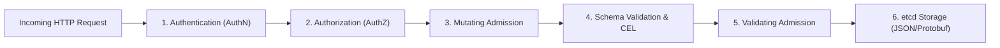
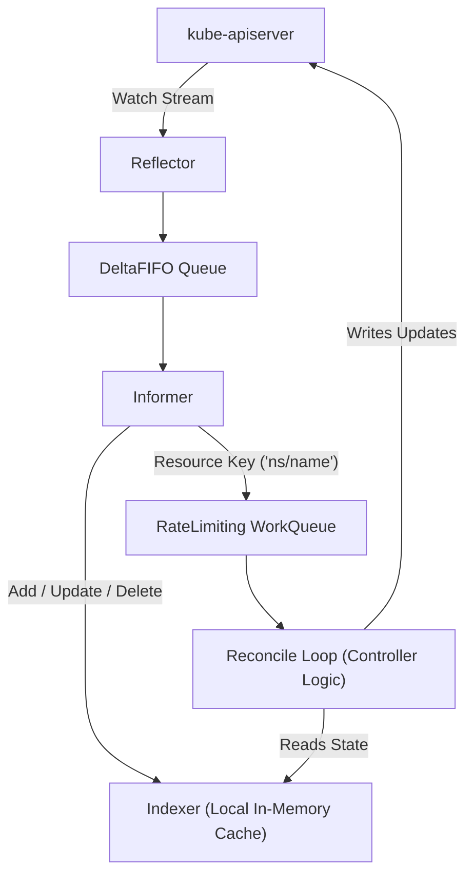
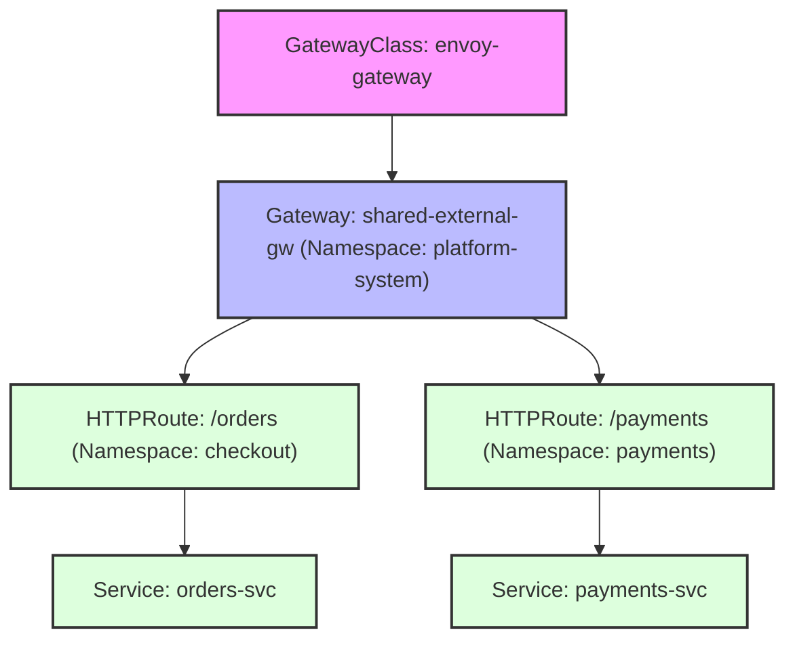
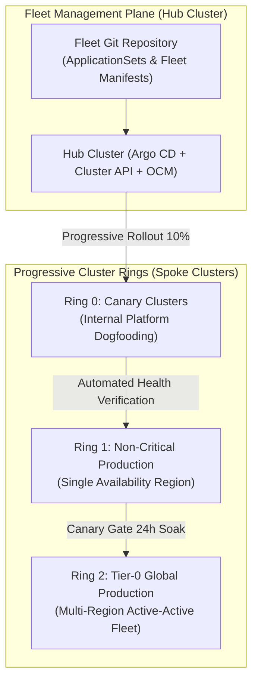

# PE Domain 3: Kubernetes Platform Engineering — Deep-Dive Study Guide

> [!IMPORTANT]
> **Interview Emphasis:** Very High
>
> **Where it shows up:** Phone screens (Kubernetes breadth), Kubernetes deep-dive rounds (Mock 3), technical architecture & system design (multi-tenancy, cluster fleets, autoscaling), and take-homes.
>
> **What "strong" sounds like:** You don't just write Deployment YAML; you understand the Kubernetes **API machinery**, controller loops, client-go caches, admission pipelines, CEL validation, CRD versioning, multi-tenancy trade-offs (vCluster vs namespaces vs clusters), Karpenter bin-packing math, and Gateway API routing topologies.

---

## 1. Kubernetes API Machinery Architecture

### 1.1 The Request Lifecycle in `kube-apiserver`
Every request to `kube-apiserver` traverses an explicit, deterministic pipeline:



1. **Authentication (AuthN):** Establishes identity. Uses x509 client certificates, OIDC bearer tokens, or webhook token authenticators. Maps identity to a `User`, `Groups`, and `Extra` metadata.
2. **Authorization (AuthZ):** Verifies permissions. Evaluates Node authorizer, RBAC (`Role`, `ClusterRole`, `RoleBinding`), and ABAC/Webhook authorizers. Evaluates in order; first allow wins.
3. **Mutating Admission Webhooks:** Mutates the object before validation (e.g., injecting sidecar containers, injecting default security contexts).
4. **Schema Validation & CEL:** Validates structural schema against OpenAPI v3 specifications and executes in-tree **Common Expression Language (CEL)** rules.
5. **Validating Admission Webhooks & Policies:** Decides whether to accept or reject the request (e.g., ValidatingAdmissionPolicy, Kyverno, Gatekeeper).
6. **etcd Transaction:** Object is serialized (Protobuf for internal types, JSON for CRDs) and written to etcd via a Raft consensus transaction.

### 1.2 etcd Consensus & Watch Mechanics
- **Raft Consensus:** etcd operates via distributed consensus. Writes require quorum: $\lfloor N/2 
floor + 1$ nodes (e.g., 3 nodes tolerate 1 failure; 5 nodes tolerate 2 failures).
- **MVCC (Multi-Version Concurrency Control):** etcd maintains historical revisions of keys. Every modification increments the global 64-bit revision.
- **ResourceVersion:** Exposed in Kubernetes object metadata. Used for **Optimistic Concurrency Control**:
  - Updates must present the current `resourceVersion`. If another client updated the object first, the API server rejects the update with `409 Conflict`.
- **HTTP/2 Streaming Watches:** Controllers establish long-lived HTTP/2 streams watching specific resources from a given `resourceVersion`, avoiding expensive polling.

---

## 2. Custom Resource Definitions (CRDs) & CEL Validation

### 2.1 Anatomy of a Production CRD
A production-grade CRD requires:
- `spec.scope`: `Namespaced` or `Cluster`.
- `spec.versions`: Multi-version schema support (e.g., `v1alpha1`, `v1beta1`, `v1`).
- `subresources.status`: Decouples `.spec` and `.status` updates. Updating `.status` does not increment generation and avoids triggering unnecessary spec reconciliations.
- `subresources.scale`: Enables integration with `kubectl scale` and HorizontalPodAutoscaler.

### 2.2 In-Tree CEL (Common Expression Language) Validation
Starting in Kubernetes 1.25+ and GA in 1.29+, CRD schemas can embed **CEL expressions** directly in OpenAPI schemas, eliminating the need for slow, fragile validating webhooks.

```yaml
apiVersion: apiextensions.k8s.io/v1
kind: CustomResourceDefinition
metadata:
  name: databaseinstances.platform.example.com
spec:
  group: platform.example.com
  names:
    kind: DatabaseInstance
    plural: databaseinstances
  scope: Namespaced
  versions:
    - name: v1
      served: true
      storage: true
      schema:
        openAPIV3Schema:
          type: object
          properties:
            spec:
              type: object
              properties:
                storageGi:
                  type: integer
                  minimum: 10
                replicas:
                  type: integer
                  minimum: 1
                  maximum: 5
              # CEL validation rule
              x-kubernetes-validations:
                - rule: "self.replicas >= 2 || self.storageGi <= 100"
                  message: "Single-replica databases cannot exceed 100Gi storage."
```

---

## 3. The Kubernetes Operator Pattern & Controller-Runtime

### 3.1 Level-Triggered vs. Edge-Triggered Architecture
- **Edge-Triggered:** Reacts only to change events (e.g., "Pod created", "Pod deleted"). If an event is missed due to a network glitch or controller crash, the system remains out of sync.
- **Level-Triggered (Kubernetes Model):** Continuously reconciles the **actual state** observed in the cluster against the **desired state** specified in the object. Events act merely as hints to enqueue a reconcile task. Even if 10 events are coalesced or dropped, the next reconcile reads current state from the cache and corrects drift.

### 3.2 Anatomy of a Controller (Client-Go Architecture)



1. **Reflector:** Establishes an HTTP/2 watch to `kube-apiserver` and streams events into a `DeltaFIFO`.
2. **Informer / Indexer:** Consumes `DeltaFIFO` to update a local, thread-safe in-memory cache (`client-go` cache). Controllers **never query etcd directly** for reads; all `Get()` and `List()` operations read from this cache.
3. **ResourceEventHandler:** Extracts the object key (`namespace/name`) and enqueues it into a `RateLimitingQueue`.
4. **Reconcile Loop:** Pops the key, fetches the latest object from the Indexer cache, performs idempotent actions to match actual to desired state, and updates `.status`.

### 3.3 Finalizers & Deletion Lifecycle
A **Finalizer** (e.g., `platform.example.com/cleanup-aws-rds`) prevents garbage collection until external resources are cleaned up.
1. When a user deletes an object with a finalizer, the API server sets `metadata.deletionTimestamp` but does **not remove the record from etcd**.
2. The controller reconciler detects `deletionTimestamp.IsZero() == false`.
3. The controller deletes the external cloud resource (e.g., destroys the AWS RDS database).
4. The controller removes its finalizer string from `metadata.finalizers` and updates the object.
5. With all finalizers removed, the API server permanently removes the object from etcd.

---

## 4. Admission Control Architecture

### 4.1 Webhook Failure Modes & Latency Penalties
Historically, admission control relied on dynamic HTTP webhooks (MutatingWebhookConfiguration / ValidatingWebhookConfiguration).
- **Latency Impact:** Every API write incurs external network round-trips to webhook pods. If a webhook pod is slow, all cluster deployments grind to a halt.
- **`failurePolicy: Fail` vs. `failurePolicy: Ignore`:**
  - `Fail`: Guarantees security enforcement, but if the webhook pod crashes or network partitions, **no pods can be created anywhere in the cluster** (cluster outage).
  - `Ignore`: Preserves cluster availability during webhook outages, but allows non-compliant/insecure pods to slip through unnoticed.

### 4.2 ValidatingAdmissionPolicy (In-Tree CEL Policies)
GA in Kubernetes 1.30, `ValidatingAdmissionPolicy` compiles CEL rules directly inside `kube-apiserver`, eliminating external webhooks entirely!
- **Zero Network Latency:** Evaluated directly in process memory.
- **Zero Webhook Downtime Risk:** No separate webhook pods to crash or scale.

```yaml
apiVersion: admissionregistration.k8s.io/v1
kind: ValidatingAdmissionPolicy
metadata:
  name: disallow-privileged-containers
spec:
  failurePolicy: Fail
  matchConstraints:
    resourceRules:
      - apiGroups: [""]
        apiVersions: ["v1"]
        operations: ["CREATE", "UPDATE"]
        resources: ["pods"]
  validations:
    - expression: "!has(object.spec.containers) || object.spec.containers.all(c, !has(c.securityContext) || !has(c.securityContext.privileged) || !c.securityContext.privileged)"
      message: "Privileged containers are strictly forbidden on this platform."
```

---

## 5. Kubernetes Multi-Tenancy Architecture

| Model | Isolation Level | Blast Radius | Resource Overhead | Operational Complexity | Typical Use Case |
| :--- | :---: | :---: | :---: | :---: | :--- |
| **Namespace Isolation** | Soft Multi-tenancy | Medium (Shared etcd, shared control plane, shared kernel) | Very Low (Zero overhead) | Low | Trusted teams within the same company. |
| **Virtual Clusters (vCluster)** | High Multi-tenancy | Low (Separate API server, etcd, CRDs, and controllers per tenant; shared worker nodes) | Low (~1 pod per tenant control plane) | Medium | Untrusted internal teams; staging environments needing custom CRDs. |
| **Cluster-Per-Tenant** | Hard Multi-tenancy | Isolated (Separate VPCs, separate control planes, separate nodes) | High (Multiple control planes, idle node capacity) | High | Regulated environments (PCI-DSS, HIPAA); different external customers. |

### 5.1 Hardening Namespace Multi-Tenancy
If utilizing shared clusters, four guardrails are mandatory:
1. **NetworkPolicy:** Default deny-all ingress and egress; explicitly allow DNS (`kube-dns` port 53) and approved intra-namespace communication.
2. **ResourceQuota:** Hard limits on total CPU, memory, persistent volume claims, and Services.
3. **LimitRange:** Default and maximum CPU/memory requests and limits per container.
4. **Admission Controls:** Block `hostNetwork: true`, `hostPID: true`, privileged containers, and unauthorized hostPath mounts.

---

## 6. Advanced Autoscaling Architecture

### 6.1 Horizontal Pod Autoscaler (HPA v2) & KEDA
- **HPA Algorithm:**
  $$\text{Desired Replicas} = \left\lceil \text{Current Replicas} \times \left( \frac{\text{Current Metric Value}}{\text{Target Metric Value}} 
ight) 
ight
ceil$$
- **KEDA (Kubernetes Event-driven Autoscaling):** Bridges external event sources (Kafka consumer lag, AWS SQS queue depth, Prometheus queries) to HPA by deploying an external metrics server, allowing workloads to scale to and from **zero**.

### 6.2 Karpenter vs. Cluster Autoscaler

```mermaid
flowchart TD
    subgraph Legacy["Cluster Autoscaler (Reactive)"]
        CA_P["Unscheduled Pod"] --> CA_ASG["Checks AWS Auto Scaling Group"]
        CA_ASG --> CA_NODE["Increments ASG desired capacity"]
        CA_NODE --> CA_WAIT["Waits for EC2 init (2-4 mins)"]
    end

    subgraph Modern["Karpenter (Declarative & Just-in-Time)"]
        K_P["Unscheduled Pod"] --> K_EVAL["Evaluates exact pod requirements (CPU, RAM, GPU, Arch, AZ)"]
        K_EVAL --> K_API["Directly calls EC2 Fleet API (Bypasses ASGs)"]
        K_API --> K_OPT["Selects optimal instance type & Spot/On-Demand mix"]
        K_OPT --> K_UP["Node joins cluster in 30-45s"]
    end
```



#### Karpenter Advantages:
1. **Group-less Auto-provisioning:** Directly queries EC2 Fleet API to create the exact instance type needed (e.g., `m6i.xlarge` vs `c6g.2xlarge`) rather than managing dozens of rigid Auto Scaling Groups.
2. **Automated Node Consolidation:** Continuously calculates if pods running on underutilized nodes can be rescheduled onto smaller, cheaper instances, terminating wasteful idle capacity automatically.
3. **Native Spot Interruption Handling:** Intercepts 2-minute AWS Spot Interruption warnings, cordoning and draining pods gracefully before physical instance termination.

---

## 7. Modern Ingress & Gateway API

### 7.1 The Gateway API Resource Hierarchy
The Kubernetes **Gateway API** replaces the legacy, fragmented Ingress specification with an expressive, role-oriented, and cross-namespace routing architecture:



1. **GatewayClass (Infrastructure Provider):** Defines the controller implementation (e.g., Envoy Gateway, Cilium, Istio).
2. **Gateway (Platform / Cluster Admin):** Defines the listening IP, ports (80, 443), TLS certificates, and allowed route namespaces.
3. **HTTPRoute / GRPCRoute (Product Developer):** Defines path matching, header rewriting, traffic weighting (canary 90/10), and backend service targets.
4. **ReferenceGrant:** Grants explicit cross-namespace permission for a Gateway in one namespace to reference a Secret or Service in another namespace, eliminating historical security vulnerabilities.

---

## 8. Staff-Level Kubernetes Fleet Architecture & Controller Engineering

A Staff Platform Engineer treats individual Kubernetes clusters not as unique pets, but as ephemeral compute nodes within an enterprise fleet. You are responsible for multi-cluster governance, zero-downtime fleet upgrades, and building resilient custom operator control planes.

### 8.1 Multi-Cluster Fleet Architecture at Scale

When scaling an enterprise platform beyond 20 clusters and 5,000 workloads, a single cluster model breaks down due to etcd scalability limits, blast radius risks, and cross-team noisy neighbors.



#### Fleet Management Paradigms: CAPI vs. OCM vs. Virtual Clusters
| Architecture | Mechanism | Best Used For | Scalability Limits / Trade-offs |
| :--- | :--- | :--- | :--- |
| **Cluster API (CAPI)** | Declarative Kubernetes Custom Resources (`Cluster`, `MachineDeployment`) that provision and manage infrastructure clusters. | Standardizing cluster lifecycle across hybrid-cloud / multi-cloud environments. | Requires deep infrastructure provider expertise; slow reconciliation during large cloud quota delays. |
| **Open Cluster Management (OCM)** | Hub-and-spoke controller architecture synchronizing policies and workloads across hundreds of clusters. | Centralized policy enforcement, security compliance, and dynamic workload placement. | Added architectural complexity; requires persistent connectivity between hub and spoke clusters. |
| **Virtual Clusters (vCluster)** | Lightweight virtual Kubernetes control planes running as stateful workloads inside a host cluster. | Multi-tenancy for dev/test environments and CI/CD pipelines with full tenant admin isolation. | Shared host kernel; not suitable for hard security boundaries untrusted multi-tenancy. |

---

### 8.2 Zero-Downtime Progressive Fleet Upgrades

Upgrading Kubernetes control planes and node pools across 100 clusters requires a disciplined progressive delivery strategy to prevent global outages (such as CoreDNS API deprecations or CNI breaking changes).

#### Blue/Green Cluster Fleet Rotation Architecture
Instead of risky in-place node pool updates on production clusters, Staff engineers implement **Blue/Green Cluster Swaps**:
1. **Cluster Provisioning:** Provision Green cluster using automated CAPI / Terraform pipelines running the target Kubernetes version.
2. **Configuration Synchronization:** Argo CD ApplicationSets automatically synchronize all fleet workloads, CRDs, and secrets to the Green cluster.
3. **Synthetic Validation:** Automated smoke tests and synthetic transactions execute against Green ingress endpoints.
4. **Traffic Weighted Shifting:** Global DNS (Route53 / Cloudflare) shifts traffic: $95/5 \to 80/20 \to 50/50 \to 0/100$ over 48 hours while Prometheus monitors error rate and latency anomalies.
5. **Drain & Teardown:** After a 72-hour soak period, the Blue cluster is decommissioned.

---

### 8.3 Enterprise Custom Controller Engineering with Controller-Runtime

Staff engineers author custom controllers that act as the programmatic glue of the internal platform. Building enterprise-grade operators requires avoiding common pitfalls: cache memory leaks, lock contention, and non-idempotent reconciliation.

#### Critical Architecture Rules for Custom Controllers
1. **Never Make Synchronous Remote Calls in Reconcile:** If your controller calls an external cloud API (e.g., AWS RDS CreateDBInstance), never block the reconciler thread. Return `ctrl.Result{RequeueAfter: 30 * time.Second}` and check status asynchronously.
2. **Implement Monotonic Requeue Exponential Backoff:** Protect upstream APIs from thundering herd problems using full jitter backoff:
   $$T_{\text{delay}} = \min(T_{\text{max}}, T_{\text{base}} \times 2^{\text{attempt}}) \times \text{Uniform}(0.8, 1.2)$$
3. **Guard Against Split-Brain with Leader Election:** Always run controller pods with `--leader-elect=true` using Kubernetes Lease coordination objects (`coordination.k8s.io/v1`).
4. **Enforce Finalizer Safety:** When deleting external resources, always verify cloud deletion success before removing the finalizer string from `metadata.finalizers`. If deletion fails, requeue with error to prevent orphaned cloud resources.

---

## 9. Essential Kubernetes Bookshelf & Further Reading

1. **Production Kubernetes: Building Robust Systems at Scale** by Josh Rosso, Rich Lander, Alexander Brand, and John Harris (O'Reilly, 2021). The definitive production guide covering multi-tenancy, cluster lifecycle, storage, and networking.
2. **Programming Kubernetes: Developing Cloud-Native Applications** by Michael Hausenblas and Stefan Schimanski (O'Reilly, 2019). The gold-standard deep dive on client-go, informers, custom controllers, and CRDs.
3. **Kubernetes: Up and Running (3rd Edition)** by Brendan Burns, Joe Beda, Kelsey Hightower, and Lachlan Evenson (O'Reilly, 2022). Foundational architecture directly from the original creators of Kubernetes.
4. **Cloud Native DevOps with Kubernetes (2nd Edition)** by John Arundel and Justin Domingus (O'Reilly, 2022). Practical guide on GitOps pipelines, monitoring, and cluster operations.
5. **CoreDNS: Modern DNS for Cloud-Native Computing** by John Belamaric and Cricket Liu (O'Reilly, 2019). Crucial for mastering Kubernetes internal name resolution and service discovery.
