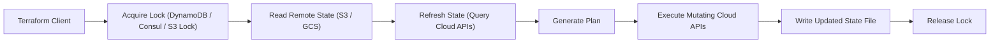
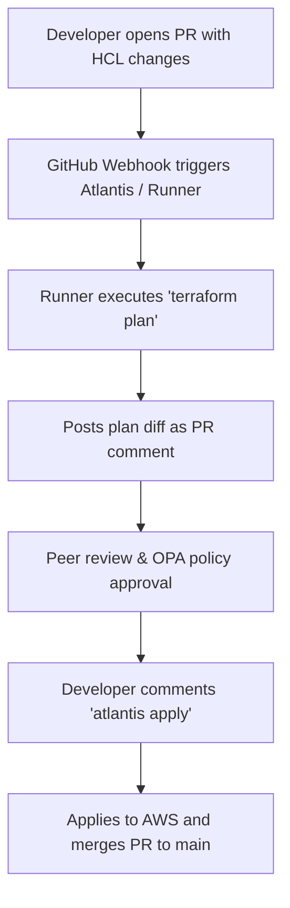
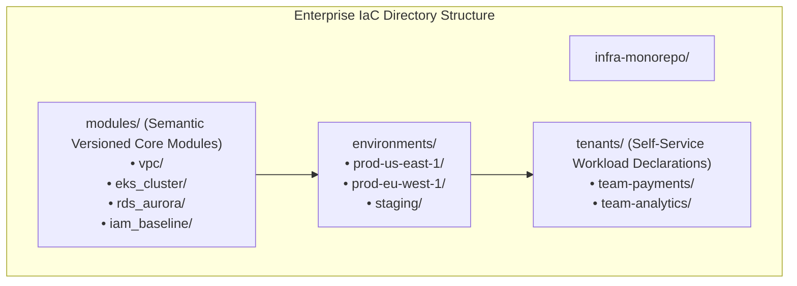
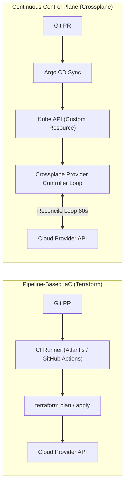

# PE Domain 4: Infrastructure as Code — Deep-Dive Study Guide

> [!IMPORTANT]
> **Interview Emphasis:** High
>
> **Where it shows up:** IaC & CI/CD deep dives (Mock 4), take-home projects (infrastructure modules), system design (landing zones, multi-account topology), and live troubleshooting (state lock errors, drift, migration failures).
>
> **What "strong" sounds like:** You don't just write basic HCL; you explain the **graph evaluation engine**, state locking mechanisms, state surgery (`moved` and `import` blocks), native `terraform test` suites, Policy as Code (OPA Rego / Conftest), PR-driven GitOps (Atlantis/Spacelift), Crossplane declarative reconciliation, and enterprise multi-account landing zones.

---

## 1. Terraform / OpenTofu Core Architecture

### 1.1 The Graph Engine & Directed Acyclic Graph (DAG)
Terraform and OpenTofu construct an in-memory **Directed Acyclic Graph (DAG)** of all resources, data sources, and providers defined in configuration.
- **Dependency Resolution:** Nodes in the graph represent resources; edges represent implicit dependencies (e.g., `aws_instance.web` references `aws_security_group.sg.id`) or explicit dependencies (`depends_on`).
- **Parallel Execution:** Terraform traverses the graph from roots to leaves, executing operations on independent nodes concurrently (controlled by `-parallelism=N`, defaulting to 10).
- **Cycle Detection:** If resource A depends on B, and B depends on A, the graph engine halts during `terraform plan` with a `Cycle error`.

### 1.2 State Storage & Locking Mechanics
The **state file** (`terraform.tfstate`) is the single source of truth mapping declared configuration to real-world cloud resource IDs and attributes.



#### Why State Locking is Mandatory:
Without distributed locking, two concurrent executions (e.g., two CI jobs running simultaneously) will interleave reads and writes to the state file, resulting in catastrophic state corruption, lost resources, and duplicate provisioning.
- **AWS Backend:** S3 bucket for state storage + DynamoDB table with partition key `LockID` for distributed mutex locks (or native S3 Object Lock in recent releases).
- **Stuck Lock Recovery:** If a CI job crashes mid-run, the lock remains held. It must be released with extreme caution using `terraform force-unlock <LOCK-ID>`.

---

## 2. State Management & State Surgery

### 2.1 Tackling Configuration Drift
**Drift** occurs when external cloud resources are modified outside of Terraform (via AWS Console, CLI, auto-remediation tools, or emergency hotfixes).
- `terraform refresh` (or the default refresh step in `plan`/`apply`) queries cloud provider APIs and updates the state file to reflect real-world attributes.
- **Detection Strategies:** Run scheduled, daily headless CI jobs: `terraform plan -detailed-exitcode`. Exit code `0` = no changes; `2` = drift detected (triggers Slack/PagerDuty alert); `1` = error.

### 2.2 Modern Declarative State Surgery
Historically, renaming a module or resource in HCL caused Terraform to plan a destructive **DESTROY and RE-CREATE** cycle, requiring risky imperative CLI surgery (`terraform state mv`).

#### Declarative `moved` Blocks (TF 1.1+):
Allows seamless refactoring directly in code without manual state modification:
```hcl
# Refactoring monolithic resource into a submodule
moved {
  from = aws_s3_bucket.data_bucket
  to   = module.storage.aws_s3_bucket.bucket
}
```

#### Declarative `import` Blocks (TF 1.5+):
Enables importing pre-existing cloud infrastructure into Terraform declaratively with automatic code generation:
```hcl
import {
  to = aws_security_group.legacy_sg
  id = "sg-0123456789abcdef0"
}
```

---

## 3. Production Module Design Patterns

### 3.1 Blast Radius Mitigation
> [!WARNING]
> **The Monolithic State Trap:** Storing an entire company's networking, databases, and Kubernetes clusters in a single 10,000-line Terraform state file is a recipe for disaster.
> - `terraform plan` takes 20+ minutes due to thousands of cloud API refresh calls.
> - A failure in one minor resource blocks all deployments across the company.
> - Blast radius is 100%: an accidental bad parameter can delete the core VPC.

#### The Decoupled State Pattern:
Partition infrastructure state into decoupled layers with separate state files:
1. `01-networking/` (VPCs, subnets, route tables, Transit Gateways) — modified rarely.
2. `02-security/` (IAM baselines, KMS keys, Vault clusters) — modified occasionally.
3. `03-compute/` (EKS clusters, node pools) — modified monthly.
4. `04-workloads/` (App-specific databases, queues, S3 buckets) — modified daily.

### 3.2 Preconditions & Postconditions
HCL supports programmatic validation guards inside resource and data blocks:
```hcl
resource "aws_ebs_volume" "data" {
  availability_zone = "us-east-1a"
  size              = var.disk_size_gb

  lifecycle {
    # Precondition: validate inputs before API execution
    precondition {
      condition     = var.disk_size_gb >= 20
      message       = "Production disk size must be at least 20GB."
    }

    # Postcondition: validate real cloud attributes after creation
    postcondition {
      condition     = self.encrypted == true
      message       = "SECURITY VIOLATION: EBS volume was provisioned without encryption!"
    }
  }
}
```

---

## 4. Native Testing & Validation Frameworks

### 4.1 `terraform test` (Native HCL Testing)
Introduced natively in Terraform 1.6+ and OpenTofu, `terraform test` eliminates the need for heavyweight external Ruby/Go testing frameworks (Terratest) for standard unit validation.
- Written in native HCL (`.tftest.hcl` files).
- Supports **Mock Providers**: runs fast unit tests without contacting real AWS/GCP APIs or spending cloud budget.
- Supports integration runs: applies real resources into temporary scratch environments and verifies outputs with assertions, tearing them down automatically.

```hcl
# tests/s3_unit.tftest.hcl
mock_provider "aws" {}

run "verify_bucket_encryption" {
  command = plan

  variables {
    bucket_prefix = "corp-data"
    enable_sse    = true
  }

  assert {
    condition     = aws_s3_bucket_server_side_encryption_configuration.this.rule[0].apply_server_side_encryption_by_default[0].sse_algorithm == "aws:kms"
    message       = "KMS encryption must be enabled by default."
  }
}
```

---

## 5. Policy as Code (PaC) & Security Guardrails

Policy as Code moves security verification **left** into the pull request pipeline, preventing non-compliant infrastructure from ever being provisioned.

| Technology | Syntax | Engine | Primary Advantage |
| :--- | :--- | :--- | :--- |
| **Open Policy Agent (OPA) / Conftest** | Rego | Open Source / Cloud Native | Industry standard; multi-purpose (IaC, K8s, API auth). |
| **Trivy / Checkov** | Pre-built rules / YAML / Python | Static Analysis Scanner | Instant out-of-the-box compliance checks (CIS Benchmarks, SOC2). |
| **HashiCorp Sentinel** | Proprietary Sentinel language | HCP Terraform (formerly Terraform Cloud) and Terraform Enterprise only | Deep native integration with HCP Terraform runs. |

### 5.1 OPA Rego Policy Example (`deny_unencrypted_s3.rego`):
```rego
package terraform.analysis

default allow = false

# Deny if any S3 bucket lacks server-side encryption
deny[msg] {
    resource := input.resource_changes[_]
    resource.type == "aws_s3_bucket"
    not has_encryption(resource)
    msg := sprintf("SECURITY VIOLATION: S3 bucket '%v' must have server-side encryption enabled.", [resource.name])
}

has_encryption(resource) {
    # Logic checking encryption block existence
    resource.change.after.server_side_encryption_configuration
}
```

---

## 6. GitOps for IaC & Automated Execution Workflows

### 6.1 Atlantis vs. HCP Terraform / Spacelift
Running `terraform apply` from developer laptops is an extreme security and consistency vulnerability (untracked local credentials, uncommitted HCL changes applied to production).



#### Advantages of PR-Driven IaC Automation:
- **Auditability:** Complete Git commit history links every cloud change to an approved PR.
- **Credential Isolation:** Developers never possess production cloud credentials; only the locked CI runner holds execution IAM roles.
- **Speculative Plans:** Reviewers see the exact diff before merging code.

---

## 7. Crossplane vs. Terraform

| Dimension | Terraform / OpenTofu | Crossplane |
| :--- | :--- | :--- |
| **Control Plane** | CLI / Pipeline-driven (Transient execution) | Continuous Kubernetes Control Plane |
| **State Storage** | Static `.tfstate` file in S3/GCS | Dynamic etcd database |
| **Drift Correction** | Passive (detects drift only during scheduled runs) | Active (continuous reconciliation loop heals drift immediately) |
| **Developer Interface** | HCL modules / PR workflows | Native Kubernetes Custom Resources (CRDs) |
| **Maturity & Ecosystem**| Massive (thousands of mature providers) | Rapidly growing; higher resource footprint |

---

## 8. Landing Zones & Account Vending Machines

### 8.1 Multi-Account AWS Topology
Enterprise platform architecture relies on **AWS Organizations** to establish strong blast-radius boundaries:
- **Management Account:** Billing and root organization controls (no workloads).
- **Core Security Account:** Centralized CloudTrail, GuardDuty, SecurityHub, and incident response.
- **Core Network Account:** Transit Gateways, DirectConnect, central egress inspection proxies.
- **Shared Services Account:** Centralized CI/CD runners, artifact registries, internal DNS.
- **Workload Accounts:** Partitioned by environment and domain (`prod-payments`, `dev-payments`, `prod-checkout`).

### 8.2 Account Vending Machine (AVM)
Automated self-service pipeline enabling platform teams to vend fully compliant, pre-configured AWS accounts in under 15 minutes:
1. Developer requests a new account via Developer Portal / Service Catalog.
2. AVM invokes AWS Control Tower / Organizations API to create account.
3. Automatically applies baseline Terraform modules: IAM roles, VPC transit attachment, KMS keys, GuardDuty enrollment, and billing alerts.

---

## 9. Staff-Level Infrastructure as Code: Monorepo Architecture & Declarative Control Planes

A Staff Platform Engineer designs infrastructure automation that balances developer velocity with enterprise blast radius containment. You establish the architectural boundary between static declarative pipelines (Terraform/OpenTofu) and continuous reconciliation engines (Crossplane).

### 9.1 Monorepo vs. Multi-Repo IaC Architecture at 500+ Engineer Scale

Structuring infrastructure code across an enterprise requires balancing blast radius, team autonomy, and pipeline concurrency.



#### IaC Governance Comparison Matrix
| Pattern | Blast Radius | Concurrency & CI Contention | Code Reuse & Versioning | Staff Recommendation |
| :--- | :--- | :--- | :--- | :--- |
| **Single Massive Monorepo** | High if states are large; low if state is cleanly sliced by directory. | High lock contention if multiple PRs touch shared directories simultaneously. | Excellent; DRY modules referenced locally or via Git tags. | **Recommended for core platform infrastructure**, using Atlantis or Spacelift with directory-based plan triggers. |
| **Multi-Repo per Team / Service** | Low; each team owns a dedicated repository and isolated state file. | Zero lock contention across teams; pipelines run independently. | Poor; leads to duplicate hand-rolled modules and configuration drift across teams. | Use for application-specific resources consumed via platform-provided modules. |

---

### 9.2 Terraform vs. Crossplane: Architectural Decision Framework

A major strategic debate for Staff Platform Engineers is whether to manage cloud infrastructure via Git-driven CI pipelines (Terraform/OpenTofu) or Kubernetes-native reconciliation loops (Crossplane).



#### The Staff Decision Matrix: When to Choose Which
- **Choose Terraform / OpenTofu for:**
  1. Foundational baseline infrastructure that changes infrequently (VPCs, Transit Gateways, DirectConnect, EKS control planes, IAM root policies).
  2. One-off migrations and disaster recovery bootstrap automation.
  3. When the platform team lacks the operational capacity to manage continuous Kubernetes operator controllers and CRDs.
- **Choose Crossplane for:**
  1. Ephemeral, high-churn application infrastructure provisioned dynamically by product teams (S3 buckets, SQS queues, RDS databases for preview environments).
  2. Building clean Kubernetes-native developer abstractions (Compositions) that hide 300 lines of raw cloud YAML behind a single `PaymentDatabase` custom resource.
  3. Continuous drift remediation: Automatically detecting and overwriting out-of-band console changes every 60 seconds without running manual CI pipelines.

---

### 9.3 Zero-Downtime Infrastructure Refactoring

Refactoring production infrastructure without causing downtime is a benchmark skill for Staff candidates.
- **Declarative `moved` Blocks:** Since Terraform 1.1, never manually run `terraform state mv` in production. Always declare refactorings in code:
  ```hcl
  moved {
    from = module.legacy_database.aws_db_instance.this
    to   = module.rds_aurora.aws_rds_cluster_instance.primary[0]
  }
  ```
- **State Decomposition:** When a state file exceeds 500 resources, plan times exceed 10 minutes and API rate limits throttle CI. Decompose monolith states into modular states connected via Terraform Remote State data sources or SSM Parameter Store outputs.

---

## 10. Essential IaC Bookshelf & Further Reading

1. **Terraform: Up and Running: Writing Infrastructure as Code (3rd Edition)** by Yevgeniy Brikman (O'Reilly, 2022). The definitive industry guide on Terraform architecture, reusable modules, state management, and refactoring.
2. **Infrastructure as Code: Dynamic Systems for the Cloud Age (2nd Edition)** by Kief Morris (O'Reilly, 2021). The foundational architectural guide on principles, patterns, and anti-patterns of managing dynamic infrastructure.
3. **Cloud Native Infrastructure: Patterns for Scalable Infrastructure and Applications in a Dynamic Environment** by Justin Garrison and Kris Nova (O'Reilly, 2017). Essential for understanding cloud-native control plane evolution and automated provisioning.
4. **Policy as Code** by Guinevere Saenger (O'Reilly, 2023). Comprehensive guide on shifting security left using OPA, Rego, and automated compliance pipelines.
5. **AWS Certified Solutions Architect Professional & DevOps Engineer Guides**. Foundational for enterprise multi-account landing zones, AWS Organizations, and network topology.
