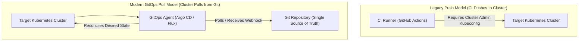
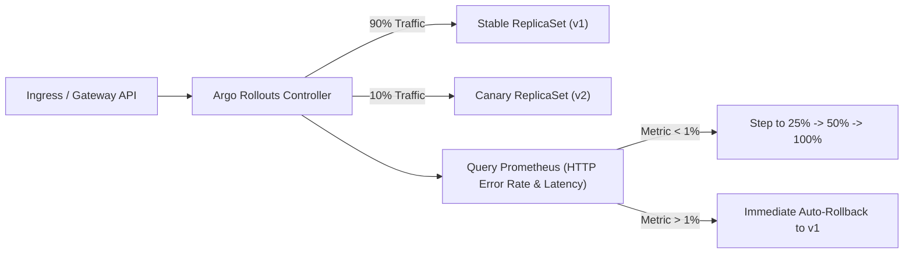
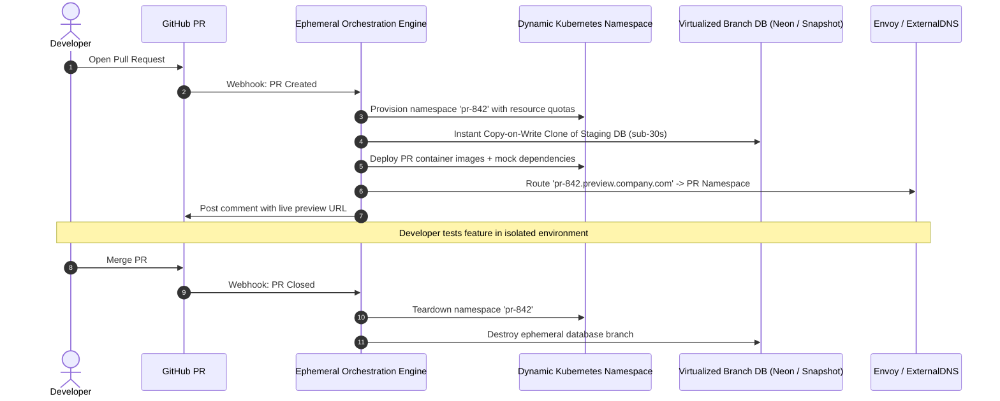
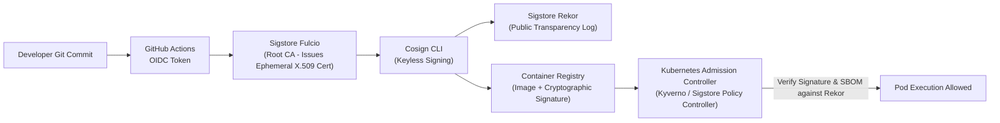

# PE Domain 5: CI/CD, GitOps & Delivery — Deep-Dive Study Guide

> [!IMPORTANT]
> **Interview Emphasis:** High
>
> **Where it shows up:** IaC, CI/CD & GitOps deep dives (Mock 4), take-home projects (delivery pipelines), technical architecture (canary delivery, supply-chain security), and live debugging (failed rollouts, out-of-sync GitOps).
>
> **What "strong" sounds like:** You don't just write GitHub Actions YAML; you understand **ephemeral runner fleets (ARC)**, remote build caching, pull-based GitOps reconciliation (Argo CD vs Flux), progressive delivery with automated canary analysis (Argo Rollouts), and end-to-end supply chain security (SLSA, Sigstore Cosign, SBOMs).

---

## 1. Enterprise CI Architecture at Scale

### 1.1 Ephemeral Runner Fleets
Static, long-lived CI runner servers suffer from disk exhaustion, state leakage between builds, and security compromises.
- **Actions Runner Controller (ARC):** The cloud-native standard for GitHub Actions. Runs a Kubernetes controller that dynamically provisions ephemeral runner pods on demand using KEDA or autoscaling runner scale sets.
- **Security Isolation:** Every build executes in a pristine container/pod that is immediately terminated and shredded upon job completion, preventing cross-build credential leaks.

### 1.2 Remote Build Caching & Acceleration
To achieve the DORA Elite standard (Lead Time for Changes < 1 hour), CI pipelines cannot rebuild Docker layers or recompile libraries from scratch.
- **Docker BuildKit Cache Mounts:**
  ```dockerfile
  # Cache Go build dependencies across runs
  RUN --mount=type=cache,target=/go/pkg/mod       --mount=type=cache,target=/root/.cache/go-build       go build -o /app/server main.go
  ```
- **OCI-Backed Build Cache:** Pushes intermediate build cache layers directly to an OCI registry (`--cache-to=type=registry,ref=org/app:cache --cache-from=type=registry,ref=org/app:cache`).
- **Distributed Build Caches:** Tools like Bazel, Gradle Enterprise, and Turborepo share build outputs across the entire organization; if Engineer A built a binary, Engineer B and CI reuse the cached artifact instantly.

---

## 2. Modern GitOps Engine Architecture

### 2.1 Push vs. Pull Deployment Models



#### Why Pull-Based GitOps is Superior:
1. **Zero External Cluster Credentials:** The CI runner does not possess production `kubeconfig` or network access to the cluster. The cluster pulls configuration from Git from within the firewall.
2. **Automated Drift Correction (Self-Healing):** If an engineer manually deletes a deployment or edits a replica count via `kubectl`, the GitOps controller detects the drift and immediately reconciles the cluster back to the Git declaration.
3. **Auditability & Rollback:** Every deployment is a Git commit. Rolling back is simply `git revert <commit>`.

### 2.2 Argo CD vs. Flux

| Dimension | Argo CD | Flux |
| :--- | :--- | :--- |
| **Architecture** | Centralized web UI and API server with multi-tenant RBAC | Modular, headless Kubernetes controllers (KustomizeController, HelmController) |
| **Interface** | Rich web dashboard, CLI, and SSO integration | Git and CLI (`flux`) only (no official built-in UI) |
| **Multi-Tenancy** | Projects, SSO, and granular RBAC built into the server | Native Kubernetes RBAC and ServiceAccount impersonation per tenant |
| **Best Used When** | Organization desires a visual dashboard for developers and centralized audit logging | Headless, lightweight, highly modular GitOps execution is preferred |

### 2.3 ApplicationSet & App-of-Apps Pattern
- **App-of-Apps:** A root Argo CD `Application` that points to a repository containing other `Application` manifests, enabling recursive deployment of an entire platform stack.
- **ApplicationSet:** Generates multiple Argo CD applications dynamically using generators (Git directory generator, List generator, Cluster generator):
  ```yaml
  apiVersion: argoproj.io/v1alpha1
  kind: ApplicationSet
  metadata:
    name: microservices-deployer
  spec:
    generators:
      - git:
          repoURL: https://github.com/org/gitops-fleet.git
          revision: main
          directories:
            - path: services/*
    template:
      metadata:
        name: "{{path.basename}}"
      spec:
        project: default
        source:
          repoURL: https://github.com/org/gitops-fleet.git
          targetRevision: main
          path: "{{path}}"
        destination:
          server: https://kubernetes.default.svc
          namespace: "{{path.basename}}"
        syncPolicy:
          automated:
            prune: true
            selfHeal: true
  ```

---

## 3. Manifest Packaging: Helm vs. Kustomize

### 3.1 Helm (Package Manager)
- Uses Go templating to interpolate variables (`{{ .Values.replicaCount }}`).
- Manages release lifecycles, chart versioning, and package repositories.
- **Weakness:** Complex templates with nested conditionals (`if/else/range`) quickly turn into unreadable "YAML soup".

### 3.2 Kustomize (Template-free Overlay Engine)
- Built directly into `kubectl` (`kubectl apply -k .`).
- Pure declarative YAML: uses a `base/` directory containing standard manifests and `overlays/` (`dev`, `staging`, `prod`) that patch attributes (e.g., changing image tags or replica counts) using JSON patches or strategic merges.
- **Advantage:** Preserves pure, valid Kubernetes YAML without syntax mangling.

### 3.3 The Enterprise Hybrid Pattern
Use **Helm for third-party off-the-shelf software** (e.g., Prometheus, Vault, Argo CD) where vendor parameterization is necessary. Use **Kustomize for internal microservices** to maintain clean, readable overlays across environments.

---

## 4. Environment Promotion & Branching Strategies

### 4.1 Trunk-Based Development vs. GitFlow
- **GitFlow (Anti-pattern in continuous delivery):** Long-lived `feature`, `develop`, `release`, and `main` branches. Leads to painful merge conflicts, delayed releases, and batch deployments.
- **Trunk-Based Development (DORA Elite):** All developers merge short-lived branches (1–2 days max) directly into `main`. Features are gated via runtime feature flags (e.g., LaunchDarkly, Unleash) rather than unmerged Git branches.

### 4.2 Branch-per-Environment vs. Directory-per-Environment
> [!CAUTION]
> **The Branch-per-Environment Trap:** Using a `dev` branch, `staging` branch, and `prod` branch creates chronic Git merge drift. Merging changes between environment branches frequently causes cherry-pick errors and un-synchronized configurations.

#### The Directory-per-Environment Standard:
A single `main` branch with directory overlays:
```text
gitops-repo/
├── base/
│   ├── deployment.yaml
│   └── service.yaml
└── environments/
    ├── dev/
    │   └── kustomization.yaml (image: tag-abc, replicas: 1)
    ├── staging/
    │   └── kustomization.yaml (image: tag-xyz, replicas: 2)
    └── production/
        └── kustomization.yaml (image: tag-1.0.0, replicas: 10)
```
Promotion between environments is a clean, automated Git commit updating the image tag in the corresponding directory.

---

## 5. Progressive Delivery Architecture

### 5.1 Canary Deployments with Argo Rollouts
Standard Kubernetes rolling updates switch traffic randomly across new and old pods without automated verification. **Argo Rollouts** provides advanced traffic shifting and automated metric verification.



#### AnalysisTemplate Example:
```yaml
apiVersion: argoproj.io/v1alpha1
kind: AnalysisTemplate
metadata:
  name: success-rate-check
spec:
  metrics:
    - name: success-rate
      interval: 30s
      successCondition: result[0] >= 0.99
      failureLimit: 2
      provider:
        prometheus:
          address: http://prometheus.monitoring:9090
          query: |
            sum(rate(http_requests_total{status=~"2..",app="payments"}[1m]))
            /
            sum(rate(http_requests_total{app="payments"}[1m]))
```

---

## 6. Software Supply Chain Security & SLSA Framework

### 6.1 The SLSA Framework (Supply-chain Levels for Software Artifacts)
- **Level 1:** Documented, automated build process generating provenance.
- **Level 2:** Hosted, tamper-resistant build platform generating signed provenance.
- **Level 3:** Ephemeral, isolated build environments with non-falsifiable provenance.
- **Level 4:** Hermetic, reproducible builds with two-party code review.

### 6.2 Sigstore Cosign (Keyless Signing)
Eliminates the operational nightmare of managing, storing, and rotating private cryptographic keys.
1. CI runner authenticates to GitHub using OpenID Connect (OIDC).
2. Runner requests an ephemeral, short-lived x509 certificate from **Fulcio** (Sigstore Certificate Authority) bound to the GitHub repository identity.
3. Runner signs the container image and records the signature in **Rekor** (an immutable, append-only public transparency log).
4. In Kubernetes, admission controllers (Kyverno, Sigstore Policy Controller) verify that deployed images possess valid signatures and Rekor log entries before admitting the pod.

### 6.3 Software Bill of Materials (SBOM) & Vulnerability Scanning
- **SBOM:** An inventory of every open-source library, compiler version, and system package embedded inside a container image (formats: SPDX, CycloneDX), generated via tools like **Syft**.
- **Vulnerability Scanning:** Tools like **Trivy** scan images against CVE databases during CI, failing pipelines if Critical or High vulnerabilities lack patches.

---

## 7. Staff-Level Delivery Engineering: Ephemeral Envs & Supply-Chain Security

A Staff Platform Engineer transforms delivery from a series of brittle, sequential CI scripts into an enterprise-wide deployment orchestration plane supporting hundreds of releases per day with zero downtime and verified cryptographic supply-chain security.

### 7.1 Ephemeral Pull Request Environments at Scale

Shared staging environments are the single greatest bottleneck in mid-to-large engineering organizations: they are constantly broken, suffer configuration drift, and block releases. Staff Platform Engineers design **On-Demand Ephemeral Preview Environments**.



#### Solving the 3 Hard Problems of Ephemeral Environments
1. **The Stateful Data Problem:** Cloning a 500GB production database for every PR is impossible with standard snapshots.
   - *Staff Solution:* Use **Copy-on-Write database branch virtualization** (e.g., Neon Postgres, or containerized synthetic seed databases created via sanitization pipelines).
2. **The Cloud Cost Problem:** Developers leaving 50 preview environments running over weekends burns tens of thousands of dollars.
   - *Staff Solution:* Implement an automated **TTL Reaper Controller** that monitors git PR status and pod traffic. Environments idle for $> 2$ hours are automatically scaled to zero; environments are deleted after 24 hours unless explicitly renewed via PR label.
3. **The Microservice Dependency Explosion:** If service A needs services B through Z, spinning up 50 microservices per PR exhausts cluster capacity.
   - *Staff Solution:* Deploy only the service under test into the ephemeral namespace; route upstream/downstream dependencies to a shared baseline staging cluster using HTTP header propagation (`x-preview-env: pr-842`).

---

### 7.2 Cryptographic Software Supply Chain Security (SLSA L3/L4)

Enterprise security at Staff level moves beyond naive container vulnerability scanning to mathematically verifiable supply-chain integrity.



#### Key Supply-Chain Standards to Champion
- **SLSA (Supply-chain Levels for Software Artifacts):** Aim for SLSA Level 3: builds run in isolated, ephemeral CI environments with cryptographically generated, non-falsifiable provenance.
- **Keyless Image Signing (Sigstore Cosign + Fulcio + Rekor):** Eliminates static private keys that can leak. Uses OpenID Connect (OIDC) identities from CI runners to issue short-lived certificates, recording signatures in an immutable transparency log.
- **Automated SBOM Generation & Attestation:** Generate Software Bill of Materials (Syft) in SPDX/CycloneDX format during build, sign with Cosign, and attach directly to the OCI image registry. Enforce admission policies blocking images lacking signed SBOMs.

---

## 8. Essential Delivery Bookshelf & Further Reading

1. **Continuous Delivery: Reliable Software Releases through Build, Test, and Deployment Automation** by Jez Humble and David Farley (Addison-Wesley, 2010). The foundational text that defined the modern continuous delivery discipline.
2. **GitOps and Kubernetes: Continuous Deployment with Argo CD, Jenkins X, and Flux** by Billy Phillips and Christian Hernandez (Manning, 2021). The comprehensive guide on declarative cluster synchronization and GitOps patterns.
3. **Software Supply Chain Security: Securing the End-to-End Supply Chain for Software Applications** by Cassius Puodzius (O'Reilly, 2023). Crucial for mastering SLSA, Sigstore, Cosign, and SBOM architectures.
4. **Accelerate: The Science of Lean Software and DevOps** by Nicole Forsgren, Jez Humble, and Gene Kim (IT Revolution, 2018). Grounding in the empirical evidence connecting continuous delivery to organizational performance.
