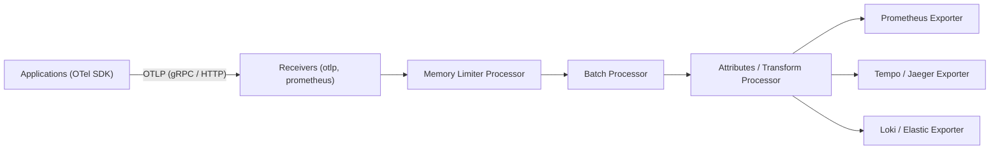

# PE Domain 6: Observability & SRE — Deep-Dive Study Guide

> [!IMPORTANT]
> **Interview Emphasis:** High
>
> **Where it shows up:** Troubleshooting & live debugging (Mock 2), system design (observability platforms), behavioral rounds (incident command, blameless postmortems), and technical deep dives (PromQL, OpenTelemetry, SLO math).
>
> **What "strong" sounds like:** You know that observability is not just "dashboards and alerts"; you explain the three telemetry signals (metrics, logs, traces) as an integrated graph. You write precise **PromQL** with counter-reset awareness, understand **OpenTelemetry Collector** processing pipelines, calculate **multi-window multi-burn-rate SLO alerts**, run calm incident command rotations, and foster a blameless engineering culture.

---

## 1. Prometheus Architecture & PromQL Mastery

### 1.1 TSDB Internal Storage Engine
Prometheus uses an append-only Time Series Database (**TSDB**):
- **Head Chunk:** In-memory block where active incoming samples (timestamp float64, value float64: ~16 bytes compressed to 1.37 bytes via Gorilla XOR compression) are written.
- **Write-Ahead Log (WAL):** Synchronously records incoming samples on disk to prevent data loss if the process crashes.
- **Block Compaction:** Every 2 hours, the Head Chunk's data is cut into an immutable block on disk containing:
  - `chunks/`: Raw compressed sample data.
  - `index`: Inverted index mapping metric names and label pairs (`label=value`) to series IDs.
  - `meta.json`: Block metadata and compaction level.

### 1.2 PromQL Core Mechanics

#### 1. Rate vs. Irate:
- `rate(v[range])`: Calculates per-second average rate of increase over the entire range window. **Always use `rate()` for alerting and SLO calculations** because it smooths out transient spikes and handles counter resets safely.
- `irate(v[range])`: Instant rate of increase based strictly on the **last two data points** in the range window. Use only for fast-moving volatile graphs during live triage; never use for alerting.

#### 2. Histogram Quantiles (p99 Calculation):
```promql
# Calculate 99th percentile HTTP latency across payment service instances
histogram_quantile(
  0.99,
  sum(rate(http_request_duration_seconds_bucket{job="payments"}[5m])) by (le)
)
```
> [!WARNING]
> **PromQL Rule:** You must **always** include `by (le)` when aggregating histograms with `sum()`. Omitting `le` strips the bucket boundaries, corrupting the mathematical interpolation of the quantile.

#### 3. Vector Matching:
- One-to-one: `vector1 * on(instance) vector2`
- Many-to-one / One-to-many: Use `group_left` or `group_right` to carry labels from the single side to the many side:
  ```promql
  # Join node memory usage with node environment metadata label
  node_memory_Active_bytes * on(instance) group_left(environment) node_metadata
  ```

---

## 2. OpenTelemetry (OTel) Collector & OTLP Protocol

### 2.1 The OTel Collector Architecture
The OpenTelemetry Collector is the vendor-agnostic proxy and processor for all telemetry signals:



1. **Receivers:** Ingest telemetry data via standard protocols (OTLP on port 4317 gRPC / 4318 HTTP, Zipkin, Jaeger, Prometheus).
2. **Processors (Pipeline Order Matters!):**
   - **`memory_limiter`:** MUST run first. Drops data or invokes backpressure if the collector's RAM approaches host limits, preventing OOM crashes.
   - **`batch`:** Groups spans/metrics into batches (e.g., 500 records or 5s timeout) to optimize network bandwidth.
   - **`transform` / `attributes`:** Strips PII (credit cards, passwords) and injects standardized cloud metadata (`cloud.region`, `k8s.pod.name`).
3. **Exporters:** Translates and dispatches telemetry to storage backends (Prometheus, Mimir, Tempo, Datadog).

---

## 3. Distributed Tracing & Context Propagation

### 3.1 W3C Trace Context Standard
Distributed tracing tracks a single logical user request across dozens of microservices via HTTP/gRPC header injection:
- **`traceparent` Header Format:**
  `00-4bf92f3577b34da6a3ce929d0e0e4736-00f067aa0ba902b7-01`
  - `00`: Version.
  - `4bf92f3577b34da6a3ce929d0e0e4736`: 16-byte **Trace ID** (shared across all spans in the entire transaction).
  - `00f067aa0ba902b7`: 8-byte **Parent Span ID**.
  - `01`: Trace flags (`01` = recorded/sampled; `00` = not sampled).
- **`tracestate`:** Opaque vendor-specific key-value pairs.

### 3.2 Tail-Based vs. Head-Based Sampling
- **Head-Based Sampling:** The sampling decision is made at the root service when the request begins (e.g., sample 5% of all traffic). **Weakness:** You inevitably drop traces that encounter downstream 500 errors or high latency later in the call chain.
- **Tail-Based Sampling:** The OpenTelemetry Collector buffers spans in memory until the entire trace finishes. If any span in the trace contains `status.code == ERROR` or duration > 2 seconds, the entire trace is retained 100%; otherwise, successful traces are downsampled to 1%.

---

## 4. Structured Logging at Scale

### 4.1 Log Ingestion Pipelines: Vector vs. Fluentbit
- **Vector / Fluentbit:** High-performance, memory-safe agents (written in Rust / C) deployed as DaemonSets to tail `/var/log/pods/*.log`, parse JSON payloads, enrich with Kubernetes metadata (namespace, pod, labels), and forward to storage.
- **The Cardinality Trap in Loki:** In Grafana Loki, labels become indexing streams. Adding high-cardinality values (e.g., `user_id`, `order_id`, `ip_address`) as Loki stream labels causes the index to explode, crashing Loki. High-cardinality fields must remain inside the un-indexed JSON payload and be queried via line filters (`| json | user_id = "123"`).

---

## 5. SRE Mechanics: SLOs, Error Budgets & Burn Rates

### 5.1 Mathematical Foundations (Google SRE Standard)
- **SLI (Service Level Indicator):** A quantifiable metric measuring service performance:
  $$\text{SLI} = \frac{\text{Good Events}}{\text{Total Events}} \times 100\%$$
- **SLO (Service Level Objective):** Target reliability agreed upon with business stakeholders (e.g., 99.9% availability over rolling 30 days).
- **Error Budget:** The allowable unreliability:
  $$\text{Error Budget} = 1 - \text{SLO} = 1 - 0.999 = 0.001 \quad (0.1\% \text{ allowable errors})$$
- For 10,000,000 monthly requests, an error budget of 0.1% permits **10,000 failed requests**.

### 5.2 Multi-Window Multi-Burn-Rate Alerting
Traditional alerts based on 5-minute error rates suffer from severe alert fatigue (triggering on transient blips) or slow detection (taking days to detect a 2% budget leak). Google SRE solves this using **Multi-Window Multi-Burn-Rate Alerts**:

| Severity | Burn Rate | Budget Consumed | Short Window | Long Window | Target Reaction Time |
| :--- | :---: | :---: | :---: | :---: | :--- |
| **Page (Critical)** | **14.4x** | 2% in 1 hour | 5 minutes | 1 hour | Acknowledge within minutes |
| **Page (High)** | **6x** | 5% in 6 hours | 30 minutes | 6 hours | Acknowledge within 15 minutes |
| **Ticket (Medium)** | **1x** | 10% in 3 days | 2 hours | 3 days | Address next business day |

#### Why Dual Windows are Required:
An alert fires **only if both the short window AND the long window exceed the burn rate threshold**.
- The long window guarantees that significant budget has actually been consumed.
- The short window guarantees that the error condition is **still actively happening** right now, preventing pages for transient spikes that resolved 10 minutes ago.

---

## 6. Incident Management & Postmortem Culture

### 6.1 The Incident Command System (ICS)
During a Sev-1 / Sev-2 outage, clear role separation is mandatory:
- **Incident Commander (IC):** Leads the response, makes decisions, coordinates resources. Does NOT touch the keyboard or debug systems.
- **Operations Lead (Ops):** Technical subject matter experts who execute commands, inspect logs, and propose mitigations.
- **Communications Lead (Comms):** Publishes updates to internal stakeholders and customer status pages every 15–30 minutes.

### 6.2 Blameless Postmortems
- Focuses on **systemic failures**, missing guardrails, and procedural gaps rather than human error ("Engineer Bob deleted the table").
- **Five Whys:** Iteratively probes root causes until systemic architectural defects are exposed.
- **Action Items:** Must be SMART (Specific, Measurable, Achievable, Relevant, Time-bound) with a single assigned owner and tracked in sprint backlogs.

---

## 7. Chaos Engineering

- Tools: **Chaos Mesh**, **LitmusChaos**.
- Proactively injects controlled turbulence (pod network latency, packet loss, DNS failure, node crash, disk fill) into staging and production to verify:
  1. Circuit breakers trip properly.
  2. Health checks mark failing pods unready.
  3. Client retry policies execute exponential backoff with jitter.
  4. Platform SLO alerts fire accurately.

---

## 8. Staff-Level SRE Leadership & Mathematical Reliability Engineering

A Staff Platform Engineer shifts organizational reliability from reactive fire-fighting to a mathematically governed engineering discipline. You establish executive error budget policies, design multi-window multi-burn-rate alerting, and lead the organization through SEV-0 catastrophic outages as Incident Commander.

### 8.1 Mathematical Framework for Multi-Window Multi-Burn-Rate Alerting

Traditional threshold alerts (e.g., "Error rate > 1% for 5 minutes") suffer from high noise during low-traffic periods and slow detection during massive catastrophic failures. Google SRE and Staff Platform Engineers implement **Multi-Window Multi-Burn-Rate Alerts**.

#### The Mathematical Foundation of Burn Rate
A **burn rate of 1.0** consumes exactly 100% of an error budget over the measurement period (typically 30 days or 720 hours).

$$\text{Error Budget} = 1 - \text{SLO}$$

For a 99.9% availability target:
$$\text{Error Budget} = 1 - 0.999 = 0.001 \quad (0.1\% \text{ allowable errors})$$

$$\text{Burn Rate } (B) = \frac{\text{Observed Error Rate}}{\text{Allowed Error Rate}}$$

| Alert Severity | Burn Rate | % Budget Consumed | Time to 100% Budget Exhaustion | Short Window | Long Window | Notification Target |
| :--- | :---: | :---: | :---: | :---: | :---: | :--- |
| **Page (SEV-1)** | **14.4x** | 2% in 1 hour | **50 hours (~2 days)** | 2 minutes | 1 hour | PagerDuty (Immediate wake-up) |
| **Page (SEV-2)** | **6.0x** | 5% in 6 hours | **120 hours (5 days)** | 15 minutes | 6 hours | PagerDuty (Working hours) |
| **Ticket (SEV-3)** | **1.0x** | 10% in 3 days | **720 hours (30 days)** | 1 hour | 3 days | Jira / Slack bug ticket |

#### Production PromQL Alert Rule for 14.4x Burn Rate
```yaml
- alert: ApiHighErrorBurnRateCritical
  expr: |
    (
      sum(rate(http_requests_total{job="api-gateway",status=~"5.."}[1h]))
      /
      sum(rate(http_requests_total{job="api-gateway"}[1h]))
    ) > (14.4 * 0.001)
    and
    (
      sum(rate(http_requests_total{job="api-gateway",status=~"5.."}[2m]))
      /
      sum(rate(http_requests_total{job="api-gateway"}[2m]))
    ) > (14.4 * 0.001)
  for: 2m
  labels:
    severity: critical
    page: "true"
  annotations:
    summary: "API Gateway critical error budget burn rate (14.4x)"
    description: "2% of 30-day error budget consumed in 1 hour. Immediate intervention required."
```
*Why Both Windows Matter:* The 1-hour window prevents alert flapping during short spikes; the 2-minute short window ensures the alert resets immediately once the incident is mitigated, preventing paging engineers for resolved issues.

---

### 8.2 Enterprise Error Budget Policy & Executive Governance

An SLO without an enforceable Error Budget Policy is just an aspirational slogan. A Staff Engineer authors and enforces the organizational policy signed by the VP of Engineering and Product Directors:

1. **Green Budget (> 50% remaining):** Teams ship features freely; experiment with riskier deploys.
2. **Yellow Budget (20%–50% remaining):** Architecture review required for high-risk changes; non-critical production changes slowed.
3. **Exhausted Budget (< 0% remaining):**
   - **Feature Freeze:** All non-emergency product feature deployments are halted.
   - **Reallocation of Sprints:** The team dedicates 100% of engineering bandwidth to reliability engineering, technical debt remediation, and test automation.
   - **Executive Escalation:** The freeze can only be overridden by written authorization from the VP of Engineering, accepting business risk.

---

### 8.3 Incident Command (SEV-0/SEV-1) & Blameless Postmortems

During major outages, Staff Engineers step in as **Incident Commander (IC)**:
- **Incident Commander:** Directs the response, maintains high-level situational awareness, delegates tasks, and makes hard tactical decisions (e.g., ordering failovers or shed traffic). *Does not touch the keyboard or run shell commands.*
- **Operations Lead:** Executes technical commands, modifies configs, and reports findings back to the IC.
- **Communications Lead:** Updates executive leadership, internal stakeholders, and customer status pages every 15 minutes with factual, non-speculative updates.

---

## 9. Essential Observability & SRE Bookshelf

1. **Site Reliability Engineering: How Google Runs Production Systems** by Betsy Beyer, Chris Jones, Jennifer Petoff, and Niall Richard Murphy (O'Reilly, 2016). The foundational text establishing SLOs, error budgets, and blameless postmortems.
2. **The Site Reliability Workbook: Practical Ways to Implement SRE** by Betsy Beyer et al. (O'Reilly, 2018). Essential chapter: "Alerting on SLOs" (the definitive mathematical reference for multi-window burn rate alerts).
3. **Observability Engineering: Achieving Production Excellence** by Charity Majors, Liz Fong-Jones, and George Miranda (O'Reilly, 2022). Master-class on structured events, high-cardinality data, and modern OpenTelemetry architectures.
4. **Practical Monitoring: Effective Strategies for the Real World** by Mike Julian (O'Reilly, 2017). Clear, pragmatic guidance on eliminating alert fatigue and monitoring user journeys.
