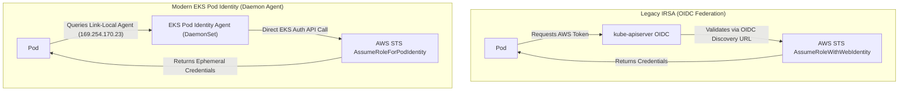
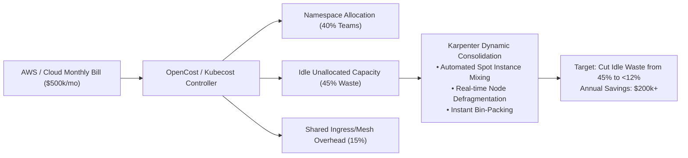

# PE Domain 7: Security, Governance & FinOps — Deep-Dive Study Guide

> [!IMPORTANT]
> **Interview Emphasis:** High
>
> **Where it shows up:** Technical deep dives (workload identity, secrets, admission policies), system design (multi-tenant security, zero-trust network topology), and behavioral/leadership rounds (FinOps cost optimization, compliance audits).
>
> **What "strong" sounds like:** You know that security cannot be an afterthought enforced by a gatekeeping committee; you bake it into the **Golden Path**. You explain **SPIFFE/SPIRE** and **EKS Pod Identity**, decouple secret storage using **External Secrets Operator**, enforce strict zero-trust **mTLS**, enforce compliance via **Kyverno**, and optimize cloud unit economics using **Kubecost/OpenCost** and Karpenter bin packing.

---

## 1. Workload Identity Architecture

### 1.1 The Elimination of Static Cloud Credentials
Long-lived access keys (`AWS_ACCESS_KEY_ID`, service account JSON keys) stored in Kubernetes secrets or environment variables represent the #1 cloud security compromise vector. Modern platform engineering mandates **cryptographic workload identity**.

### 1.2 SPIFFE / SPIRE Foundations
- **SPIFFE (Secure Production Identity Framework for Everyone):** An open standard defining universal cryptographic workload identity:
  - **SPIFFE ID:** A standardized URI format: `spiffe://example.com/ns/payments/sa/payment-processor`.
  - **SVID (SPIFFE Verifiable Identity Document):** An x509 certificate or JWT token encoding the SPIFFE ID, signed by a trusted authority with a short lifetime (e.g., 1 hour).
- **SPIRE (SPIFFE Runtime Engine):**
  - **SPIRE Server:** Manages trust bundles, registers workloads, and acts as the Certificate Authority.
  - **SPIRE Agent:** Runs on every node. Performs **Node Attestation** (verifying physical instance identity via AWS IID or TPM) and **Workload Attestation** (inspecting Linux kernel `/proc` metadata, container runtime UID/GID, and cgroups) before issuing SVIDs via a local Unix domain socket.

### 1.3 AWS EKS Pod Identity vs. IRSA (IAM Roles for Service Accounts)



#### Why EKS Pod Identity is Superior:
1. **No OIDC Provider per Cluster:** Eliminates the need to maintain public OIDC discovery endpoints and complex IAM trust policies per cluster.
2. **Simplified IAM Role Reusability:** Roles can be shared across multiple clusters seamlessly; mapping is defined via `eks:CreatePodIdentityAssociation`.
3. **Session Tags & ABAC:** Supports native AWS session tagging based on Kubernetes namespace and service account names, enabling Attribute-Based Access Control (ABAC).

---

## 2. Cloud-Native Secrets Management

### 2.1 HashiCorp Vault Core Architecture
- **Shamir's Secret Sharing:** Unsealing the Vault master key requires $M$ of $N$ unseal key shards.
- **Dynamic Database Secrets:** Vault generates unique, temporary database credentials (e.g., PostgreSQL username `v-token-1234` valid for 1 hour) on demand, automatically revoking them upon lease expiry.
- **Transit Secrets Engine:** "Cryptography-as-a-Service": applications send plaintext to Vault; Vault encrypts data using an internal HSM/KMS key and returns ciphertext, ensuring keys never leave Vault memory.

### 2.2 External Secrets Operator (ESO) vs. SealedSecrets vs. CSI Driver

| Mechanism | GitOps Safe? | Architecture | Failure Mode | Recommendation |
| :--- | :---: | :--- | :--- | :--- |
| **External Secrets Operator (ESO)** | **Yes** | In-cluster controller syncs external vaults (Vault, AWS SSM, GCP) into native K8s Secrets | External API rate limits; controller crash | **Industry Standard:** Decouples Git from secrets; native Secret compatibility. |
| **Bitnami SealedSecrets** | **Yes** | Client encrypts secret with cluster public key; committed directly to Git | Cluster key loss; painful multi-cluster re-keying | Suitable for small, standalone clusters without cloud secret managers. |
| **Secrets Store CSI Driver** | No (Manifests only) | Mounts secrets as a virtual volume into the pod directly from cloud API | Secret not accessible as environment variables unless syncing is enabled | High security (no K8s Secret created in etcd), but adds volume mount latency. |

---

## 3. Zero-Trust Networking & Service Mesh

### 3.1 Mutual TLS (mTLS) Mechanics
In a perimeter-based security model, internal network traffic is unencrypted ("the hard shell, soft center" fallacy). In **Zero-Trust**, the internal network is assumed to be hostile.
- **mTLS:** Both client and server present x509 certificates during the TLS handshake, mutually authenticating each other's cryptographic identity before establishing an encrypted tunnel.
- **Ambient Mesh / Sidecarless mTLS:** Newer service mesh architectures (Istio Ambient, Cilium) replace per-pod Envoy sidecars with a shared node-level transport proxy (**ztunnel**) or eBPF IPsec/WireGuard, reducing memory overhead by 80% while preserving zero-trust mTLS.

---

## 4. Admission Guardrails & Policy Enforcement

### 4.1 Kyverno vs. OPA Gatekeeper
- **OPA Gatekeeper:** Uses Rego language. Highly expressive, general-purpose, but has a steep learning curve and requires managing separate ConstraintTemplates and Constraints.
- **Kyverno:** Kubernetes-native. Policies are written in standard YAML. Supports validation, mutation (e.g., auto-injecting labels or annotations), and image verification natively without learning a new DSL.

### 4.2 Essential Admission Guardrails
1. **Disallow Privileged Containers:** Block `securityContext.privileged: true`.
2. **Enforce Non-Root Execution:** Require `securityContext.runAsNonRoot: true`.
3. **Disallow Dangerous Host Mounts:** Block `hostPath` mounts into `/`, `/etc`, or `/var/run/docker.sock`.
4. **Drop Capabilities:** Enforce `capabilities.drop: ["ALL"]`, allowing only specific additions like `NET_BIND_SERVICE`.
5. **Enforce Read-Only Root Filesystems:** Require `readOnlyRootFilesystem: true`, using `emptyDir` for temporary scratch space.

---

## 5. Continuous Compliance Automation & Auditing

### 5.1 Compliance Frameworks in Cloud Platforms
- **SOC 2 Type II:** Focuses on Security, Availability, Processing Integrity, Confidentiality, and Privacy over a multi-month observation period.
- **ISO 27001:** Information security management systems and procedural risk management.
- **PCI-DSS:** Strict isolation of cardholder data environments (CDE); mandates network segmentation, encryption in transit/rest, and quarterly vulnerability scans.

### 5.2 Ephemeral Access & Just-In-Time (JIT) Privileges
Platform engineers must not possess standing production cluster-admin or root cloud access.
- **JIT Access:** An engineer requests temporary access via Slack/CLI (e.g., via Teleport or Okta).
- A peer approves the request.
- The system grants a short-lived IAM role or Kubernetes RBAC binding valid for 2 hours.
- Every command and session recording is immutably logged for audit compliance.

---

## 6. Cloud FinOps & Kubernetes Cost Optimization

### 6.1 The FinOps Lifecycle
1. **Inform (Visibility):** Allocate 100% of cloud spend to owning teams and services using tags and Kubernetes cost allocation tools (**Kubecost**, **OpenCost**).
2. **Optimize (Rate & Usage Reduction):**
   - *Rate Optimization:* Purchase AWS Savings Plans / Reserved Instances for baseline capacity; use Spot instances for stateless/batch workloads.
   - *Usage Optimization:* Rightsize CPU/RAM requests; configure Karpenter consolidation to eliminate idle node waste.
3. **Operate (Continuous Improvement):** Embed cost metrics into CI/CD scorecards; track unit economics (e.g., "Infrastructure cost per checkout transaction").

### 6.2 Kubernetes Resource Allocation Math: Requests vs. Limits
- **Requests:** Used by `kube-scheduler` to place pods on nodes. **This is what you pay for** (capacity reservation).
- **Limits:** Enforced by the Linux kernel (CFS for CPU, OOM killer for memory).
- **The Idle Capacity Gap:** If a developer sets `requests.cpu: 4` but the application only consumes 0.2 CPUs, the remaining 3.8 CPUs are blocked from other workloads, wasting thousands of dollars monthly.
- **Remediation:** Deploy Vertical Pod Autoscaler (VPA) in `recommendation` mode or Goldilocks to automatically align requests with real p95 historical usage.

---

## 7. Staff-Level Security & FinOps Architecture

At the Staff Platform Engineer level, security and cloud finance cannot be treated as downstream audit checkpoints. You design automated guardrails, cryptographic zero-trust workload identities, and algorithmic unit-cost economics integrated natively into the platform core.

### 7.1 Zero-Trust Workload Identity: SPIFFE/SPIRE & Service Mesh

Traditional security relies on static IP whitelists and long-lived API tokens that leak and fail in dynamic container environments. Staff Platform Engineers architect **Zero-Trust Workload Identity** using the **SPIFFE** (Secure Production Identity Framework for Everyone) standard and **SPIRE** (its reference implementation).

```mermaid
flowchart TD
    subgraph Node ["Kubernetes Worker Node"]
        Pod["Application Pod (Workload)"]
        Agent["SPIRE Node Agent<br>(DaemonSet)"]
        Kernel["Linux Kernel (Socket /proc inspection)"]

        Pod -->|Attest over UNIX Domain Socket| Agent
        Agent <-->|Inspect PID, Cgroups, K8s ServiceAccount| Kernel
    end

    subgraph TrustDomain ["Platform Identity Plane"]
        Server["SPIRE Server (Cluster Root Authority)"]
        CA["Hardware HSM / Vault Root CA"]
        Server <--> CA
    end

    Agent <-->|Node Attestation (mTLS)| Server
    Agent -->|Issue Short-Lived SVID (X.509 / JWT)| Pod
```

#### How SPIFFE/SPIRE Eliminates Static Secrets
1. **Workload Attestation:** When a container launches, it queries the local SPIRE agent over a Linux UNIX domain socket.
2. **Kernel Verification:** The agent queries the kernel (`/proc/<pid>`) to verify the pod's UID, namespace, and Kubernetes ServiceAccount cryptographically.
3. **SVID Issuance:** The agent issues a short-lived **SPIFFE Verifiable Identity Document (SVID)** (typically an X.509 certificate valid for only 1 hour).
4. **Mutual TLS (mTLS):** Services authenticate each other directly using SVID certificates, rotating keys continuously with zero human intervention and zero static credentials in git.

---

### 7.2 Cloud FinOps: Unit Economics & Karpenter Consolidation

A Staff Platform Engineer works closely with the CFO and Finance Directors to translate infrastructure spend into engineering unit economics:

$$\text{Unit Cost} = \frac{\text{Total Infrastructure & Platform Spend}}{\text{Total Core Business Transactions (e.g., Orders Placed, Active Users)}}$$



#### The Karpenter Dynamic Consolidation Algorithm
Unlike legacy Cluster Autoscaler which only checks pending pods, Karpenter actively simulates cluster bin-packing:
- **Consolidation Loop:** Continuously evaluates whether running pods on 5 underutilized nodes can fit onto 2 larger, cheaper instances or spot instances.
- **Graceful Node Expiry:** Karpenter cordons and drains a node before terminating it, evicting pods through the Eviction API so each workload's `PodDisruptionBudget` is respected. Separately, NodePool disruption budgets (`spec.disruption.budgets`) cap how many nodes Karpenter may disrupt at once, so consolidation and expiry can't remove too much capacity at the same time.
- **Architectural Safeguard:** Always configure Karpenter with strict fallback parameters: never use 100% Spot instances for stateful workloads or tier-0 databases. Maintain a 30% On-Demand baseline with 70% Spot for stateless web tiers.

---

## 8. Essential Security, Governance & FinOps Bookshelf

1. **Cloud FinOps: Collaborative, Real-Time Cloud Value Decision Making (2nd Edition)** by J.R. Storment and Mike Fuller (O'Reilly, 2023). The definitive bible of cloud financial management, cost allocation, and unit economics.
2. **Zero Trust Networks: Building Secure Systems in Untrusted Networks (2nd Edition)** by Evan Gilman and Doug Barth (O'Reilly, 2024). Foundational text on mTLS, identity-based authorization, and modern network perimeter elimination.
3. **Container Security: Fundamental Technology Concepts that Protect Containerized Applications** by Liz Rice (O'Reilly, 2020). Essential guide on Linux kernel security primitives (namespaces, cgroups, seccomp, capabilities, AppArmor).
4. **Hacking Kubernetes: Threat-Driven Analysis and Defense** by Andrew Martin and Michael Hausenblas (O'Reilly, 2021). Master-class on attack vectors, admission controller exploitation, cluster hardening, and runtime security.
