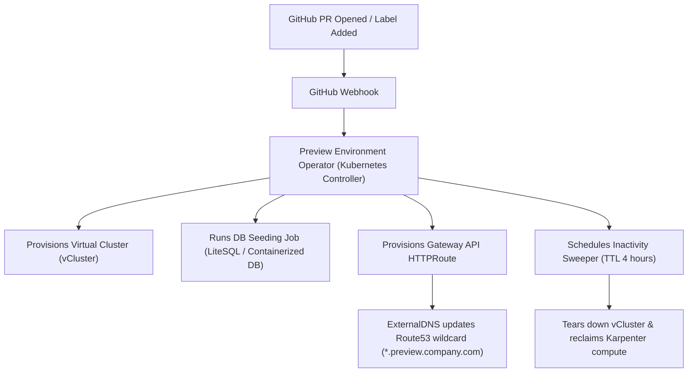
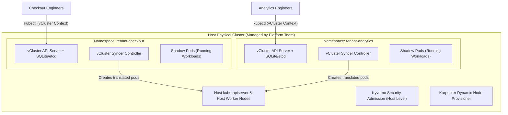
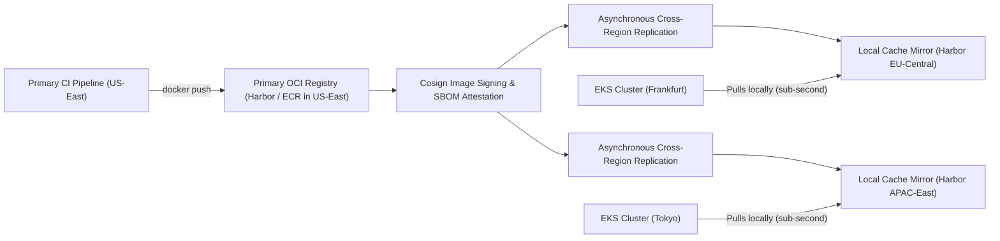
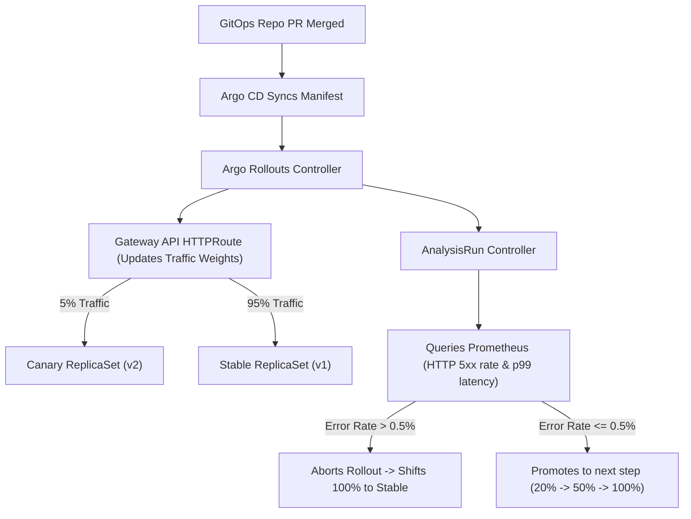
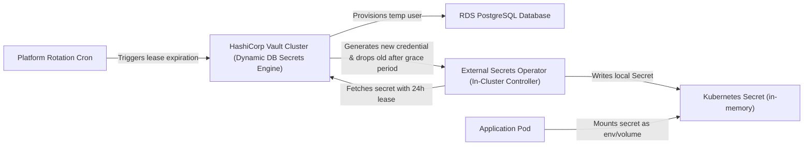
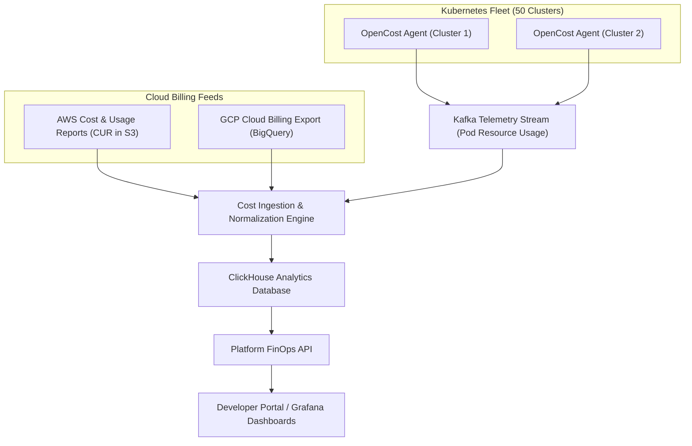

# PE Domain 8: System Design — Hands-On Design Drills

Six comprehensive system design drills. For each drill, practice timing yourself for 45 minutes: clarify requirements, estimate scale, diagram control vs data planes, analyze failure modes, and state trade-offs explicitly before consulting the model solution.

---

## Drill 1: Design an Ephemeral Development Environment Platform

### 1. Requirements & Scope
- **Functional Requirements:**
  - Developers can spin up a complete, isolated preview environment for any open GitHub Pull Request via a single CLI command (`pctl env create --pr 123`) or PR label.
  - Generates a unique, routable public HTTPS URL (`https://pr-123.preview.company.com`).
  - Pre-populates mock/sanitized database state with seed data.
  - Automatically destroys the environment upon PR merge or after 4 hours of inactivity.
- **Non-Functional Requirements:**
  - Spin-up latency: < 3 minutes (p95).
  - Scalability: Support 200 concurrent preview environments.
  - Cost efficiency: Zero idle cloud spend during off-hours.

### 2. Architecture Diagram

### 3. Key Architectural Decisions & Trade-offs
- **vCluster vs Namespaces vs Separate EKS:** vCluster provides complete control plane isolation (allowing PRs to test custom CRDs and Helm charts) without the 15-minute provisioning latency and massive cost of dedicated EKS clusters.
- **Database Seeding Strategy:** Avoid cloning terabyte production databases. Use lightweight schema migrations with synthetic test fixture data (100MB seed container).
- **Cost Controls:** Integrate with Karpenter so that when environments idle down at night, underlying EC2 instances are terminated automatically.

---

## Drill 2: Design a Multi-Tenant Kubernetes Control Plane with vCluster

### 1. Requirements & Scope
- **Functional Requirements:**
  - Provide 50 autonomous product engineering teams with their own dedicated Kubernetes API endpoints.
  - Teams have full `cluster-admin` privileges inside their virtual environment (can install custom CRDs, operators, and namespaces).
  - Host cluster administrators enforce global security guardrails and resource quotas transparently.
- **Non-Functional Requirements:**
  - Control plane isolation: Tenant A cannot see or access Tenant B's API server, etcd, or workloads.
  - High availability: Tenant control planes survive underlying node failures.
  - Resource footprint: < 500MB RAM per tenant control plane.

### 2. Architecture Diagram

### 3. Key Architectural Decisions & Trade-offs
- **Storage Backend for vCluster:** Use embedded SQLite for lightweight development teams; use HA etcd backing for mission-critical staging environments.
- **Network Isolation:** Apply strict host-level `NetworkPolicy` on tenant namespaces, blocking inter-tenant communication while allowing DNS and external egress.

---

## Drill 3: Design a Global Container Registry Mirroring System

### 1. Requirements & Scope
- **Functional Requirements:**
  - Provide sub-second container image pull latencies for Kubernetes clusters distributed across 3 continents (US, EU, APAC).
  - High availability: Clusters continue pulling images during trans-oceanic network fiber cuts or regional registry outages.
  - Cryptographic validation: All mirrored images must retain verified Cosign signatures and SBOM attestations.
- **Non-Functional Requirements:**
  - Throughput: 10,000 image layer pulls per minute during rolling deployments.
  - Egress cost optimization: Minimize cross-region and cross-cloud data transfer fees.

### 2. Architecture Diagram

### 3. Key Architectural Decisions & Trade-offs
- **Push Replication vs Pull-Through Cache:** Pull-through caching adds cold-start latency on the first pod pull. Push replication proactively replicates new release tags to all edge regions immediately after CI signing completes.
- **P2P Image Distribution:** For ultra-large clusters (1,000+ nodes pulling simultaneously), deploy **Kraken** (Uber) or **Dragonfly** (CNCF) peer-to-peer distribution agents on worker nodes to prevent registry network interface saturation.

---

## Drill 4: Design an Automated Canary Analysis & Deployment Engine

### 1. Requirements & Scope
- **Functional Requirements:**
  - Enable continuous, hands-off canary rollouts for 400 microservices.
  - Incrementally shift traffic: 5% -> 20% -> 50% -> 100%.
  - Continuously analyze real-time telemetry metrics (Prometheus error rates and latency) at each step.
  - Automatically abort and rollback within 30 seconds if error thresholds are breached.
- **Non-Functional Requirements:**
  - Zero downtime during deployments.
  - Blast radius: At most 5% of users exposed to initial defects.

### 2. Architecture Diagram

### 3. Key Architectural Decisions & Trade-offs
- **Traffic Routing Layer:** Utilize the Kubernetes **Gateway API** rather than proprietary service mesh annotations to ensure vendor neutrality across clouds.
- **Handling Low-Traffic Services:** For services receiving < 5 requests/sec, statistical error rates are volatile. Complement passive Prometheus analysis with active synthetic smoke tests executed during the pause phase.

---

## Drill 5: Design a Dynamic Secret Injection & Rotation Platform

### 1. Requirements & Scope
- **Functional Requirements:**
  - Securely deliver database credentials and API keys to 5,000 microservices without hardcoding secrets in Git or container images.
  - Automatically rotate database passwords every 24 hours with zero application downtime.
  - Provide an emergency "kill-switch" to revoke compromised credentials instantly across the enterprise.
- **Non-Functional Requirements:**
  - Availability: Applications can start and run even during central secret vault outages (local caching).
  - Auditability: Complete immutable log of every secret access.

### 2. Architecture Diagram

### 3. Key Architectural Decisions & Trade-offs
- **Vault Agent Sidecars vs External Secrets Operator:** Sidecars consume memory in every pod and slow down container startup. ESO decouples secret retrieval to a centralized controller, storing credentials in native Kubernetes secrets.
- **Two-Phase Rotation Grace Period:** Never delete old credentials instantly. Maintain both active credentials for a 2-hour grace period to ensure rolling application pods smoothly transition.

---

## Drill 6: Design a Real-Time Multi-Cloud Cost Allocation Engine

### 1. Requirements & Scope
- **Functional Requirements:**
  - Aggregate infrastructure costs across AWS, GCP, and bare-metal Kubernetes clusters.
  - Proportionally allocate compute, memory, and network egress spend down to individual business units, teams, and microservice namespaces.
  - Expose cost metrics in Prometheus and Grafana for developer portal scorecards.
- **Non-Functional Requirements:**
  - Processing latency: Costs allocated and queryable within 15 minutes of occurrence.
  - Scale: Support 50 Kubernetes clusters and 100,000 pods.

### 2. Architecture Diagram

### 3. Key Architectural Decisions & Trade-offs
- **Storage Engine:** Use **ClickHouse** for cost analytics. Columnar storage and massive parallel processing allow sub-second aggregations across billions of hourly cost records.
- **Shared Cost Allocation:** Distribute unallocated platform overhead (e.g., control plane instances, monitoring stacks) proportionally based on each team's percentage of total compute requests.
