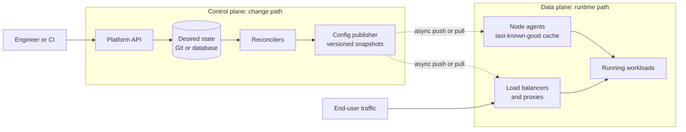
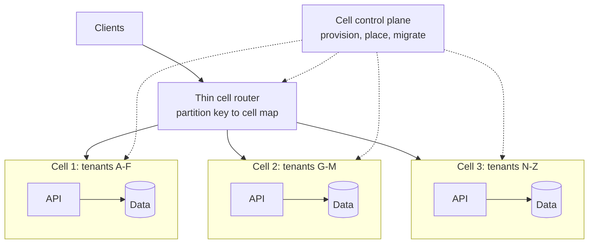
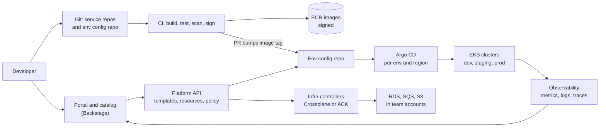
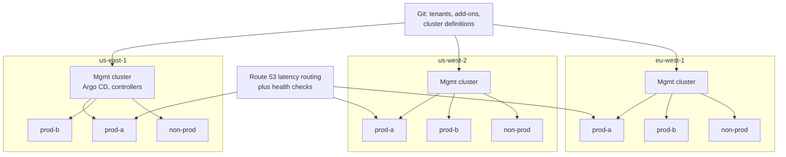
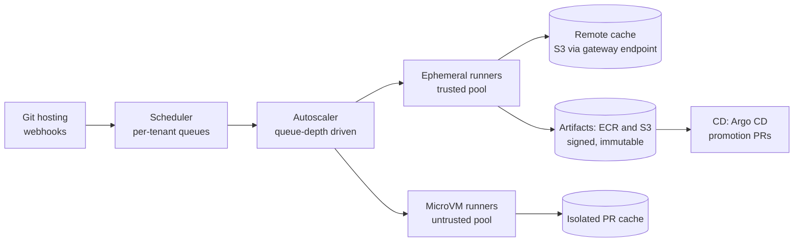
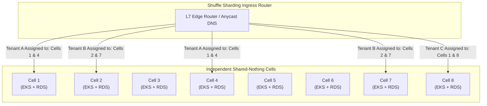

# PE Domain 8: System Design for Platform Engineers — Deep-Dive Study Guide

> [!IMPORTANT]
> **Interview Emphasis:** Very High. In senior platform loops the design round is usually the one that decides the level (mid vs senior vs staff).
> **Where it shows up:** System design (one or two rounds in most senior loops), technical deep dive ("how would you build X at our scale?"), hiring manager (scope and judgment), take-home (architecture write-up and presentation).
> **What "strong" sounds like:** You run the 45 minutes yourself. You scope the problem around the engineers who will use the platform, put numbers on it, and define the developer-facing interface before drawing boxes. You keep the control plane separate from the data plane, name the failure modes and blast radius of each choice, explain how existing teams migrate onto it, and finish with the metrics that would prove it worked.

---

## 1. How Platform and Infrastructure Design Rounds Differ

This domain covers how to lead a senior-to-staff platform system design interview: scoping ambiguous requirements, designing self-service control planes, establishing blast radius isolation, and architecting multi-region platforms that product engineering teams love using.

### 1.1 Your users are engineers

In a product round ("design a URL shortener") the users are consumers and the hard parts are read/write fan-out, caching and data modeling. In a platform round ("design a deployment system for 400 services") the users are internal engineers. The system is mostly a **control plane** that changes a large **data plane** (clusters, runners, proxies, agents). Request rates against the platform API are often tiny. The hard parts are elsewhere.

| Dimension | Product design round | Platform design round |
| :--- | :--- | :--- |
| Users | Millions of end users | Tens to thousands of engineers, plus the services they run |
| Load shape | High-QPS read/write path | Low-QPS control plane driving a high-volume data plane (deploys, config, telemetry) |
| Hardest problems | Fan-out, caching, data modeling | Safe change, multi-tenancy, blast radius, upgrades, migration of existing workloads |
| Can users opt out? | Rarely | Often yes. Adoption has to be earned; a platform nobody migrates to has failed |
| Failure impact | Customers see errors | Every team is blocked at once; one bad push can break the whole fleet |
| Interface | Public API, UI | Developer API, CLI, CRDs, Git conventions, portal, templates |
| Success metrics | Latency, conversion, revenue | Lead time, change failure rate, adoption, toil removed, cost per tenant |

### 1.2 Themes to raise without being asked

Interviewers keep a mental checklist. Mention each of these at least once, at the point in the design where it matters:

- **Control plane vs data plane.** Running workloads must survive a control-plane outage.
- **Multi-tenancy.** Noisy neighbours, quotas, fairness, isolation tiers.
- **Blast radius.** Cells, deployment waves, regional independence, shuffle sharding.
- **Operability.** How the platform team upgrades, observes and is on call for this system. Day 2 is most of the lifetime cost.
- **Migration and adoption.** There is always an existing system. Say how 300 services move onto the new one without downtime.
- **Developer experience.** The interface, the defaults, the escape hatches, time-to-first-deploy.
- **Security and compliance.** Identity, least privilege, audit trail, supply chain.
- **Cost.** What scales linearly with tenants, who pays, how spend is attributed.

### 1.3 What interviewers score

| Competency | What they look for | What pushes it to senior/staff |
| :--- | :--- | :--- |
| Problem scoping | Asks about users, scale and constraints; writes requirements down | Finds the 1–2 requirements that drive the whole design ("tenant isolation drives everything here") |
| Estimation | Produces numbers quickly with stated assumptions | Uses the numbers to decide things ("150M in-memory series means RAM is the cost driver, not disk") |
| Architecture | Clear components, data flow and state ownership | Control/data plane split, simple first version, explicit evolution path |
| Depth | Can go deep on 2–3 components | Knows the real failure modes of the chosen technology (etcd size limits, Kafka partition limits, CNI IP exhaustion) |
| Trade-offs | Names alternatives and why they lost | Ties each trade-off to requirements, team size and skills, cost and reversibility |
| Reliability and operations | Failure modes, monitoring, upgrades | Static stability, blast-radius control, safe rollout of the platform itself |
| Communication | Structured, checks in with the interviewer | Drives the session, keeps to time, summarizes decisions, adapts when redirected |

> [!TIP]
> **Interview Angle:** Interviewers often open vaguely on purpose ("design a platform for our engineers"). The first thing they score is whether you narrow it. A senior answer names the personas (service developer, platform operator, security, finance), picks the 2–3 journeys that matter most (create a service, ship a change, debug production) and says out loud what is out of scope.

> [!CAUTION]
> **Classic trap: a product design in disguise.** If you spend 15 minutes sizing read QPS for the portal of a 600-engineer company, you are optimizing a component that sees a few requests per second. In platform problems the scale usually lives in the **change rate, tenant count, fleet size and telemetry volume**, not in portal traffic.

---

## 2. The 45/60-Minute Framework

### 2.1 Time-box table

| # | Step | 45-min round | 60-min round | What ends up on the board |
| :--- | :--- | :--- | :--- | :--- |
| 1 | Clarify and scope | 0–4 | 0–5 | Personas, top journeys, in/out of scope, greenfield or brownfield |
| 2 | Functional + non-functional requirements | 4–8 | 5–10 | FR bullets; NFRs with numbers (scale, SLOs, tenancy, compliance, cost) |
| 3 | Back-of-envelope estimates | 8–12 | 10–15 | 4–6 numbers that drive decisions |
| 4 | Developer-facing API / interface | 12–16 | 15–20 | Spec, CRD, CLI or endpoints; sync vs async; idempotency |
| 5 | High-level architecture | 16–24 | 20–30 | Control plane and data plane boxes, state stores, data flow |
| 6 | Deep dives (2–3) | 24–36 | 30–48 | Mechanisms, algorithms, trade-offs |
| 7 | Failure modes and operations | 36–40 | 48–53 | Failure table, blast radius, static stability, on-call |
| 8 | Evolution, migration and rollout | 40–43 | 53–57 | Phases, pilot, migration strategy, deprecation |
| 9 | Success metrics and wrap-up | 43–45 | 57–60 | 3–5 metrics; recap of the key decisions |

The deep dives get the biggest single block of time because that is where depth gets scored. Requirements and estimates together should not run past the first quarter of the interview.

### 2.2 What to say at each step

**Step 1 — Clarify and scope.** "Before I draw anything: who uses this and what are they trying to get done? Is this greenfield or are we replacing something? How big is the engineering org, which cloud, which tools exist today? Any compliance constraints such as PCI, SOC 2 or data residency?" Close the step explicitly: "I'll scope to creating services, deploying them and observing them. I'll treat data platforms and cost tooling as out of scope unless you want them."

**Step 2 — Requirements.** Write 3–6 functional requirements as user journeys, then the non-functional ones *with numbers*. A reusable skeleton:

```text
Functional
  FR1  A developer creates a new service from a template and has it running in dev in < 1 hour
  FR2  A merged change reaches production through automated gates; rollback in one action
  FR3  Every service gets logs, metrics, traces, dashboards and SLO alerts by default
Non-functional
  Scale        600 engineers, 75 teams, 400 services, ~1,600 deploys/day, 3 envs, 2 regions
  Availability Data plane (running services): independent of the platform
               Control plane (deploy/provision APIs): 99.9% monthly
  Latency      Deploy starts < 1 min after merge; provisioning p90 < 15 min
  Tenancy      Teams isolated by namespace + IAM; prod and non-prod separated by AWS account
  Security     SSO everywhere, least privilege, signed artifacts, audit trail (SOC 2)
  Cost         Showback per team; platform overhead < X% of compute spend
  Operability  Run by a platform team of ~8 engineers with one on-call rotation
```

Call out that **control-plane and data-plane availability targets differ**. This one sentence tells the interviewer you think in planes.

**Step 3 — Estimates.** Say what you are estimating and *why*: "I'll estimate peak concurrent builds because that sizes the runner fleet and the cost." Round hard, state assumptions, sanity-check against something you know, and write the results in a corner of the board for later.

**Step 4 — Interface.** "Before boxes, here is what a developer actually touches." Prefer declarative specs (desired state, idempotent by name), asynchronous long-running operations with a status resource, explicit versioning (`v1alpha1` → `v1`), and an escape hatch for the 10% of cases the golden path does not cover.

**Step 5 — High-level design.** Put the control plane on one side and the data plane on the other. Mark where state lives and who owns it. Draw the change path (developer → API → desired state → reconcilers → data plane) separately from the runtime path (user traffic → data plane).

**Step 6 — Deep dives.** Offer a menu: "The riskiest parts are tenant isolation, the upgrade path and the cache design. Which would you like me to go deep on? Otherwise I'll start with isolation." This shows judgment and lets the interviewer steer toward what they score.

**Step 7 — Failure modes.** Go through the standard list: dependency down, overload, bad change (code *and* config), AZ/region loss, data corruption, security compromise. For each one, state the blast radius and the mitigation.

**Step 8 — Evolution and migration.** Phases (pilot → early adopters → default → deprecate old path), parallel run, migration tooling, and what would make you change the design later.

**Step 9 — Success metrics.** One developer-experience metric, one reliability metric, one adoption metric, one cost metric. Then spend 30 seconds recapping the 3–4 key decisions and their trade-offs.

### 2.3 Whiteboarding tips

- Draw left to right: actors, then entry points, then control plane, then data plane, then state.
- Label arrows with protocol and sync/async (`gRPC sync`, `SQS async`, `Git poll 3m`). Unlabeled arrows hide the most important design decisions.
- Keep a **"Decisions & assumptions" box** in a corner and update it as you go. It doubles as your wrap-up.
- Number components (1–9) so you can say "component 4 is the reconciler" during deep dives.
- Leave empty space on the right for the deep dive instead of cramming it into the overview.
- Check in about every 10 minutes: "Does this level of detail work, or should I go deeper on X?"
- Virtual whiteboards (Excalidraw, Miro, a shared doc): practice in the tool beforehand and keep a template with the 9 step headings ready.
- If you make a mistake, say so and fix it out loud. Interviewers score self-correction positively.

> [!TIP]
> **Interview Angle:** The framework is a means, not the deliverable. Strong candidates use it to manage time and then flex. If the interviewer says "skip estimates, let's talk about tenancy," you skip estimates. What separates senior from mid level is spending most of the time on the 2–3 decisions that actually carry risk.

> [!CAUTION]
> **Trap: naming tools before responsibilities.** "I'd use Backstage, Argo CD and Crossplane" is not a design. First say the responsibility ("a catalog that knows who owns what," "a reconciler that converges clusters to Git," "a provisioning API with policy"), then say which tool fills it and why you picked it over the alternative. Interviewers often follow up with "and if you couldn't use that tool?"

---

## 3. Estimation Toolkit

Estimates exist to **make decisions**: rule an option in or out, size a fleet, find the cost driver. Round aggressively (one significant figure is often enough), say your assumptions out loud, and check the result against something you know.

### 3.1 Latency numbers every engineer should know

These are order-of-magnitude planning numbers, adapted from the well-known list popularized by Jeff Dean and Peter Norvig and adjusted for current hardware and cloud networks. Measure in your own environment. The ratios matter more than the exact values.

| Operation | Approximate latency | Design implication |
| :--- | :--- | :--- |
| L1 cache reference | ~1 ns | — |
| Main memory reference | ~100 ns | In-process caches are effectively free |
| Random 4 KB read from NVMe SSD | ~10–100 µs | Local disk is fine for hot indexes |
| Read 1 MB sequentially from memory | ~50–250 µs | — |
| Read 1 MB sequentially from NVMe SSD | ~0.2–1 ms | — |
| Round trip within one AZ | well under 1 ms | Chatty RPCs add up quickly |
| Round trip between AZs in a region | ~0.5–2 ms | AWS describes inter-AZ links as low-latency and suitable for synchronous replication |
| HDD seek | ~10 ms | Avoid random I/O on spinning disks |
| Round trip US East ↔ US West | ~60–80 ms | Cross-region synchronous calls hurt every request |
| Round trip US ↔ Western Europe | ~70–100 ms | Same |
| Round trip US ↔ Asia-Pacific | ~100–250 ms | Same |
| New TLS connection | +1 RTT (TLS 1.3) or +2 RTT (TLS 1.2) on top of the TCP handshake | Reuse connections; terminate TLS close to clients |

Physics check: light in fiber covers about 200 km per millisecond, so each 100 km of fiber adds about 1 ms of round-trip time. A cross-AZ round trip costs roughly as much as 10,000 memory references. A cross-region round trip is tens of times slower than a cross-AZ one.

### 3.2 Conversions and throughput math

| Fact | Value | Mental shortcut |
| :--- | :--- | :--- |
| Seconds per day | 86,400 | ≈ 10^5. Dividing by 10^5 understates per-second rates by about 14% |
| Seconds per 30-day month | 2,592,000 | ≈ 2.6M |
| Seconds per year | 31,536,000 | ≈ 31.5M |
| 1M requests/day | ≈ 12 req/s average | — |
| 1B requests/day | ≈ 11,600 req/s average | — |
| 1 Gbps | 125 MB/s | 10 Gbps ≈ 1.25 GB/s |
| 2^10 / 2^20 / 2^30 / 2^40 | KiB / MiB / GiB / TiB | ≈ 10^3 / 10^6 / 10^9 / 10^12 |
| Hours per month (AWS billing) | 730 | 8,760 / 12 |

Three formulas carry most interviews:

```text
Little's Law      concurrency (L) = arrival rate (λ) × time in system (W)
Storage           bytes = rate × size × retention × replication ÷ compression
Peak              peak rate = average rate × peak-to-average factor (state it; 2–3× is a common assumption for diurnal load)
```

**Worked example: config distribution.** 10,000 nodes each poll for config every 30 s, which is 10,000 / 30 ≈ 333 requests/s. If every poll downloads a 1 MB file, that is 333 MB/s ≈ 2.7 Gbps of steady egress. With conditional GETs (`ETag` / `If-None-Match`) nearly every response is a `304 Not Modified` and bandwidth drops to almost nothing. The request rate is trivial for S3 or a CDN. The number shows the problem is bytes, not requests, and the fix is versioning plus conditional fetches.

### 3.3 Metrics cardinality math

```text
active series   = Σ over metric names of (distinct label-value combinations actually present)
histogram       = (bucket count incl. +Inf) + 2 series (_sum, _count) per label combination
ingest rate     = active series ÷ scrape interval            (samples/s)
disk per day    ≈ ingest rate × 86,400 × 1–2 bytes/sample    (Prometheus docs: 1–2 bytes/sample)
ingester RAM    ≈ 2.5 GB per 300k in-memory series            (Grafana Mimir planning guidance)
in-memory       = active series × replication factor (Mimir default RF = 3)
```

**Worked example 1: one histogram, one service.** `http_server_request_duration_seconds` has 10 explicit buckets, so 11 bucket series (including `+Inf`) plus `_sum` and `_count` gives 13 series per label combination. Labels present: `pod` (20 values), `method` (5), `route` (30), `status_code` (5). That is 20 × 5 × 30 × 5 = 15,000 combinations × 13 = **195,000 series** from one metric on one service. Aggregating `pod` away before storage leaves 750 × 13 = **9,750 series**.

> [!CAUTION]
> **Do not just relabel-drop the `pod` label.** If you drop it with `metric_relabel_configs`, series from different pods end up with identical label sets and collide, which produces duplicate or out-of-order sample errors and wrong values. Aggregate instead: use recording rules close to the source or a stream-aggregation layer (`sum without (pod)`), and keep per-pod detail only where someone actually uses it.

**Worked example 2: a fleet.** 2,000 services averaging 25,000 series each gives 50M active series.

| Quantity | Calculation | Result |
| :--- | :--- | :--- |
| Ingest at 30 s scrape | 50M / 30 | ≈ 1.67M samples/s |
| Samples per day | 1.67M × 86,400 | 1.44 × 10^11 |
| Disk per day at 1.5 B/sample | 1.44 × 10^11 × 1.5 B | ≈ 216 GB/day |
| 13 months in object storage | 216 GB × 395 days | ≈ 85 TB ≈ $2.0k/month on S3 Standard |
| In-memory series (RF 3) | 50M × 3 | 150M |
| Ingester RAM (Mimir rule of thumb) | 150M / 300k × 2.5 GB | ≈ 1.25 TB, plus 50% headroom ≈ 1.9 TB |
| Ingester CPU | 150M / 300k × 1 core | ≈ 500 cores |

Conclusion: **active series, which drive RAM and CPU, are the cost driver.** Storage bytes are a rounding error by comparison, which is why metrics platforms enforce per-tenant series limits rather than byte quotas.

### 3.4 Log-volume math

```text
bytes/day = pods × lines/s per pod × bytes/line × 86,400
```

**Worked example: 1,000 pods for 30 days.** Assume each pod writes 5 lines/s at 200 bytes, so 1 KB/s per pod.

| Quantity | Calculation | Result |
| :--- | :--- | :--- |
| Fleet rate | 1,000 × 1 KB/s | 1 MB/s |
| Per day | 1 MB/s × 86,400 | 86.4 GB/day |
| 30 days raw | 86.4 × 30 | ≈ 2.6 TB |
| Compressed in object storage (Loki-style, ~10×) | 2.6 TB / 10 | ≈ 260 GB, about $6/month on S3 Standard |
| Indexed (OpenSearch, ~1.1× index overhead, 1 replica) | 2.6 TB × 1.1 × 2 | ≈ 5.7 TB of disk (about $460/month of gp3 alone) |
| CloudWatch Logs ingestion (Standard, ~$0.50/GB) | 2,592 GB × $0.50 | ≈ $1,300/month before storage |

Takeaway: **ingestion and indexing cost far more than storage.** Logs also spike during incidents, exactly when you need them, so size the pipeline for bursts, buffer at the agent, and drop or sample debug-level logs at the edge.

### 3.5 CI build-minute math

**Worked example: 20,000 builds/day, average 10 minutes.**

| Quantity | Calculation | Result |
| :--- | :--- | :--- |
| Build-minutes/day | 20,000 × 10 | 200,000 min ≈ 3,333 runner-hours |
| Arrival rate in working hours (80% of builds in 10 h) | 16,000 / 600 min | ≈ 26.7 builds/min |
| Average concurrency (Little) | 26.7 × 10 min | ≈ 267 concurrent builds |
| Burst concurrency (assume 2×) | 267 × 2 | ≈ 530, so plan for ~600 runners at peak |
| Peak vCPU at 4 vCPU per runner | 600 × 4 | 2,400 vCPU |
| Job-time compute, on-demand c6i.xlarge (~$0.17/h) | 3,333 h × $0.17 | ≈ $567/day ≈ $17k/month, before warm-pool and packing overhead |

### 3.6 Kubernetes capacity math (EKS with the AWS VPC CNI)

Pods per node = min(CPU fit, memory fit, max-pods limit). On EKS the max-pods limit usually comes from IP addresses.

```text
VPC CNI secondary-IP mode:  max pods = ENIs × (IPv4 addresses per ENI − 1) + 2
  m5.large     3 × (10 − 1) + 2 = 29
  m6i.2xlarge  4 × (15 − 1) + 2 = 58
  m6i.4xlarge  8 × (30 − 1) + 2 = 234
Prefix delegation: each slot holds a /28 prefix (16 IPs); EKS recommends max pods of
  110 for instance types with fewer than 30 vCPUs and 250 for larger ones
```

**Worked example: m6i.2xlarge (8 vCPU, 32 GiB).** Assume about 0.1 vCPU and 1 GiB of kubelet/system reservation (the EKS AMIs reserve memory as a function of max pods, roughly 11 MiB per pod + 255 MiB) and DaemonSets using 0.5 vCPU and 1 GiB.

| Pod size (requests) | CPU fit | Memory fit | IP limit | Binding constraint |
| :--- | :--- | :--- | :--- | :--- |
| 250m / 512 MiB | (8 − 0.1 − 0.5) / 0.25 ≈ 29 | 30 GiB / 0.5 = 60 | 58 | **CPU** at ~29 pods |
| 100m / 256 MiB | 7.4 / 0.1 = 74 | 30 GiB / 0.25 = 120 | 58 | **IPs** at 58, so use prefix delegation or larger nodes |

**Subnet sizing.** In the worst case a node holds ENIs × IPs-per-ENI addresses (60 for m6i.2xlarge), and the default `WARM_ENI_TARGET=1` keeps a spare ENI's worth of addresses attached. 150 nodes × 60 = 9,000 IPs, so three /20 subnets (4,091 usable each after the 5 addresses AWS reserves per subnet, 12,273 total). Options when routable space is tight: tune `WARM_IP_TARGET`/`MINIMUM_IP_TARGET`, enable prefix delegation, or use custom networking with pod subnets from a secondary `100.64.0.0/10` CIDR.

**Upstream limits.** The Kubernetes docs describe clusters of up to 5,000 nodes, 110 pods per node, 150,000 total pods and 300,000 total containers. Platform teams split into multiple clusters long before these limits, for blast radius and upgrade safety. Cluster networking details are in [CKA Services & Networking]().

### 3.7 Availability math

| Availability | Downtime per year | Per 30-day month | Per week |
| :--- | :--- | :--- | :--- |
| 99% | 3.65 days (87.6 h) | 7.2 h | 1.68 h |
| 99.5% | 1.83 days (43.8 h) | 3.6 h | 50.4 min |
| 99.9% | 8.76 h | 43.2 min | 10.1 min |
| 99.95% | 4.38 h | 21.6 min | 5.04 min |
| 99.99% | 52.6 min | 4.32 min | 1.01 min |
| 99.999% | 5.26 min | 25.9 s | 6.05 s |

```text
Serial (all required):     A = A1 × A2 × … × An
  99.95% × 99.9% × 99.95%  = 99.80%
  five deps at 99.9%       = 99.50%
Parallel (any one enough, independent failures):  A = 1 − Π(1 − Ai)
  two replicas at 99.9%    = 99.9999%
k-of-n (need 2 of 3 at 99.5%):  3p²(1 − p) + p³ = 99.9925%
Error budget (99.9%, 30 days) = 43.2 min, or 0.1% of requests
Burn rate 14.4 sustained for 1 h consumes 14.4 / 720 = 2% of a 30-day budget
```

> [!WARNING]
> **Parallel math assumes independent failures, and real systems rarely have them.** Two "independent" replicas that share a deploy pipeline, a config push, DNS, IAM or a control plane fail together. Your real availability is close to that of the weakest *shared* dependency. That is the core argument for cells, staggered deployments and static stability.

### 3.8 Rough cloud cost estimation

**Approximate us-east-1 on-demand list prices at the time of writing. Verify with the AWS Pricing Calculator before quoting real budgets.** In an interview, say "roughly" and round.

| Item | Approximate price | Monthly equivalent |
| :--- | :--- | :--- |
| EC2 m6i.2xlarge (8 vCPU, 32 GiB) | ~$0.384/h | ~$280 (730 h) |
| EC2 c6i.xlarge (4 vCPU, 8 GiB) | ~$0.17/h | ~$124 |
| EKS control plane | $0.10/h standard support; $0.60/h in extended support | $73 or $438 per cluster |
| S3 Standard | ~$0.023/GB-month (first 50 TB) | $23 per TB |
| EBS gp3 | ~$0.08/GB-month | $80 per TB |
| Inter-AZ data transfer | ~$0.01/GB in each direction | — |
| NAT Gateway data processing | ~$0.045/GB (plus hourly charge) | — |
| Internet egress | ~$0.09/GB (first 10 TB/month) | — |
| CloudWatch Logs ingestion (Standard) | ~$0.50/GB | — |
| Secrets Manager | $0.40/secret-month + $0.05 per 10,000 API calls | — |

**Worked examples that win arguments:**

- **Cross-AZ chatter.** 1 Gbps sustained = 125 MB/s × 2.592M s ≈ 324 TB/month × $0.02 (both directions) ≈ **$6,500/month**. That justifies topology-aware routing.
- **Upgrade debt.** 300 EKS clusters cost $21,900/month in standard support and $131,400/month if they all slip into extended support. The **$109,500/month** difference pays for an upgrade-automation team.
- **NAT on the hot path.** CI runners pulling 2 GB of cache each for 20,000 builds/day is 40 TB/day. Through a NAT gateway that is 40,000 GB × $0.045 ≈ **$1,800/day**. Through an S3 gateway endpoint the data-processing charge is zero.

| AWS | GCP | Azure |
| :--- | :--- | :--- |
| EKS | GKE | AKS |
| S3 | Cloud Storage | Blob Storage |
| Cost and Usage Report (CUR) | Cloud Billing export to BigQuery | Cost Management exports |

> [!TIP]
> **Interview Angle:** Interviewers rarely check your arithmetic to the dollar. They check whether you **estimate the thing that drives the decision**: RAM for a metrics platform, concurrency for CI, IPs for EKS density, change rate for a deployment system. A senior candidate finishes each estimate with "so what": "…so the cost is dominated by ingesters, and per-tenant series limits are the main cost control."

> [!CAUTION]
> **Classic estimation mistakes:** mixing bits and bytes (1 Gbps is 125 MB/s, not 1 GB/s); forgetting replication factors (Kafka RF 3, ingester RF 3, OpenSearch replicas); using averages where peaks matter (CI at 10:00 on Monday); forgetting that a 30-day month has about 2.6M seconds; and leaving out per-unit overheads such as IPs per ENI, DaemonSet requests and warm pools.

---

## 4. Platform Architecture Patterns

### 4.1 Control plane vs data plane separation

| Plane | What it does | Platform examples | Design posture |
| :--- | :--- | :--- | :--- |
| **Control plane** | Accepts desired-state changes, validates, stores, reconciles | Kubernetes API server and controllers, the platform API, Argo CD, Terraform runners, the fleet upgrade orchestrator | Complex, low volume, changes often. Can tolerate lower availability *if* the data plane does not depend on it at runtime |
| **Data plane** | Does the runtime work | kubelet and running pods, load balancers, mesh proxies, DNS resolvers, CI runners executing jobs, the metrics ingestion path | Simple, high volume, changes rarely. Must keep working on stale config |

Rules to say out loud:

1. The data plane **never calls the control plane synchronously on the request path**.
2. The control plane publishes versioned configuration; the data plane caches it and keeps **last-known-good** if the publisher disappears.
3. Changes coming out of the control plane are validated, rate-limited and rolled out progressively, because a bad config push is the most common way to break the whole fleet at once.



### 4.2 Static stability

The Amazon Builders' Library defines a statically stable design as one where the system keeps working when a dependency is impaired, without having to *react*: no new provisioning, no new config fetches, no failover logic that only runs during the outage.

- **Pre-provision for the failure.** To survive losing one of *N* AZs without launching anything, provision N/(N−1) of peak capacity: 200% for 2 AZs, 150% for 3 AZs, 133% for 4 AZs.
- **Cache with long TTLs and serve stale.** Credentials, config, service discovery and authorization policy keep working from cache when the source is down.
- **Avoid bimodal behaviour.** A fallback path that only runs during incidents is untested code that runs at the worst possible moment.
- **Prefer constant work.** For example, push the full config snapshot every N seconds whether or not anything changed. Load is identical in calm and crisis, and every push repairs drift.

Platform examples: if the EKS API endpoint is unavailable, existing pods keep running because the kubelet keeps containers alive, but nothing can scale or reschedule, so pre-scale critical services. Envoy keeps its last xDS config when the management server is down. CI runners finish the jobs already assigned to them when the scheduler restarts.

### 4.3 Cell-based architecture

A **cell** is a complete, independent copy of the stack that serves a subset of tenants, chosen by a partition key. A thin **cell router** sends each request to its cell, and a control plane creates cells and places or migrates tenants. Cells share no state and do not call each other. The AWS whitepaper *Reducing the Scope of Impact with Cell-Based Architecture* gives the basic arithmetic: with 10 cells, one failed cell leaves 90% of requests unaffected.



| Benefit | Cost |
| :--- | :--- |
| Blast radius of a bug, poison request or bad deploy is one cell | More infrastructure and more things to operate |
| Each cell has a known, tested maximum size; you scale out by adding cells, not by growing them | Tenant placement, rebalancing and migration between cells are real engineering work |
| Deployments go cell by cell, and the first cell acts as a canary | Cross-cell queries and global views need a separate path |
| Easier load testing: test one cell at maximum size | The router becomes critical, so it must be simple, cached and statically stable |

**When it is worth it:** many tenants, a strong need to limit blast radius, and scale beyond what one tested unit can handle. Examples include a multi-tenant CI service, a metrics SaaS or a deployment control plane serving thousands of teams. **When it is not:** the IDP portal for a 600-engineer company. Say so explicitly; it shows judgment.

### 4.4 Shuffle sharding

Plain sharding puts each tenant on one shard, so a bad tenant takes down everyone else on that shard. **Shuffle sharding** gives each tenant a random *combination* of workers. The Builders' Library article on shuffle sharding uses this example:

- 8 workers, each tenant assigned 2 of them: C(8,2) = **28** possible shards.
- A poison tenant takes out its 2 workers. Any other tenant has the *same* pair with probability 1/28 (about 3.6%). Of the other 27 pairs, 12 share one worker and keep the other healthy one, and 15 share nothing.
- With 100 workers and shards of 5 there are C(100,5) = 75,287,520 combinations, so full overlap with a specific bad tenant is about 1 in 75 million.

This only works if **clients retry against the other members of their shard**. Real uses include Kubernetes **API Priority and Fairness**, which assigns flows to queues with shuffle sharding, and per-tenant shuffle sharding of ingesters and queriers in Grafana Mimir.

### 4.5 Regionalization

- **Regional by default, global by exception.** Each region's control plane manages only that region. No cross-region synchronous dependencies on the runtime path.
- Keep global components minimal and boring: DNS, the identity root, asynchronous artifact replication.
- **A global control plane is a global blast radius.** A single config push that reaches every region at once can take all of them down together. Deploy region by region.
- Replicate artifacts (images, charts) to each region *before* deploying there, so a deploy in eu-west-1 never depends on us-east-1. AWS's *AWS Fault Isolation Boundaries* whitepaper covers which AWS services are zonal, regional or global. For multi-region data patterns, review Section 4 on Distributed Consensus and Storage Replication in this Study Guide.

### 4.6 Push vs pull configuration distribution

| Aspect | Push (server sends) | Pull (agent fetches) |
| :--- | :--- | :--- |
| Propagation latency | Seconds | Bounded by poll interval plus jitter |
| Control-plane load | Grows with connections and fan-out; needs flow control | Predictable (N / interval); can be served from S3 or a CDN |
| Control plane down | Agents keep last config but stop receiving updates | Same, and nothing has to reconnect afterwards |
| Missed updates | Need sequence numbers and resync logic | Full snapshot each time, so it self-heals |
| Examples | Envoy xDS streams, Kubernetes watches | Agents polling versioned objects with `ETag`; Argo CD polling Git (default about every 3 minutes) |

A **hybrid** is usually best: push a small notification ("version 812 available") or use a watch, pull the content, and run a periodic full resync to catch anything missed. For 10,000 nodes, a pull from object storage with jitter and conditional GETs is statically stable and cheap (see 3.2).

### 4.7 Reconciliation loops as a design pattern

Kubernetes controllers made this the default way to build platforms. A reconciler is **level-triggered**: it compares desired state with observed state and acts on the difference, no matter which event woke it up. Missed or duplicated events therefore don't break correctness.

```go
// Sketch of a level-triggered reconciler (controller-runtime style).
func (r *DatabaseReconciler) Reconcile(ctx context.Context, req ctrl.Request) (ctrl.Result, error) {
    var db platformv1.Database
    if err := r.Get(ctx, req.NamespacedName, &db); err != nil {
        return ctrl.Result{}, client.IgnoreNotFound(err) // deleted: finalizer handles cleanup
    }
    observed, err := r.Cloud.Describe(ctx, db.Spec.Name) // what actually exists
    if err != nil {
        return ctrl.Result{}, err // requeue with per-key exponential backoff
    }
    for _, step := range plan(db.Spec, observed) { // diff -> ordered, idempotent steps
        if err := step.Apply(ctx); err != nil {
            return ctrl.Result{}, err
        }
    }
    db.Status.ObservedGeneration = db.Generation
    return ctrl.Result{RequeueAfter: 10 * time.Minute}, r.Status().Update(ctx, &db) // periodic resync
}
```

Properties to mention: idempotent steps; per-key rate-limited work queues with backoff; `observedGeneration` and status conditions so users can see progress; finalizers for cleanup of external resources; periodic resync to fix drift. Operators and CRDs are covered in [CKA Domain 1]().

### 4.8 Event-driven vs polling

Events give low latency and efficiency, but they can be lost, duplicated or reordered, and replay needs infrastructure. Polling is simple and self-healing but costs latency and load. **Use events as hints and periodic reconciliation as the guarantee.** Example: GitHub webhooks trigger an immediate sync, and a 3-minute poll catches dropped webhooks. Always verify webhook signatures, and design consumers to be idempotent.

### 4.9 Idempotency keys

Every mutating platform API will be retried: by clients after timeouts, by CI on flaky networks, by humans clicking twice. Without idempotency, a retried "create environment" creates two environments.

```http
POST /v1/databases HTTP/1.1
Idempotency-Key: 6f1c2a8e-3d7b-4c1e-9a55-2b7f0e9d4a10
Content-Type: application/json

{"name": "orders-db", "engine": "postgres", "tier": "prod-small", "team": "payments"}
```

- The server stores `(key, request hash, response)` **in the same transaction** as the side effect, or before starting the async operation.
- A replay with the same key returns the stored response (`202` plus the same operation ID). The same key with a different payload returns an error (`409`/`422`).
- Keys expire (for example after 24 h).
- Declarative "PUT desired state by name" APIs, such as Kubernetes `apply`, are naturally idempotent, which is one reason platforms favour them.

### 4.10 Leader election

Use a single leader when exactly one actor must do something: a scheduler, a singleton controller, a cron trigger. In Kubernetes this is a `Lease` object (`coordination.k8s.io/v1`) managed through client-go's `leaderelection` package. kube-controller-manager defaults to a 15 s lease duration, 10 s renew deadline and 2 s retry period.

The danger is **two leaders at once**: a leader pauses (GC, CPU starvation, network partition), its lease expires, a new leader is elected, and the old one wakes up and keeps writing. Mitigations:

- **Fencing tokens.** Each lease acquisition gets a monotonically increasing number, and the storage layer rejects writes with an older token.
- **Conditional writes.** Optimistic concurrency (`resourceVersion`, DynamoDB condition expressions) so stale writers fail.
- **Avoid leaders where you can.** Partition the work so each worker owns a disjoint shard, or make operations idempotent and conditional. The Builders' Library article *Leader election in distributed systems* discusses this trade-off.

### 4.11 Sharding

| Strategy | How | Good for | Watch out for |
| :--- | :--- | :--- | :--- |
| Hash | `hash(key) mod N` or a consistent-hash ring | Even spread | `mod N` remaps most keys when N changes; consistent hashing moves about 1/N |
| Range | Key ranges per shard | Range scans, time series | Hot ranges (e.g., "now") |
| Directory | Lookup table key → shard | Moving individual tenants, cells | The directory is critical state; cache it |

Platform uses include sharding reconcilers by cluster (Argo CD can shard its application controller across clusters), sharding metrics ingestion by series hash, and sharding work queues by tenant. Big tenants ("whales") need to be split or given dedicated capacity.

### 4.12 Work queues and fairness

A single FIFO queue across tenants is unfair. One team enqueues 5,000 jobs and everyone else waits behind them.

- **Per-tenant queues with weighted fair dequeue** (round robin or deficit round robin) instead of one global FIFO.
- **Per-tenant concurrency caps** plus a global cap, so no tenant can hold more than X% of workers.
- **Priority classes.** Release and main-branch builds ahead of PR builds; interactive ahead of batch. Add age-based boosting so low priorities don't starve.
- **Admission control at enqueue time** (quotas) rather than an unbounded queue. The Builders' Library article *Avoiding insurmountable queue backlogs* covers bounded queues and dropping or deprioritizing stale work.
- **Shuffle-sharded queues**, as Kubernetes API Priority and Fairness does for API requests.

### 4.13 Multi-tenancy isolation tiers

| Tier | Mechanism | What is isolated | Relative cost/ops | Use when |
| :--- | :--- | :--- | :--- | :--- |
| Namespace in shared cluster | RBAC, ResourceQuota, LimitRange, NetworkPolicy, Pod Security Admission, policy engine | API objects and quotas; kernel and control plane are shared | Lowest | Trusted internal teams, standard services |
| Namespace + dedicated nodes | Taints/tolerations, node affinity, per-tenant Karpenter NodePools | Adds node and kernel separation between tenants | Low–medium | Noisy, GPU or compliance-sensitive workloads |
| Virtual cluster (e.g., vCluster) | A tenant API server running inside a host namespace | Own API, CRDs and RBAC; shared nodes | Medium | Teams that need CRDs or cluster-admin-like UX; preview environments |
| Sandboxed runtime | gVisor, Kata Containers, Firecracker microVMs (RuntimeClass) | Strong workload/kernel isolation | Medium–high | Untrusted code: CI for fork PRs, customer code |
| Dedicated cluster | Separate control plane, often a separate AWS account | Control plane, IAM boundary, upgrade schedule | High | Regulated (PCI), hard multi-tenancy, very large tenants |
| Dedicated account/VPC | AWS account per tenant or environment | Strongest cloud boundary, separate billing | High | Regulatory or contractual isolation |

Sandboxing mechanics are covered in [CKS Minimize Microservice Vulnerabilities](). In practice, offer 2–3 tiers as products ("standard," "dedicated nodes," "dedicated cluster") with clear criteria, rather than designing each case individually.

### 4.14 Quotas, rate limiting and backpressure

- **Quotas** cap *resources* (databases per team, vCPU, environments). **Rate limits** cap *request rates* (API calls per second).
- **Token bucket:** a refill rate plus a burst capacity. Rate-limit per tenant *and* per operation (expensive `create` calls get smaller buckets than `get`).
- **429 vs 503:** `429 Too Many Requests` means "you exceeded your quota." `503` means "the server is overloaded" (load shedding). Clients should handle them differently.
- **Clients:** exponential backoff with jitter, retry budgets, honour `Retry-After`. Retries at every layer of a deep call chain multiply load.
- **Backpressure:** bounded queues, reject at the edge, and propagate "slow down" upstream instead of buffering without limit.
- **Local vs global limits:** local per-instance buckets are cheap but approximate (limit ÷ instances). A global limiter (for example Envoy calling a central rate-limit service) is accurate but adds a dependency, so it should fail open or closed deliberately.

```python
import time

class TokenBucket:
    """Per-tenant limiter: refill `rate` tokens/s up to `burst`."""
    def __init__(self, rate: float, burst: int):
        self.rate, self.capacity = rate, burst
        self.tokens, self.updated = float(burst), time.monotonic()

    def allow(self, cost: float = 1.0) -> bool:
        now = time.monotonic()
        self.tokens = min(self.capacity, self.tokens + (now - self.updated) * self.rate)
        self.updated = now
        if self.tokens >= cost:
            self.tokens -= cost
            return True
        return False  # caller returns 429 with Retry-After
```

### 4.15 Caching layers

| Layer | Example | Notes |
| :--- | :--- | :--- |
| In-process / client | SDK caches, a local secrets agent | Fastest; invalidation is the hard part |
| Node / sidecar | Local DNS cache, image pull-through cache | Removes thundering herds from many pods on one node |
| Distributed | Redis / Valkey | Shared; becomes a dependency with its own failure modes |
| HTTP / CDN | `ETag`, `Cache-Control`, CloudFront | Good for artifacts, static config, portal assets |

Problems to name: **stampedes** when a hot key expires (use request coalescing, jittered TTLs, stale-while-revalidate); **staleness** (TTL vs explicit invalidation); and **cold-cache overload**, where the backend was sized for the cache hit rate and falls over when the cache restarts empty. If the cache is load-bearing, treat it as a tier-0 dependency.

### 4.16 Consistency trade-offs: CAP and PACELC

**CAP:** during a network partition, a system must choose between consistency and availability. **PACELC** (Daniel Abadi) adds the everyday case: *if Partition, choose A or C; Else, choose Latency or Consistency.*

| System | Rough PACELC classification | Notes |
| :--- | :--- | :--- |
| etcd, ZooKeeper | PC/EC | Quorum-based (Raft, ZAB); the minority side becomes unavailable |
| DynamoDB global tables, default multi-Region eventual consistency | PA/EL | Asynchronous replication; last writer wins on conflict |
| DynamoDB global tables, multi-Region strong consistency (GA June 2025) | PC/EC | Writes replicate synchronously to another Region before returning |
| S3 within a Region | Strong read-after-write consistency | Cross-Region Replication is asynchronous |
| Kafka with `acks=all`, `min.insync.replicas=2` | Leans C | Producers fail rather than accept under-replicated writes |

How to apply it to platform data:

| Platform data | Consistency needed | Why |
| :--- | :--- | :--- |
| Leader leases, locks | Linearizable | Two leaders cause corruption |
| Quota accounting | Strong, or conservative eventual | Over-allocation costs money; under-counting lets tenants exceed limits |
| Service catalog, ownership | Eventual | Seconds of staleness are harmless |
| Config distribution | Eventual with versioning | Monotonic versions and last-known-good matter more than freshness |
| Audit log | Durable, ordered per key | Must not lose records; global order rarely needed |

Consistency models from strongest to weakest: linearizable, sequential, causal, read-your-writes, monotonic reads, eventual. Know at least what read-your-writes means: a developer who just created a database must see it in the next `GET`, even if replicas lag.

### 4.17 API versioning and backward compatibility

- Within a version, changes are **additive only**: new optional fields with defaults, never a changed meaning for an existing field.
- Support N and N−1, and **measure who still calls the old version** before you remove it.
- Kubernetes is a good model. Beta APIs must be served for 9 months or 3 releases (whichever is longer) after deprecation, and GA APIs are not removed within a major version. CRDs evolve through served/storage versions, conversion webhooks and storage-version migration.
- Protobuf: never reuse or renumber field numbers; reserve removed ones.
- **Golden-path templates are an API too.** Version them, and ship updates to existing services through automated PRs. Otherwise every scaffolded service is a fork you will never be able to change.

### 4.18 Migration strategies

| Strategy | How it works | Use when | Caveats |
| :--- | :--- | :--- | :--- |
| **Strangler fig** | Route one slice (service, route, tenant) at a time to the new system; retire the old one when nothing is left | Most platform migrations | Needs a routing layer you control (DNS weights, ALB weighted target groups, mesh, router) |
| **Parallel run / shadow** | Run old and new on the same input, compare outputs; the old system stays authoritative | Schedulers, CI pipelines, policy engines, billing | Side effects in the new path must be disabled or sandboxed |
| **Dual write** | The application writes to old and new stores | Rarely the best choice | No atomicity: partial failures and reordering cause silent divergence. Prefer **CDC** from the source of truth or a **transactional outbox**, plus a reconciliation job that diffs both sides |
| **Expand/contract** | Add new schema or API alongside old, migrate readers then writers, remove old | Schema and API changes | Several deploys; requires backward-compatible code at every step |
| **Feature flags** | Decouple deploy from release; per-tenant enablement; kill switches | Gradual exposure, fast rollback | Flag debt: remove flags once done; flag changes need the same progressive rollout as code |

Migration *programs* (300 services, not one) also need waves ordered by risk, champion teams first, automation (codemods, bots that open PRs), a migration dashboard, published deprecation dates, and a clear answer to "what does a team gain by moving?" More on enterprise migration strategies is covered in Section 7 of this Study Guide and in Domain 1.

> [!TIP]
> **Interview Angle:** Interviewers probe patterns by asking about failure, not definitions. "Your control plane is down. What still works?" "Your biggest tenant just 10×'d its load. Who notices?" "You pushed a bad config. How many customers saw it?" Answer with the mechanism (static stability, per-tenant limits plus shuffle sharding, cell-by-cell rollout) and a number (one cell out of 20 is 5% of tenants).

> [!CAUTION]
> **Misconception: "We'll make it highly available with more replicas."** Replicas protect against *independent* hardware failures. Most large outages are *correlated*: bad deploys, bad config, expired certificates, overload and retry storms, a shared dependency. Those are addressed with blast-radius controls (cells, waves, regional independence), static stability and change safety, not with replica counts.

---

## 5. Building-Blocks Cheat Table

| Category | Option | Choose it when | Watch out for |
| :--- | :--- | :--- | :--- |
| Queue | **SQS** | Simple work distribution with per-message ack and visibility timeouts; no servers to run; FIFO when you need per-group ordering | At-least-once delivery (standard queues can duplicate and reorder), so consumers must be idempotent; no replay. Max message size is 1 MiB (raised from 256 KiB in August 2025) |
| Stream | **Kafka** (or MSK) | Durable ordered log, replay, many independent consumer groups, CDC and event sourcing, high throughput | Partitions are both the ordering unit and the parallelism ceiling; operational weight. Kafka 4.0 (March 2025) removed ZooKeeper and runs on KRaft only |
| Messaging | **NATS** (JetStream for persistence) | Lightweight pub/sub and request/reply, edge and multi-cluster messaging, low latency | Smaller ecosystem than Kafka for data pipelines |
| Relational DB | **Postgres** (RDS/Aurora) | Source of truth for control planes: transactions, constraints, joins, idempotency tables | Single writer; connection limits (use pooling); major-version upgrades |
| Key-value | **DynamoDB** | Predictable latency at any scale; conditional writes for idempotency and locks; serverless | Design access patterns up front; 400 KB item limit; hot partitions |
| Coordination | **etcd** / **ZooKeeper** | Small, strongly consistent data: leases, membership, config, watches | Not a general database. etcd: 2 GiB default quota, 8 GiB suggested max, 1.5 MiB request limit. Quorum = 2f+1, so 5 members tolerate 2 failures, and 4 members still tolerate only 1 |
| Cache | **Redis / Valkey** | Caching, rate-limit counters, ephemeral state | Durability trade-offs; failover can lose recent writes. Redis changed license in 2024; Valkey is the Linux Foundation fork, and ElastiCache supports both |
| Object storage | **S3** | Artifacts, backups, log chunks, metric blocks, static config snapshots; strong read-after-write consistency | Per-prefix request rates (3,500 writes and 5,500 reads per second per prefix); listing is slow; not a filesystem |
| Service discovery | Kubernetes Services/EndpointSlices + CoreDNS, AWS Cloud Map, Consul, xDS | In-cluster: Kubernetes. Cross-cluster or VM: Consul, Cloud Map or a mesh control plane | DNS TTLs and client caching delay failover |
| Load balancing | NLB (L4), ALB / Gateway API (L7), Global Accelerator (anycast), Route 53 (DNS + health checks) | L7 for routing, auth and weights; L4 for raw TCP and static IPs; DNS or anycast for cross-region | DNS failover depends on client TTL behaviour; health checks must test the real path |
| CDN | **CloudFront** | Portal assets, artifact and config distribution at scale | Cache keys and invalidation; do not cache per-tenant data by accident |
| Workflow | **Temporal** | Long-running, code-defined workflows with retries, timers and human signals (fleet upgrades, provisioning, rotations) | You operate it (or buy the managed service); workflow code must be deterministic |
| Workflow | **Argo Workflows** | Kubernetes-native DAGs of containers: CI, batch, data/ML pipelines | Workflows are CRs, so large or many workflows load etcd; archive completed ones to a database |
| Workflow | **AWS Step Functions** | Managed state machines with native AWS integrations. Standard workflows run up to 1 year; Express up to 5 minutes | AWS-only; cost grows with state transitions at high volume |

| AWS | GCP | Azure |
| :--- | :--- | :--- |
| SQS | Pub/Sub, Cloud Tasks | Service Bus queues |
| Kinesis / MSK | Pub/Sub, Managed Service for Apache Kafka | Event Hubs |
| DynamoDB | Firestore, Bigtable | Cosmos DB |
| RDS / Aurora | Cloud SQL, AlloyDB, Spanner | Azure Database for PostgreSQL |
| Step Functions | Workflows | Logic Apps, Durable Functions |
| Global Accelerator / Route 53 | Global external Application Load Balancer, Cloud DNS | Front Door, Traffic Manager |
| Amazon Managed Service for Prometheus | Google Cloud Managed Service for Prometheus | Azure Monitor managed service for Prometheus |

> [!TIP]
> **Interview Angle:** "Why Kafka and not SQS?" is a standard probe. Answer from the requirements: "We need replay and multiple independent consumers of the same deploy events (audit, metrics, notifications), so a log fits. If it were only fan-out of build jobs to workers, SQS is simpler and has no partitions to manage." Picking the boring option and justifying it reads as senior.

---

## 6. Worked Design 1: Internal Developer Platform (600 Engineers, 400 Microservices, AWS)

> **Prompt:** "We have 600 engineers and about 400 microservices on AWS. Teams deploy in different ways, onboarding takes weeks and nobody knows who owns what. Design an internal developer platform."

### 6.1 Clarify and scope

Questions and the assumed answers:

- What exists today? *A mix of EC2 and several EKS clusters, Jenkins, Terraform copied between repos, inconsistent observability. 30+ AWS accounts.*
- Main pain? *Time to create and ship a new service (weeks), unclear ownership, risky deploys.*
- Compliance? *SOC 2; no PCI scope for now.*
- Platform team size? *8 engineers today.*

**Scope:** service creation (golden paths), build and deploy, environments, baseline observability and security. **Out of scope:** data platform, ML platform, cost tooling beyond showback.

### 6.2 Requirements

- **FR:** create a service from a template to running in dev in < 1 hour; merge-to-prod via automated gates with one-click rollback; per-service catalog page (owner, on-call, docs, dashboards, deploys); self-service cloud resources (database, queue, bucket) with guardrails; ephemeral or shared dev/staging environments.
- **NFR:** data plane independent of the portal and the platform API; control-plane APIs at 99.9%; deploy start < 1 min after merge; SSO, least privilege, signed artifacts, audit trail; showback per team; operable by 8 people.

### 6.3 Estimates

| Quantity | Assumption | Result |
| :--- | :--- | :--- |
| Teams | 600 engineers / ~8 per team | ~75 teams, ~5 services each |
| Deploys/day | 400 prod deploys (1 per service) + 1,200 non-prod | ~1,600/day, about 160/hour in a 10-hour day: trivial for a GitOps controller |
| CI runs/day | 600 engineers × 5 pushes | ~3,000/day |
| Pods | 400 × (6 prod + 2 staging + 1 dev) + 15% platform overhead | ~4,100 pods |
| Prod nodes | 2,400 prod pods × 0.5 vCPU = 1,200 vCPU, at 70% packing ≈ 1,714 vCPU | ~215 m6i.2xlarge |
| Non-prod nodes | 1,200 pods × 0.25 vCPU = 300 vCPU, at 70% packing ≈ 429 vCPU | ~54 nodes |
| Compute cost | ~270 nodes × ~$280/month on-demand | ~$75k/month before Savings Plans or Spot |
| Portal load | 600 users, a few hundred catalog entities | A few requests/s: not a scaling problem |

The "so what": **the control plane is small; the scale is organizational.** The design risk is in adoption, golden-path maintenance and safe change, not in QPS.

### 6.4 Developer-facing interface

The developer writes one spec next to their code. The platform turns it into everything else. This is an illustrative schema of our own design, not a standard:

```yaml
# platform.yaml (lives in the service repo; validated in CI against a JSON Schema)
apiVersion: platform.example.com/v1alpha1
kind: Service
metadata:
  name: payments-api
spec:
  owner: team-payments            # must match an IdP group; drives RBAC and on-call routing
  tier: tier-1                    # sets defaults: replicas, PDBs, alert severity, rollout strategy
  runtime:
    port: 8080
    healthPath: /healthz
  environments: [dev, staging, prod]
  resources:                      # provisioned through the platform API with guardrails
    - type: postgres
      size: small
    - type: sqs-queue
      name: payment-events
  slo:
    availability: "99.9"
    latencyP99Ms: 300
```

Developer journeys: the portal template or CLI (`platform create service`) scaffolds a repo with this file, a Dockerfile, a CI workflow, `catalog-info.yaml` and deployment config. After that, Git is the interface: merge to main to deploy, and open a PR to change resources or promote.

### 6.5 High-level architecture



Key decisions:

1. **Git is the source of truth for desired state.** The platform API writes to Git (or to CRDs that are reconciled) rather than mutating clusters directly. You get an audit trail and rollback, and Argo CD becomes the only writer to clusters.
2. **Account and tenancy model:** shared EKS clusters per environment and region in platform-owned accounts, with namespaces per team and service. Team-owned AWS resources live in per-team, per-environment accounts, reached through EKS Pod Identity or IRSA roles. Prod and non-prod are separated at the account level.
3. **The portal is a read-mostly window, not a dependency.** If Backstage is down, nothing that deploys or runs is affected.

### 6.6 Deep dives

**Golden paths and template lifecycle.** Scaffolding is day 1; the real cost is day 2. Templates are versioned, and the platform tracks which template version each service was created from (an annotation in `catalog-info.yaml`). A bot opens PRs to upgrade services (new base image, CI changes, chart version) with a changelog. Golden paths are **paved, not mandatory**: teams can leave the path, but then they own what the path would have given them. The escape hatch is a documented, supported option, not a fork.

**GitOps and promotion.** One env-config repo with a directory per environment and region. Argo CD ApplicationSets generate an Application per service per environment. CI opens a PR that bumps the image digest in dev; promotion to staging and prod is a PR, auto-merged when gates pass (tests, policy, a staging soak). Prod uses Argo Rollouts canaries with metric analysis. Rollback means reverting the commit, or aborting the rollout for speed. See [CI/CD & GitOps](../Domain_5_CICD_GitOps_Delivery/Study_Guide.md).

**Self-service infrastructure with guardrails.** Resource types in `platform.yaml` map to opinionated compositions (Crossplane compositions or ACK resources wrapped by our API): `postgres: small` becomes Multi-AZ RDS with encryption, backups, tags, parameter group and alarms. Policy as code (Kyverno or OPA in clusters, plus a policy check in the platform API) enforces tagging, size caps per environment and region allow-lists. Costs flow to teams through enforced tags.

**Observability by default.** Every service gets OpenTelemetry auto-instrumentation where the language supports it, standard RED dashboards, SLO burn-rate alerts generated from `spec.slo`, and log shipping with team labels. Alert routing comes from `spec.owner`. See [Observability & SRE](../Domain_6_Observability_SRE/Study_Guide.md).

### 6.7 Security

SSO through the IdP, with group-based RBAC in clusters and Argo CD (AppProjects restrict which repos deploy to which namespaces). Workloads get AWS access only through Pod Identity/IRSA roles scoped to their own resources, never static keys. CI signs images and attaches SBOMs and provenance; admission policy verifies signatures in staging and prod (see [CKS Supply Chain]()). Secrets live in Secrets Manager and sync into namespaces through External Secrets Operator. Namespaces are default-deny for network traffic, and Pod Security Admission runs at `restricted` with documented exceptions. More in [Security, Governance & FinOps](../Domain_7_Security_Governance_FinOps/Study_Guide.md).

### 6.8 Failure modes and operations

| Failure | Blast radius | Mitigation |
| :--- | :--- | :--- |
| Portal or platform API down | Cannot create services or resources; **deploys and running services unaffected** | Data plane independent of the portal; Git and Argo CD path still works |
| Argo CD down in one env/region | No new deploys there; running workloads unaffected | Argo CD per env and region; break-glass `kubectl` with audit |
| Bad golden-path template change | Every new service, plus services that merge the upgrade PR | Version templates; canary the bot PRs to a few services; templates tested in CI |
| Bad shared add-on or policy rollout | Whole cluster | Add-ons roll out through env waves (dev → staging → one prod cluster) with health gates |
| Cluster-wide outage | Every team in that cluster | At least two prod clusters per region for tier-1 services; Route 53 failover; upgrades one cluster at a time |
| Expensive mistake (huge RDS instance) | Budget | Size caps per environment, approval above thresholds, daily cost anomaly alerts |

The platform team is on call for platform components with its own SLOs (deploy pipeline success rate, provisioning latency, Argo CD sync lag).

### 6.9 Rollout and migration plan

1. **Months 0–2, foundations:** account structure, prod and non-prod clusters, GitOps, CI templates for the top 2 languages. Pilot with 2–3 volunteer teams building new services.
2. **Months 2–4, golden path v1:** portal with catalog (import ownership from existing sources), service templates, observability defaults. Target: every *new* service starts on the platform.
3. **Months 4–9, migration waves:** move existing services in waves of 20–40, lowest risk first. Provide migration tooling (a generator that converts Jenkins jobs and manifests into `platform.yaml` plus a PR), office hours, and a migration dashboard. Use weighted DNS or ALB target groups to shift traffic gradually from the old to the new runtime.
4. **Months 9–12, deprecation:** announce an end-of-support date for the old paths, migrate the long tail with embedded help, and decommission.

### 6.10 Success metrics

- **Time to first deploy** of a new service (target < 1 day, from weeks).
- **DORA delivery metrics:** deployment frequency, change lead time, change failure rate, failed-deployment recovery time.
- **Adoption:** % of services on the golden path; % of deploys through GitOps.
- **Developer satisfaction:** quarterly survey and portal NPS; tickets per team to the platform team.
- **Platform SLOs and cost:** deploy pipeline success rate; provisioning p90; platform cost as a % of compute spend.

> [!TIP]
> **Interview Angle:** IDP prompts test whether you treat the platform as a **product**. Interviewers listen for user journeys before tools, a spec-driven interface, a rollout plan that earns adoption instead of mandating it, and metrics that measure developer outcomes rather than just uptime. For practice under time pressure, use [Mock Interview 5](../Mock_Interviews/Mock_Interview_5_System_Design_IDP.md) and see [Platform Foundations & IDP](../Domain_1_Platform_Foundations_IDP/Study_Guide.md).

---

## 7. Worked Design 2: Multi-Tenant Kubernetes Platform (50 Teams, 3 Regions)

> **Prompt:** "Design the Kubernetes platform for 50 product teams running in three AWS regions."

**Scope and requirements.** About 300 services, stateless-first (managed databases outside the clusters). Tier-1 services run active-active in us-east-1, us-west-2 and eu-west-1. FRs: team onboarding in < 1 day, self-service namespaces, quotas, ingress, add-ons managed centrally. NFRs: survive the loss of a cluster or a region without manual capacity work; upgrades without tenant downtime; per-team cost visibility; a platform team of ~6 operating ~12 clusters.

**Estimates.**

| Quantity | Calculation | Result |
| :--- | :--- | :--- |
| Prod pods per region (normal) | 300 services × 5 replicas | 1,500 |
| Provisioned per region (absorb loss of 1 of 3 regions) | 1,500 × 3/2 | 2,250, split across 2 prod clusters ≈ 1,125 each |
| Pods per m6i.4xlarge (0.5 vCPU pods) | (16 − 0.2 reserved − 1.0 DaemonSets) / 0.5 | ~29, well under the CNI limit of 234 |
| Nodes per prod cluster | 1,125 / 29 | ~39 |
| Fleet | 6 prod clusters × 39 + 3 non-prod × ~25 | ~310 nodes ≈ $173k/month on-demand before discounts |

Cluster count is driven by **blast radius and upgrade safety, not by Kubernetes limits**: 1,125 pods per cluster is nowhere near 150,000.

**Tenancy model.** Three products with clear criteria (see 4.13):

1. **Standard (default):** a namespace per team per environment in shared clusters, with RBAC from IdP groups, ResourceQuota and LimitRange, default-deny NetworkPolicy, Pod Security Admission `restricted`, and Kyverno/OPA policies.
2. **Dedicated nodes:** a per-team Karpenter NodePool with taints, for GPU, noisy or compliance-sensitive workloads.
3. **Dedicated cluster:** for regulated scope or untrusted code only, with a higher bar and chargeback.

A `Tenant` definition in Git (team, environments, quota tier, cost center, IdP group) is the single input. Controllers fan it out to namespaces, RoleBindings, quotas, network policies and an Argo CD AppProject in every cluster the tenant is entitled to.

**Cluster topology.**



Each region has its own management cluster, so a management outage in one region affects only that region's *changes*. Traffic is split across prod-a and prod-b inside a region (weighted target groups or DNS), and Route 53 latency routing with health checks spreads it across regions (only the prod-a edges are drawn). Losing prod-a shifts its load to prod-b and to the other regions, which already hold 50% headroom. This is region-level static stability.

**Fleet management.** Clusters are defined as code (Terraform/OpenTofu modules or Cluster API). Argo CD ApplicationSets with the **cluster generator** select clusters by labels (`env`, `region`, `cell`, `channel`) to install add-ons such as the CNI config, ingress controller, Karpenter, policy engine, observability agents and External Secrets. Add-on versions move through **release channels**: `canary` (non-prod), then `stable` (prod-a), then `stable` (prod-b). Cluster mechanics are covered in [Kubernetes Platform Engineering](../Domain_3_Kubernetes_Platform_Engineering/Study_Guide.md).

**Upgrades.** Kubernetes ships about three minor versions a year, and EKS gives 14 months of standard support (then 12 months of extended support at $0.60/h instead of $0.10/h). Order: non-prod in all regions, then prod-a in one region, bake 48 h, then prod-b, then the next regions. The EKS control plane cannot be downgraded, so pre-flight checks matter: deprecated API usage (the `apiserver_requested_deprecated_apis` metric, EKS upgrade insights), add-on compatibility, PDBs that would block drains. Nodes roll through Karpenter drift or managed node group updates with disruption budgets. kubelets may lag the API server by up to three minor versions, which gives room to pace node rotation.

**Quotas and fairness.** ResourceQuota per namespace from the tenant's tier; LimitRange defaults so pods without requests still schedule sanely; PriorityClasses (platform-critical > tier-1 > default > batch) so batch work is preempted first; per-team Karpenter NodePool `limits` for dedicated pools; API Priority and Fairness to keep one team's controller from starving the API server.

**Networking.** One VPC per region per environment, allocated from AWS IPAM; Transit Gateway for inter-VPC and inter-region routing. Pods get IPs from a secondary `100.64.0.0/10` range (VPC CNI custom networking), so pod density doesn't consume routable space. That range is reused per VPC and not routed between them: outbound pod traffic to other VPCs is SNATed to the node IP, and other VPCs reach these pods through load balancers or the mesh, not by pod IP. Ingress through the AWS Load Balancer Controller; cross-cluster east-west through internal load balancers or a mesh. Egress through NAT with DNS filtering, plus VPC endpoints for AWS services to keep traffic off NAT.

**Cost allocation.** Admission policy requires `team`, `service` and `cost-center` labels. AWS split cost allocation data for EKS (in the Cost and Usage Report) or OpenCost attributes node cost to pods by requests. Shared costs (control planes, add-ons, idle headroom) are spread proportionally, with the policy published. Teams get monthly showback first; chargeback comes later, once the numbers are trusted. VPA in recommendation mode feeds rightsizing reports.

**Failure modes.** A bad add-on rolls through channels and halts on health gates. A cluster lost to a botched upgrade is absorbed by prod-b and the other regions. A noisy tenant is capped by quotas, PriorityClasses and APF. IP exhaustion is avoided with secondary CIDRs and alerting on free IPs per subnet. If a region's management cluster is down, workloads keep running and only changes in that region stop.

**Metrics.** Onboarding lead time; % of clusters on N or N−1; upgrade-caused incidents; cluster utilization (requests vs allocatable); cost per team trend; tenant-facing SLOs (API availability, pod startup p90).

> [!TIP]
> **Interview Angle:** The follow-up is almost always "why not one big cluster?" or "why not a cluster per team?" A strong answer gives criteria: one big cluster maximizes utilization but makes every upgrade and every bad add-on fleet-wide. A cluster per team (50 × 3 regions × environments = hundreds of clusters) multiplies upgrade and add-on work for little isolation gain. Shared clusters per region, two prod cells, and dedicated clusters only for hard requirements is the middle ground, and it can be justified with numbers.

---

## 8. Worked Design 3: CI/CD System Handling 20,000 Builds/Day

> **Prompt:** "Design our CI/CD system. We run about 20,000 builds a day, queues are long in the morning, and security is worried about fork PRs."

**Requirements.** FRs: run pipelines on push and PR, cache dependencies and layers, store artifacts, hand off to CD, support untrusted (fork or contractor) PRs. NFRs: queue time p90 < 1 min at peak; builds isolated from each other; no long-lived cloud credentials; per-team fairness; cost visibility.

**Estimates** (from 3.5): 200,000 build-minutes/day, about 267 concurrent builds on average in working hours and ~600 at peak, 2,400 vCPU at peak, about $17k/month of job-time compute on-demand.

| Artifact storage | Calculation | Result |
| :--- | :--- | :--- |
| PR builds | 85% × 20,000 × 100 MB, kept 14 days | 1.7 TB/day × 14 = 23.8 TB |
| Main-branch builds | 15% × 20,000 × 100 MB, kept 90 days | 0.3 TB/day × 90 = 27 TB |
| Total on S3 Standard | 50.8 TB × $23/TB | ≈ $1,170/month; release artifacts kept separately with long retention |



**Runner autoscaling.** Scale on queue depth and age, not CPU. Keep a small **warm pool** per runner class so the morning ramp doesn't wait for node boots, then scale out on Spot with on-demand fallback and diversified instance types. Runners are **ephemeral, one job per runner**, which removes cross-build contamination. On Kubernetes, Actions Runner Controller scale sets or Karpenter-backed pods; on VMs, an autoscaling group per runner class. Bin-pack small jobs and give large builds their own class.

**Caching.** Layers: dependency caches keyed by lockfile hash; a remote build cache (Bazel/Gradle) or BuildKit cache exported to a registry or S3; a registry pull-through cache for base images. **Cache poisoning** is the security issue: PR builds read the trusted cache but write only to a PR-scoped cache, and only main-branch builds write to the trusted cache. Route S3 and ECR traffic through VPC endpoints; through NAT, cache traffic alone can cost thousands of dollars a day (see 3.8).

**Queueing fairness.** Per-team queues with weighted fair dequeue and per-team concurrency caps; priority for main-branch and release pipelines over PRs; **auto-cancel superseded PR builds** when a new commit lands (often the single biggest saving); a per-repo cap on matrix fan-out.

**Security isolation of untrusted builds.** Fork and contractor PRs run in a separate pool of **microVM-isolated** (Firecracker or Kata) or gVisor-sandboxed runners in a separate account or VPC, with no instance-metadata access, restricted egress, no secrets and no write access to trusted caches. In GitHub Actions, `pull_request` from forks runs without repository secrets, while `pull_request_target` runs in the base repository's context *with* secrets, so never check out and execute fork code there. Trusted builds get cloud access only through **OIDC federation** to short-lived roles, with trust policies conditioned on repository and ref (`token.actions.githubusercontent.com:sub`). Artifacts are signed with provenance, and CD verifies before deploy (see [CI/CD & GitOps](../Domain_5_CICD_GitOps_Delivery/Study_Guide.md)).

**Cost levers.** Spot for most runner classes; right-sized runner classes; caching; auto-cancel; S3 lifecycle rules (PR artifacts 14 days); showback of build-minutes per team.

**Failure modes.** Git-host webhook loss is covered by a reconciliation poll of open PRs. Scheduler restarts are safe because queue state is durable (database or SQS) and runners finish assigned jobs. A Spot reclaim (2-minute notice) triggers an automatic retry of idempotent jobs. A cache outage makes builds slower, not failed. A cache stampede after a base-image change is handled by pre-warming caches from a main-branch build. A runaway tenant is bounded by concurrency caps.

**Metrics.** Queue time p50/p90; build duration p50/p95 by repo; success rate excluding test failures (infrastructure failure rate); cache hit rate; cost per build; % of builds on ephemeral, OIDC-only runners.

> [!TIP]
> **Interview Angle:** CI design questions are really about **multi-tenant scheduling and security**. Bring Little's Law for concurrency, a fairness mechanism, and an untrusted-code story (fork PRs, microVMs, OIDC, cache poisoning). Candidates who only draw "webhook → Jenkins → S3" stay at mid level.

---

## 9. Pitfalls, Mid-Interview Recovery, "What Changes at 10x?" and Staff-Level Signals

### 9.1 Common pitfalls and the recovery line

| Pitfall | What it looks like | Recovery line |
| :--- | :--- | :--- |
| Jumping to tools | "Backstage, Argo, Crossplane" in minute 2 | "Let me step back and name the responsibilities first, then map tools to them." |
| No numbers | A design that would look the same at 10 or 10,000 tenants | "Let me put rough numbers on this, because they change the design." |
| Over-engineering | Cells, Kafka and multi-region for 50 engineers | "At this scale I'd start simpler. Here is the trigger that would make me add cells." |
| Ignoring the existing system | Greenfield design for a brownfield org | "There are 300 services on the old path. Let me cover migration explicitly." |
| Control plane on the request path | Sidecars calling a central policy API per request | "That puts the control plane on the hot path. I'll push policy to the proxies and cache it." |
| Rabbit-holing | 20 minutes on one component | "I'm conscious of time. Let me close this deep dive and cover failure modes." |
| Monologue | No check-ins for 15 minutes | "Before I go further, is this the direction you want, or should I focus elsewhere?" |
| Forgetting the developer | Infrastructure only, no interface | "Let me show what a developer actually writes and sees." |

**Recovering from a mistake:** name it, fix it and move on. For example: "I just realized quota checks and provisioning aren't atomic, so two concurrent requests can exceed the quota. I'll make the quota reservation a conditional write in the same transaction as the request record." Self-correction scores as judgment. Silently hoping the interviewer missed it does not.

### 9.2 "What changes at 10x?"

Method: (1) re-run the estimates at 10x; (2) find the **first thing that breaks**; (3) separate what scales linearly (fine) from what scales superlinearly (redesign); (4) include *organizational* scaling (teams, on-call, support load).

| Dimension | At 1x | At 10x | What changes |
| :--- | :--- | :--- | :--- |
| Metrics series | 50M | 500M | Hard per-tenant limits, cells per tenant group, possibly per-region metric stores with federated queries |
| CI builds/day | 20,000 | 200,000 | Scheduler sharded by tenant, multiple runner cells, remote execution for monorepos, cost becomes a top-3 line item |
| Clusters | 12 | 120 | Hand-run upgrades become an orchestrator with waves; a fleet inventory service; add-on channels |
| Services on the IDP | 400 | 4,000 | Template upgrades must be fully automated; catalog ingestion moves from scheduled crawls to events; cells for the platform API |
| Platform team | 8 people | Not 80 | More self-service, stricter paved paths, fewer supported variations. Headcount cannot scale linearly |

### 9.3 Signaling staff-level judgment

- **Tie trade-offs to the organization:** "With a 6-person platform team, operating Kafka is a real cost. SQS gets us 90% of the value."
- **Say what you would not build,** and when you would revisit it.
- **Sequence the work:** what ships in month 1 to earn trust, and what waits.
- **Separate one-way from two-way doors:** spend design time on decisions that are hard to reverse (tenancy model, account structure, API contracts), and decide the reversible ones quickly.
- **Put a number on cost** and name the cost driver.
- **Design the platform's own operations:** its SLOs, its upgrades, its on-call, its blast radius.
- **Treat migration and adoption as part of the design,** with incentives and metrics.
- **Name the risks** you are accepting and how you would detect them going wrong.

> [!TIP]
> **Interview Angle:** The level decision often comes from one moment, such as the interviewer adding a constraint ("now make it multi-region" or "half the budget"). Mid-level candidates bolt on components. Senior and staff candidates revisit the requirements, say what the new constraint invalidates, and rebalance the design, sometimes by *removing* things. Practice with [Mock Interview 6](../Mock_Interviews/Mock_Interview_6_System_Design_Infrastructure.md).

> [!CAUTION]
> **Trap: defending a decision past its usefulness.** If the interviewer pushes back with a good point, agree and adapt: "That's a fair point. With that constraint I'd switch to X because Y." Arguing to protect your first design is one of the most common reasons strong engineers get down-levelled.

---

## 10. Staff-Level Platform Systems Architecture: Cellular Design & Static Stability

Designing systems at the Staff level means architecting for resilience against catastrophic multi-zone cloud outages, correlated software bugs, and cascading thundering herd failures.

### 10.1 Cellular Architecture & Shuffle Sharding: Mathematical Fault Isolation

When serving 10,000 enterprise tenants or 500,000 requests per second, placing all customers into a single shared cluster creates an unacceptably large blast radius: a single toxic payload or runaway query can take down the entire company.



#### The Combinatorial Mathematics of Shuffle Sharding
Suppose we have a fleet of $N = 8$ independent cells, and each tenant is assigned to $k = 2$ cells:

$$\text{Total Unique Shards} = \binom{N}{k} = \frac{N!}{k!(N - k)!} = \frac{8 \times 7}{2 \times 1} = 28 \text{ unique combinations}$$

If Tenant A sends a "poison pill" request that completely crashes both of its assigned cells (Cell 1 and Cell 4):
- What is the probability that another random tenant (e.g., Tenant B) is also affected?
  Tenant B is only affected if its assigned pair is *identical* to Tenant A's pair (Cells 1 & 4).
  $$\text{Impacted Fraction} = \frac{1}{28} \approx 3.5\% \text{ of customers}$$
- Without shuffle sharding, 100% of customers would suffer downtime.
- Scale to $N = 100$ cells with $k = 4$ cells per tenant:
  $$\binom{100}{4} = \frac{100 \times 99 \times 98 \times 97}{24} = 3,921,225 \text{ shards}$$
  A customer outage has a **1 in 3.9 million** chance of overlapping with another specific customer.

---

### 10.2 The Principle of Static Stability in Distributed Platforms

A system is **statically stable** if it continues to operate correctly even when its control plane, discovery service, or external dependencies fail completely.

#### Examples of Static Stability in Platform Design:
1. **DNS & Service Discovery:** Pods must cache DNS records locally using NodeLocal DNSCache. If CoreDNS crashes, running pods continue communicating with known IPs.
2. **Credential Issuance:** Once issued, mTLS certificates or tokens remain valid for their full TTL. If the IAM identity provider or SPIRE server crashes, existing connections and traffic flow uninterrupted.
3. **Data Plane Independence:** The data plane (Envoy proxies, Cilium eBPF) must keep routing traffic according to the last known good configuration even if `kube-apiserver` or the control plane goes down for 4 hours.

---

## 11. 60-Second Recap

- Platform design rounds are about **engineers as users**, a control plane that changes a large data plane, and safe change. The scale is in change rate, tenants, fleet size and telemetry, not portal QPS.
- Follow the 9-step framework (scope → requirements → estimates → interface → HLD → deep dives → failure modes → migration → metrics), and adjust it when the interviewer steers.
- Give the control plane and data plane **separate availability targets**. Running workloads must never depend on the control plane at runtime.
- **Static stability:** pre-provision N/(N−1) capacity, cache with last-known-good, avoid bimodal fallbacks, prefer constant work.
- **Cells** limit blast radius to one cell; **shuffle sharding** (8 workers, pairs → 28 shards) makes full overlap with a bad tenant rare; both need simple, cached routing and clients that retry.
- Estimate the thing that drives the decision: series × RF for metrics RAM, Little's Law for CI concurrency, ENIs × (IPs − 1) + 2 for EKS pod density, change rate for deploy systems.
- Availability: serial dependencies multiply (three at 99.9% ≈ 99.7%); parallel math assumes independence that shared pipelines and config destroy.
- Prefer **level-triggered reconciliation**, with events as hints and periodic resync as the guarantee.
- Every mutating platform API needs **idempotency**: declarative PUT-by-name, or idempotency keys stored atomically with the side effect.
- Fairness: per-tenant queues, weighted dequeue, concurrency caps, quotas at admission, 429 for over-quota vs 503 for overload.
- Match consistency to the data: linearizable for leases and quotas, eventual with versioning for config and catalogs.
- Migrations: strangler fig and parallel run; avoid naive dual writes (use CDC or an outbox); expand/contract for schemas; flags with cleanup.
- Offer multi-tenancy as 2–3 **tiers with clear criteria**: namespace, dedicated nodes or virtual cluster, dedicated cluster.
- At 10x, find the first thing that breaks and remember the platform team cannot grow 10x.
- Finish with success metrics: time to first deploy, DORA metrics, adoption, platform SLOs and cost per tenant.

---

## Further Reading

- Martin Kleppmann and Chris Riccomini, *Designing Data-Intensive Applications*, 2nd edition (O'Reilly, 2026). The 2017 first edition by Kleppmann is still excellent on replication, partitioning and consistency.
- Amazon Builders' Library (articles now redirect to AWS Builder Center):
  - "Static stability using Availability Zones" — <https://aws.amazon.com/builders-library/static-stability-using-availability-zones/>
  - "Workload isolation using shuffle-sharding" (Colm MacCárthaigh) — <https://aws.amazon.com/builders-library/workload-isolation-using-shuffle-sharding/>
  - "Timeouts, retries, and backoff with jitter" (Marc Brooker) — <https://aws.amazon.com/builders-library/timeouts-retries-and-backoff-with-jitter/>
  - "Fairness in multi-tenant systems" — <https://aws.amazon.com/builders-library/fairness-in-multi-tenant-systems/>
  - "Automating safe, hands-off deployments" (Clare Liguori) and "Ensuring rollback safety during deployments"
  - "Leader election in distributed systems", "Making retries safe with idempotent APIs" (Malcolm Featonby), "Reliability, constant work, and a good cup of coffee" (Colm MacCárthaigh)
- AWS whitepapers: *Reducing the Scope of Impact with Cell-Based Architecture* (AWS Well-Architected, 2023) — <https://docs.aws.amazon.com/wellarchitected/latest/reducing-scope-of-impact-with-cell-based-architecture/reducing-scope-of-impact-with-cell-based-architecture.html>; *AWS Fault Isolation Boundaries* — <https://docs.aws.amazon.com/whitepapers/latest/aws-fault-isolation-boundaries/abstract-and-introduction.html>
- Betsy Beyer, Chris Jones, Jennifer Petoff and Niall Richard Murphy (eds.), *Site Reliability Engineering: How Google Runs Production Systems* (O'Reilly, 2016), especially "Handling Overload," "Addressing Cascading Failures," "Managing Critical State: Distributed Consensus for Reliability" and "Distributed Periodic Scheduling with Cron." Also *The Site Reliability Workbook* (2018), chapter "Alerting on SLOs." Both are free at <https://sre.google/books/>.
- Alex Xu, *System Design Interview – An Insider's Guide* (Vol. 1, 2020); Alex Xu and Sahn Lam, *Volume 2* (2022). Product-oriented, but useful for the framework and estimation practice; Vol. 2 includes metrics monitoring and distributed message queue chapters.
- Marc Brooker's blog — <https://brooker.co.za/blog/> (retries, backoff, metastability, cells and databases).
- Daniel J. Abadi, "Consistency Tradeoffs in Modern Distributed Database System Design," *IEEE Computer*, 2012 (PACELC). Martin Kleppmann, "How to do distributed locking" (2016), on fencing tokens.
- Kubernetes docs: "Considerations for large clusters," "API Priority and Fairness," "Version Skew Policy." Prometheus docs: "Storage." Grafana Mimir docs: "Planning Grafana Mimir capacity."
