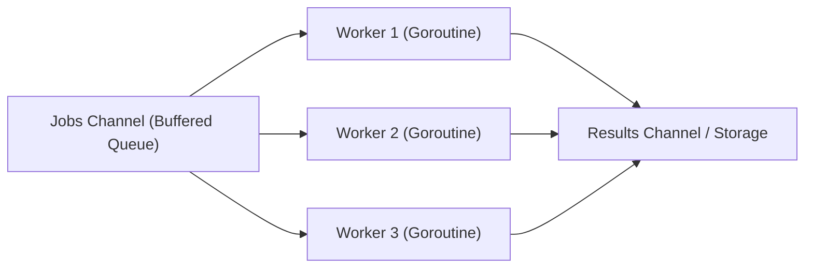

# PE Domain 9: Coding & Automation — Deep-Dive Study Guide

> [!IMPORTANT]
> **Interview Emphasis:** High (The Technical Gatekeeper)
>
> **Where it shows up:** Practical coding rounds (Mock 7), take-home projects, live debugging, and automation tasks.
>
> **What "strong" sounds like:** You don't just solve LeetCode algorithmic puzzles; you write **production systems code** in Go or Python. You demonstrate mastery of concurrency (channels, worker pools, contexts, mutexes), understand controller reconciliation loops, implement rate limiters (token bucket, sliding window), resolve DAG deployment dependencies (topological sort), write resilient HTTP clients with exponential backoff and jitter, and construct robust CLI tools.

---

## 1. Systems & Platform Coding: Go & Python Foundations

### 1.1 Concurrency Primitives in Go
Platform automation heavily favors **Go** due to its fast compilation, low memory footprint, and native concurrency model:
- **Goroutines:** Lightweight user-space threads managed by the Go runtime (starting at 2KB stack vs 2MB for OS threads).
- **Channels:** Typed conduits for synchronization and data transmission ("Do not communicate by sharing memory; instead, share memory by communicating").
  - *Unbuffered:* Synchronous rendezvous; sender blocks until receiver is ready.
  - *Buffered:* Asynchronous until capacity is full.
- **`sync.WaitGroup` & `sync.Mutex`:** Traditional synchronization primitives for coordinating thread completion and protecting shared state.
- **`context.Context`:** Propagates deadlines, cancellation signals, and request-scoped metadata across API boundaries.

### 1.2 Python for Platform Automation & Tooling
Python 3.12+ is the dominant choice for scripting, data pipelines, and CLI automation:
- **`asyncio`:** Single-threaded cooperative multitasking event loop; ideal for high-concurrency I/O operations (e.g., querying 500 Git repositories concurrently).
- **Type Annotations (`typing`):** Mandatory for enterprise scripts (`mypy` enforcement) to ensure reliability and self-documenting code.
- **Subprocess Management:** Using `subprocess.run(..., check=True, capture_output=True)` safely without shell injection vulnerabilities.

---

## 2. Kubernetes Client-Go & Controller Runtime

### 2.1 Anatomy of a Controller Reconcile Loop
All Kubernetes controllers (operators) follow a strict level-triggered reconciliation signature:
```go
type Reconciler interface {
    Reconcile(context.Context, reconcile.Request) (reconcile.Result, error)
}
```
- **Inputs:** `reconcile.Request` containing only the `NamespacedName` (`namespace/name`) of the object that changed.
- **Outputs:** `reconcile.Result`:
  - `Requeue: true`: Re-enqueues immediately.
  - `RequeueAfter: 30 * time.Second`: Re-enqueues after a specific delay.
  - `error != nil`: Re-enqueues with exponential backoff.
  - `Result{}, nil`: Reconcile successful; waits for next event.

---

## 3. Systems Concurrency: Worker Pool Pattern

### 3.1 The Bounded Worker Pool with Graceful Drain
Unbounded spawning of goroutines or threads under load (`go handle(req)`) crashes servers via memory exhaustion or file descriptor limits. A **Worker Pool** caps maximum concurrency.



#### Key Requirements:
1. Fixed number of worker goroutines ($N = \text{runtime.NumCPU()}$).
2. Graceful shutdown: on `SIGTERM`, close jobs channel, allow workers to complete in-flight tasks, and wait via `sync.WaitGroup`.

---

## 4. Rate Limiting Algorithms

| Algorithm | State Tracking | Burst Support? | Memory | Production Use Case |
| :--- | :--- | :---: | :---: | :--- |
| **Token Bucket** | Tokens available + Last update timestamp | **Yes** | $O(1)$ | API Gateways (Envoy, NGINX), AWS rate limits. |
| **Leaky Bucket** | Queue of requests | No (Fixed output rate) | $O(\text{Queue Size})$ | Smoothing traffic bursts before downstream databases. |
| **Fixed Window** | Counter per time window | No (Boundary bursts) | $O(1)$ | Basic per-minute rate limits (vulnerable to 2x boundary spikes). |
| **Sliding Window Log**| Sorted set of timestamps | No | $O(N)$ requests | High-accuracy fraud detection (high memory consumption). |
| **Sliding Window Counter**| Counter for current & previous window | Smooth approximation | $O(1)$ | Cloudflare, distributed Redis rate limiting. |

---

## 5. Graph Algorithms: Topological Sort

### 5.1 Resolving Deployment Dependencies
When deploying complex platforms consisting of multiple interdependent microservices or Terraform modules (e.g., Database must exist before Auth Service, Auth must exist before Gateway):
- Represent components as a **Directed Acyclic Graph (DAG)**.
- Execute **Topological Sort** (Kahn's Algorithm or Depth-First Search with cycle detection) to generate the linear execution order.
- If a cycle is detected (A -> B -> A), fail fast with an error.

---

## 6. Resilient HTTP Clients & Network I/O

A production HTTP client must never use `http.DefaultClient` in Go or naive `requests.get()` in Python without strict timeouts:
1. **Timeouts:** `DialTimeout` (connect), `TLSHandshakeTimeout`, `ResponseHeaderTimeout`, and total `Timeout`.
2. **Connection Pooling:** Reuse TCP connections via `MaxIdleConns` and `MaxIdleConnsPerHost` to avoid socket churn and `TIME_WAIT` storms.
3. **Retry Policy:** Retry only idempotent HTTP verbs (GET, PUT, DELETE) on 5xx errors or connection timeouts using **exponential backoff with full jitter**.

---

## 7. Staff-Level Systems Programming: Reconcilers, Workqueues & Fleet Automation

At the Staff Platform Engineer level, coding questions go far beyond standard algorithms: you are evaluated on your ability to design resilient, concurrent distributed systems primitives, custom Kubernetes controllers, and automated fleet-wide refactoring engines.

### 7.1 High-Performance Concurrent Rate Limiting: Redis Lua Sliding Window

In-memory rate limiters fail across distributed multi-pod ingress fleets. Staff candidates implement atomic, distributed rate limiting using Redis and Lua to prevent race conditions without heavy distributed locks.

```lua
-- sliding_window_rate_limiter.lua
-- KEYS[1]: Rate limit key (e.g., "ratelimit:tenant_123:api")
-- ARGV[1]: Current timestamp in milliseconds
-- ARGV[2]: Window size in milliseconds (e.g., 60000 for 1 minute)
-- ARGV[3]: Max allowed requests in window (e.g., 100)

local key = KEYS[1]
local now = tonumber(ARGV[1])
local window = tonumber(ARGV[2])
local limit = tonumber(ARGV[3])
local clear_before = now - window

-- 1. Remove expired timestamps outside the sliding window
redis.call('ZREMRANGEBYSCORE', key, 0, clear_before)

-- 2. Count current requests in the window
local current_requests = redis.call('ZCARD', key)

-- 3. Check if over limit
if current_requests < limit then
    -- Add unique request entry (timestamp as score and member)
    redis.call('ZADD', key, now, now .. '-' .. redis.call('INCR', key .. ':seq'))
    -- Set TTL to ensure Redis memory cleans up after idle period
    redis.call('PEXPIRE', key, window)
    return 1 -- Allowed
else
    return 0 -- Rejected (Rate limited)
end
```
*Why this is Staff level:* It runs inside Redis in a single atomic thread, avoiding race conditions and lock contention while providing a true sliding window rather than a fixed window that allows double-bursts at boundary edges.

---

### 7.2 Fleet-Wide Automated Refactoring Bots (Codemods)

When upgrading an internal SDK, deprecating a Kubernetes API version, or updating base Dockerfiles across 500 microservice repositories, manual developer tickets take 18 months and fail. Staff Engineers build **Automated Codemod Bots**:
1. Scan all GitHub/GitLab repositories using code search APIs.
2. Parse the AST (Abstract Syntax Tree) using tools like `ast-grep` or `tree-sitter`.
3. Apply programmatic refactoring transformations deterministically.
4. Run the target repository's CI test suite locally in Docker.
5. Open an automated pull request with detailed release notes, benchmark comparison, and auto-merge labels if tests pass.

---

## 8. Essential Systems Coding Bookshelf

1. **The Go Programming Language** by Alan Donovan and Brian Kernighan (Addison-Wesley, 2015). The master reference for idioms, data structures, and systems programming in Go.
2. **Concurrency in Go: Tools and Techniques for Developers** by Katherine Cox-Buday (O'Reilly, 2017). The definitive guide to pipelines, worker pools, context propagation, and race conditions.
3. **Designing Data-Intensive Applications** by Martin Kleppmann (O'Reilly, 2017 / 2nd Edition 2026). Foundational for understanding distributed data structures, batch processing, and consensus.
4. **Programming Kubernetes: Developing Cloud-Native Applications** by Michael Hausenblas and Stefan Schimanski (O'Reilly, 2019). The indispensable handbook for `client-go`, API machinery, and custom controller development.
