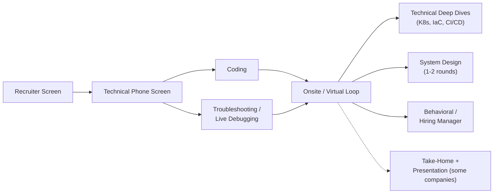
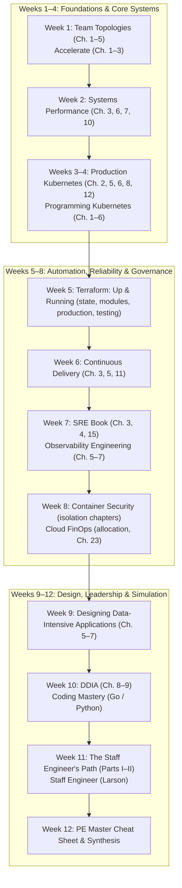

# Platform Engineering — Interview Preparation & Study Workspace

A comprehensive, self-contained study program and interview preparation master workspace designed to take an engineer to **Senior and Staff Platform Engineer** levels over a multi-year horizon: the 12-week plan below gets you hired, and the [Staff Track](Staff_Track/README.md) covers the three years after. It covers complete end-to-end platform architecture: platform product thinking, systems engineering, Linux & networking primitives, multi-tenant Kubernetes, infrastructure as code, GitOps delivery, observability/SRE, security governance & FinOps, systems design, automation coding, and executive technical leadership.

**Inventory:** 10 domains, each with a deep-dive study guide, 6 hands-on labs (design drills, coding problems or a workbook for Domains 8–10), 3 scenario quizzes (300 questions in total), and a 25-question interview bank with model answers (250 in total). On top of that: a 9-round mock interview loop with re-run variants, a master cheat sheet, and a three-year [Staff Track](Staff_Track/README.md).

> [!IMPORTANT]
> **How this differs from the certification folders:** certifications reward recall and speed; platform interviews reward *judgment*. For every topic, be ready to answer four follow-ups: **Why this design? What breaks first? How would you know? How does a developer experience it?** The study guides flag these with **Interview Angle** callouts, and the mock interviews drill them under time pressure.

---

## Staff SRE & Platform Engineering Production Hub

For senior and staff engineers targeting high-leverage roles, deep systems diagnostics, and executive technical leadership, reference these production resources:

| Production Resource | Focus & Deliverable | Primary Scope |
| :--- | :--- | :--- |
| **[Staff SRE Production Playbook](Staff_Track/Staff_SRE_Playbook.md)** | Linux memory/OOM triage, CFS CPU quota throttling, TCP socket buffers/BDP tuning, `bpftrace` eBPF one-liners, and Google SRE Multi-Window Multi-Burn-Rate (MWMBR) Prometheus alerting rules | Systems Performance & SRE |
| **[Incident War Room Postmortems](Incident_War_Room_Postmortems.md)** | 5 comprehensive SEV-1 production incident post-mortems (Conntrack table exhaustion, etcd disk fsync starvation, CFS CPU quota throttling, DB thundering herd retry storms, BGP asymmetric routing) | Incident Command & Reliability |
| **[Architecture Decision Records (ADRs)](Architecture_Decision_Records.md)** | 5 enterprise ADRs (Internal Developer Portal, Kubernetes Multi-Tenancy vCluster vs Mega-Clusters, Crossplane vs OpenTofu, Gateway API vs Istio vs Lattice, OpenTelemetry Tail-Based Sampling vs Direct Agent Ingestion) | Technical Strategy & Governance |
| **[Staff Track (3-Year Career Plan)](Staff_Track/README.md)** | Multi-team scope, evidence log, staff drills, distributed systems reading list, and quarterly reviews | Leadership & Career |
| **[Master Cheat Sheet](PE_Master_Cheat_Sheet.md)** | Consolidated quick-reference across all 10 domains, CLI commands, and architectural trade-offs | Rapid Review |

---

## The Platform Engineer Interview Loop

Loops vary by company, but most platform/infrastructure loops are built from the rounds below. Each round has a matching mock in [`Mock_Interviews/`](Mock_Interviews/README.md).



| Round | Typical Length | What Is Really Being Assessed | Practice With |
| :--- | :---: | :--- | :--- |
| Recruiter screen | 20–30 min | Motivation, background fit, level and logistics | [Domain 10](Domain_10_Behavioral_Career/Study_Guide.md) (90-second pitch) |
| Technical phone screen | 45–60 min | Breadth across Linux, networking, Kubernetes, IaC, CI/CD, observability — and whether you go deeper when probed | [Mock 1](Mock_Interviews/Mock_Interview_1_Phone_Screen.md) |
| Coding | 45–60 min | Practical problem solving in Python or Go, code quality, testing, communication | [Mock 7](Mock_Interviews/Mock_Interview_7_Coding.md) |
| Troubleshooting / live debugging | 45–60 min | Hypothesis-driven debugging, mitigation-first instinct, tool fluency, calm communication | [Mock 2](Mock_Interviews/Mock_Interview_2_Troubleshooting.md) |
| Technical deep dive(s) | 60 min | How far down you can go: Kubernetes internals, operators, multi-tenancy, IaC, GitOps, supply chain | [Mock 3](Mock_Interviews/Mock_Interview_3_Kubernetes_Deep_Dive.md), [Mock 4](Mock_Interviews/Mock_Interview_4_IaC_CICD_Deep_Dive.md) |
| System design | 60 min (often 2 rounds) | Platform architecture, trade-offs, multi-tenancy, blast radius, migration plans, developer experience | [Mock 5](Mock_Interviews/Mock_Interview_5_System_Design_IDP.md), [Mock 6](Mock_Interviews/Mock_Interview_6_System_Design_Infrastructure.md) |
| Behavioral / hiring manager | 45–60 min | Ownership, influence without authority, product mindset, conflict, failure, level signals | [Mock 8](Mock_Interviews/Mock_Interview_8_Behavioral_Hiring_Manager.md) |
| Take-home + presentation | 4–8 h + 45–60 min | Building and defending a small platform; scoping and documentation | [Mock 9](Mock_Interviews/Mock_Interview_9_Take_Home_Presentation.md) |

---

## Domains

| Domain | Interview Emphasis | Where It Shows Up | Core Topics |
| :--- | :---: | :--- | :--- |
| **[Domain 1: Platform Foundations & IDPs](Domain_1_Platform_Foundations_IDP/Study_Guide.md)** | **Very High** | Hiring manager, system design, behavioral | Platform as a product, Team Topologies, cognitive load, golden paths, IDP reference architecture, Backstage, DORA / SPACE / DevEx, CNCF maturity model, adoption and migrations |
| **[Domain 2: Linux, Networking & Systems](Domain_2_Linux_Networking_Fundamentals/Study_Guide.md)** | **Very High** | Phone screen, troubleshooting | Processes and signals, memory/OOM, CPU throttling, namespaces and cgroups, TCP states, DNS (ndots, conntrack), TLS, L4/L7 load balancing, the "curl an HTTPS URL" walkthrough |
| **[Domain 3: Kubernetes Platform Engineering](Domain_3_Kubernetes_Platform_Engineering/Study_Guide.md)** | **Very High** | Phone screen, deep dive, troubleshooting, design | API machinery, CRDs and CEL, operators, admission policy, multi-tenancy (namespaces vs vCluster vs clusters), fleets and upgrades, HPA / KEDA / Karpenter, Gateway API |
| **[Domain 4: Infrastructure as Code](Domain_4_Infrastructure_as_Code/Study_Guide.md)** | **High** | Deep dive, take-home, design | Terraform/OpenTofu state and refactoring, module design, `terraform test`, policy as code, PR-based workflows, Crossplane, landing zones |
| **[Domain 5: CI/CD, GitOps & Delivery](Domain_5_CICD_GitOps_Delivery/Study_Guide.md)** | **High** | Deep dive, design, take-home | CI at scale, caching, runner fleets, Argo CD / Flux, Helm and Kustomize, environment promotion, Argo Rollouts, supply-chain security (SLSA, Sigstore, SBOMs) |
| **[Domain 6: Observability & SRE](Domain_6_Observability_SRE/Study_Guide.md)** | **High** | Troubleshooting, design, behavioral (incidents) | Prometheus and PromQL, OpenTelemetry, logs and traces, SLOs and burn-rate alerts, incident management, postmortems, chaos engineering |
| **[Domain 7: Security, Governance & FinOps](Domain_7_Security_Governance_FinOps/Study_Guide.md)** | **High** | Deep dive, design | Workload identity, Vault and External Secrets, mTLS and service mesh, Kyverno/OPA guardrails, compliance automation, Kubernetes cost allocation and optimization |
| **[Domain 8: System Design](Domain_8_System_Design/Study_Guide.md)** | **Very High** | System design (the senior-vs-mid decider) | Design framework, estimation, control vs data planes, cells, static stability, worked designs (IDP, multi-tenant Kubernetes, CI/CD at scale) plus 6 design drills |
| **[Domain 9: Coding & Automation](Domain_9_Coding_Automation/Study_Guide.md)** | **High** (gatekeeper) | Coding, take-home | Python/Go/Bash for platform work, DS&A patterns, rate limiters, worker pools, reconcile loops, 8 problems with worked solutions |
| **[Domain 10: Behavioral & Career](Domain_10_Behavioral_Career/Study_Guide.md)** | **Very High** | Recruiter, hiring manager, behavioral | STAR+L, story bank, product sense, leveling signals, resume and portfolio, questions to ask, negotiation basics |

### Quick Navigation Matrix

| Domain | Study Guide | White Papers & Docs | Labs / Drills | Quiz 1 | Quiz 2 | Quiz 3 | Interview Bank |
| :--- | :--- | :--- | :--- | :--- | :--- | :--- | :--- |
| **1. Platform Foundations & IDPs** | [Study Guide](Domain_1_Platform_Foundations_IDP/Study_Guide.md) | [White Papers & Docs](Domain_1_Platform_Foundations_IDP/White_Papers.md) | [Labs](Domain_1_Platform_Foundations_IDP/Exercises.md) | [Quiz 1](Domain_1_Platform_Foundations_IDP/Quiz_1.md) | [Quiz 2](Domain_1_Platform_Foundations_IDP/Quiz_2.md) | [Quiz 3](Domain_1_Platform_Foundations_IDP/Quiz_3.md) | [25 Questions](Domain_1_Platform_Foundations_IDP/Interview_Questions.md) |
| **2. Linux, Networking & Systems** | [Study Guide](Domain_2_Linux_Networking_Fundamentals/Study_Guide.md) | [White Papers & Docs](Domain_2_Linux_Networking_Fundamentals/White_Papers.md) | [Labs](Domain_2_Linux_Networking_Fundamentals/Exercises.md) | [Quiz 1](Domain_2_Linux_Networking_Fundamentals/Quiz_1.md) | [Quiz 2](Domain_2_Linux_Networking_Fundamentals/Quiz_2.md) | [Quiz 3](Domain_2_Linux_Networking_Fundamentals/Quiz_3.md) | [25 Questions](Domain_2_Linux_Networking_Fundamentals/Interview_Questions.md) |
| **3. Kubernetes Platform Eng.** | [Study Guide](Domain_3_Kubernetes_Platform_Engineering/Study_Guide.md) | [White Papers & Docs](Domain_3_Kubernetes_Platform_Engineering/White_Papers.md) | [Labs](Domain_3_Kubernetes_Platform_Engineering/Exercises.md) | [Quiz 1](Domain_3_Kubernetes_Platform_Engineering/Quiz_1.md) | [Quiz 2](Domain_3_Kubernetes_Platform_Engineering/Quiz_2.md) | [Quiz 3](Domain_3_Kubernetes_Platform_Engineering/Quiz_3.md) | [25 Questions](Domain_3_Kubernetes_Platform_Engineering/Interview_Questions.md) |
| **4. Infrastructure as Code** | [Study Guide](Domain_4_Infrastructure_as_Code/Study_Guide.md) | [White Papers & Docs](Domain_4_Infrastructure_as_Code/White_Papers.md) | [Labs](Domain_4_Infrastructure_as_Code/Exercises.md) | [Quiz 1](Domain_4_Infrastructure_as_Code/Quiz_1.md) | [Quiz 2](Domain_4_Infrastructure_as_Code/Quiz_2.md) | [Quiz 3](Domain_4_Infrastructure_as_Code/Quiz_3.md) | [25 Questions](Domain_4_Infrastructure_as_Code/Interview_Questions.md) |
| **5. CI/CD, GitOps & Delivery** | [Study Guide](Domain_5_CICD_GitOps_Delivery/Study_Guide.md) | [White Papers & Docs](Domain_5_CICD_GitOps_Delivery/White_Papers.md) | [Labs](Domain_5_CICD_GitOps_Delivery/Exercises.md) | [Quiz 1](Domain_5_CICD_GitOps_Delivery/Quiz_1.md) | [Quiz 2](Domain_5_CICD_GitOps_Delivery/Quiz_2.md) | [Quiz 3](Domain_5_CICD_GitOps_Delivery/Quiz_3.md) | [25 Questions](Domain_5_CICD_GitOps_Delivery/Interview_Questions.md) |
| **6. Observability & SRE** | [Study Guide](Domain_6_Observability_SRE/Study_Guide.md) | [White Papers & Docs](Domain_6_Observability_SRE/White_Papers.md) | [Labs](Domain_6_Observability_SRE/Exercises.md) | [Quiz 1](Domain_6_Observability_SRE/Quiz_1.md) | [Quiz 2](Domain_6_Observability_SRE/Quiz_2.md) | [Quiz 3](Domain_6_Observability_SRE/Quiz_3.md) | [25 Questions](Domain_6_Observability_SRE/Interview_Questions.md) |
| **7. Security, Governance & FinOps** | [Study Guide](Domain_7_Security_Governance_FinOps/Study_Guide.md) | [White Papers & Docs](Domain_7_Security_Governance_FinOps/White_Papers.md) | [Labs](Domain_7_Security_Governance_FinOps/Exercises.md) | [Quiz 1](Domain_7_Security_Governance_FinOps/Quiz_1.md) | [Quiz 2](Domain_7_Security_Governance_FinOps/Quiz_2.md) | [Quiz 3](Domain_7_Security_Governance_FinOps/Quiz_3.md) | [25 Questions](Domain_7_Security_Governance_FinOps/Interview_Questions.md) |
| **8. System Design** | [Study Guide](Domain_8_System_Design/Study_Guide.md) | [White Papers & Docs](Domain_8_System_Design/White_Papers.md) | [Design Drills](Domain_8_System_Design/Exercises.md) | [Quiz 1](Domain_8_System_Design/Quiz_1.md) | [Quiz 2](Domain_8_System_Design/Quiz_2.md) | [Quiz 3](Domain_8_System_Design/Quiz_3.md) | [25 Questions](Domain_8_System_Design/Interview_Questions.md) |
| **9. Coding & Automation** | [Study Guide](Domain_9_Coding_Automation/Study_Guide.md) | [White Papers & Docs](Domain_9_Coding_Automation/White_Papers.md) | [Coding Problems](Domain_9_Coding_Automation/Exercises.md) | [Quiz 1](Domain_9_Coding_Automation/Quiz_1.md) | [Quiz 2](Domain_9_Coding_Automation/Quiz_2.md) | [Quiz 3](Domain_9_Coding_Automation/Quiz_3.md) | [25 Questions](Domain_9_Coding_Automation/Interview_Questions.md) |
| **10. Behavioral & Career** | [Study Guide](Domain_10_Behavioral_Career/Study_Guide.md) | [White Papers & Docs](Domain_10_Behavioral_Career/White_Papers.md) | [Workbook](Domain_10_Behavioral_Career/Exercises.md) | [Quiz 1](Domain_10_Behavioral_Career/Quiz_1.md) | [Quiz 2](Domain_10_Behavioral_Career/Quiz_2.md) | [Quiz 3](Domain_10_Behavioral_Career/Quiz_3.md) | [25 Questions](Domain_10_Behavioral_Career/Interview_Questions.md) |

### How to Use Each File Type

| File | How to Use It |
| :--- | :--- |
| `White_Papers.md` | Authoritative industry white papers, RFCs, kernel/CNCF standards, and official documentation to master alongside the Study Guide. |
| `Study_Guide.md` | Read actively. Stop at every **Interview Angle** callout and say the answer out loud before reading on. |
| `Exercises.md` | Build it, break it, fix it. The **Interview Talking Points** after each lab turn the work into stories you can tell. |
| `Quiz_1–3.md` | Answer in your own words before reading the options, then pick one, then open the hidden answer. Target **85%+**; re-take misses after 48 hours. The right option is often the longest one, so don't let length decide for you. |
| `Interview_Questions.md` | The core interview drill. Answer out loud in 2–3 minutes *before* opening the model answer, then practice the follow-ups. Record yourself at least once per domain. |

---

## Mock Interview Loop

Nine rounds that mirror a real loop. Each has an interviewer packet, a scoring rubric and at least two re-run variants. Run them with an AI interviewer (Claude or Gemini in this repo), a peer, or solo. See **[Mock_Interviews/README.md](Mock_Interviews/README.md)** for how to run them and **[Interviewer_Protocol.md](Mock_Interviews/Interviewer_Protocol.md)** for the interviewer rules.

| # | Round | Duration | Primary Prep |
| :---: | :--- | :---: | :--- |
| 1 | [Technical Phone Screen](Mock_Interviews/Mock_Interview_1_Phone_Screen.md) | 45 min | Domains 2, 3, 4, 5, 6 |
| 2 | [Live Troubleshooting](Mock_Interviews/Mock_Interview_2_Troubleshooting.md) | 60 min | Domains 2, 3, 6 |
| 3 | [Kubernetes & Platform Deep Dive](Mock_Interviews/Mock_Interview_3_Kubernetes_Deep_Dive.md) | 60 min | Domain 3 |
| 4 | [IaC, CI/CD & GitOps Deep Dive](Mock_Interviews/Mock_Interview_4_IaC_CICD_Deep_Dive.md) | 60 min | Domains 4, 5 |
| 5 | [System Design: Internal Developer Platform](Mock_Interviews/Mock_Interview_5_System_Design_IDP.md) | 60 min | Domains 1, 8 |
| 6 | [System Design: Infrastructure](Mock_Interviews/Mock_Interview_6_System_Design_Infrastructure.md) | 60 min | Domain 8 |
| 7 | [Coding](Mock_Interviews/Mock_Interview_7_Coding.md) | 60 min | Domain 9 |
| 8 | [Behavioral & Hiring Manager](Mock_Interviews/Mock_Interview_8_Behavioral_Hiring_Manager.md) | 45–60 min | Domains 1, 10 |
| 9 | [Take-Home & Presentation](Mock_Interviews/Mock_Interview_9_Take_Home_Presentation.md) | ~6 h + 45 min | Domains 1, 3, 4, 5, 6 |

Track every attempt in the **[Mock Interview Log](Mock_Interviews/Mock_Interview_Log.md)**.

---

## 12-Week Study Plan & Progress Tracker

**Daily habits (5 days a week, every week):**
- 30–45 minutes of coding: [Domain 9 problems](Domain_9_Coding_Automation/Exercises.md) first, then pattern practice (hash maps, heaps, graphs, sliding windows, intervals).
- 3 questions out loud from the current domain's `Interview_Questions.md`, timed at 2–3 minutes each.
- Weekly: add at least one story to your [story bank](Domain_10_Behavioral_Career/Exercises.md).

### Week 1: Baseline & Platform Foundations
- [ ] **Reading:** *Team Topologies* (Ch. 1–5: Conway's law, cognitive load and the four team types, plus Ch. 7: Team Interaction Modes) + *Accelerate* (Ch. 1–3)
- [ ] Take [Mock 1 (Phone Screen), Variant A](Mock_Interviews/Mock_Interview_1_Phone_Screen.md) **cold** as your baseline and log it. A low score is expected; it shows you where to focus.
- [ ] Read the [Domain 1 Study Guide](Domain_1_Platform_Foundations_IDP/Study_Guide.md) and complete the [Domain 1 labs](Domain_1_Platform_Foundations_IDP/Exercises.md)
- [ ] Score 85%+ on Domain 1 [Quiz 1](Domain_1_Platform_Foundations_IDP/Quiz_1.md), [Quiz 2](Domain_1_Platform_Foundations_IDP/Quiz_2.md), [Quiz 3](Domain_1_Platform_Foundations_IDP/Quiz_3.md)
- [ ] Draft 5 stories using [Domain 10 Workbook Exercise 1](Domain_10_Behavioral_Career/Exercises.md)

### Week 2: Linux, Networking & Systems
- [ ] **Reading:** *Systems Performance (2nd Ed.)* (Ch. 3 Operating Systems, Ch. 6 CPUs, Ch. 7 Memory, Ch. 10 Network)
- [ ] [Domain 2 Study Guide](Domain_2_Linux_Networking_Fundamentals/Study_Guide.md) + all 6 [labs](Domain_2_Linux_Networking_Fundamentals/Exercises.md)
- [ ] Score 85%+ on Domain 2 [Quiz 1](Domain_2_Linux_Networking_Fundamentals/Quiz_1.md), [Quiz 2](Domain_2_Linux_Networking_Fundamentals/Quiz_2.md), [Quiz 3](Domain_2_Linux_Networking_Fundamentals/Quiz_3.md)
- [ ] [Domain 2 Interview Bank](Domain_2_Linux_Networking_Fundamentals/Interview_Questions.md)

### Week 3: Kubernetes Architecture & API Machinery
- [ ] **Reading:** *Production Kubernetes* (Ch. 2 Deployment Models, Ch. 5 Pod Networking, Ch. 6 Service Routing, Ch. 8 Admission Control)
- [ ] [Domain 3 Study Guide](Domain_3_Kubernetes_Platform_Engineering/Study_Guide.md) (§1–5) + [Domain 3 labs](Domain_3_Kubernetes_Platform_Engineering/Exercises.md) 1–3
- [ ] Score 85%+ on Domain 3 [Quiz 1](Domain_3_Kubernetes_Platform_Engineering/Quiz_1.md)

### Week 4: Kubernetes Fleet Operations & Controllers
- [ ] **Reading:** *Programming Kubernetes* (Ch. 2 API Basics, Ch. 3 client-go, Ch. 4 Custom Resources, Ch. 6 Writing Operators)
- [ ] [Domain 3 Study Guide](Domain_3_Kubernetes_Platform_Engineering/Study_Guide.md) (§6–10) + [Domain 3 labs](Domain_3_Kubernetes_Platform_Engineering/Exercises.md) 4–6
- [ ] Score 85%+ on Domain 3 [Quiz 2](Domain_3_Kubernetes_Platform_Engineering/Quiz_2.md) and [Quiz 3](Domain_3_Kubernetes_Platform_Engineering/Quiz_3.md)
- [ ] [Domain 3 Interview Bank](Domain_3_Kubernetes_Platform_Engineering/Interview_Questions.md), all tiers
- [ ] End of week 4: [Mock 3 (Kubernetes Deep Dive), Variant A](Mock_Interviews/Mock_Interview_3_Kubernetes_Deep_Dive.md)

### Week 5: Infrastructure as Code
- [ ] **Reading:** *Terraform: Up & Running (3rd Ed.)* (Ch. 3 State, Ch. 4 Modules, then the production-grade code and testing chapters)
- [ ] [Domain 4 Study Guide](Domain_4_Infrastructure_as_Code/Study_Guide.md) + all 6 [labs](Domain_4_Infrastructure_as_Code/Exercises.md)
- [ ] Score 85%+ on Domain 4 [Quiz 1](Domain_4_Infrastructure_as_Code/Quiz_1.md), [Quiz 2](Domain_4_Infrastructure_as_Code/Quiz_2.md), [Quiz 3](Domain_4_Infrastructure_as_Code/Quiz_3.md)
- [ ] [Domain 4 Interview Bank](Domain_4_Infrastructure_as_Code/Interview_Questions.md)

### Week 6: CI/CD, GitOps & Delivery
- [ ] **Reading:** *Continuous Delivery* (Ch. 3 Continuous Integration, Ch. 5 Anatomy of the Deployment Pipeline, Ch. 11 Managing Infrastructure and Environments)
- [ ] [Domain 5 Study Guide](Domain_5_CICD_GitOps_Delivery/Study_Guide.md) + all 6 [labs](Domain_5_CICD_GitOps_Delivery/Exercises.md)
- [ ] Score 85%+ on Domain 5 [Quiz 1](Domain_5_CICD_GitOps_Delivery/Quiz_1.md), [Quiz 2](Domain_5_CICD_GitOps_Delivery/Quiz_2.md), [Quiz 3](Domain_5_CICD_GitOps_Delivery/Quiz_3.md)
- [ ] [Domain 5 Interview Bank](Domain_5_CICD_GitOps_Delivery/Interview_Questions.md)
- [ ] [Mock 4 (IaC, CI/CD & GitOps Deep Dive), Variant A](Mock_Interviews/Mock_Interview_4_IaC_CICD_Deep_Dive.md)

### Week 7: Observability & SRE
- [ ] **Reading:** *Site Reliability Engineering* (Ch. 3 Embracing Risk, Ch. 4 Service Level Objectives, Ch. 15 Postmortem Culture) + *Observability Engineering* (Ch. 5–7: structured events, traces, OpenTelemetry)
- [ ] [Domain 6 Study Guide](Domain_6_Observability_SRE/Study_Guide.md) + all 6 [labs](Domain_6_Observability_SRE/Exercises.md)
- [ ] Score 85%+ on Domain 6 [Quiz 1](Domain_6_Observability_SRE/Quiz_1.md), [Quiz 2](Domain_6_Observability_SRE/Quiz_2.md), [Quiz 3](Domain_6_Observability_SRE/Quiz_3.md)
- [ ] [Domain 6 Interview Bank](Domain_6_Observability_SRE/Interview_Questions.md)
- [ ] [Mock 2 (Live Troubleshooting), Variant A](Mock_Interviews/Mock_Interview_2_Troubleshooting.md)

### Week 8: Security, Governance & FinOps
- [ ] **Reading:** *Container Security* (the chapters on system calls and capabilities, control groups and container isolation) + *Cloud FinOps (2nd Ed.)* (the allocation chapters and Ch. 23, FinOps for the Container World)
- [ ] [Domain 7 Study Guide](Domain_7_Security_Governance_FinOps/Study_Guide.md) + all 6 [labs](Domain_7_Security_Governance_FinOps/Exercises.md)
- [ ] Score 85%+ on Domain 7 [Quiz 1](Domain_7_Security_Governance_FinOps/Quiz_1.md), [Quiz 2](Domain_7_Security_Governance_FinOps/Quiz_2.md), [Quiz 3](Domain_7_Security_Governance_FinOps/Quiz_3.md)
- [ ] [Domain 7 Interview Bank](Domain_7_Security_Governance_FinOps/Interview_Questions.md)
- [ ] Progress check: [Mock 1, Variant B](Mock_Interviews/Mock_Interview_1_Phone_Screen.md). Compare with your week 1 baseline.

### Week 9: System Design I
- [ ] **Reading:** *Designing Data-Intensive Applications*, 1st ed. (Ch. 5–7: Replication, Partitioning, Transactions)
- [ ] [Domain 8 Study Guide](Domain_8_System_Design/Study_Guide.md): framework, estimation, patterns and the three worked designs
- [ ] [Design Drills](Domain_8_System_Design/Exercises.md) 1–3 on a 45-minute timer, drawing before reading the model solution
- [ ] Score 85%+ on Domain 8 [Quiz 1](Domain_8_System_Design/Quiz_1.md), [Quiz 2](Domain_8_System_Design/Quiz_2.md), [Quiz 3](Domain_8_System_Design/Quiz_3.md)
- [ ] [Mock 5 (System Design: IDP), Variant A](Mock_Interviews/Mock_Interview_5_System_Design_IDP.md)

### Week 10: System Design II & Coding Intensive
- [ ] **Reading:** *Designing Data-Intensive Applications*, 1st ed. (Ch. 8–9: The Trouble with Distributed Systems, Consistency and Consensus)
- [ ] [Design Drills](Domain_8_System_Design/Exercises.md) 4–6 + [Domain 8 Interview Bank](Domain_8_System_Design/Interview_Questions.md)
- [ ] All 8 [Domain 9 coding problems](Domain_9_Coding_Automation/Exercises.md) re-solved from scratch, without notes
- [ ] Score 85%+ on Domain 9 [Quiz 1](Domain_9_Coding_Automation/Quiz_1.md), [Quiz 2](Domain_9_Coding_Automation/Quiz_2.md), [Quiz 3](Domain_9_Coding_Automation/Quiz_3.md)
- [ ] [Mock 6 (System Design: Infrastructure), Variant A](Mock_Interviews/Mock_Interview_6_System_Design_Infrastructure.md)
- [ ] [Mock 7 (Coding), Variant A](Mock_Interviews/Mock_Interview_7_Coding.md)

### Week 11: Behavioral, Career & Capstone
- [ ] **Reading:** *The Staff Engineer's Path* (Parts I–II: The Big Picture, Execution) + *Staff Engineer* (Will Larson)
- [ ] [Domain 10 Study Guide](Domain_10_Behavioral_Career/Study_Guide.md) + full [Workbook](Domain_10_Behavioral_Career/Exercises.md): 12–15 polished stories, pitch, resume rewrite
- [ ] Score 85%+ on Domain 10 [Quiz 1](Domain_10_Behavioral_Career/Quiz_1.md), [Quiz 2](Domain_10_Behavioral_Career/Quiz_2.md), [Quiz 3](Domain_10_Behavioral_Career/Quiz_3.md)
- [ ] Build the [Mock 9 take-home](Mock_Interviews/Mock_Interview_9_Take_Home_Presentation.md) and publish it on GitHub as your portfolio capstone
- [ ] [Mock 8 (Behavioral & Hiring Manager), Variant A](Mock_Interviews/Mock_Interview_8_Behavioral_Hiring_Manager.md)

### Week 12: Full-Loop Simulation & Polish
- [ ] **Onsite Day 1:** Mocks 1 → 7 → 2 → 8 (Variant C), with 15-minute breaks, all in one day
- [ ] **Onsite Day 2:** Mocks 3 → 5 → 6 → 4 (Variant B or C), plus the Mock 9 presentation
- [ ] Re-study every competency that scored below 3; re-take every quiz that scored below 85%
- [ ] Review the [PE Master Cheat Sheet](PE_Master_Cheat_Sheet.md) end to end
- [ ] Start applying once the readiness gates below are met. Interview first at companies that matter less to you, to warm up.

### After Week 12: The Staff Track

The 12 weeks get you the job. Growing a staff-level skill set by 2029 is a different kind of work, measured by evidence rather than quiz scores. See **[Staff_Track/README.md](Staff_Track/README.md)** for the three-year plan and **[Staff_Track/Evidence_Log.md](Staff_Track/Evidence_Log.md)** for the quarterly evidence log.

---

## Essential Bookshelf & Recommended Reading

Platform engineering interviews evaluate architectural maturity and judgment far beyond syntax recall. The following curated bookshelf represents the industry standard canon for platform architects, staff engineers, and cloud infrastructure leaders.

> [!NOTE]
> **Chapter numbers** were checked against publisher tables of contents in October 2026. Where a number couldn't be confirmed, the chapters are named by topic instead. Three of these books have newer editions with different numbering: *Team Topologies* (2nd ed., September 2025), *Designing Data-Intensive Applications* (2nd ed., with Chris Riccomini, 2026) and *Container Security* (2nd ed., October 2025). Numbers here refer to their first editions; with a newer edition, find the chapter by title.

### Tier 1: The Core Foundation (Read Cover-to-Cover)

| Book | Author(s) | Primary Domain | Why Platform Engineers Must Read It | Key Chapters |
| :--- | :--- | :---: | :--- | :--- |
| **Team Topologies** | Matthew Skelton & Manuel Pais | Domain 1 & 10 | The foundational organizational blueprint for platform engineering. Teaches cognitive load management, the 4 team types (Stream-aligned, Enabling, Complicated-subsystem, Platform), and the 3 interaction modes (Collaboration, X-as-a-Service, Facilitating). | Ch. 1–3 (Conway's Law, Team-First Thinking & Cognitive Load), Ch. 4 (Static Team Topologies), Ch. 5 (The Four Fundamental Team Topologies), Ch. 7 (Team Interaction Modes) |
| **Designing Data-Intensive Applications** | Martin Kleppmann | Domain 8 | The gold standard for distributed system design. Essential for answering questions on data consistency, replication lag, partitioning, transactions, and consensus protocols in cloud-native platforms. | Ch. 5 (Replication), Ch. 6 (Partitioning), Ch. 7 (Transactions), Ch. 9 (Consistency & Consensus) |
| **Production Kubernetes** | Josh Rosso, Rich Lander, Alex Brand, John Harris | Domain 3 & 8 | Written by VMware/Heptio engineers. Bridges the gap between basic container orchestration and enterprise multi-tenant fleet operations, cluster lifecycle, and ingress architecture. | Ch. 2 (Deployment Models), Ch. 5 (Pod Networking), Ch. 6 (Service Routing), Ch. 8 (Admission Control), Ch. 12 (Multitenancy), Ch. 17 (Platform Abstractions) |
| **Site Reliability Engineering** | Betsy Beyer, Chris Jones, Jennifer Petoff, Niall Murphy | Domain 6 | The Google SRE bible that defined modern production operations. Invaluable for mastering SLOs, SLIs, error budgets, blameless postmortems, and incident response structures. | Ch. 3 (Embracing Risk), Ch. 4 (Service Level Objectives), Ch. 7 (Evolution of Automation), Ch. 15 (Postmortem Culture) |
| **Continuous Delivery** | Jez Humble & David Farley | Domain 5 | The seminal work on automated deployment pipelines, trunk-based development, and configuration management. Provides the theoretical backing for modern GitOps. | Ch. 3 (Continuous Integration), Ch. 5 (Anatomy of the Deployment Pipeline), Ch. 10 (Deploying and Releasing Applications), Ch. 11 (Managing Infrastructure and Environments) |

---

### Tier 2: Deep Technical Mastery (Domain Specialization)

| Book | Author(s) | Primary Domain | Core Takeaways for Platform Interviews | Key Topics |
| :--- | :--- | :---: | :--- | :--- |
| **Systems Performance: Enterprise and the Cloud (2nd Ed.)** | Brendan Gregg | Domain 2 | The ultimate authority on Linux kernel performance, memory profiling, CPU scheduling, cgroups, eBPF, and network socket tuning. Essential for senior live troubleshooting rounds. | Ch. 3 (Operating Systems), Ch. 5 (Applications), Ch. 6 (CPUs), Ch. 7 (Memory), Ch. 10 (Network), Ch. 15 (BPF) |
| **Programming Kubernetes** | Michael Hausenblas & Stefan Schimanski | Domain 3 & 9 | The definitive guide to building Cloud-Native operators using `client-go`, custom controllers, Informer caches, and Custom Resource Definitions (CRDs). | Ch. 2 (Kubernetes API Basics), Ch. 3 (Basics of client-go), Ch. 4 (Using Custom Resources), Ch. 5 (Automating Code Generation), Ch. 6 (Solutions for Writing Operators) |
| **Terraform: Up & Running (3rd Ed.)** | Yevgeniy Brikman | Domain 4 | Practical, production-grade guide to declarative IaC, remote state locking, module design, refactoring without downtime (`moved` blocks), and native integration testing. | Ch. 3 (Terraform State), Ch. 4 (Reusable Modules), plus the chapters on production-grade code and testing |
| **Observability Engineering** | Charity Majors, Liz Fong-Jones, George Miranda | Domain 6 | Moves past legacy "metrics/logs/traces" silos into structured event-driven telemetry, high-cardinality debugging, and OpenTelemetry instrumentation pipelines. | Ch. 5 (Structured Events Are the Building Blocks of Observability), Ch. 6 (Stitching Events into Traces), Ch. 7 (Instrumentation with OpenTelemetry), plus the SLO chapters in Part III |
| **Container Security** | Liz Rice | Domain 7 | Demystifies Linux isolation mechanisms: cgroups, namespaces, seccomp, AppArmor, capabilities, rootless containers, and container runtime security. | System calls and capabilities, control groups, container isolation (namespaces), image security, runtime protection |
| **Cloud FinOps (2nd Ed.)** | J.R. Storment & Mike Fuller | Domain 7 | How to build cost allocation models, rightsizing and commitment strategies, and unit-cost metrics, and how FinOps applies to shared Kubernetes clusters. | The lifecycle and allocation chapters, rate and usage optimization, Ch. 21–22 (automation and metric-driven optimization), Ch. 23 (FinOps for the Container World) |

---

### Tier 3: Platform Leadership & Executive Influence

| Book | Author(s) | Primary Domain | Why It Matters for Senior/Staff Candidates | Key Focus Areas |
| :--- | :--- | :---: | :--- | :--- |
| **The Staff Engineer's Path** | Tanya Reilly | Domain 10 | The clearest map of what staff engineers actually do: seeing the big picture, leading big projects, and raising the level of the engineers around you. | Part I (The Big Picture), Part II (Execution), Part III (Leveling Up) |
| **Staff Engineer: Leadership Beyond the Management Track** | Will Larson | Domain 10 | The four staff archetypes (tech lead, architect, solver, right hand), what staff work looks like day to day, and how people got the title, plus interviews with staff-plus engineers. | Staff archetypes, operating at staff, getting the title where you are, the interviews |
| **Accelerate** | Nicole Forsgren, Jez Humble, Gene Kim | Domain 1 & 5 | Empirical research proving the direct statistical link between software delivery performance (the 4 DORA metrics) and business outcomes. Essential for building executive business cases for platform funding. | Ch. 2 (Measuring Performance), Ch. 3 (Measuring and Changing Culture), Ch. 4 (Technical Practices) |

---

### Suggested Reading Pace Across the 12-Week Plan



---

## Readiness Gates: When to Start Applying

| Gate | Target |
| :--- | :--- |
| Quizzes | All 30 quizzes at **85%+** |
| Interview banks | Tier 1 answered fluently in every domain; Tier 2 at 80%+; able to hold a 5-minute discussion on any Tier 3 question |
| Story bank | **12+ stories** in STAR+L form with real metrics, each rehearsed out loud |
| Mock interviews | **Hire** (average ≥ 3.0, no 1s) on all 9 rounds; **Strong Hire** on at least 3 |
| Portfolio | Capstone take-home public on GitHub, with a README, architecture diagram and ADRs |

---

## Local Lab Setup (Arch Linux)

**Already on this machine:** Docker 29 (running; your user is in the `docker` group), kubectl 1.37 (with built-in Kustomize 5.8), Helm 4.3, Terraform 1.15, Go 1.27, Python 3.14, jq, git, gh.

```bash
# Official repositories
sudo pacman -S --needed kind kustomize opentofu argocd k9s kubectx stern go-yq \
  cosign syft trivy vault tflint act

# AUR (yay or paru)
yay -S --needed flux-bin conftest k3d-bin vcluster-bin terraform-docs k6

# Not packaged for Arch: kyverno CLI and opa. Install them from upstream releases
# (see the lab prerequisites in Domains 3, 4 and 7).
```

> [!NOTE]
> **Backstage (Domain 1 labs) needs an active Node.js LTS release.** You have Node 26, which is not LTS. Install Node 24 LTS with `sudo pacman -S nodejs-lts-krypton` (this replaces the `nodejs` package), or use a version manager such as `fnm` to keep both.

**Base lab cluster** (individual labs say when they need something different):

```bash
cat > /tmp/kind-pe-lab.yaml <<'EOF'
kind: Cluster
apiVersion: kind.x-k8s.io/v1alpha4
name: pe-lab
nodes:
  - role: control-plane
  - role: worker
EOF
kind create cluster --config /tmp/kind-pe-lab.yaml
kubectl cluster-info --context kind-pe-lab
```

> [!WARNING]
> **Resource budget:** this laptop has 8 CPUs and 15 GB RAM. Run **one kind cluster at a time** and delete it between labs (`kind delete cluster --name pe-lab`). Heavy stacks such as kube-prometheus-stack, Argo CD with Argo Rollouts, and Vault fit fine on a 2-node cluster, but not all at once. Multi-cluster labs (fleet management, blue/green cluster upgrades) should use single-node clusters.

---

## Optional Credential: CNCF Platform Engineering Certifications

Interviews are won with skills and stories, not certificates. Still, since you already hold or have studied for CKA and CKS, CNCF's platform engineering credentials are the natural next step, and this workspace covers most of their scope. Per [cncf.io](https://www.cncf.io/training/certification/cnpe/) (checked October 2026):

- **CNPE — Certified Cloud Native Platform Engineer:** 120-minute performance-based exam (hands-on in a remote Linux desktop), $445 including one free retake.
- **CNPA — Certified Cloud Native Platform Engineering Associate:** multiple-choice exam, $250 including one free retake ([cncf.io/cnpa](https://www.cncf.io/training/certification/cnpa/)).

| CNPE Domain (Weight) | Covered Here |
| :--- | :--- |
| Platform Architecture and Infrastructure (15%) | Domains 3, 4, 8 |
| GitOps and Continuous Delivery (25%) | Domain 5 |
| Platform APIs and Self-Service Capabilities (25%) | Domain 1, plus CRDs/operators in Domain 3 and Crossplane in Domain 4 |
| Observability and Operations (20%) | Domain 6 |
| Security and Policy Enforcement (15%) | Domain 7 (Security, Governance & FinOps) |

| CNPA Domain (Weight) | Covered Here |
| :--- | :--- |
| Platform Engineering Core Fundamentals (36%) | Domains 1, 3 |
| Platform Observability, Security, and Conformance (20%) | Domains 6, 7 |
| Continuous Delivery & Platform Engineering (16%) | Domain 5 |
| Platform APIs and Provisioning Infrastructure (12%) | Domains 3, 4 |
| IDPs and Developer Experience (8%) | Domain 1 |
| Measuring your Platform (8%) | Domains 1, 6 |

---

## Golden Interview Rules

1. **Clarify before you solve.** In design and troubleshooting rounds, the first 3–5 minutes of questions decide the rest of the round.
2. **Lead with the answer, then the reasoning.** One-sentence answer first, then structure, then an example.
3. **Name the trade-off, every time.** "X, because Y, at the cost of Z, which is acceptable because..." is the sound of a senior engineer.
4. **Incidents: mitigate first, then find the root cause, then prevent recurrence.** Stop the bleeding (roll back, fail over, turn off the flag), then diagnose, then add the platform guardrail that stops it happening again.
5. **Developers are your customers.** Bring every design back to developer experience: self-service, golden paths, guardrails rather than gates, time to first deploy.
6. **Quantify.** "Cut onboarding from 3 weeks to 2 days for 40 teams" beats "improved onboarding."
7. **"I" in behavioral rounds, "we" for the team's results.** Interviewers are scoring *your* decisions.
8. **Think out loud** in coding and design. Silence is scored as nothing happening.
9. **Don't bluff.** "I haven't run that in production. Here's how I'd reason about it and verify it" earns more than a confident wrong answer.
10. **Manage the clock.** If you're 10 minutes into a 45-minute design and still listing requirements, move on.

---
