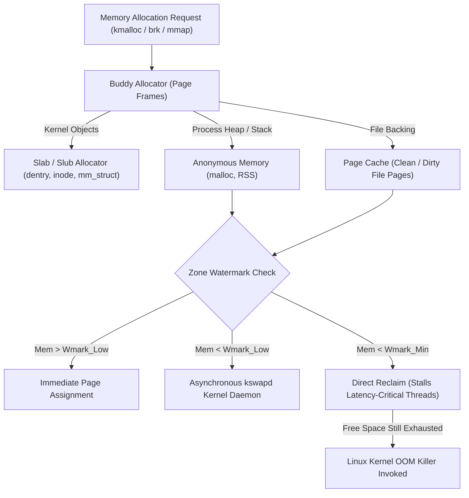
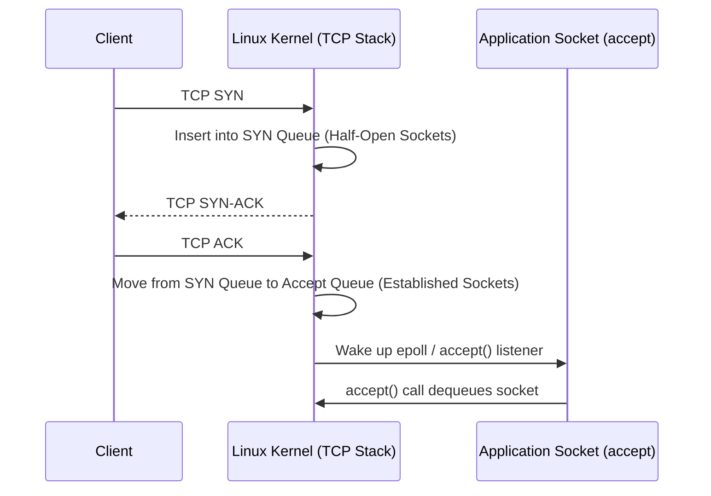
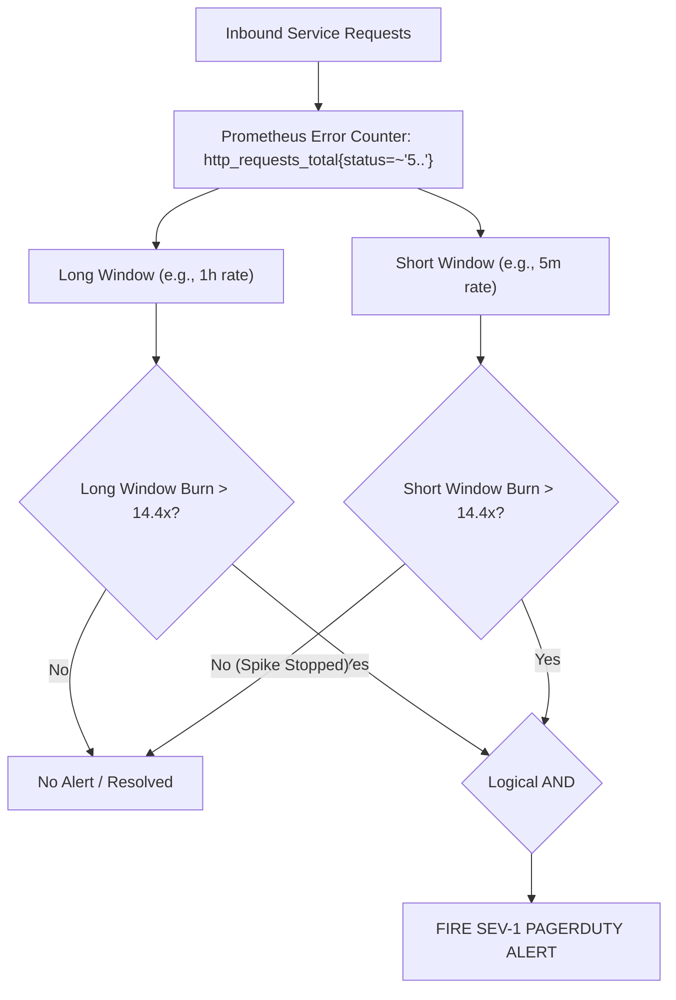

# Staff SRE Production Diagnostics & Systems Engineering Playbook

This playbook provides staff-level SRE and Platform Engineers with kernel-level diagnostic runbooks, systems performance mathematics, eBPF tracing recipes, and Google SRE Multi-Window Multi-Burn-Rate alerting formulas.

---

## 1. Linux Memory & OOM Subsystem Deep-Dive

### 1.1 Memory Allocation & Reclamation Architecture

The Linux kernel decomposes physical memory into zones (`ZONE_DMA`, `ZONE_DMA32`, `ZONE_NORMAL`). Allocation occurs via the buddy allocator (in $2^n$ order pages, standard 4KiB page size).



#### Page Cache vs. Anonymous Memory
- **Page Cache (`Active(file)` / `Inactive(file)`):** Backed by block devices. The kernel can evict clean file pages instantaneously with zero disk I/O. Dirty pages require flushing via `sync()` / `flusher` threads before eviction.
- **Anonymous Memory (`Active(anon)` / `Inactive(anon)`):** Process heap, stack, thread locals, and `mmap(MAP_ANONYMOUS)`. Anonymous memory **cannot be evicted** unless swap is active. If swap is disabled (`swapoff -a` in Kubernetes), anonymous pages are non-reclaimable memory.
- **Slab Allocation (`SReclaimable` vs `SUnreclaim`):** Kernel data structures (`dentry_cache`, `inode_cache`, `buffer_head`). `SReclaimable` can be freed under pressure; `SUnreclaim` cannot.

---

### 1.2 Cgroups v1 vs. Cgroups v2 Memory Accounting

| Characteristic | cgroups v1 (`/sys/fs/cgroup/memory/`) | cgroups v2 (`/sys/fs/cgroup/`) |
| :--- | :--- | :--- |
| **Hierarchy** | Multiple distinct orthogonal hierarchies per controller | Unified single hierarchy (`unified`) |
| **Limit Knobs** | `memory.limit_in_bytes`, `memory.memsw.limit_in_bytes` | `memory.max` (hard limit), `memory.high` (throttling limit), `memory.low` (protection) |
| **Reclamation Signaling** | Hard OOM kill immediately upon breaching `limit_in_bytes` | Soft reclaim triggered at `memory.high` before triggering `memory.max` hard OOM killer |
| **Group OOM Kill** | Individual thread/process killed inside container | `memory.oom.group = 1` kills all processes in container atomically |
| **Pressure Tracking** | Ad-hoc eventfd notifications | Native Pressure Stall Information (PSI) via `memory.pressure` |

---

### 1.3 Kernel OOM Killer Scoring & Heuristic Mathematics

When `kswapd` and direct reclaim fail to bring memory above `watermark[WMARK_MIN]`, `out_of_memory()` triggers.

The kernel assigns each process an `oom_score` (between 0 and 1000) calculated as:

$$\text{oom\_score} = \left( \frac{\text{RSS} + \text{swap\_usage} + \text{kernel\_pages}}{\text{total\_system\_pages}} \times 1000 \right) + \text{oom\_score\_adj}$$

- `oom_score_adj` ranges from $-1000$ (OOM kill disabled) to $+1000$ (kill first).
- Kubernetes Quality of Service (QoS) classes program `oom_score_adj`:
  - **Guaranteed:** `oom_score_adj = -997` (Protected, killed only after Burstable and BestEffort).
  - **Burstable:** $\max\left( \min\left( 1000 - \frac{1000 \times \text{request}}{\text{node\_capacity}}, 999 \right), 2 \right)$.
  - **BestEffort:** `oom_score_adj = 1000` (First to be terminated).

---

### 1.4 Pressure Stall Information (PSI)

PSI measures Wall-Clock execution delays caused by resource starvation:
- **`some`:** Percentage of time in which at least one task was stalled on the resource.
- **`full`:** Percentage of time in which *all non-idle tasks* were stalled simultaneously (complete system dead-time).

```bash
cat /proc/pressure/memory
# Output:
# some avg10=0.04 avg60=0.01 avg300=0.00 total=1240321
# full avg10=0.00 avg60=0.00 avg300=0.00 total=23412
```

> [!CRITICAL]
> If `some avg10` exceeds **15.00** or `full avg10` exceeds **5.00**, your workloads are undergoing direct page reclaim and disk I/O thrashing. Latency SLAs will breach before an OOM kill triggers.

---

### 1.5 Production Memory Triage Runbook

```bash
# 1. Check for OOM terminations across the kernel ring buffer
dmesg -T | grep -E -i "oom-killer|out of memory|killed process" -B 2 -A 5

# 2. Inspect host-wide memory distribution and slab
free -h -w
cat /proc/meminfo | grep -E "MemTotal|MemFree|MemAvailable|Active|Inactive|Slab|SReclaimable|SUnreclaim|Dirty"

# 3. Identify runaway kernel slab consumption (dentries / inodes from file descriptors)
slabtop -s c -o | head -n 25

# 4. Check Container-level cgroup v2 memory events (inside node or container)
cat /sys/fs/cgroup/system.slice/containerd.service/memory.events
# Key counters: low, high, max, oom, oom_kill, oom_group_kill

# 5. Extract top memory consumers sorted by proportional set size (PSS)
smem -r -k -p -t -n 15
```

---

## 2. Completely Fair Scheduler (CFS) CPU Quota & Latency Engineering

### 2.1 The CFS Quota Architecture

Kubernetes `resources.limits.cpu` is implemented via the Linux CFS bandwidth controller:
- `cpu.cfs_period_us`: Time enforcement window (default: $100000\mu\text{s} = 100\text{ms}$).
- `cpu.cfs_quota_us`: Total cumulative CPU execution time allocated across all threads in the cgroup during that period.

$$\text{Quota Ratio} = \frac{\text{cpu.cfs\_quota\_us}}{\text{cpu.cfs\_period\_us}} = \text{Kubernetes CPU cores}$$

```mermaid
sequenceDiagram
    autonumber
    participant App as 16-Thread Java/Go Pod
    participant CFS as Linux CFS Bandwidth Controller
    participant CPU as Host Physical Cores

    Note over App,CFS: Container Limit: 2 Cores (Quota = 200ms / 100ms Period)
    App->>CPU: 16 concurrent threads process burst of RPCs
    CPU-->>CFS: Cumulative CPU time accumulated across 16 cores
    Note over CFS: At t = 12.5ms: (16 threads * 12.5ms = 200ms)<br/>Quota Exhausted!
    CFS->>App: Hard Thread Deschedule / Throttle
    Note over App: Threads frozen for remaining 87.5ms of period!
    Note over CFS: Period timer resets at t = 100ms
    CFS->>App: Replenish 200ms quota; threads resume
```

### 2.2 The Multi-Threaded Quota Exhaustion Trap

Consider a Go runtime (`GOMAXPROCS=16`) or Java JVM configured on a host with 32 cores, but allocated a Kubernetes CPU limit of `2.0` (`quota = 200,000us`, `period = 100,000us`).
- When a traffic burst arrives, the runtime spawns 16 worker threads concurrently.
- The 16 threads run in parallel across 16 physical cores.
- **Quota Burn Time:**

$$t_{\text{exhaustion}} = \frac{200{,}000\,\mu\text{s}}{16 \text{ cores}} = 12{,}500\,\mu\text{s} = 12.5\text{ms}$$

- For the remaining **$87.5\text{ms}$** of the CFS period, all threads are descheduled and completely frozen.
- **Host CPU utilization may be under 15%**, yet p99 request latency degrades from $2\text{ms}$ to $>90\text{ms}$.

---

### 2.3 Diagnostic Commands for CPU Throttling

```bash
# 1. Inspect cgroup v2 CPU throttling counters
cat /sys/fs/cgroup/cpu.stat
# Output:
# usage_usec 241940123
# user_usec 190123122
# system_usec 51817001
# nr_periods 10240
# nr_throttled 3410          <-- Count of periods where throttling occurred
# throttled_usec 142109200   <-- Total microseconds threads were suspended

# 2. Compute throttling ratio
python3 -c "print(f'Throttled periods: {(3410 / 10240) * 100:.2f}%')"
# Result: 33.30% of scheduling periods were throttled!

# 3. Kernel PSI for CPU pressure
cat /proc/pressure/cpu
# some avg10=2.41 avg60=1.10 avg300=0.80 total=812903
```

### 2.4 Staff SRE Golden Rule: Sizing & Bursts
1. **Never set CPU limits on tier-1 latency-sensitive RPC microservices.** Use `requests` for scheduling and node bin-packing; allow workloads to burst into slack capacity.
2. **Set `cpu.cfs_burst_us`** on Kubernetes 1.25+ (`CPUCFSQuotaPeriod` feature gate) to allow pods to bank unused quota from previous quiet periods up to a configurable ceiling.
3. **Align Runtime Thread Pools:** In Go, set `GOMAXPROCS` explicitly to match CPU limits via `go.uber.org/automaxprocs`. In Java 17+, use `-XX:ActiveProcessorCount` to prevent thread explosion.

---

## 3. Linux Kernel Networking & Socket Subsystem Tuning

### 3.1 TCP Connection Lifecycles & Queue Architecture



#### Listen Queue Starvation:
- If the application event loop stalls, the **Accept Queue** fills up to `min(backlog, /proc/sys/net/core/somaxconn)`.
- When the Accept Queue is full:
  - If `net.ipv4.tcp_abort_on_overflow = 0` (default): The kernel silently drops client ACKs. The client retransmits SYN-ACK until timeout.
  - If `net.ipv4.tcp_abort_on_overflow = 1`: The kernel immediately sends a `TCP RST` packet to terminate the client connection.

---

### 3.2 Ephemeral Port Exhaustion & TIME_WAIT Management

High-throughput proxy tiers (Envoy, NGINX, Gateway API pods) connecting to downstream services can exhaust the client ephemeral port range:

$$\text{Usable Outbound Sockets per Target IP:Port} = \text{ip\_local\_port\_range} \approx 65535 - 32768 = 32767$$

- Sockets enter `TIME_WAIT` for $2 \times \text{MSL}$ (Maximum Segment Lifetime = 60 seconds) to ensure delayed packets in flight do not corrupt subsequent connections.
- **At 1,000 new outbound TCP connections/sec to a single backend IP:Port, 32,767 ephemeral ports are exhausted in 32.7 seconds.**

#### Kernel Tuning Recipe:
```bash
# Expand ephemeral port range
sysctl -w net.ipv4.ip_local_port_range="1024 65535"

# Allow reuse of TIME_WAIT sockets for outgoing connections when safe from protocol viewpoint
sysctl -w net.ipv4.tcp_tw_reuse=1

# NEVER enable tcp_tw_recycle (deprecated and breaks behind NAT/ALB gateways due to timestamp mismatches)
```

---

### 3.3 Bandwidth-Delay Product (BDP) & Socket Buffer Sizing

To maximize TCP throughput over long distances or high-bandwidth cloud VPC interconnects:

$$\text{BDP (bytes)} = \text{Bandwidth (bytes/sec)} \times \text{Round-Trip Time (sec)}$$

#### Example: 10 Gbps Direct Connect with 40ms RTT
$$\text{BDP} = \frac{10 \times 10^9 \text{ bits/sec}}{8 \text{ bits/byte}} \times 0.040 \text{ sec} = 1{,}250{,}000{,}000 \times 0.040 = 50{,}000{,}000 \text{ bytes} \approx 50 \text{ MB}$$

If TCP socket buffer limits (`tcp_rmem` / `tcp_wmem`) are capped at the Linux default of $4\text{MB}$, the maximum achievable throughput is constrained by the TCP sliding window:

$$\text{Max Throughput} = \frac{\text{TCP Window Size}}{\text{RTT}} = \frac{4{,}194{,}304 \text{ bytes}}{0.040 \text{ sec}} = 104{,}857{,}600 \text{ B/s} \approx 838 \text{ Mbps}$$

*You achieve less than 8.5% of your 10 Gbps physical link capacity.*

#### Production BDP Sysctl Blueprint:
```bash
# Set maximum OS receive and send buffer sizes across all protocols
sysctl -w net.core.rmem_max=67108864
sysctl -w net.core.wmem_max=67108864

# Set TCP autotuning limits: <MIN> <DEFAULT> <MAX>
# Defaults: 4KiB min, 87KiB default, 64MiB max
sysctl -w net.ipv4.tcp_rmem="4096 87380 67108864"
sysctl -w net.ipv4.tcp_wmem="4096 65536 67108864"

# Increase maximum backlog queues
sysctl -w net.core.somaxconn=16384
sysctl -w net.ipv4.tcp_max_syn_backlog=16384
```

---

### 3.4 SoftIRQ & Network Driver Ring Saturation

Network packets trigger hardware interrupts (NIC) $\to$ Top-half ISR schedules SoftIRQ (`NET_RX_SOFTIRQ`) $\to$ Processed by `ksoftirqd/x` CPU threads via NAPI polling loop.

```bash
# 1. Check SoftIRQ distribution across physical CPU cores
cat /proc/softirqs | grep NET_RX

# 2. Inspect NIC ring buffer sizes and frame drops
ethtool -g eth0
ethtool -S eth0 | grep -E "drop|miss|error|fifo"

# 3. Increase NIC RX/TX ring buffer descriptors to hardware ceiling
ethtool -G eth0 rx 4096 tx 4096

# 4. Check network backlog queue drops from /proc/net/softnet_stat
cat /proc/net/softnet_stat
# Column 1: packet count
# Column 2: packets dropped due to netdev_max_backlog exhaustion
# Column 3: times ksoftirqd ran out of its netdev_budget quota
```

---

## 4. Production eBPF Profiling & Tracing Recipes

eBPF executes sandboxed bytecode in the Linux kernel in response to kernel tracepoints, kprobes, and uprobes with sub-microsecond overhead.

### 4.1 Essential `bpftrace` Diagnostic One-Liners

#### 1. Real-time Block I/O Latency Histogram (Disk Contention)
Traces the latency distribution between block request submission and physical device completion:

```bash
bpftrace -e '
kprobe:blk_account_io_start { @start[arg0] = nsecs; }
kprobe:blk_account_io_done /@start[arg0]/ {
    @usecs = hist((nsecs - @start[arg0]) / 1000);
    delete(@start[arg0]);
}
END { clear(@start); }'
```

#### 2. Detect TCP Retransmissions with IP & Port Identification
Identifies exact microservices suffering network packet loss and connection retransmits:

```bash
bpftrace -e '
#include <net/sock.h>
tracepoint:tcp:tcp_retransmit_skb {
    $sk = (struct sock *)args->skaddr;
    $daddr = ntop(args->daddr);
    $saddr = ntop(args->saddr);
    printf("TIME: %s | TCP RETRANSMIT | %s:%d -> %s:%d | state: %d\n",
        time("%H:%M:%S"), $saddr, args->sport, $daddr, args->dport, $sk->__sk_common.skc_state);
}'
```

#### 3. CPU Run-Queue Latency (`runqlat`)
Measures the duration runnable threads spend waiting on the run queue before being scheduled onto a CPU:

```bash
bpftrace -e '
tracepoint:sched:sched_wakeup,
tracepoint:sched:sched_wakeup_new {
    @qtime[args->pid] = nsecs;
}
tracepoint:sched:sched_switch {
    if (@qtime[args->next_pid]) {
        @latency_us = hist((nsecs - @qtime[args->next_pid]) / 1000);
        delete(@qtime[args->next_pid]);
    }
}
END { clear(@qtime); }'
```

#### 4. Trace Longest System Calls by PID and Process Name
Identifies which system calls (e.g., `futex`, `epoll_wait`, `read`, `write`) block for longer than $10\text{ms}$:

```bash
bpftrace -e '
tracepoint:raw_syscalls:sys_enter {
    @start[tid] = nsecs;
    @sys[tid] = args->id;
}
tracepoint:raw_syscalls:sys_exit /@start[tid]/ {
    $dur = (nsecs - @start[tid]) / 1000000;
    if ($dur > 10) {
        printf("COMM: %-16s PID: %-6d SYSCALL: %-4d DURATION: %d ms\n",
            comm, pid, @sys[tid], $dur);
    }
    delete(@start[tid]);
    delete(@sys[tid]);
}'
```

---

### 4.2 On-CPU vs. Off-CPU FlameGraph Generation

- **On-CPU Sampling:** Where threads spend cycles executing instructions.
- **Off-CPU Sampling:** Where threads spend wall-clock time blocked on locks, I/O, paging, and kernel context switches.

```bash
# --- On-CPU Profiling ---
# Sample all CPUs at 99Hz for 30 seconds
perf record -F 99 -a -g -- sleep 30
perf script > out.perf
stackcollapse-perf.pl out.perf > out.folded
flamegraph.pl out.folded > on_cpu_flamegraph.svg

# --- Off-CPU Profiling with eBPF ---
# Measures time blocked waiting for scheduler
/usr/share/bcc/tools/offcputime -df 30 > out.offcpu
flamegraph.pl --color=io out.offcpu > off_cpu_flamegraph.svg
```

---

## 5. Multi-Window Multi-Burn-Rate (MWMBR) Alerting Engine

### 5.1 Mathematical Foundation of Error Budget Burn Rates

Let:
- $SLO$ be the service level objective target (e.g., $99.9\% \implies 0.999$).
- $U$ be the acceptable error budget fraction: $U = 1 - SLO = 0.001$ ($0.1\%$).
- $P$ be the rolling measurement period (e.g., $30\text{ days} = 720\text{ hours}$).
- $B$ be the burn rate factor: $B = 1.0$ consumes $100\%$ of the budget over exactly period $P$.

The time to completely consume the entire error budget at burn rate $B$ is:

$$T_{\text{exhaustion}} = \frac{P}{B}$$

$$\text{Fraction of Budget Consumed in Duration } t = \frac{B \times t}{P}$$

---

### 5.2 Google SRE Standard Alerting Matrix

| Severity | Alert Action | Budget Consumed | Burn Rate ($B$) | Long Window ($L_w$) | Short Window ($S_w$) | Time to 100% Budget Exhaustion |
| :--- | :--- | :---: | :---: | :---: | :---: | :---: |
| **Sev-1** | PagerDuty (Immediate) | $2.0\%$ | **$14.4\times$** | $1\text{ hour}$ | $5\text{ minutes}$ | $50\text{ hours}$ ($\approx 2\text{ days}$) |
| **Sev-2** | PagerDuty (Immediate) | $5.0\%$ | **$6.0\times$** | $6\text{ hours}$ | $30\text{ minutes}$ | $120\text{ hours}$ ($5\text{ days}$) |
| **Sev-3** | Jira Ticket (Next Biz Day)| $10.0\%$ | **$3.0\times$** | $3\text{ days}$ | $6\text{ hours}$ | $10\text{ days}$ |
| **Sev-4** | Jira Ticket (Next Biz Day)| $10.0\%$ | **$1.0\times$** | $3\text{ days}$ | $6\text{ hours}$ | $30\text{ days}$ |



> [!NOTE]
> **Why Short Windows Are Essential:**
> Without the short window, an alert fired during a 10-minute outage would continue paging the on-call engineer for the remainder of the 1-hour window long after the system fully recovered. The short window enforces rapid alert reset when the incident ceases.

---

### 5.3 Production Prometheus Alerting Rules (MWMBR Blueprint)

```yaml
groups:
  - name: production_api_slo_alerts
    rules:
      # -------------------------------------------------------------
      # Sev-1 Alert: 14.4x Burn Rate (Burns 2% of budget in 1 hour)
      # -------------------------------------------------------------
      - alert: CheckoutAPISevereErrorBudgetBurnSev1
        expr: |
          (
            sum(rate(http_requests_total{job="checkout-api", status=~"5.."}[1h]))
            /
            sum(rate(http_requests_total{job="checkout-api"}[1h]))
          ) > (14.4 * (1 - 0.999))
          and
          (
            sum(rate(http_requests_total{job="checkout-api", status=~"5.."}[5m]))
            /
            sum(rate(http_requests_total{job="checkout-api"}[5m]))
          ) > (14.4 * (1 - 0.999))
        for: 2m
        labels:
          severity: critical
          tier: platform
          paging: pagerduty
        annotations:
          summary: "Checkout API burning >14.4x 30-day error budget across 1h and 5m windows"
          description: "Current error rate exceeds 1.44%. At this rate, the entire monthly error budget will be exhausted within 50 hours."
          runbook_url: "https://wiki.internal/ops/checkout-api-degradation"

      # -------------------------------------------------------------
      # Sev-2 Alert: 6x Burn Rate (Burns 5% of budget in 6 hours)
      # -------------------------------------------------------------
      - alert: CheckoutAPIHighErrorBudgetBurnSev2
        expr: |
          (
            sum(rate(http_requests_total{job="checkout-api", status=~"5.."}[6h]))
            /
            sum(rate(http_requests_total{job="checkout-api"}[6h]))
          ) > (6.0 * (1 - 0.999))
          and
          (
            sum(rate(http_requests_total{job="checkout-api", status=~"5.."}[30m]))
            /
            sum(rate(http_requests_total{job="checkout-api"}[30m]))
          ) > (6.0 * (1 - 0.999))
        for: 5m
        labels:
          severity: warning
          tier: platform
          paging: pagerduty
        annotations:
          summary: "Checkout API burning >6x 30-day error budget across 6h and 30m windows"
          description: "Current error rate exceeds 0.6%. At this rate, the monthly error budget will be exhausted within 5 days."
          runbook_url: "https://wiki.internal/ops/checkout-api-degradation"
```

---

## 6. Staff Engineer Production Incident Command Checklist

When commanding a SEV-1 outage across multiple engineering teams, execute this protocol:

1. **Establish Single Source of Truth:**
   - Designate one Incident Commander (IC), one Communications Lead, and one Operations/Scribe Lead.
   - Lock the incident Slack bridge: only the IC, Tech Lead, and Ops Lead have speaking rights; spectators listen.
2. **Mitigate First, Post-Mortem Later:**
   - **Do not root-cause in the critical path of mitigation.**
   - Roll back recent deployments $\to$ Shed non-essential load $\to$ Failover traffic to healthy AZ/region $\to$ Scale pods/replicas $\to$ Restart unhealthy subsystems.
3. **Preserve Volatile Diagnostic State Prior to Termination:**
   - Before killing/restarting a node or container:
     ```bash
     # Dump core/threads
     gcore -o /tmp/coredump.<pid> <pid>
     # Dump thread stacks
     pstack <pid> > /tmp/pstack.<pid>.txt
     # Capture socket states
     ss -tapen > /tmp/sockets.txt
     ```
4. **Enforce Blameless Post-Mortem Rigor:**
   - Identify system design vulnerabilities, lack of guardrails, and detection gaps rather than human operator error.
   - Every Sev-1 post-mortem must output prioritized engineering tickets with an assigned staff-level sponsor.
