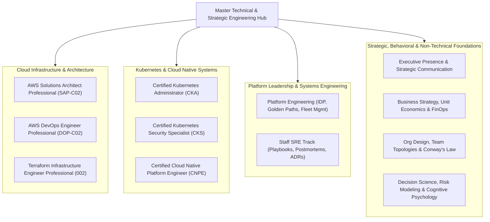

# Master Technical & Strategic Engineering Curriculum

Welcome to the comprehensive, production-grade repository for mastering Staff SRE, Cloud Native Platform Engineering, Advanced Cloud Certifications, and Multi-Disciplinary Technical Leadership. 

While built with terminal-first rigor, real-world failure mode simulations, architectural white papers, performance labs, and full-length scenario exams, this knowledge base spans beyond pure cloud infrastructure. It bridges hard technical systems engineering with the non-technical, strategic, behavioral, and organizational disciplines required to operate at Staff, Principal, and executive leadership levels.

---

## Workspace Navigation & Domain Matrix

---

## Technical Track Overviews & Direct Links

### 1. [Certified Cloud Native Platform Engineer (CNPE)](./Certified_Cloud_Native_Platform_Engineer/README.md)
- **Exam Profile:** 100% Performance-Based Terminal Exam (2 Hours).
- **Core Technology Stack:** Kubernetes v1.31+, Argo CD v2.12+, Argo Rollouts, Crossplane v1.16+, Backstage IDP, OpenTelemetry Collector, Prometheus Operator, Kyverno v1.12+, External Secrets Operator (ESO), KEDA v2.15+, Karpenter v1.0+, Gateway API, Cilium eBPF, vCluster.
- **Key Resources:**
  - [CNPE Master Cheat Sheet](./Certified_Cloud_Native_Platform_Engineer/CNPE_Master_Cheat_Sheet.md)
  - [DigitalOcean Droplet Lab Bootstrap Guide](./Certified_Cloud_Native_Platform_Engineer/DigitalOcean_Droplet_Lab_Guide.md)
  - [Domain 1: GitOps & Continuous Delivery (25%)](./Certified_Cloud_Native_Platform_Engineer/Domain_1_GitOps_Continuous_Delivery/Study_Guide.md)
  - [Domain 2: Self-Service Platform APIs & Automation (25%)](./Certified_Cloud_Native_Platform_Engineer/Domain_2_Self_Service_APIs_Automation/Study_Guide.md)
  - [Domain 3: Observability & Operations (20%)](./Certified_Cloud_Native_Platform_Engineer/Domain_3_Observability_Operations/Study_Guide.md)
  - [Domain 4: Platform Architecture & Scalability (15%)](./Certified_Cloud_Native_Platform_Engineer/Domain_4_Platform_Architecture_Scalability/Study_Guide.md)
  - [Domain 5: Security, Governance & Policy Enforcement (15%)](./Certified_Cloud_Native_Platform_Engineer/Domain_5_Security_Governance_Policy/Study_Guide.md)
  - [Full-Length Practice Exams Suite (5 Complete Performance Exams)](./Certified_Cloud_Native_Platform_Engineer/Practice_Exams/README.md)

---

### 2. [Terraform Infrastructure Engineer Professional (002)](./Terraform_Infrastructure_Engineer_Professional/README.md)
- **Exam Profile:** Comprehensive scenario exam launching at IBM TechXchange 2026 in Atlanta.
- **Key Resources:**
  - [Terraform Master Cheat Sheet](./Terraform_Infrastructure_Engineer_Professional/Terraform_Master_Cheat_Sheet.md)
  - [Domain 1: Scalable Configuration Design](./Terraform_Infrastructure_Engineer_Professional/Domain_1_Scalable_Configuration_Design/Study_Guide.md)
  - [Domain 2: State & Backend Operations](./Terraform_Infrastructure_Engineer_Professional/Domain_2_State_Backend_Operations/Study_Guide.md)
  - [Domain 3: Lifecycle Operations](./Terraform_Infrastructure_Engineer_Professional/Domain_3_Lifecycle_Operations/Study_Guide.md)
  - [Domain 4: CI/CD & Automation Workflows](./Terraform_Infrastructure_Engineer_Professional/Domain_4_CICD_Automation_Workflows/Study_Guide.md)
  - [Domain 5: Security, Governance & Compliance](./Terraform_Infrastructure_Engineer_Professional/Domain_5_Security_Governance/Study_Guide.md)
  - [Domain 6: Advanced Modules & Testing Frameworks](./Terraform_Infrastructure_Engineer_Professional/Domain_6_Advanced_Modules_Testing/Study_Guide.md)
  - [Domain 7: HCP Terraform & Terraform Enterprise](./Terraform_Infrastructure_Engineer_Professional/Domain_7_HCP_Terraform_Enterprise/Study_Guide.md)
  - [Full-Length Practice Exams Suite (4 Comprehensive Exams)](./Terraform_Infrastructure_Engineer_Professional/Practice_Exams/README.md)

---

### 3. [Certified Kubernetes Administrator (CKA)](./Certified_Kubernetes_Administrator/README.md)
- **Exam Profile:** 100% Performance-based CLI Exam (2 Hours).
- **Core Coverage:** Cluster Architecture, Installation & Configuration, Workloads & Scheduling, Services & Networking, Storage, and Troubleshooting.
- **Lab Infrastructure:** Fully integrated with DigitalOcean Droplets multi-node architecture (VPC private networking on `eth1`).
- **Full-Length Practice Suite:** [5 Complete Performance Exams](./Certified_Kubernetes_Administrator/Practice_Exams/README.md) (85 real-world cluster tasks).

---

### 4. [Certified Kubernetes Security Specialist (CKS)](./Certified_Kubernetes_Security_Specialist/README.md)
- **Exam Profile:** 100% Performance-based Security Hardening Exam (2 Hours).
- **Core Coverage:** Cluster Setup (NetworkPolicies, CIS Benchmarks, etcd encryption), Cluster Hardening (RBAC, PSA/PSS), System Hardening (AppArmor, Seccomp), Supply Chain Security (Image vulnerability scanning, Cosign), Monitoring & Logging (Falco, audit logs, Tetragon eBPF).
- **Lab Infrastructure:** Fully integrated with DigitalOcean Droplets multi-node architecture (`cks-cp1`, `cks-worker1`, `cks-worker2`).
- **Full-Length Practice Suite:** [5 Complete Performance Exams](./Certified_Kubernetes_Security_Specialist/Practice_Exams/README.md) (80 real-world security tasks).

---

### 5. [Platform Engineering & Staff SRE Master Curriculum](./Platform_Engineering/README.md)
- **Target Role:** Staff SRE / Staff Platform Engineer / Principal Cloud Architect.
- **Core Coverage:** Internal Developer Platforms (Backstage, Port), Golden Paths, Multi-cluster Fleet Management, Service Meshes (Cilium, Istio), Advanced GitOps, FinOps, SLO/Error Budget Engineering.
- **Staff Artifacts & War Rooms:**
  - [Staff SRE Production Playbook](./Platform_Engineering/Staff_Track/Staff_SRE_Playbook.md)
  - [Incident War Room Postmortems (7 SEV-1 Outages Analyzed)](./Platform_Engineering/Incident_War_Room_Postmortems.md)
  - [Enterprise Architecture Decision Records (7 Production ADRs)](./Platform_Engineering/Architecture_Decision_Records.md)
  - [Staff Career Track & Evidence Log](./Platform_Engineering/Staff_Track/README.md)

---

### 6. [AWS Certified Solutions Architect Professional (SAP-C02)](./AWS_Solutions_Architect_Professional/README.md)
- **Exam Profile:** High-scale enterprise multi-account architectures, hybrid cloud, disaster recovery, migration strategies, and complex networking.
- **Full-Length Practice Suite:** [6 Complete Scenario Practice Exams](./AWS_Solutions_Architect_Professional/Practice_Exams/README.md) (120 multi-paragraph scenario questions with full distractor analysis).

---

### 7. [AWS Certified DevOps Engineer Professional (DOP-C02)](./AWS_DevOps_Professional/README.md)
- **Exam Profile:** SDLC automation, configuration management, infrastructure-as-code, monitoring and event management, policies and standards automation, incident and event response.
- **Full-Length Practice Suite:** [6 Complete Scenario Practice Exams](./AWS_DevOps_Professional/Practice_Exams/Practice_Exam_1.md) (150 scenario questions).

---

## Multi-Disciplinary & Non-Technical Foundations (Evolution & Roadmap)

Mastering technology is only half the equation for top-tier engineers. Impact at the Staff, Principal, and executive level is dictated by what changes across the organization because of you: problems framed before anyone else saw them, decisions adopted by teams you do not manage, and alignment forged between engineering and executive business objectives.

This repository is continuously expanding to encompass the following non-technical and strategic pillars:

### Pillar 1: Executive Communication & Influence Without Authority
- **Technical Writing as an Operational Lever:** Writing Architecture Decision Records (ADRs), Request for Comments (RFCs), and 1-pagers that persuade executives and align cross-functional teams without meetings.
- **Blameless Incident Leadership:** Guiding high-stress SEV-1 incident war rooms, de-escalating panic, communicating business impact to executives, and facilitating blameless post-mortems that drive genuine systemic change.
- **Foundations in Repo:** [Staff SRE Production Playbook](./Platform_Engineering/Staff_Track/Staff_SRE_Playbook.md), [Incident War Room Postmortems](./Platform_Engineering/Incident_War_Room_Postmortems.md), and [Domain 10: Behavioral & Career Strategy](./Platform_Engineering/Domain_10_Behavioral_Career/Study_Guide.md).

### Pillar 2: Business Acumen, Unit Economics & Cloud FinOps
- **Engineering as an Economic Engine:** Translating latency, availability, and developer lead time into top-line revenue, customer retention, and COGS (Cost of Goods Sold).
- **Cloud Financial Management:** Designing allocation models, unit cost metrics (cost per transaction/order), reservation/Savings Plans hedging strategies, and engineering incentives to eliminate waste.
- **Foundations in Repo:** [Platform Engineering Domain 7: FinOps & Governance](./Platform_Engineering/Domain_7_Security_Governance_FinOps/Study_Guide.md).

### Pillar 3: Organizational Design, Conway's Law & Team Topologies
- **Conway's Law & Reverse Conway Maneuvers:** Structuring platform interfaces and boundaries to reflect the desired software architecture rather than organizational silos.
- **Cognitive Load Optimization:** Treating the platform as a product to minimize extraneous cognitive load on stream-aligned product engineering teams.
- **Interaction Modes:** Transitioning from ticket-based fulfillment to self-service enablement, facilitating, and X-as-a-Service collaboration.
- **Foundations in Repo:** [Platform Engineering Domain 1: Platform Foundations & IDP](./Platform_Engineering/Domain_1_Platform_Foundations_IDP/Study_Guide.md).

### Pillar 4: Decision Science, Risk Modeling & Systems Thinking
- **Type 1 vs. Type 2 Decisions:** Differentiating between reversible two-way doors and irreversible one-way doors; preventing analysis paralysis on low-risk decisions while establishing rigorous evaluation frameworks for foundational choices.
- **Second-Order Thinking:** Anticiptating emergent behavior in distributed human and technical systems (e.g. feedback loops, retry storms, local optimization creating global bottlenecks).
- **Probabilistic Risk Assessment:** Moving past binary "is it safe?" thinking to statistical risk modeling, error budget policies, and calculated trade-offs.
- **Foundations in Repo:** [Enterprise Architecture Decision Records](./Platform_Engineering/Architecture_Decision_Records.md).

### Pillar 5: Behavioral Dynamics, Interviewing & Career Strategy
- **Executive Presence & Behavioral Interviews:** Mastering the STAR method, leading with the direct conclusion, owning trade-offs explicitly, and demonstrating ownership.
- **The Staff Progression Framework:** Tracking evidence, measuring influence, sponsoring junior engineers, and driving cross-team consensus.
- **Foundations in Repo:** [Staff Track & Evidence Log](./Platform_Engineering/Staff_Track/README.md), [Mock Interview Protocol & Rubrics](./Platform_Engineering/Mock_Interviews/Interviewer_Protocol.md), and [Domain 10 Behavioral Exercises](./Platform_Engineering/Domain_10_Behavioral_Career/Exercises.md).

---

## Lab Architecture & Operational Standards

All technical lab environments in this repository are designed with the following operational principles:
1. **Zero-Trust Baseline:** Default-deny ingress/egress policies, mutual TLS encryption, short-lived ephemeral credentials, and least-privilege RBAC.
2. **Infrastructure-as-Code & GitOps:** Automated provisioning with Terraform and declarative reconciliation via Argo CD.
3. **DigitalOcean Droplet Compatibility:** Optimized scripts utilizing private VPC IP addresses (`eth1`) on Ubuntu 24.04 LTS for low-cost, high-fidelity cluster environments.
