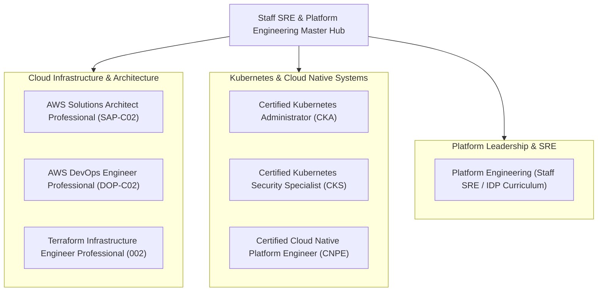

# Cloud & Platform Engineering Master Technical Curriculum

Welcome to the comprehensive, production-grade technical repository for mastering Staff SRE, Cloud Native Platform Engineering, and advanced Cloud Certifications. Every workspace is built with terminal-first rigor, real-world failure mode simulations, architectural white papers, performance labs, and full-length scenario exams.

---

## Workspace Navigation & Domain Matrix

---

## Track Overviews & Direct Links

### 1. [Certified Cloud Native Platform Engineer (CNPE)](./Certified_Cloud_Native_Platform_Engineer/README.md)
- **Exam Weight:** 100% Performance-Based Terminal Exam (2 Hours)
- **Core Technology Stack:** Kubernetes v1.31+, Argo CD v2.12+, Argo Rollouts, Crossplane v1.16+, Backstage, OpenTelemetry Collector, Prometheus Operator, Kyverno v1.12+, External Secrets Operator (ESO), KEDA v2.15+, Karpenter v1.0+, Gateway API, Cilium eBPF, vCluster.
- **Key Resources:**
  - [CNPE Master Cheat Sheet](./Certified_Cloud_Native_Platform_Engineer/CNPE_Master_Cheat_Sheet.md)
  - [DigitalOcean Droplet Lab Bootstrap Guide](./Certified_Cloud_Native_Platform_Engineer/DigitalOcean_Droplet_Lab_Guide.md)
  - [Domain 1: GitOps & Continuous Delivery (25%)](./Certified_Cloud_Native_Platform_Engineer/Domain_1_GitOps_Continuous_Delivery/Study_Guide.md)
  - [Domain 2: Self-Service Platform APIs & Automation (25%)](./Certified_Cloud_Native_Platform_Engineer/Domain_2_Self_Service_APIs_Automation/Study_Guide.md)
  - [Domain 3: Observability & Operations (20%)](./Certified_Cloud_Native_Platform_Engineer/Domain_3_Observability_Operations/Study_Guide.md)
  - [Domain 4: Platform Architecture & Scalability (15%)](./Certified_Cloud_Native_Platform_Engineer/Domain_4_Platform_Architecture_Scalability/Study_Guide.md)
  - [Domain 5: Security, Governance & Policy Enforcement (15%)](./Certified_Cloud_Native_Platform_Engineer/Domain_5_Security_Governance_Policy/Study_Guide.md)
  - [Full-Length Practice Exams 1, 2, 3](./Certified_Cloud_Native_Platform_Engineer/Practice_Exams/Practice_Exam_1.md)

---

### 2. [Terraform Infrastructure Engineer Professional (002)](./Terraform_Infrastructure_Engineer_Professional/README.md)
- **Exam Profile:** Multiple-choice scenario exam launching at IBM TechXchange 2026 in Atlanta.
- **Key Resources:**
  - [Terraform Master Cheat Sheet](./Terraform_Infrastructure_Engineer_Professional/Terraform_Master_Cheat_Sheet.md)
  - [Domain 1: Scalable Configuration Design](./Terraform_Infrastructure_Engineer_Professional/Domain_1_Scalable_Configuration_Design/Study_Guide.md)
  - [Domain 2: State & Backend Operations](./Terraform_Infrastructure_Engineer_Professional/Domain_2_State_Backend_Operations/Study_Guide.md)
  - [Domain 3: Lifecycle Operations](./Terraform_Infrastructure_Engineer_Professional/Domain_3_Lifecycle_Operations/Study_Guide.md)
  - [Domain 4: CI/CD & Automation Workflows](./Terraform_Infrastructure_Engineer_Professional/Domain_4_CICD_Automation_Workflows/Study_Guide.md)
  - [Domain 5: Security, Governance & Compliance](./Terraform_Infrastructure_Engineer_Professional/Domain_5_Security_Governance/Study_Guide.md)
  - [Domain 6: Advanced Modules & Testing Frameworks](./Terraform_Infrastructure_Engineer_Professional/Domain_6_Advanced_Modules_Testing/Study_Guide.md)
  - [Domain 7: HCP Terraform & Terraform Enterprise](./Terraform_Infrastructure_Engineer_Professional/Domain_7_HCP_Terraform_Enterprise/Study_Guide.md)
  - [Full-Length Practice Exams 1, 2](./Terraform_Infrastructure_Engineer_Professional/Practice_Exams/Practice_Exam_1.md)

---

### 3. [Certified Kubernetes Administrator (CKA)](./Certified_Kubernetes_Administrator/README.md)
- **Exam Profile:** 100% Performance-based CLI Exam (2 Hours).
- **Core Coverage:** Cluster Architecture, Installation & Configuration, Workloads & Scheduling, Services & Networking, Storage, and Troubleshooting.
- **Lab Infrastructure:** Fully integrated with DigitalOcean Droplets multi-node architecture (VPC private networking on `eth1`).

---

### 4. [Certified Kubernetes Security Specialist (CKS)](./Certified_Kubernetes_Security_Specialist/README.md)
- **Exam Profile:** 100% Performance-based Security Hardening Exam (2 Hours).
- **Core Coverage:** Cluster Setup (NetworkPolicies, CIS Benchmarks, etcd encryption), Cluster Hardening (RBAC, PSA/PSS), System Hardening (AppArmor, Seccomp), Supply Chain Security (Image vulnerability scanning, Cosign), Monitoring & Logging (Falco, audit logs).
- **Lab Infrastructure:** Fully integrated with DigitalOcean Droplets multi-node architecture (`cks-cp1`, `cks-worker1`, `cks-worker2`).

---

### 5. [Platform Engineering & Staff SRE Master Curriculum](./Platform_Engineering/README.md)
- **Target Role:** Staff SRE / Staff Platform Engineer / Principal Cloud Architect.
- **Core Coverage:** Internal Developer Platforms (Backstage, Port), Golden Paths, Multi-cluster Fleet Management, Service Meshes (Cilium, Istio), Advanced GitOps, FinOps, SLO/Error Budget Engineering.

---

### 6. [AWS Certified Solutions Architect Professional (SAP-C02)](./AWS_Solutions_Architect_Professional/README.md)
- **Exam Profile:** High-scale enterprise multi-account architectures, hybrid cloud, disaster recovery, migration strategies, and complex networking.

---

### 7. [AWS Certified DevOps Engineer Professional (DOP-C02)](./AWS_DevOps_Professional/README.md)
- **Exam Profile:** SDLC automation, configuration management, infrastructure-as-code, monitoring and event management, policies and standards automation, incident and event response.

---

## Lab Architecture & Testing Standards

All lab environments in this repository are designed with the following operational principles:
1. **Zero-Trust Network Baseline:** Default-deny ingress/egress policies, mutual TLS encryption, and scoped API tokens.
2. **Infrastructure-as-Code & GitOps:** Automated provisioning with Terraform and declarative reconciliation via Argo CD.
3. **DigitalOcean Droplet Compatibility:** Optimized scripts utilizing private VPC IP addresses (`eth1`) on Ubuntu 24.04 LTS for low-cost, high-fidelity cluster environments.
