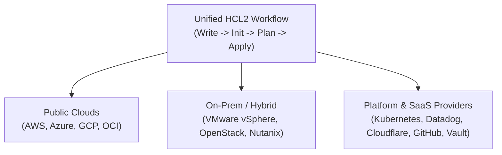

# Domain 1: Infrastructure as Code (IaC) with Terraform — Study Guide (004)

> **Official 004 Blueprint Focus:** Objective 1 — Infrastructure as Code (IaC) with Terraform (`1a`, `1b`, `1c`).  
> **Tested Version:** Terraform 1.12+

---

## 1. Explain What Infrastructure as Code (IaC) Is (`1a`)

**Infrastructure as Code (IaC)** is the engineering practice of provisioning, configuring, and managing infrastructure (virtual machines, networks, databases, DNS, SaaS resources) through machine-readable, version-controlled definition files rather than manual click-driven web consoles ("ClickOps") or interactive shell scripts.

### 1.1 Declarative vs. Imperative Paradigms

```
Paradigm        Philosophy               Engineer Defines...        Tool Computes...           Canonical Examples
──────────────────────────────────────────────────────────────────────────────────────────────────────────────────
Declarative     "What, not How"          Desired target state       Delta & step sequence      Terraform, CloudFormation,
                                                                    via dependency graph       Kubernetes YAML
Imperative      "How, step-by-step"      Exact sequence of API      Executes commands in       Bash + AWS CLI, Python
                                         commands to execute        written procedural order   Boto3 scripts, Ansible
```

- **Declarative Execution in Terraform:** You declare *what* the final infrastructure should look like (e.g., 3 EC2 instances attached to a VPC). Terraform inspects its current state, compares it against your `.tf` files, constructs a **Directed Acyclic Graph (DAG)**, and executes only the necessary Create, Read, Update, or Delete (CRUD) operations.
- **Idempotence:** Because Terraform is declarative and state-aware, applying an unchanged configuration multiple times produces the exact same result without creating duplicate resources:
  ```
  No changes. Your infrastructure matches the configuration.
  ```

---

## 2. Describe the Advantages of IaC Patterns (`1b`)

1. **Consistency & Elimination of "Snowflake" Environments:** Identical HCL modules can provision `dev`, `staging`, and `prod` environments, eliminating configuration drift caused by manual point-and-click administration.
2. **Version Control & Peer Review (GitOps):** Storing `.tf` files in Git enables Pull Request code reviews, commit history auditing (`git blame`), rollback to known-good configurations, and automated CI/CD pipeline execution.
3. **Speed, Reproducibility & Disaster Recovery:** Multi-region architectures can be stood up in minutes during disaster recovery failovers or torn down after testing (`terraform destroy`) to optimize cloud FinOps spend.
4. **Self-Documenting Architecture:** The HCL codebase serves as living, machine-verified documentation of the organization's live topology.
5. **Automated Guardrails & Shift-Left Validation:** Before any cloud resource is created, configurations can be validated for syntax (`terraform validate`), custom conditions (`precondition`/`postcondition`/`check`), estimated cost, and policy compliance (Sentinel / OPA).

---

## 3. Multi-Cloud, Hybrid Cloud & Service-Agnostic Workflows (`1c`)

Unlike vendor-locked tools (AWS CloudFormation, Azure Bicep, Google Cloud Deployment Manager), Terraform is **cloud-agnostic and service-agnostic**:



### 3.1 Single Workflow Across Heterogeneous Layers
- **Multi-Cloud & Hybrid Cloud:** A single Terraform configuration can provision an on-premises VMware vSphere virtual machine, establish an AWS Transit Gateway VPN connection, and register the DNS record in Cloudflare in a single `terraform apply`.
- **Day 1 Provisioning vs. Day 2 Configuration Management:**
  - **Day 1 (Terraform's Core Strength):** Provisioning foundational cloud and network infrastructure, managed databases, Kubernetes clusters, and IAM policies.
  - **Day 2 (Configuration Management — Ansible, Chef, Puppet):** Managing in-guest OS packages, daemon configs, and software patches inside running VMs.

> [!WARNING]
> **004 Exam Trap:** While Terraform provides a **unified workflow and language (HCL)** across all clouds, configuration code is **not write-once-run-anywhere**. Each provider exposes its own resource types (`aws_instance` vs. `azurerm_linux_virtual_machine` vs. `google_compute_instance`) that map 1:1 to that vendor's API schema.
