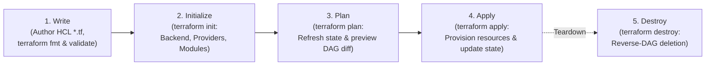

# Domain 3: Core Terraform Workflow — Study Guide (004)

> **Official 004 Blueprint Focus:** Objective 3 — Core Terraform Workflow (`3a`, `3b`, `3c`, `3d`, `3e`, `3f`, `3g`).  
> **Tested Version:** Terraform 1.12+

---

## 1. Describe the Core Terraform Workflow (`3a`)

HashiCorp defines the core Terraform workflow in three conceptual phases (**Write $\rightarrow$ Plan $\rightarrow$ Apply**), bookended by directory initialization (`init`) and optional decommissioning (`destroy`):



1. **Write:** Author infrastructure code in HCL (`.tf`), format with `terraform fmt`, and verify offline syntax/schema consistency with `terraform validate`.
2. **Plan:** Preview the exact additions (`+`), in-place updates (`~`), replacements (`-/+`), or deletions (`-`) Terraform will perform before mutating any real-world infrastructure.
3. **Apply:** Execute the planned changes against target provider APIs in parallel along the dependency graph (DAG) and write updated resource IDs/attributes to the state file.

---

## 2. Initialize a Working Directory: `terraform init` (`3b`)

`terraform init` must be run in any new or cloned working directory before `validate`, `plan`, `apply`, or `destroy` can run. It performs **four distinct initialization tasks**:
1. **Backend Initialization:** Configures the local or remote state backend (e.g., `s3`, `azurerm`, `gcs`, or HCP Terraform `cloud` block).
2. **Child Module Installation:** Downloads and indexes any `module` blocks into `.terraform/modules/`.
3. **Provider Plugin Installation:** Downloads required provider binaries into `.terraform/providers/`.
4. **Lock File Generation:** Creates or verifies `.terraform.lock.hcl`.

* **Key `terraform init` Flags Tested on 004:**
  * `-upgrade`: Upgrades all modules and providers to the latest versions allowed by configured version constraints.
  * `-migrate-state`: Reconfigures the backend and **copies existing state** to the new backend.
  * `-reconfigure`: Reconfigures the backend cleanly, **ignoring/abandoning any previous backend state**.
  * `-backend=false`: Skips backend initialization (useful in CI jobs that only run `terraform validate`).

### 2.1 `terraform get` vs. `terraform init`
- **`terraform get`:** Downloads and installs child modules declared in `module` blocks without initializing backends or downloading provider plugins. Use `terraform get -update` to check for newer versions of existing modules.
- **`terraform init`:** Performs full initialization (backends + provider plugins + child modules + lock file).

---

## 3. Validate a Configuration: `terraform validate` (`3c`)

`terraform validate` checks whether a configuration is **syntactically valid and internally consistent**:
- Verifies HCL syntax, undeclared variables, invalid attribute names, and type mismatches against installed provider schemas.
- **Crucial 004 Exam Rules:**
  1. `terraform validate` runs **100% offline**—it does **not** connect to cloud APIs, verify IAM credentials, or read remote state.
  2. However, `terraform validate` **requires `terraform init`** to have run first (can use `terraform init -backend=false`) so that provider schemas and child modules are present locally in `.terraform/`.

---

## 4. Generate and Review an Execution Plan: `terraform plan` (`3d`)

When you run `terraform plan`, Terraform performs the following steps:
1. Acquires a **state lock** on the backend (unless `-lock=false` is passed).
2. Queries target cloud APIs to **refresh** the in-memory state of existing managed resources (unless `-refresh=false` is passed).
3. Evaluates custom conditions (`validation`, `precondition`, `postcondition`, and `check` blocks).
4. Computes the delta between the **Desired Configuration** (`.tf` files) and the **Prior Refreshed State**, printing the diff:
   * `+` **create**
   * `-` **destroy**
   * `~` **update in-place**
   * `-/+` **destroy and then create replacement** (or `+/-` **create replacement and then destroy** when `create_before_destroy = true` is set)
   * `<=` **read** (data source read during apply)

* **Key `terraform plan` Flags:**
  * `-out=tfplan`: Writes the generated execution plan to a binary file. Passing this file to `terraform apply tfplan` guarantees that **only the exact changes reviewed in the plan are executed**, and skips the interactive confirmation prompt.
  * `-refresh-only`: Checks if real-world cloud resources have drifted from the state file and proposes updating the state file only (zero changes made to cloud resources).
  * `-replace=<ADDRESS>`: Plans the forced replacement (destroy + recreate) of a specific degraded resource.
  * `-destroy`: Generates a speculative destroy plan showing what would happen if `terraform destroy` were run.

---

## 5. Apply Changes to Infrastructure: `terraform apply` (`3e`)

- **Default Behavior (`terraform apply` without a plan file):** Automatically runs a fresh `plan` phase, prints the diff, and pauses at an interactive prompt requiring the user to type the exact word `yes`.
- **Saved Plan Mode (`terraform apply tfplan`):** Executes the binary plan file immediately **without** re-planning and **without** prompting for interactive confirmation.
- **`-auto-approve`:** Skips the interactive confirmation prompt during a plan-and-apply run (`terraform apply -auto-approve`).
- **Partial Failure Behavior (Non-Transactional):** If 3 out of 5 resources succeed and the 4th fails due to an API quota error, Terraform **does NOT roll back** the 3 created resources. Instead, it records the 3 successful resources in the state file and halts with an error so the next `terraform apply` can resume idempotently.

---

## 6. Destroy Managed Infrastructure: `terraform destroy` (`3f`)

- Deletes all remote objects managed by the current Terraform configuration and state file.
- Traverses the dependency graph in **reverse order** (dependent child resources are destroyed before the parent resources they depend on).
- Is a convenience alias for `terraform apply -destroy`.
- Supports `-auto-approve` for non-interactive CI tear-downs.

---

## 7. Formatting and Style Adjustments: `terraform fmt` (`3g`)

`terraform fmt` rewrites `.tf` and `.tfvars` files into canonical HashiCorp style (2-space indentation, aligned `=` signs):
- `terraform fmt`: Formats `.tf` files in the current directory only (prints the filenames it modified).
- `terraform fmt -recursive`: Formats `.tf` files in the current directory and all nested subdirectories (e.g., `./modules/*`).
- `terraform fmt -check`: Does **not** modify files; returns exit code `0` if all files are properly formatted or non-zero (`3`) if any file needs formatting (ideal for CI/CD pull request linters).
- `terraform fmt -diff`: Prints unified diffs of formatting adjustments.

---

## 8. Interactive Exploration & Graphing (`3a`, `3d`, `7b`)

### 8.1 Interactive Evaluation: `terraform console`
- **What it is:** An interactive read-eval-print loop (REPL) command-line shell for evaluating and experimenting with HCL expressions, built-in functions, and inspecting attributes from the current state file.
- **Key Exam Behaviors:**
  - Can read variables, locals, data sources, and state attributes (e.g., typing `aws_vpc.main.cidr_block` or `lookup(var.tags, "env", "dev")` prints the evaluated result immediately).
  - **Read-Only:** Does **not** modify configuration files, state, or remote infrastructure.
  - Acquires a state lock while open unless the backend does not support locking or the state is local.

### 8.2 Dependency Visual Graph: `terraform graph`
- **What it is:** Generates a visual execution graph representing the dependencies between resources in DOT format (Graphviz standard).
- **Usage:**
  ```bash
  terraform graph | dot -Tpng > graph.png
  ```
- **Exam Rule:** Shows both implicit and explicit (`depends_on`) dependencies across configuration blocks.

### 8.3 State and Plan Inspection: `terraform show`
- **What it is:** Reads and displays the current state file or a saved binary plan file (`-out=tfplan`) in a human-readable format.
- **Flags:**
  - `terraform show`: Displays human-readable state.
  - `terraform show tfplan`: Displays human-readable contents of a saved binary plan.
  - `terraform show -json [tfplan]`: Outputs state or plan data as standard JSON, perfect for automated CI/CD compliance scanners or jq filtering.
