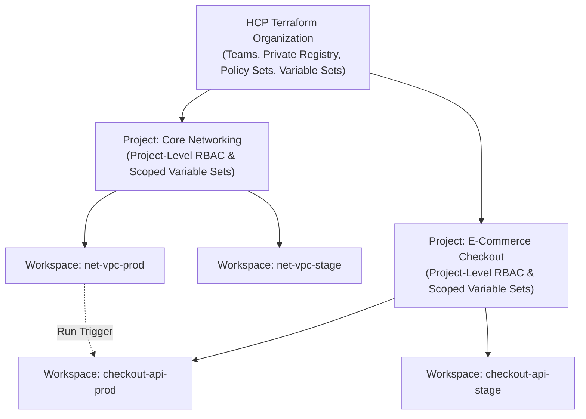

# Domain 8: HCP Terraform — Study Guide (004)

> **Official 004 Blueprint Focus:** Objective 8 — HCP Terraform (`8a`, `8b`, `8c`, `8d`).  
> **Tested Version:** Terraform 1.12+ (Includes **New 004 Objective `8c`: Organizing Workspaces & Projects, Variable Sets, Dynamic Provider Credentials, and Health Assessments**!)

---

## 1. Use HCP Terraform to Create Infrastructure (`8a`) & Configure Integration (`8d`)

**HCP Terraform** (formerly *Terraform Cloud*) is HashiCorp's managed cloud platform that runs Terraform in secure, disposable remote execution environments, manages encrypted state with automatic locking, and enforces enterprise governance.

### 1.1 Connecting Terraform CLI to HCP Terraform (`cloud` Block & `terraform login`)
1. **Authenticate via CLI:** Run `terraform login` to generate an API user token and store it locally in `~/.terraform.d/credentials.tfrc.json` (or pass `TF_TOKEN_app_terraform_io` in CI/CD).
2. **Configure the `cloud` Block in HCL:**
   ```hcl
   terraform {
     cloud {
       organization = "acme-enterprise" # Required

       workspaces {
         # Specify EITHER 'name' (single workspace) OR 'tags' / 'project' (multiple workspaces)
         name    = "payments-prod-us-east"
         project = "Payments Platform"
       }
     }
   }
   ```
3. **Initialize & Migrate:** Run `terraform init` to initialize the HCP Terraform integration (and migrate existing state if switching from a local/S3 backend).

### 1.2 The Three HCP Terraform Workflow Types (`8a`, `8d`)
- **VCS-Driven Workflow:** Linked directly to GitHub, GitLab, Bitbucket, or Azure DevOps.
  - Opening a Pull Request automatically triggers a **Speculative Plan** (evaluates diff, cost estimation, and Sentinel/OPA checks without allowing `apply`).
  - Merging to the tracked branch automatically queues a production **Plan & Apply** run.
- **CLI-Driven Workflow:** Engineers run `terraform plan` and `terraform apply` from their terminal (using the `cloud` block). The terminal streams real-time console output, while the actual plan/apply executes remotely inside HCP Terraform's runners.
- **API-Driven Workflow:** External CI/CD orchestrators upload configuration `.tar.gz` archives and trigger runs programmatically via the HCP Terraform REST API.

### 1.3 Execution Modes (`8d`)
Each HCP Terraform workspace can be configured with one of three execution modes:
1. **Remote Execution (Default):** Plans and applies run on HashiCorp-managed cloud infrastructure.
2. **Agent Execution (HCP Terraform Agents):** Plans and applies run on lightweight `tfc-agent` containers deployed inside your private VPC or on-premises data center (pull-based over outbound HTTPS `443`—no inbound firewall holes required!).
3. **Local Execution:** HCP Terraform is used **solely for remote state storage and locking**; `plan` and `apply` execute on the local machine running the CLI (policy checks, cost estimation, and run tasks do not run in Local mode).

### 1.4 HCP Terraform vs. Terraform Enterprise (`8a`, `8b`)
| Architectural Dimension | HCP Terraform (Hosted SaaS) | Terraform Enterprise (Self-Hosted Private Instance) |
| :--- | :--- | :--- |
| **Deployment Model** | Fully managed SaaS hosted by HashiCorp | Customer-hosted (runs on private AWS/Azure/GCP VPCs, VMware, or bare metal) |
| **Maintenance & Upgrades** | Automatic, zero-touch maintenance by HashiCorp | Managed and upgraded by customer sysadmins |
| **Network Isolation** | Public internet; connects to private networks via **HCP Terraform Agents** | Runs natively inside private corporate network; supports **fully air-gapped / offline** operations |
| **Enterprise Governance** | Sentinel, OPA, PMR, Variable Sets, Projects | Sentinel, OPA, PMR, Variable Sets, Projects (plus SAML/SCIM SSO, Audit Logging, and customer-managed encryption keys) |

---

## 2. Organize and Use HCP Terraform Workspaces and Projects (`8c` — NEW IN 004!)



### 2.1 Projects (Workspace Organization & RBAC Boundaries)
- **What Projects Are:** Logical containers inside an HCP Terraform **Organization** used to group related **Workspaces** by business unit, application team, or environment (every Organization starts with a `Default Project`).
- **Why Projects Matter on the 004 Exam:**
  1. **Project-Level RBAC (Permissions):** Administrators can grant a team permission (e.g., *Read*, *Plan*, *Write*, *Admin*) over **all workspaces within a specific Project** without granting Organization-wide access or configuring permissions workspace-by-workspace.
  2. **Project-Scoped Variable Sets:** Credentials and variables can be attached directly to a **Project**, automatically propagating to every workspace currently in (or later added to) that Project.

### 2.2 Variable Sets & Precedence in HCP Terraform (`8c`)
Instead of duplicating cloud credentials or shared variables across 50 workspaces, administrators create **Variable Sets** at the Organization level and scope them to:
- **Global (All Workspaces in the Organization)**
- **Specific Projects**
- **Specific Workspaces**

**HCP Terraform Variable Precedence (Highest Overrides Lowest):**
$$\text{Workspace-Specific Variable} > \text{Workspace-Scoped Variable Set} > \text{Project-Scoped Variable Set} > \text{Global Variable Set}$$

### 2.3 Cross-Workspace Orchestration: Run Triggers & `tfe_outputs` (`8c`)
- **Run Triggers:** Connect an upstream **Source Workspace** (e.g., `net-vpc-prod`) to a downstream **Target Workspace** (e.g., `checkout-api-prod`). Whenever an `apply` succeeds in `net-vpc-prod`, HCP Terraform automatically queues a new `plan` in `checkout-api-prod`.
- **Sharing State Outputs Across Workspaces:** Prefer the `tfe_outputs` data source (which exposes **only** the upstream workspace's root outputs) over `terraform_remote_state` (which requires granting access to the entire upstream state file including sensitive resource attributes).

---

## 3. Collaboration, Security & Governance Features (`8b`)

| HCP Terraform Feature | Purpose & 004 Exam Key Points |
| :--- | :--- |
| **Dynamic Provider Credentials** | Uses **OIDC Workload Identity Federation** to mint ephemeral, single-run tokens for AWS, Azure, GCP, and Vault—eliminating long-lived static IAM keys in workspaces |
| **Sentinel & OPA Policy-as-Code** | Evaluates policies **between `plan` and `apply`**. Supports **Sentinel** (`Advisory`, `Soft Mandatory`, `Hard Mandatory`) and **Open Policy Agent (OPA Rego)** (`Advisory`, `Mandatory`) |
| **Run Tasks** | Third-party webhook integrations (e.g., Snyk, Prisma Cloud, ServiceNow, Infracost) invoked at `Pre-plan`, `Post-plan`, `Pre-apply`, or `Post-apply` stages |
| **Private Registry** | Internal organization catalog for sharing private modules and custom providers (supports no-code module provisioning) |
| **Cost Estimation** | Calculates projected monthly cost delta for AWS, Azure, and GCP resources during the `plan` stage before `apply` |
| **Health Assessments (Drift Detection & Continuous Validation)** | Automatically runs background **Drift Detection** (`-refresh-only` checks) and **Continuous Validation** (`check` blocks and `precondition`/`postcondition` assertions) on a schedule, alerting teams when live infrastructure drifts or fails health checks between runs |
