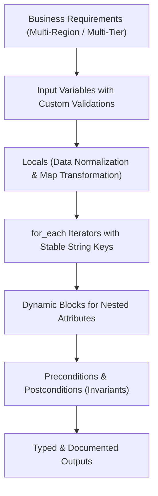

# Domain 1: Scalable Configuration Design — Complete Study Guide

**Exam Weight:** 20% of the Terraform Infrastructure Engineer Professional (002) Exam  
**Target Mastery:** Production HCL architecture, Terraform 1.15 features, `for_each` chaining, dynamic nested blocks, preconditions/postconditions, custom variable validation, provider aliases and child module inheritance, and the Terraform Model Context Protocol (MCP) server.

---

## 1. Architectural Principles of Scalable HCL

Writing scalable Terraform requires designing configurations that are deterministic, modular, idempotent, and decoupled.



### 1.1 Custom Variable Validation & Object Constraints
In modern Terraform, variables must enforce strict type constraints and semantic validations to fail fast during `terraform plan` rather than during remote API execution:

```hcl
variable "droplet_tier_config" {
  description = "Configuration parameters for DigitalOcean Droplets cluster"
  type = object({
    size       = string
    region     = string
    monitoring = optional(bool, true)
    tags       = optional(list(string), ["production", "kubernetes"])
    node_count = number
  })

  validation {
    condition     = var.droplet_tier_config.node_count >= 3 && var.droplet_tier_config.node_count <= 50
    error_message = "The node_count must be between 3 and 50 to maintain high availability and stay within quota."
  }

  validation {
    condition     = can(regex("^(s-2vcpu-4gb|s-4vcpu-8gb|c-4)$", var.droplet_tier_config.size))
    error_message = "Approved droplet sizes are: s-2vcpu-4gb, s-4vcpu-8gb, or c-4."
  }
}
```

### 1.2 Preconditions and Postconditions (`lifecycle`)
- **`precondition`:** Evaluated **before** Terraform plans or applies changes to the resource or data source. Used to verify assumptions about inputs or referenced resources.
- **`postcondition`:** Evaluated **after** the resource is created or modified. Used to assert that the cloud provider returned expected attributes (e.g. validating that a certificate was signed with the correct SAN or that an instance was provisioned with the right public IP).

```hcl
resource "digitalocean_droplet" "api" {
  image    = "ubuntu-24-04-x64"
  name     = "api-production-node"
  region   = "nyc3"
  size     = "s-2vcpu-4gb"
  vpc_uuid = data.digitalocean_vpc.main.id

  lifecycle {
    precondition {
      condition     = data.digitalocean_vpc.main.ip_range != ""
      error_message = "Target VPC must exist and have a valid IP range."
    }

    postcondition {
      condition     = self.status == "active"
      error_message = "Droplet must reach active state immediately upon provisioning."
    }
  }
}
```

---

## 2. Advanced `for_each` and Data Structure Transformations

### 2.1 The Cardinal Rule of `for_each`
> [!IMPORTANT]
> A `for_each` expression **must evaluate to a set of strings or a map whose keys are known at plan time**. If a map key depends on a dynamic resource attribute that won't be known until apply (e.g. `digitalocean_vpc.main.id`), Terraform will fail with:  
> `The "for_each" value depends on resource attributes that cannot be determined until apply`.

### 2.2 Transforming Lists of Objects into Stable Keyed Maps
A common pattern on the exam involves taking a list of subnet configurations and mapping them by unique name:

```hcl
variable "subnets" {
  type = list(object({
    name = string
    cidr = string
    az   = string
  }))
}

locals {
  # Safe transformation: name is a deterministic string known at plan time
  subnet_map = { for s in var.subnets : s.name => s }
}

resource "aws_subnet" "tiers" {
  for_each          = local.subnet_map
  vpc_id            = aws_vpc.main.id
  cidr_block        = each.value.cidr
  availability_zone = each.value.az

  tags = {
    Name = each.key
  }
}
```

### 2.3 `dynamic` Blocks for Nested Attributes
When a resource has repeated nested configuration blocks (such as `ingress` in security groups or `forwarding_rule` in load balancers), use `dynamic` blocks with `for_each`:

```hcl
variable "firewall_inbound_rules" {
  type = list(object({
    protocol         = string
    port_range       = string
    source_addresses = list(string)
  }))
}

resource "digitalocean_firewall" "cluster_fw" {
  name        = "k8s-cluster-firewall"
  droplet_ids = [for d in digitalocean_droplet.workers : d.id]

  dynamic "inbound_rule" {
    for_each = var.firewall_inbound_rules
    content {
      protocol         = inbound_rule.value.protocol
      port_range       = inbound_rule.value.port_range
      source_addresses = inbound_rule.value.source_addresses
    }
  }
}
```

---

## 3. Multiple Providers and Child Module Provider Inheritance

### 3.1 Provider Aliases
When deploying across multiple regions, accounts, or cloud projects within a single configuration:

```hcl
# Default provider (unaliased)
provider "aws" {
  region = "us-east-1"
}

# Aliased provider for disaster recovery
provider "aws" {
  alias  = "dr"
  region = "us-west-2"
}
```

### 3.2 Passing Providers to Child Modules (`configuration_aliases`)
In the child module's `versions.tf`, you **must declare** any expected provider aliases using `configuration_aliases`:

```hcl
# modules/s3_cross_region_replication/versions.tf
terraform {
  required_version = ">= 1.15.0"
  required_providers {
    aws = {
      source                = "hashicorp/aws"
      version               = ">= 5.0.0"
      configuration_aliases = [ aws.primary, aws.replica ]
    }
  }
}
```

In the root module, explicitly pass the matching provider instances:

```hcl
module "s3_replication" {
  source = "./modules/s3_cross_region_replication"

  providers = {
    aws.primary = aws
    aws.replica = aws.dr
  }
}
```

---

## 4. Terraform Model Context Protocol (MCP) Server

Terraform 1.15 introduces native support for the **Model Context Protocol (MCP)** server for AI-assisted engineering:

- **What it does:** Runs a standardized JSON-RPC server locally (`terraform mcp-server` / provider plugin integration) allowing AI agents to query provider documentation, inspect schema definitions, and evaluate expressions without guessing attribute names.
- **Security Invariant:** The MCP server executes with read-only inspection access and does not execute remote state mutations or cloud write operations without explicit approval.
