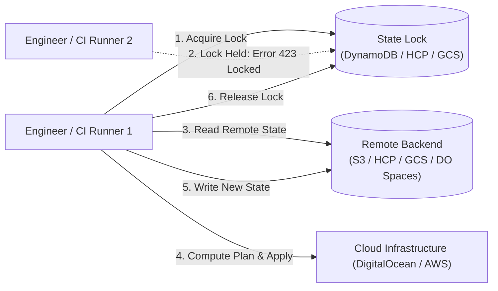

# Domain 2: State and Backend Operations — Complete Study Guide

**Exam Weight:** 18% of the Terraform Infrastructure Engineer Professional (002) Exam  
**Target Mastery:** Remote backend architectures, state locking, state encryption, drift detection & reconciliation (`-refresh-only`), state surgery (`state mv`, `state rm`, `force-unlock`), Directed Acyclic Graph (DAG) dependency chains, and Terraform version upgrade lifecycles.

---

## 1. Remote State Architecture & Backend Locking

Terraform state records the exact mapping between resources defined in code and real-world infrastructure objects in cloud APIs.



### 1.1 S3 / DynamoDB Backend with Encryption & Bucket Key
```hcl
terraform {
  backend "s3" {
    bucket         = "corp-terraform-state-prod"
    key            = "networking/vpc.tfstate"
    region         = "us-east-1"
    dynamodb_table = "terraform-state-locks"
    encrypt        = true
  }
}
```

### 1.2 HCP Terraform / Terraform Cloud Backend
In modern Terraform 1.1+, the `cloud` block configures the native remote execution and remote state backend:
```hcl
terraform {
  cloud {
    organization = "enterprise-platform"

    workspaces {
      name = "production-infrastructure"
    }
  }
}
```

---

## 2. Drift Detection and Reconciliation

### 2.1 The Two Types of Drift
1. **Configuration Drift:** Code was changed in Git, but has not yet been applied to the cloud.
2. **Infrastructure Drift (Out-of-band changes):** An engineer changed a security group or resized a Droplet directly via the Web Console or CLI, causing `.tfstate` to become out-of-sync with reality.

### 2.2 Refresh-Only Workflow (Safe Drift Reconciliation)
Before Terraform 0.15, running `terraform refresh` modified state immediately without code review. In Terraform 1.0+, use the safe plan/apply refresh-only workflow:

```bash
# 1. Inspect drift without altering code or state:
terraform plan -refresh-only

# 2. Reconcile state to reflect the out-of-band changes:
terraform apply -refresh-only
```

> [!NOTE]
> If out-of-band changes should be **reverted** back to what code specifies, run a standard `terraform plan` followed by `terraform apply`. Terraform will overwrite the manual modifications.

---

## 3. Advanced State Surgery

### 3.1 Renaming or Refactoring Resources (`terraform state mv`)
When refactoring standalone resources into child modules, running `terraform apply` will destroy the existing resources and recreate them under the module address. To prevent destruction:

```bash
# Syntax: terraform state mv [options] SOURCE DESTINATION

# Refactor an existing firewall into a module:
terraform state mv 'digitalocean_firewall.web' 'module.security.digitalocean_firewall.web'

# Refactor a single item from count to for_each:
terraform state mv 'aws_instance.nodes[0]' 'aws_instance.nodes["worker-alpha"]'
```

### 3.2 Decoupling Without Destroying (`terraform state rm`)
If a resource should no longer be managed by Terraform, but must remain running in production:

```bash
terraform state rm 'aws_s3_bucket.historical_archive'
# Now delete the resource block from .tf code.
# The S3 bucket remains in AWS untouched.
```

### 3.3 State Locking Issues & `force-unlock`
If a CI/CD runner crashes or an internet connection drops mid-apply, the backend lock remains held. Subsequent runs fail with:
`Error: Error acquiring the state lock: ConditionalCheckFailedException`.

```bash
# 1. Identify Lock ID from error message (e.g. 84d284bc-298a-49a1-b847-819a9d949b28)
# 2. Release lock manually:
terraform force-unlock 84d284bc-298a-49a1-b847-819a9d949b28
```

---

## 4. Directed Acyclic Graph (DAG) & Dependency Analysis

Terraform builds a Directed Acyclic Graph (DAG) during `terraform plan` to determine the order of operations and parallel execution paths:

```bash
# Generate GraphViz dot output:
terraform graph | dot -Tpng > graph.png

# Target specific subgraph during debugging:
terraform plan -target=module.network
```

> [!WARNING]
> Using `-target` is an emergency workaround and should never be used in standard CI/CD pipelines. It creates partial state updates and can lead to undetected configuration drift.
