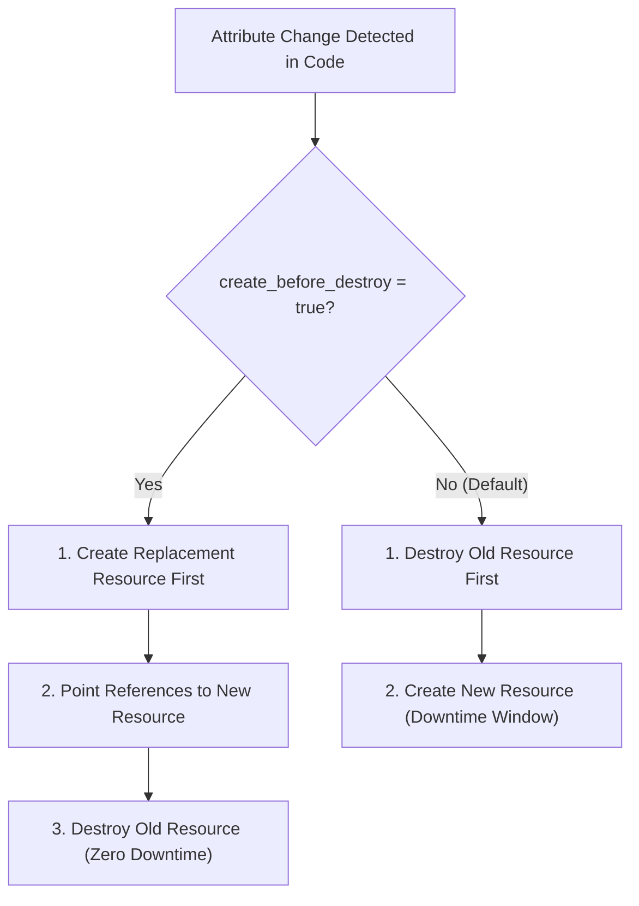

# Domain 3: Infrastructure Lifecycle and Operations — Complete Study Guide

**Exam Weight:** 15% of the Terraform Infrastructure Engineer Professional (002) Exam  
**Target Mastery:** Declarative `import` blocks, `removed` blocks, `lifecycle` meta-arguments (`create_before_destroy`, `prevent_destroy`, `ignore_changes`, `replace_triggered_by`), saved execution plans (`-out=tfplan`), dependency graph ordering, and concurrency tuning.

---

## 1. Resource Lifecycle Meta-Arguments

Terraform provides four core `lifecycle` meta-arguments to alter how resources are created, updated, or destroyed:



### 1.1 `create_before_destroy`
By default, Terraform destroys a resource that requires replacement before creating the new one. With `create_before_destroy = true`, Terraform provisions the replacement first, tests references, and only deletes the old resource once the new one is active. Essential for zero-downtime certificate, AMI, and load balancer updates.

### 1.2 `prevent_destroy`
Prevents accidental deletion of mission-critical stateful resources (e.g. production databases, storage buckets, KMS keys). If `terraform apply` or `terraform destroy` would delete this resource, Terraform halts execution with an error:
```hcl
resource "digitalocean_database_cluster" "postgres_primary" {
  name       = "prod-db-postgres"
  engine     = "pg"
  version    = "16"
  size       = "db-s-4vcpu-8gb"
  region     = "nyc3"
  node_count = 3

  lifecycle {
    prevent_destroy = true
  }
}
```

### 1.3 `ignore_changes`
Ignores out-of-band updates to specific resource arguments (e.g. autoscaling group `desired_capacity` managed by Kubernetes Cluster Autoscaler or tags injected by AWS Service Catalog):
```hcl
resource "aws_autoscaling_group" "workers" {
  max_size         = 20
  min_size         = 3
  desired_capacity = 5

  lifecycle {
    ignore_changes = [
      desired_capacity,
      tags
    ]
  }
}
```

### 1.4 `replace_triggered_by`
Forces the replacement (recreation) of a resource when another referenced resource or attribute changes:
```hcl
resource "digitalocean_droplet" "k8s_worker" {
  name   = "k8s-worker-1"
  region = "nyc3"
  size   = "s-2vcpu-4gb"
  image  = "ubuntu-24-04-x64"

  lifecycle {
    # Force replacement of Droplet if cloud-init script or SSH key changes:
    replace_triggered_by = [
      terraform_data.cloud_init_hash,
      digitalocean_ssh_key.default.public_key
    ]
  }
}
```

---

## 2. Declarative Import & Removal (Modern Terraform 1.5–1.15)

### 2.1 Declarative `import` Blocks
Avoids fragile CLI commands and enables code review for imported infrastructure:

```hcl
import {
  to = digitalocean_vpc.production
  id = "84d92039-491a-493a-810a-b89284910283"
}
```

You can automatically generate the matching HCL:
```bash
terraform plan -generate-config-out=generated_vpc.tf
```

### 2.2 Declarative `removed` Blocks
Cleanly removes a resource from Terraform management without destroying the cloud resource:
```hcl
removed {
  from = digitalocean_droplet.legacy_bastion

  lifecycle {
    destroy = false  # Retains the Droplet in DigitalOcean!
  }
}
```

---

## 3. Plan & Apply Workflows in Production

### 3.1 Saved Plan Files (`-out=tfplan`)
To ensure that what was reviewed in a pull request is **strictly identical** to what is executed in production:
```bash
# In PR / CI verification step:
terraform plan -out=tfplan

# In Approval / Deployment step:
terraform apply tfplan
```
> [!IMPORTANT]
> Running `terraform apply <planfile>` skips re-evaluating variables and state refresh; it executes the exact pre-computed execution graph.

### 3.2 Tuning Concurrency (`-parallelism=N`)
By default, Terraform walks the dependency graph with up to **10 concurrent operations** (`-parallelism=10`). In massive enterprise estates with 500+ resources, API rate limits (HTTP 429) can occur. Tune parallelism down to avoid throttling or up for fast creation:
```bash
terraform apply -parallelism=5
```
