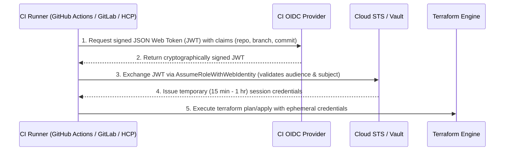
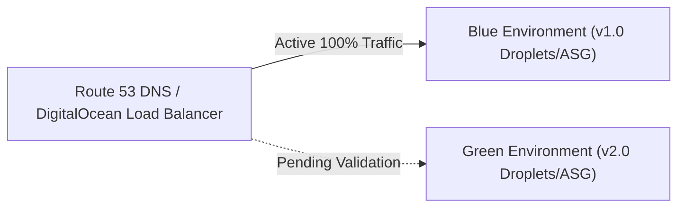

# Domain 4: CI/CD and Automation Workflows — Complete Study Guide

**Exam Weight:** 15% of the Terraform Infrastructure Engineer Professional (002) Exam  
**Target Mastery:** Automated GitOps pipelines, OpenID Connect (OIDC) dynamic provider credentials (zero static secrets), variable evaluation precedence, VCS-driven vs API-driven workflows, and concurrency control.

---

## 1. Dynamic Provider Credentials via OpenID Connect (OIDC)

Storing static cloud credentials (`AWS_ACCESS_KEY_ID`, `AWS_SECRET_ACCESS_KEY`, or GCP Service Account JSON keys) in CI/CD secret stores is a critical security vulnerability. If a pipeline runner or repository is compromised, static keys can be exfiltrated and abused indefinitely.

### 1.1 The OIDC Authentication Flow


### 1.2 GitHub Actions OIDC Configuration for AWS
```yaml
name: "Terraform Production Deployment"
on:
  push:
    branches: [ main ]

permissions:
  id-token: write # Required for requesting the JWT
  contents: read

jobs:
  terraform:
    runs-on: ubuntu-latest
    steps:
      - uses: actions/checkout@v4

      - name: Configure AWS Credentials via OIDC
        uses: aws-actions/configure-aws-credentials@v4
        with:
          role-to-assume: arn:aws:iam::123456789012:role/GitHubTerraformDeploymentRole
          aws-region: us-east-1

      - uses: hashicorp/setup-terraform@v3
        with:
          terraform_version: 1.15.0

      - run: terraform init
      - run: terraform plan -out=tfplan
      - run: terraform apply -auto-approve tfplan
```

---

## 2. Variable Evaluation Precedence in CI/CD

When debugging pipelines, you must know exactly which variable definition wins when variables are declared in multiple locations:

| Rank | Source | Mechanism / Scope |
| :---: | :--- | :--- |
| **1 (Lowest)** | Default in block | `variable "name" { default = "val" }` inside `.tf` code. |
| **2** | Environment Variables | `TF_VAR_name="val"` set in runner environment or shell. |
| **3** | `terraform.tfvars` | File in working directory automatically loaded. |
| **4** | `terraform.tfvars.json` | JSON format automatically loaded. |
| **5** | `*.auto.tfvars` / `.json` | Automatically loaded; if multiple exist, evaluated in **alphabetical filename order**. |
| **6** | `-var-file="path.tfvars"` | Explicitly passed CLI flag (later flags override earlier flags). |
| **7 (Highest)** | `-var="name=val"` | Explicit command-line override; overrides all other sources. |

---

## 3. Deployment Strategies: Blue/Green & Canary in Infrastructure

### 3.1 Blue/Green with DNS or Target Group Switching


1. Deploy the new (Green) environment alongside the existing (Blue) environment using distinct variable identifiers.
2. Run smoke tests and integration assertions against Green.
3. Switch the Load Balancer forwarding rule or DNS alias to point to Green.
4. Decommission Blue by running `terraform destroy` against the Blue workspace or by setting its replica count to 0.

### 3.2 Automated Speculative Plans on Pull Requests
Every pull request targeting the infrastructure repository should trigger an automated CI job that:
- Executes `terraform fmt -check`.
- Executes `terraform validate`.
- Executes `tflint` and security linters (Trivy / Checkov).
- Executes `terraform test` unit tests.
- Executes `terraform plan` (speculative plan) and posts the formatted plan summary as a comment on the PR.
